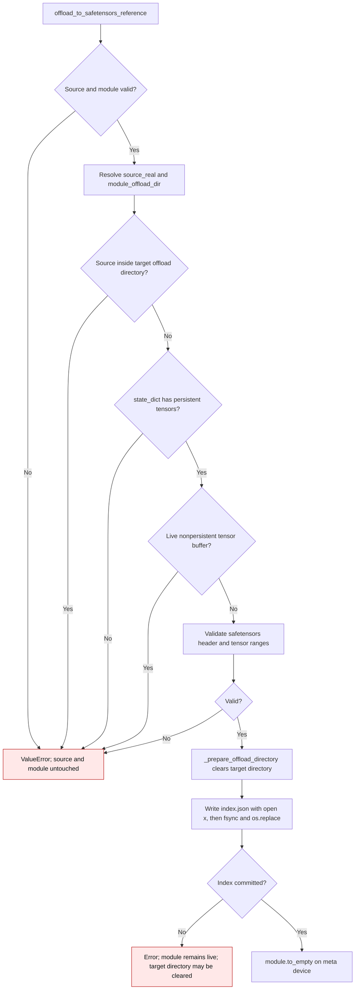
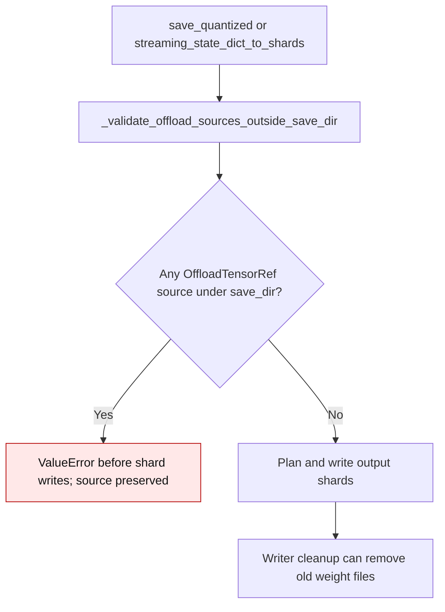
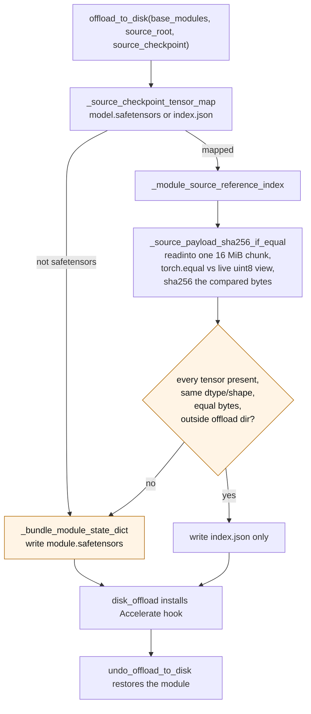

# Safetensors reference offload

`offload_to_safetensors_reference()` records byte ranges from an existing
safetensors file and hashes from the live tensors. It then replaces the module's
tensors with meta tensors. The caller owns the source file and must keep it
available until export. This path
does not install Accelerate hooks, so `undo_offload_to_disk()` cannot restore the
module from the reference index.

The reference index and streaming writer share the safetensors dtype map.
When PyTorch exposes `float8_e4m3fnuz` and `float8_e5m2fnuz`, they use the
`F8_E4M3FNUZ` and `F8_E5M2FNUZ` header IDs. Both export paths preserve their
payload bytes exactly.

The module's target offload directory is cleared before its new `index.json` is
written. A source file inside that directory would be deleted while the index
was being built. The source location is therefore checked before any directory
cleanup or module mutation.

`module.to_empty()` leaves buffers registered as `None` untouched. Reference
offload permits these absent optional buffers, while it rejects live
nonpersistent tensor buffers because their data would be lost.

The export directory must also be separate from every referenced source file.
`streaming_state_dict_to_shards()` may replace an output shard before it has
read later tensors from the same source. `save_quantized()` may also clean old
weight files after export. Both paths reject a source under the export root
before writing any shard. Save to a different directory to keep the source and
its offload index usable.

| Case | Earlier behavior | Current behavior |
| --- | --- | --- |
| Source inside the module offload directory | `_prepare_offload_directory()` deleted the source, then the index pointed to a missing file and `module.to_empty()` discarded the live tensors | `gptqmodel/utils/offload.py:193` rejects the location before cleanup; the source and live tensors remain intact |
| New index file with a restrictive process umask | An explicit `fchmod(0644)` broadened its permissions | `gptqmodel/utils/offload.py:301` lets `open(..., "x")` honor the process umask |
| Source outside the module offload directory | Header and tensor metadata are checked, then the index is committed and the module becomes meta | The same reference offload path remains available |
| Optional nonpersistent buffer registered as `None` | `gptqmodel/utils/offload.py:206-210` listed its name and rejected offload even though `module.to_empty()` keeps it as `None` | `gptqmodel/utils/offload.py:206-211` checks the buffer value and permits the absent optional buffer; direct and nested cases export their persistent weights |
| Live nonpersistent tensor buffer | Its contents would be lost during `module.to_empty()`, so offload raised | The same guard still raises before changing the module or source |
| Referenced source under the export root | `streaming_state_dict_to_shards()` could replace the source while writing the first shard; `_cleanup_saved_weight_files()` could remove it afterward | `_validate_offload_sources_outside_save_dir()` rejects the save before shard writes, including layer-split exports (`gptqmodel/utils/model.py:2918`, `gptqmodel/models/writer.py:2498`) |

This contract applies to the reference offload path introduced in
[PR #3586](https://github.com/ModelCloud/GPTQModel/pull/3586). The index
stores source locations and hashes; it does not contain a second tensor payload.
The export source guard was added in
[PR #3620](https://github.com/ModelCloud/GPTQModel/pull/3620).
Absent optional nonpersistent buffers were admitted in
[PR #3626](https://github.com/ModelCloud/GPTQModel/pull/3626).

## Quantization base-module references

The quantization looper offloads the untouched base modules (`embed_tokens`,
the final norm) while the layer loop runs. It used to re-serialize each module
with `safetensors.save_file`, even when the source checkpoint already held the
same bytes. `offload_to_disk(..., source_root=..., source_checkpoint=...)` now
builds an Accelerate-compatible index that points at the source safetensors
payload. Unlike `offload_to_safetensors_reference()`, this path installs the
normal Accelerate disk-offload hook, so `undo_offload_to_disk()` still
materializes the module in-session.

The reference is fail-closed. Every module tensor must be present in the
source, with the same dtype and shape, and its bytes must equal the source
payload; otherwise the looper writes the old `module.safetensors` bundle. A
source inside the target offload directory is also rejected. This covers
fusion and rotation, which can rewrite a base module before the offload.

The offload directory for the Llama-3.2-1B `embed_tokens` tensor drops from
525,336,576 B to a 367 B index; the restored tensor is bitwise identical.

### Bounded host memory for the content check

The first version proved content by loading each source tensor
(`safe_open(...).get_tensor()`, `gptqmodel/utils/offload.py:498` before #4463)
and comparing it with `torch.equal`. That is a full owned copy plus the
mapped file pages, so the check cost about twice the embedding size in peak
RSS, more than the disk it saved. `_source_payload_sha256_if_equal` now reads
the payload range with `readinto` into one reusable buffer of
`_SOURCE_COMPARE_CHUNK_BYTES` (16 MiB) and compares it with the matching
slice of a `uint8` view of the live tensor. The index `sha256` is computed
over the same bytes, so export still verifies the source against the live
tensor's digest. The comparison is now bytewise: `-0.0` against `0.0` falls
back to a bundle, and identical NaN payloads still qualify for a reference.

| Measurement (CUDA 4090, GPTQ 4-bit, 128 samples, `offload_to_disk=True`) | Before (`4bc0413`) | After |
| --- | --- | --- |
| Llama-3.2-1B, RSS added inside the base-module `offload_to_disk` (RssAnon / RssFile) | +502 / +502 MiB | +1 / +0 MiB |
| Qwen2.5-0.5B, the same | +261 / +261 MiB | +1 / +0 MiB |
| Llama-3.2-1B, quantize peak RSS / offload temp disk peak | 3954 MiB / 484 MiB | 3327 MiB / 475 MiB |
| Qwen2.5-0.5B, quantize peak RSS / offload temp disk peak | 3098 MiB / 179 MiB | 2842 MiB / 179 MiB |

Saved checkpoints are byte-identical before and after.
`tests/test_offload_reference_rss_4463.py` checks chunk boundaries, a one-bit
difference in the first and last chunk, and that the check raises the peak RSS
(`VmHWM`) by less than one chunk plus slack for a 128 MiB tensor (the old
check added about 90 MiB there).
`tests/test_offload_reference_4395.py` covers single-file and sharded sources,
the content-mismatch fallback, and an end-to-end quantize/save round trip.

## Pinned host staging cache

`move_module_to_cpu_pinned()` and Accelerate's checkpoint staging allocate
non-swappable host blocks. Deleting the staging tensor only returns the block
to PyTorch's process-wide pinned cache, so `RssShmem` stays resident.
`gptqmodel.utils.torch.release_pinned_host_cache()` calls
`torch._C._host_emptyCache()` and is invoked at the end of `quantize()` and in
the checkpoint loader's `finally`. Blocks owned by live tensors are untouched.

| Run | Before | After |
| --- | --- | --- |
| Llama-3.2-1B GPTQ quantize, pinned bytes at return | 115.70 MiB | 0.00 MiB |
| Llama-3.2-1B GPTQ quantize, pinned bytes after `del` | 115.70 MiB | 0.00 MiB |
| Llama-3.2-1B GPTQ checkpoint load on CUDA, pinned bytes at return | 554.87 MiB | ~0.00 MiB |

`tests/test_pinned_host_cache_4395.py` pins the release helper, the loader call,
and the `quantize()` call.
FNUZ float8 serialization was added in
[PR #3628](https://github.com/ModelCloud/GPTQModel/pull/3628).
