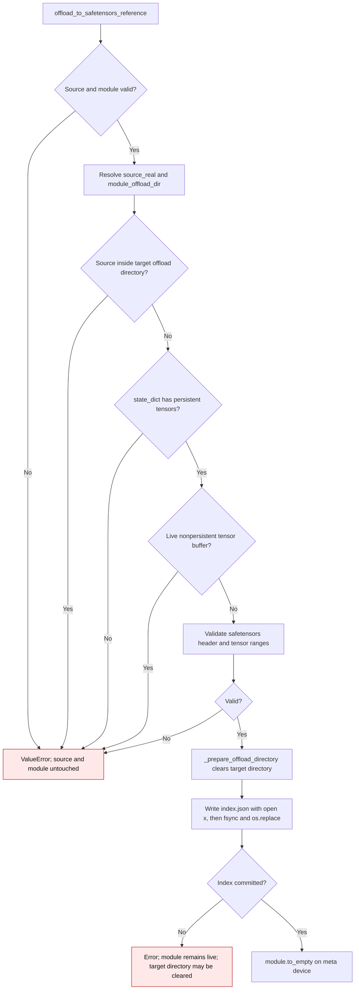
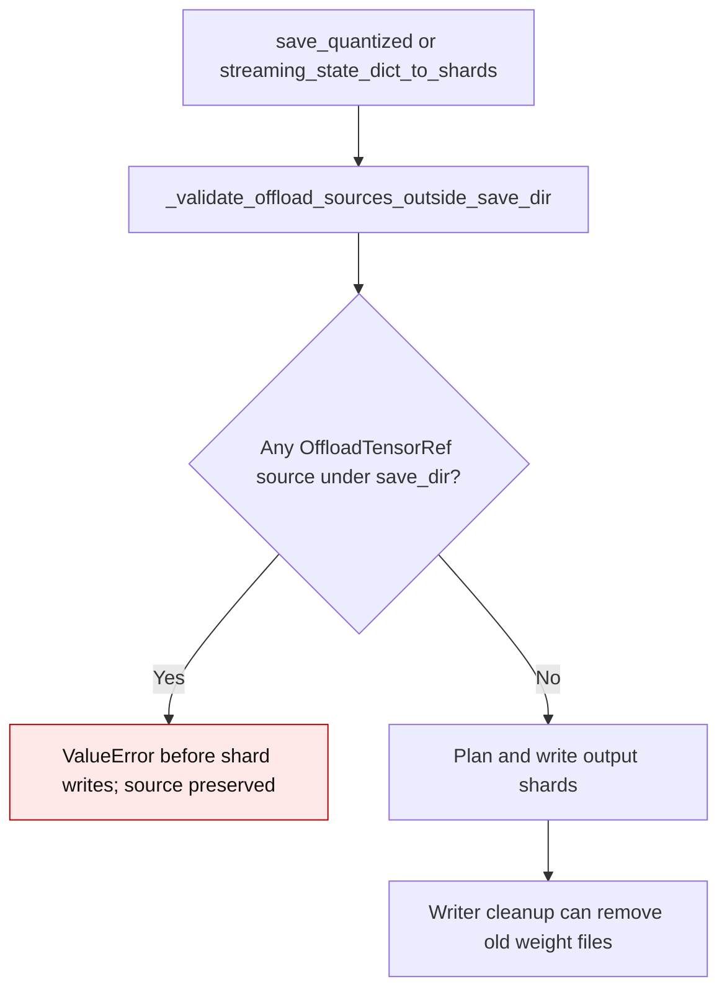

# Safetensors reference offload

`offload_to_safetensors_reference()` records byte ranges from an existing
safetensors file and hashes from the live tensors. It then replaces the module's
tensors with meta tensors. The caller owns the source file and must keep it
available until export. This path
does not install Accelerate hooks, so `undo_offload_to_disk()` cannot restore the
module from the reference index.

The reference index and streaming writer share the safetensors dtype map.
When PyTorch exposes `float8_e4m3fnuz` and `float8_e5m2fnuz`, they use the
`F8_E4M3FNUZ` and `F8_E5M2FNUZ` header IDs. Both export paths preserve their
payload bytes exactly.

The module's target offload directory is cleared before its new `index.json` is
written. A source file inside that directory would be deleted while the index
was being built. The source location is therefore checked before any directory
cleanup or module mutation.

`module.to_empty()` leaves buffers registered as `None` untouched. Reference
offload permits these absent optional buffers, while it rejects live
nonpersistent tensor buffers because their data would be lost.

The export directory must also be separate from every referenced source file.
`streaming_state_dict_to_shards()` may replace an output shard before it has
read later tensors from the same source. `save_quantized()` may also clean old
weight files after export. Both paths reject a source under the export root
before writing any shard. Save to a different directory to keep the source and
its offload index usable.

| Case | Earlier behavior | Current behavior |
| --- | --- | --- |
| Source inside the module offload directory | `_prepare_offload_directory()` deleted the source, then the index pointed to a missing file and `module.to_empty()` discarded the live tensors | `gptqmodel/utils/offload.py:193` rejects the location before cleanup; the source and live tensors remain intact |
| New index file with a restrictive process umask | An explicit `fchmod(0644)` broadened its permissions | `gptqmodel/utils/offload.py:301` lets `open(..., "x")` honor the process umask |
| Source outside the module offload directory | Header and tensor metadata are checked, then the index is committed and the module becomes meta | The same reference offload path remains available |
| Optional nonpersistent buffer registered as `None` | `gptqmodel/utils/offload.py:206-210` listed its name and rejected offload even though `module.to_empty()` keeps it as `None` | `gptqmodel/utils/offload.py:206-211` checks the buffer value and permits the absent optional buffer; direct and nested cases export their persistent weights |
| Live nonpersistent tensor buffer | Its contents would be lost during `module.to_empty()`, so offload raised | The same guard still raises before changing the module or source |
| Referenced source under the export root | `streaming_state_dict_to_shards()` could replace the source while writing the first shard; `_cleanup_saved_weight_files()` could remove it afterward | `_validate_offload_sources_outside_save_dir()` rejects the save before shard writes, including layer-split exports (`gptqmodel/utils/model.py:2918`, `gptqmodel/models/writer.py:1225`) |

This contract applies to the reference offload path introduced in
[PR #3586](https://github.com/ModelCloud/GPTQModel/pull/3586). The index
stores source locations and hashes; it does not contain a second tensor payload.
The export source guard was added in
[PR #3620](https://github.com/ModelCloud/GPTQModel/pull/3620).
Absent optional nonpersistent buffers were admitted in
[PR #3626](https://github.com/ModelCloud/GPTQModel/pull/3626).
FNUZ float8 serialization was added in
[PR #3628](https://github.com/ModelCloud/GPTQModel/pull/3628).
