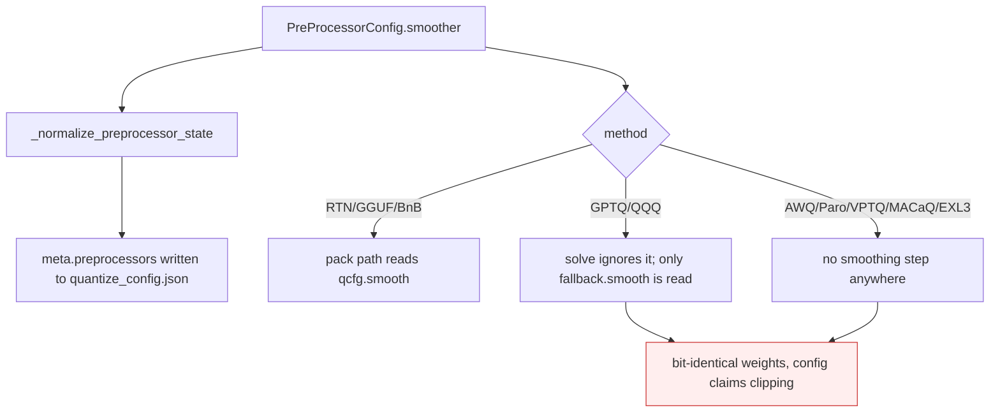
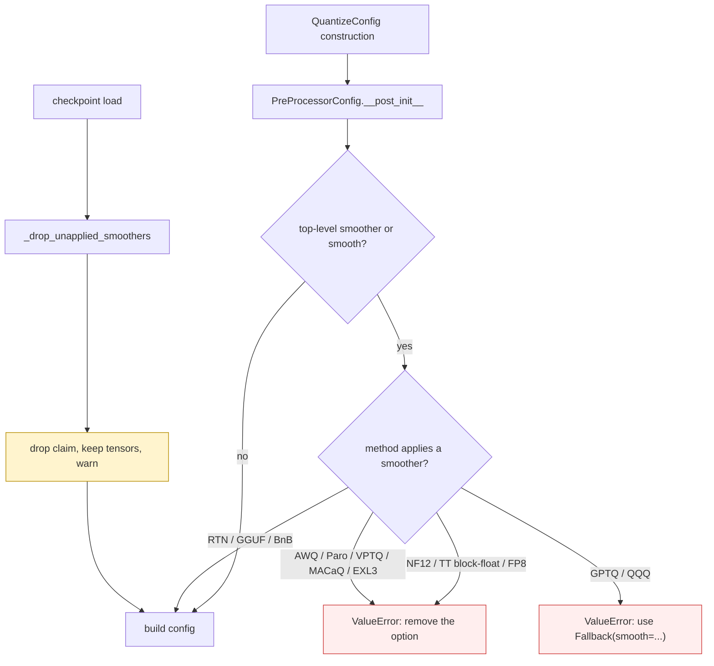

<!-- SPDX-FileCopyrightText: 2026 ModelCloud.ai -->
<!-- SPDX-License-Identifier: Apache-2.0 -->

# Smoother applicability

`SmootherConfig`, `smoother=`/`smooth=` and a `SmootherConfig` entry in
`preprocessors` describe one weight-clip transform. Only some recipes apply it.
This page records which ones, and why a config that cannot apply it is now
rejected before a model loads.

## What a smoother does

A smoother clamps (or rescales) each weight group before the codes are chosen,
so a few outlier weights do not stretch the group's scale and starve the rest.
It is a property of the *weight quantizer*, not of calibration, and not of the
checkpoint layout.

## Owners

| Surface | Consumer | Where it is applied |
| --- | --- | --- |
| `RTNConfig(smooth=...)` | `RTN.quantize` | `smooth_block` before `Quantizer.find_params` |
| `GGUFConfig(smoother=...)` | `pack_original` | `_apply_optional_smoother` (smooth, rescaler-refusing) |
| `BitsAndBytesConfig(smoother=...)` | `pack_original` | `_apply_optional_smoother` |
| `Fallback(smooth=...)` on GPTQ/QQQ | `_fallback_quantize` | `smooth_block` / `mse_optimal_quant` on the fallback only |
| `GPTQConfig(smoother=...)`, `AWQConfig(smoother=...)`, Paro/VPTQ/MACaQ/EXL3 | **none** | rejected at construction |
| `Fallback(smooth=...)` on RTN/GGUF/BitsAndBytes/NF12/TT block-float/FP8 | **none** | rejected at construction |
| `NF12Config(smoother=...)`, `TTBlockfloatConfig(smoother=...)`, `FP8Config(smoother=...)` | **none** | rejected at construction |

A weight-only recipe reads only its top-level `smooth`: the `fallback.smooth`
branch belongs to the GPTQ/QQQ fallback quantizer, so a weight-only config that
recorded one described smoothing its weights never got
([#5401](https://github.com/ModelCloud/GPTQModel/issues/5401)). NF12, the
Tenstorrent block-float packer and FP8 have no smoothing step at all, so their
top-level option is refused at construction instead of at pack time (NF12 used
to raise from `pack_original`, after a model load).

The calibrated GPTQ/QQQ solve and the AWQ/Paro/VPTQ/MACaQ/EXL3 solves never
read the top-level field. Before the rejection, `GPTQConfig(bits=4,
smoother=SmoothMAD(k=1.0))` validated the payload, wrote it into
`quantize_config.json` under `meta.preprocessors`, and quantized
bit-identically to no smoother.

## Old flow: accepted everywhere, applied almost nowhere

## New flow: refused where the quantizer cannot honor it

Per-module `dynamic` rules follow the same decision: a rule's `smoother`,
`smooth`, or `fallback.smooth` is rejected while the rule still names the
offending pattern. Weight-only recipes keep a per-module `smoother` (their
packing path applies it) but reject a per-module `fallback.smooth`, and the
lossless/load-only formats reject both.

## Loading a checkpoint written before this change

The smoother was never applied, so those checkpoint tensors are plain
quantization outputs. Refusing the load would break an artifact whose weights
are valid, while keeping the claim would keep misdescribing it. The loader
therefore drops the unapplied claim (top-level, `meta.preprocessors` and
`dynamic` rules) and logs a warning; a save then writes the corrected config.
Weight-only top-level smoothers (RTN/GGUF/BitsAndBytes) and the GPTQ/QQQ
`fallback.smooth` are preserved because their consumers do apply them. A
weight-only `fallback.smooth`, and any smoother on NF12/TT block-float/FP8, is
dropped: those recipes never read it.

## Failure contract

| Request | Result |
| --- | --- |
| `RTNConfig(smooth=SmoothMAD(k=1.0))` | applied by `RTN.quantize` |
| `GGUFConfig(smoother=SmoothMAD(k=1.0))` | applied by the direct packer |
| `GPTQConfig(fallback=Fallback(smooth=SmoothMAD(k=1.0)))` | applied on the fallback path |
| `GPTQConfig(smoother=SmoothMAD(k=1.0))` | `ValueError` naming `Fallback(smooth=...)` |
| `AWQConfig(smoother=SmoothMAD(k=1.0))` | `ValueError`; the method has no smoothing step |
| `AWQConfig(fallback=Fallback(smooth=...))` | `ValueError`; AWQ's fallback never read it |
| `RTNConfig(fallback=Fallback(smooth=...))` | `ValueError`; point it at `smoother=` |
| `BitsAndBytesConfig(fallback=Fallback(smooth=...))` | `ValueError`; point it at `smoother=` |
| `NF12Config(smoother=SmoothMAD(k=1.0))` | `ValueError`; the format is lossless |
| `TTBlockfloatConfig(smoother=...)`, `FP8Config(smoother=...)` | `ValueError`; no smoothing step |
| pre-fix checkpoint with an unapplied smoother | loads; the claim is dropped with a warning |

The same message shape is produced by the protocol compiler, which already
refuses `weight.prepare` on the GPTQ/AWQ targets instead of dropping it.

## Related tests

- `tests/test_calibrated_smoother_unapplied_5302.py` — construction rejection,
  per-module rules, load-path correction, and the RTN control that proves the
  smoother still changes packed weights where it is supported.
- `tests/test_weight_only_smoother_unapplied_5401.py` — the weight-only
  `fallback.smooth` rejection, the NF12/TT/FP8 construction-time refusal, and
  the load-path correction for both ([#5401](https://github.com/ModelCloud/GPTQModel/issues/5401)).
- `tests/test_smooth_mse_endpoint_baseline.py` — RTN/GPTQ/QQQ consumer parity.
- `tests/test_fallback.py` — fallback thresholds and `fallback.smooth`.
- `tests/qcfg/test_config_validation_4668.py` — payload key validation.

## Other options accepted but never applied (#5583)

The same audit covers the other shared fields. `desc_act`, `mse`, `gptaq` and
`act_group_aware` live on `PreProcessorConfig`/`GPTQConfig`, so every method
config accepted them and the writer copied them into `quantize_config.json`.
`mse` is a three-field dataclass, and its fields belong to different consumers:

| Field | Consumer |
| --- | --- |
| `mse.norm`, `mse.grid_budget` | the GPTQ/QUU/RTN shrink grid (`Quantizer`, `qqq.py`) |
| `mse.clip_grid_budget` | the AWQ clip grid (`awq_processor.py`) |
| `desc_act` | GPTQ/QUU/RTN activation reordering; AWQ has none |
| `gptaq` | GPTQ only (`GPTQProcessor`) |
| `act_group_aware` | GPTQ/FOEM/GPTAQ calibration; QQU has none |

A non-default value for a field its method does not read is refused at
construction with the same "is not applied by the X quantizer" wording, for
both the top-level config and `dynamic` rules. The loader drops the claim from a
checkpoint written before the fix (top level, the `meta` copy and `dynamic`
rules), so those artifacts still load and re-save a config that matches the
tensors that were actually produced.

| Request | Result |
| --- | --- |
| `AWQConfig(desc_act=True)` | `ValueError`; AWQ has no activation reordering |
| `AWQConfig(mse=2.0)` | `ValueError`; only `clip_grid_budget` is read |
| `GGUFConfig(mse=2.0)`, `BitsAndBytesConfig(mse=2.0)` | `ValueError`; no MSE search |
| `QUUConfig(gptaq=...)` | `ValueError`; QQU does not run GPTAQ |
| `QUUConfig(act_group_aware=True)` | `ValueError`; QQU has no activation-group-aware calibration |
| `GPTQConfig(mse=2.0)`, `RTNConfig(mse=2.0)`, `QUUConfig(mse=2.0)` | applied |
| pre-fix checkpoint with one of these | loads; the claim is dropped with a warning |

- `tests/test_config_unapplied_options_5583.py` - construction rejection,
  per-module rules, load-path correction, and the RTN control that proves the
  MSE grid still changes packed weights where it is accepted.

Introduced for [#5302](https://github.com/ModelCloud/GPTQModel/issues/5302).
