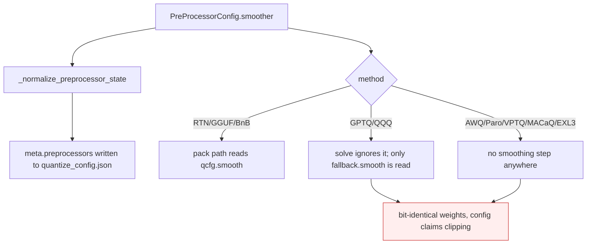
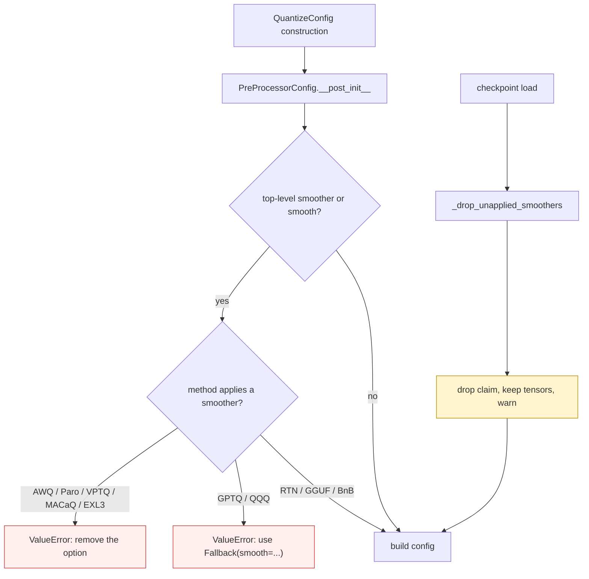

<!-- SPDX-FileCopyrightText: 2026 ModelCloud.ai -->
<!-- SPDX-License-Identifier: Apache-2.0 -->

# Smoother applicability

`SmootherConfig`, `smoother=`/`smooth=` and a `SmootherConfig` entry in
`preprocessors` describe one weight-clip transform. Only some recipes apply it.
This page records which ones, and why a config that cannot apply it is now
rejected before a model loads.

## What a smoother does

A smoother clamps (or rescales) each weight group before the codes are chosen,
so a few outlier weights do not stretch the group's scale and starve the rest.
It is a property of the *weight quantizer*, not of calibration, and not of the
checkpoint layout.

## Owners

| Surface | Consumer | Where it is applied |
| --- | --- | --- |
| `RTNConfig(smooth=...)` | `RTN.quantize` | `smooth_block` before `Quantizer.find_params` |
| `GGUFConfig(smoother=...)` | `pack_original` | `_apply_optional_smoother` (smooth, rescaler-refusing) |
| `BitsAndBytesConfig(smoother=...)` | `pack_original` | `_apply_optional_smoother` |
| `Fallback(smooth=...)` on GPTQ/QQQ | `_fallback_quantize` | `smooth_block` / `mse_optimal_quant` on the fallback only |
| `GPTQConfig(smoother=...)`, `AWQConfig(smoother=...)`, Paro/VPTQ/MACaQ/EXL3 | **none** | rejected at construction |

The calibrated GPTQ/QQQ solve and the AWQ/Paro/VPTQ/MACaQ/EXL3 solves never
read the top-level field. Before the rejection, `GPTQConfig(bits=4,
smoother=SmoothMAD(k=1.0))` validated the payload, wrote it into
`quantize_config.json` under `meta.preprocessors`, and quantized
bit-identically to no smoother.

## Old flow: accepted everywhere, applied almost nowhere

## New flow: refused where the quantizer cannot honor it

Per-module `dynamic` rules follow the same decision: a rule's `smoother`,
`smooth`, or (on a method with no smoothing step) `fallback.smooth` is rejected
while the rule still names the offending pattern.

## Loading a checkpoint written before this change

The smoother was never applied, so those checkpoint tensors are plain
quantization outputs. Refusing the load would break an artifact whose weights
are valid, while keeping the claim would keep misdescribing it. The loader
therefore drops the unapplied claim (top-level, `meta.preprocessors` and
`dynamic` rules) and logs a warning; a save then writes the corrected config.
Weight-only smoothers and the GPTQ/QQQ `fallback.smooth` are preserved because
their consumers do apply them.

## Failure contract

| Request | Result |
| --- | --- |
| `RTNConfig(smooth=SmoothMAD(k=1.0))` | applied by `RTN.quantize` |
| `GGUFConfig(smoother=SmoothMAD(k=1.0))` | applied by the direct packer |
| `GPTQConfig(fallback=Fallback(smooth=SmoothMAD(k=1.0)))` | applied on the fallback path |
| `GPTQConfig(smoother=SmoothMAD(k=1.0))` | `ValueError` naming `Fallback(smooth=...)` |
| `AWQConfig(smoother=SmoothMAD(k=1.0))` | `ValueError`; the method has no smoothing step |
| `AWQConfig(fallback=Fallback(smooth=...))` | `ValueError`; AWQ's fallback never read it |
| pre-fix checkpoint with an unapplied smoother | loads; the claim is dropped with a warning |

The same message shape is produced by the protocol compiler, which already
refuses `weight.prepare` on the GPTQ/AWQ targets instead of dropping it.

## Related tests

- `tests/test_calibrated_smoother_unapplied_5302.py` — construction rejection,
  per-module rules, load-path correction, and the RTN control that proves the
  smoother still changes packed weights where it is supported.
- `tests/test_smooth_mse_endpoint_baseline.py` — RTN/GPTQ/QQQ consumer parity.
- `tests/test_fallback.py` — fallback thresholds and `fallback.smooth`.
- `tests/qcfg/test_config_validation_4668.py` — payload key validation.

Introduced for [#5302](https://github.com/ModelCloud/GPTQModel/issues/5302).
