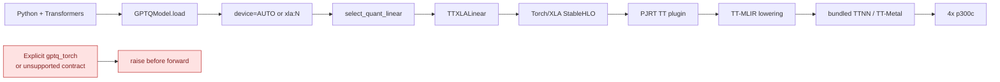
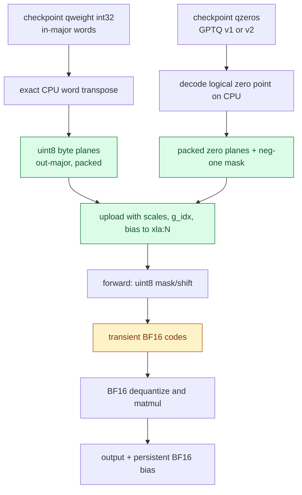
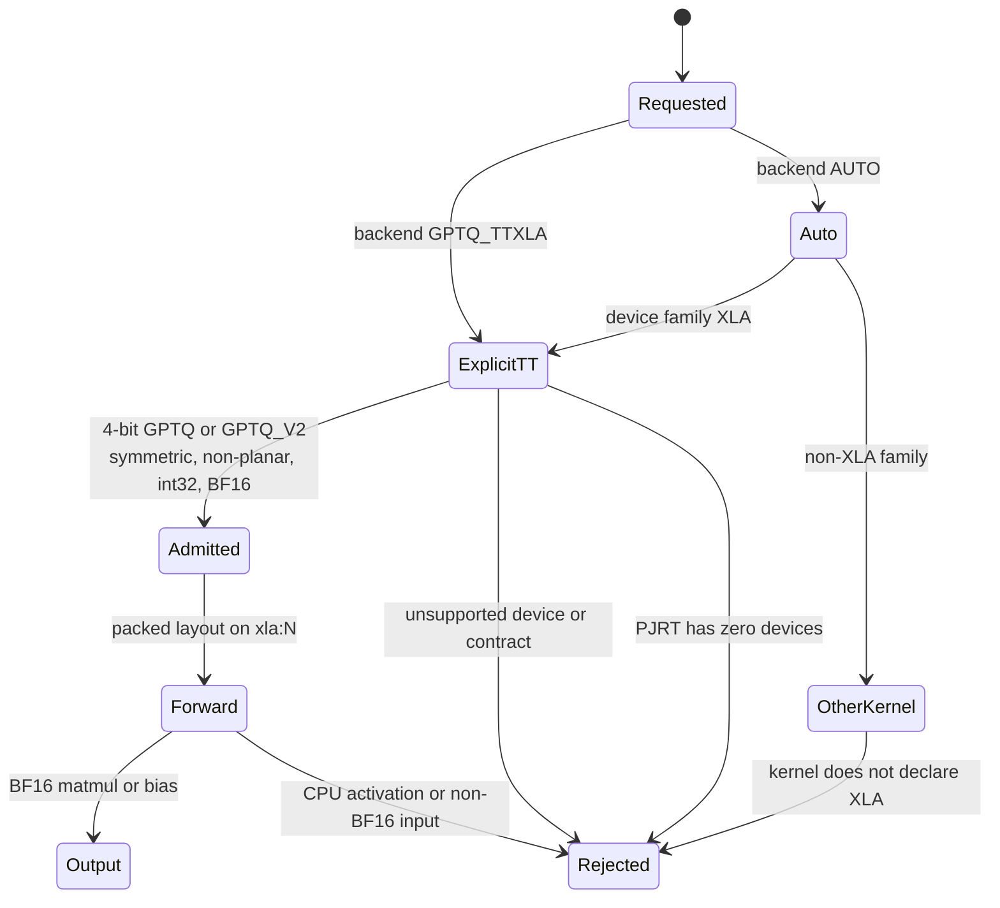

# Tenstorrent XLA GPTQ execution

GPT-QModel uses the Torch/XLA device family for Tenstorrent instead of treating
the cards as CUDA, XPU, or a generic "all devices" fallback. The distinction is
required for both dispatch and correctness: Tenstorrent's current PJRT lowering
does not provide the exact packed-word integer operations used by the portable
Torch GPTQ kernel.

This page describes the implementation in this change. It was validated on four
Blackhole p300c cards. Standard CPU PyTorch plus Torch/XLA/PJRT is used; no
special PyTorch hardware build is required. TTNN and TT-Metal are bundled inside
the PJRT plugin.

## Execution path

The Python model does not send a kernel directly to TT-Metal. PyTorch records
the graph, Torch/XLA converts it to StableHLO, the PJRT TT plugin lowers it
through TT-MLIR, and the bundled TT-Metal runtime issues device programs. For
the current kernel, the matmul itself executes on the card while nibble
expansion and dequantization are expressed as staged device operations.



`AUTO` considers `TTXLALinear` only when the selector family is `DEVICE.XLA`.
An explicit `BACKEND.GPTQ_TTXLA` selects the same class and still validates the
device, format, dtype, layout, and shape contract. Lazy device probing means a
library import alone does not deliberately start PJRT or claim cards.

## Packed checkpoint conversion

The checkpoint remains GPTQ words, scales, zeros, and `g_idx` on disk. After
placement, `repack_gptq_for_tt()` builds an output-major packed layout on CPU:
it transposes the still-packed words, writes exact little-endian uint8 byte
planes, and then uploads those planes to the selected `xla:N` card. This avoids
the inexact 32-bit shift path on the device.

Forward expands the packed nibbles only for the active computation. No dense,
dequantized, or expanded weight cache survives the call.



The persistent layout is `weight_bytes[out, in/8, 4]`, plus packed zero planes,
`zero_neg_one`, BF16 scales, `g_idx`, and optional BF16 bias. It is invalidated
when the module is moved, a state dict is loaded, the checkpoint format changes,
or packed tensor versions change. The `_tt_layout` is rebuilt for the new card
after placement.

## Device family and lazy probing

Before this change, portable kernels declared `DEVICE.ALL`, so Tenstorrent could
be admitted by accident. Their unpack path then used an integer shift that
Tenstorrent currently lowers through f32, which can corrupt high GPTQ nibbles.
The current implementation removes that silent path.

| Old mechanism | New mechanism | Evidence |
| --- | --- | --- |
| `TorchLinear.SUPPORTS_DEVICES = [DEVICE.ALL]` admitted every unknown family | Explicit non-XLA family list; `validate_device()` rejects XLA with guidance | `gptqmodel/nn_modules/qlinear/torch.py:189`, `torch.py:279` |
| Portable unpack accepted XLA | Raises instead of producing approximate codes | `gptqmodel/nn_modules/qlinear/torch.py:95` |
| No XLA family existed | `DEVICE.XLA` is explicit and maps to `xla:N` | `gptqmodel/models/_const.py:56`, `_const.py:74` |
| Device discovery did not distinguish runtime probes from imports | Runtime discovery returns XLA cards; module initialization uses a probe-free selector | `gptqmodel/utils/torch.py:604`, `torch.py:625` |
| `ALL_DEVICES` captured at import time | `all_torch_devices()` performs discovery only on request | `gptqmodel/utils/torch.py:673` |
| No TT kernel backend | `BACKEND.GPTQ_TTXLA` maps only to `TTXLALinear` | `gptqmodel/utils/backend.py:26`, `gptqmodel/nn_modules/qlinear/tt_xla.py:41` |

`torch_xla` itself initializes PJRT on import, and an installed `accelerate`
imports it by default during GPT-QModel startup. GPT-QModel does not cache an
import-time device list and does not make its own availability probe at module
scope; callers that require hardware use the explicit XLA path. A host that
must start the process before claiming cards can set `USE_TORCH_XLA=0`, which
disables Accelerate's probe; GPT-QModel then claims devices only when an
explicit XLA operation needs `require_xla_runtime()`.

## GPTQ kernel conversion matrix

Only `TTXLALinear` is admitted on XLA. Every other GPTQ-capable kernel keeps its
declared native family and fails closed on XLA. This table is the complete
registered GPTQ conversion inventory.

| Kernel | Checkpoint formats | Devices and XLA policy |
| --- | --- | --- |
| `AllSparkLinear` | GPTQ, GPTQ_V2 | CUDA, ROCm; reject XLA |
| `BitblasLinear` | BitBLAS, GPTQ, GPTQ_V2 | CUDA; reject XLA |
| `ExllamaV2Linear` | GPTQ, GPTQ_V2 | CUDA; reject XLA |
| `MacheteLinear` | GPTQ | CUDA; reject XLA |
| `MarlinLinear` | GPTQ, GPTQ_V2, Marlin | CUDA; reject XLA |
| `MlxQuantLinear` | GPTQ, GPTQ_V2, GPTQ_P | MPS; reject XLA |
| `SwordfishLinear` | GPTQ | CUDA; reject XLA |
| `TTXLALinear` | GPTQ, GPTQ_V2 | XLA/Tenstorrent; admitted |
| `TorchAtenLinear` | GPTQ, GPTQ_V2 | CPU; reject XLA |
| `TorchCpuAvx512Linear` | GPTQ, GPTQ_V2 | CPU; reject XLA |
| `TorchFusedLinear` | GPTQ, GPTQ_V2 | CPU, XPU; reject XLA |
| `TorchInt8Linear` | GPTQ, GPTQ_V2 | CPU; reject XLA |
| `TorchLinear` | GPTQ, GPTQ_V2, GPTQ_P | CPU, CUDA, ROCm, XPU, NPU, MPS; reject XLA |
| `TritonV2Linear` | GPTQ, GPTQ_V2 | CUDA; reject XLA |
| `W4AFP8Linear` | GPTQ, GPTQ_V2 | CUDA; reject XLA |
| `W4ANVFP4Linear` | GPTQ, GPTQ_V2 | CUDA; reject XLA |

The rejection is an intentional semantic conversion boundary, not a missing
format translation. Moving a packed checkpoint to XLA without its kernel's
layout and arithmetic contract would yield plausible but incorrect output.

## Failure contract



| Situation | Behavior |
| --- | --- |
| Explicit `gptq_torch` on XLA | `NotImplementedError` with native-kernel guidance |
| AUTO on XLA with supported GPTQ | Selects `TTXLALinear` |
| Other GPTQ-capable kernel requested on XLA | Kernel family validation rejects it |
| FP16 activation or transfer | Rejected; Tenstorrent rounds FP16 to BF16 on transfer |
| Bits other than 4; planar layout; asymmetric zeros; non-int32 words | Rejected before layout construction |
| In/out features not divisible by 8 | Rejected by validation |
| No addressable PJRT devices | `validate_once()` rejects kernel initialization |
| CPU activation sent to `TTXLALinear.forward()` | `RuntimeError` before any device operation |
| Training or adapters | Not supported |
| Host readback | Call `torch_xla.sync(wait=True)` before observing results |

## Numerical qualification

The hardware test uses a synthetic GPTQ-v2 layer with output-major group 128,
bias, and BF16 output on each of the four cards. Its oracle independently
unpacks the checkpoint, reconstructs weights, and computes expected output in
FP32 before rounding once to BF16.

Measured on `tt-quietbox` 2026-11-10:

| Check | Result |
| --- | --- |
| Four cards discovered | `xla:0` through `xla:3` |
| Device dequantized weights vs CPU oracle | bit-identical |
| PCC | approximately `0.999999` |
| Normalized output error | approximately `3e-4` |
| Output distance at material magnitudes | at most one BF16 ULP |
| Packed weight retained after forward | yes, on target `xla:N` |
| Expanded BF16 weight cache retained | no |
| Hardware gate | `1 passed` |

The focused CPU and contract suite reports `402 passed, 1 skipped` when the
opt-in hardware gate is disabled. The skip is that hardware test.

## Install and versions

The pinned environment is in
[`requirements/tenstorrent-py312.txt`](../requirements/tenstorrent-py312.txt)
and can be installed by
[`requirements/install-tenstorrent-py312.sh`](../requirements/install-tenstorrent-py312.sh).
It is deliberately separate from the global package requirements because the
PJRT plugin is available only from Tenstorrent's index and its CPU Torch pin is
older than GPT-QModel's declared runtime floor. The manifest contains the
compatible base GPT-QModel dependencies plus the TT tools. After installing
that complete set, the script installs the local GPT-QModel checkout with
`--no-deps` so pip does not re-resolve and replace the validated Torch ABI.

```bash
PYTHON_BIN="$HOME/.pyenv/versions/3.12.16/bin/python" \
  requirements/install-tenstorrent-py312.sh /path/to/gptqmodel
```

The validated Python pins are listed below. This records installed package
versions; it is not permission to replace GPT-QModel's global requirements.

| Package | Validated pin |
| --- | --- |
| Python | CPython 3.12.16, GIL enabled |
| `torch` | `2.11.0+cpu` |
| `torch-xla` | `2.9.0+gited8a445` |
| `pjrt-plugin-tt` | `1.5.0.dev20260831000501` |
| `jax` / `jaxlib` | `0.7.1` |
| `numpy` | `1.26.4` |
| `accelerate` | `1.15.0` |
| `transformers` | `5.22.2` |
| `safetensors` | `0.8.0` |
| `click` | `8.3.1` |
| `PyYAML` | `6.0.3` |
| `pyluwen` | `0.10.0` |
| `tt-lang` | `1.1.5.dev20260704+light` |
| `tt-smi` | `6.8.1` |
| `tt-flash` | `4.2.0` |
| `tt-topology` | `1.2.20` |
| `tt-umd` | `0.9.17` |
| `tt-tools-common` | `1.6.0` |
| `sfpi` | `7.69.0` |
| `tenstorrent-dkms` | `2.12.0` |
| `tenstorrent-tools` | `1.4.1` |

`python -m pip check` reports known cross-tool conflicts on the qualified host:
`huggingface-hub` prefers Click `>=8.4.2`; `tt-flash` pins PyYAML `6.0.2`; and
`tt-topology` pins pyluwen `~=0.8.5`. The model runtime works with the plugin's
Click `8.3.1` and PyYAML `6.0.3`. If topology or flashing tooling needs a
different ABI, install that maintenance tool in its own environment rather than
mutating the validated inference environment.

`tt-flash` is the firmware/SPI maintenance utility. It does not flash weights
and is not in the inference execution path. Firmware updates are intentionally
outside this change.

## Scope and follow-up

This change implements the following:

- Explicit `DEVICE.XLA` and `BACKEND.GPTQ_TTXLA` routing.
- Exact packed 4-bit GPTQ and GPTQ-v2 checkpoint conversion.
- Lazy runtime probing and fail-closed non-TT kernel dispatch.
- Real four-card `TTXLALinear` numerical validation.

The following remain future work and are not claimed here:

- Native TTNN QLinear with tiled dequantization and tiled matmul. The current
  path uses Torch/XLA operations and a full BF16 matmul after transient nibble
  expansion; it is correctness-first rather than M5 performance work.
- A post-init repacker that directly targets a future native tile ABI.
- Multi-card tensor-parallel model execution beyond per-card kernel placement.
- On-device GPTQ quantization and calibration.

The native kernel should preserve this conversion contract and add tile-shape,
sharding, and bounded-scratch tests before becoming an `AUTO` candidate.
