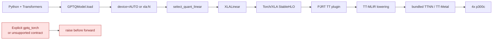
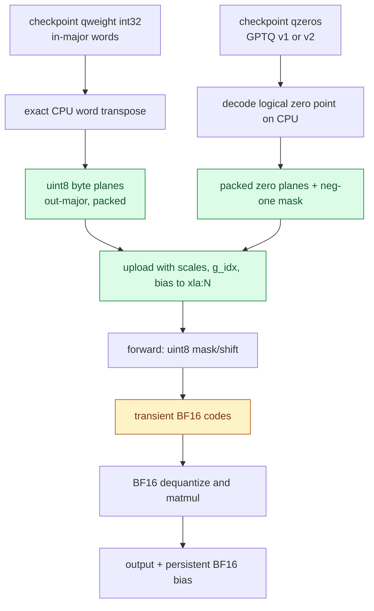
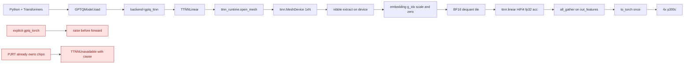
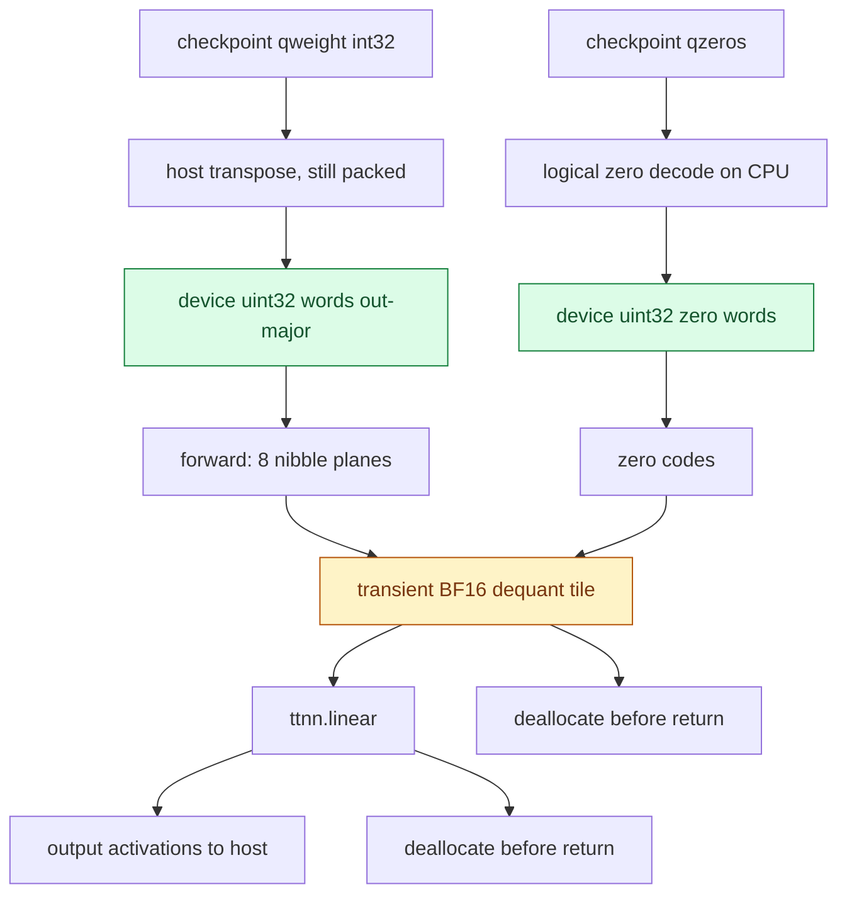
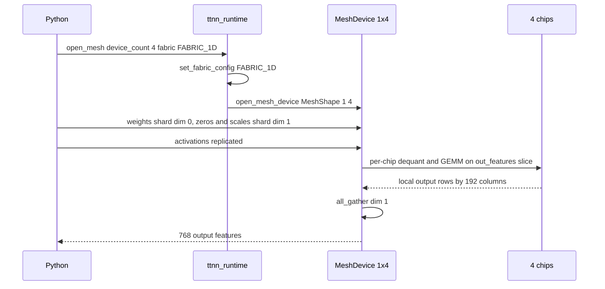
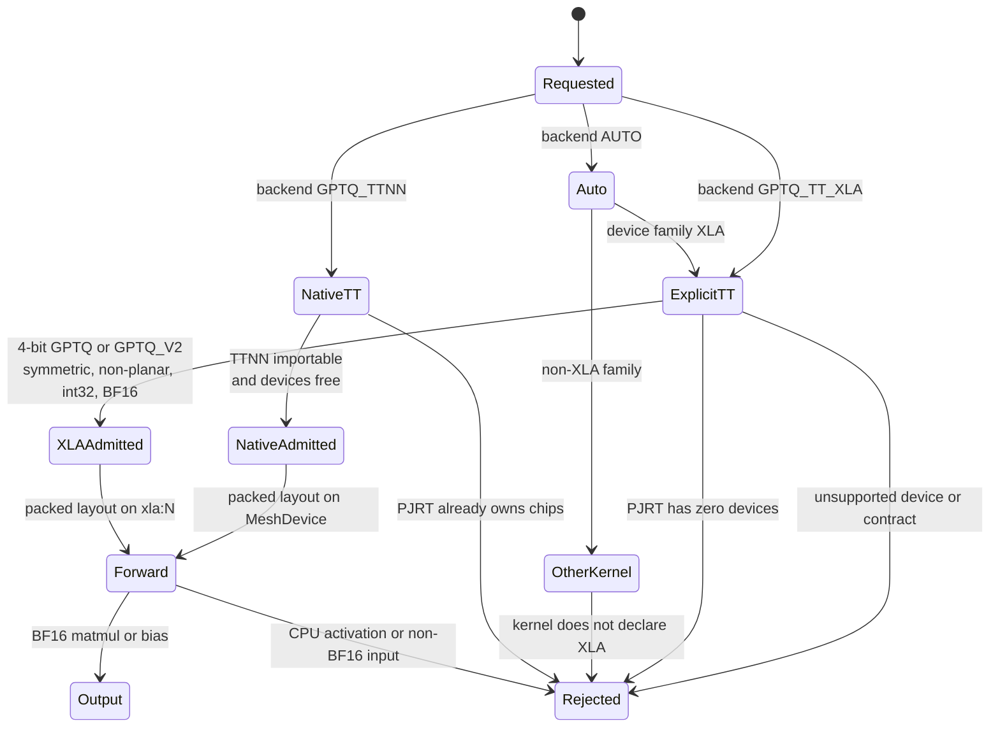

# Tenstorrent GPTQ execution

GPT-QModel uses the Torch/XLA device family for Tenstorrent instead of treating
the cards as CUDA, XPU, or a generic "all devices" fallback. The distinction is
required for both dispatch and correctness: Tenstorrent's current PJRT lowering
does not provide the exact packed-word integer operations used by the portable
Torch GPTQ kernel.

There are two Tenstorrent backends, both validated on four Blackhole p300c
cards:

| Backend | Kernel | Execution path | Reaches TTNN |
| --- | --- | --- | --- |
| `BACKEND.GPTQ_TT_XLA` | `XLALinear` | Python -> Torch/XLA -> StableHLO -> PJRT TT -> TT-MLIR | indirectly, bundled in the PJRT plugin |
| `BACKEND.GPTQ_TTNN` | `TTNNLinear` | Python -> `ttnn.MeshDevice` | directly, no StableHLO or PJRT |

`AUTO` still resolves to `XLALinear` so an existing model load never changes
execution backend silently; the native kernel must be requested explicitly.
Standard CPU PyTorch is used in both cases; no special PyTorch hardware build is
required.

Every dtype used here — including the native `bf4_b`/`bf8_b` block-float grid — is
defined at the bit level, for both weights and arithmetic, in
[`hw/dtypes.md`](../hw/dtypes.md). Hardware measurements for this box are in
[`hw/tenstorrent.md`](../hw/tenstorrent.md).

## CPU kernels

[`gptqmodel_ext/ttbfp/`](../gptqmodel_ext/ttbfp/) executes the same packed
`bf8_b`/`bf4_b`/`bf2_b` block floats on ordinary CPUs, with no Tenstorrent
runtime, PJRT plugin, or card present. It is a standalone C/C++ extension with a
quantizer validated bit-for-bit against the upstream `tt-llk` helpers and fused
dequantize+GEMM microkernels for scalar, AVX2+FMA and AVX-512. This makes it
possible to check a converted checkpoint, reproduce a TT numerical result, or
develop against the block-float formats on a laptop or CI runner. Build it with
`make -C gptqmodel_ext/ttbfp`; it is not imported by `gptqmodel`. See
[`docs/tt-blockfloat-cpu.md`](tt-blockfloat-cpu.md) for the dtype definition,
layouts, dispatch, and measured performance.

The two backends are mutually exclusive within one process. TT-Metal allows a
single runtime owner per chip, and initializing the PJRT plugin is irreversible,
so a process that has used `XLALinear` cannot then open a `ttnn.MeshDevice`.

## Torch/XLA execution path

The Python model does not send a kernel directly to TT-Metal. PyTorch records
the graph, Torch/XLA converts it to StableHLO, the PJRT TT plugin lowers it
through TT-MLIR, and the bundled TT-Metal runtime issues device programs. For
the current kernel, the matmul itself executes on the card while nibble
expansion and dequantization are expressed as staged device operations.



`AUTO` considers `XLALinear` only when the selector family is `DEVICE.XLA`.
An explicit `BACKEND.GPTQ_TT_XLA` selects the same class and still validates the
device, format, dtype, layout, and shape contract. Lazy device probing means a
library import alone does not deliberately start PJRT or claim cards.

## Packed checkpoint conversion

The checkpoint remains GPTQ words, scales, zeros, and `g_idx` on disk. After
placement, `repack_gptq_for_tt()` builds an output-major packed layout on CPU:
it transposes the still-packed words, writes exact little-endian uint8 byte
planes, and then uploads those planes to the selected `xla:N` card. This avoids
the inexact 32-bit shift path on the device.

Forward expands the packed nibbles only for the active computation. No dense,
dequantized, or expanded weight cache survives the call.



The persistent layout is `weight_bytes[out, in/8, 4]`, plus packed zero planes,
`zero_neg_one`, BF16 scales, `g_idx`, and optional BF16 bias. It is invalidated
when the module is moved, a state dict is loaded, the checkpoint format changes,
or packed tensor versions change. The `_tt_layout` is rebuilt for the new card
after placement.

## Native TTNN execution path

`TTNNLinear` removes StableHLO and PJRT from the inference path. It opens a
`ttnn.MeshDevice` directly and expresses the entire GPTQ contract as TTNN ops,
so nibble extraction, zero-point correction, per-group scaling and the GEMM all
run on the Tensix cores.



### Why native integer ops matter

The Torch/XLA kernel uploads uint8 byte planes because PJRT's 32-bit signed
shift path can mislegalize or drop the high bit. Native TTNN does not have that
limitation: measured on the qualified host, `logical_right_shift` and
`bitwise_and` on `uint32` are bit-exact.

Not every dtype works. TT-Metal rejects bitwise/shift on `uint8` and `uint16`
with `Unsupported input dtype for bitwise/shift ... expected Int32, UInt32, or
UInt16` and `is not supported for binary operation LogicalRightShift`
respectively, so `uint32` is the only usable lane width. The packed words
therefore upload unchanged from the transposed checkpoint.

### Tensor lifecycle

Only packed tensors persist. The dequantized BF16 weight tile is a local
created per forward and deallocated before the call returns.



Measured per OPT-125M `q_proj` (`768x768`, group 128, 4-bit): the persistent
packed words occupy 294,912 bytes versus 1,179,648 bytes for a dense BF16 copy,
a 4x reduction. Retained `scales` and `bias` are the checkpoint's native
metadata, which the storage rule permits.

### GPTQ v1 zero-point correction

`_repack_zero_words` in `gptqmodel/utils/tt_packing.py` normalizes GPTQ v1's
serialized `zero_point - 1` into logical space while the codes are still
packed, because a per-nibble `+1` carry must not bleed into the adjacent field.
`TTNNLinear._logical_zeros` therefore reads the uploaded words as already
logical. Applying the `+1` a second time on device is a real defect that was
caught here: it produced exactly half the correct reconstructed weight
(`max abs err 0.107` instead of `0.0`).

### Tiled dequant cost

Stacking the eight nibble planes on the trailing tile dimension is pathologically
slow because that dimension is not tile-aligned. Stacking on dim 0 and permuting
is equivalent and much cheaper. Measured for `[768, 96]` packed words on
Blackhole p300c:

| Operation | Time |
| --- | --- |
| stack 8 planes on trailing dim | 3.35 ms |
| 4-way stack on trailing dim | 14.46 ms |
| stack 8 planes on dim 0 + permute | 0.03 ms + 0.13 ms |
| full forward, 1 chip | 1.24 ms |

### Math fidelity

TT-Metal defaults to `MathFidelity.LoFi` with `math_approx_mode`. Measured on
real OPT-125M `q_proj` data against an independent FP32 oracle:

| Configuration | Max abs error | PCC |
| --- | --- | --- |
| `LoFi` + `math_approx_mode` (default) | 0.0456 | 0.999979 |
| `HiFi2` + fp32 dest | 0.0238 | 0.999994 |
| `HiFi4` + fp32 dest | 0.0093 | 0.999998 |

`TTNNLinear` pins `HiFi4` with `fp32_dest_acc_en` and `math_approx_mode=False`,
which measured no latency difference at row counts 6, 64 and 128. The residual
is the Tensix FMA floor: storing inputs as `float32` instead of BF16 does not
reduce it (`max abs 0.00164` against float64 with FP32 storage).

## GDDR thermal pacing

A Blackhole p300c throttles GDDR at 90 C and shuts the card down at 110 C.
A benchmark loop that loads and unloads models back to back never idles long
enough for the previous run's heat to leave the GDDR dies, so the temperature
ratchets upward across cycles instead of recovering between them. On this host
that produced a hard thermal shutdown, after which a warm reboot left one card
in `D3cold` and only three of four root ports enumerated; recovery required
`poweroff` plus a cold start.

Measured on `tt-quietbox` on 2026-11-10, before choosing any number here:

| Quantity | Measured |
| --- | --- |
| Idle baseline, after full cooldown | 58-64 C |
| GDDR rise caused by one model load | **+20 to +34 C** |
| GDDR cooling rate at idle | **about 2 C per minute** |
| Residual heat after killing a load mid-compile | 90/96/94/98 C, minutes to clear |

The last two rows are why the guard is a temperature gate and not a sleep. At
2 C/min a five-second pause removes roughly 0.2 C -- useful for settling the
driver, useless as thermal protection. A load that starts at 80 C can reach the
110 C shutdown limit on its own, so the soft limit defaults to 80 C rather than
sitting just under the throttle point.

`gptqmodel/utils/tt_thermal.py` gates the ownership transitions:

| Hook | When | Effect |
| --- | --- | --- |
| `before_device_open` | before a load claims a chip | wait for the GDDR to fall below the soft limit, then sleep the configured cooldown |
| `park_idle_clock` | immediately after the mesh closes | send the firmware `AICLK_GO_LONG_IDLE` (0x54) so the cards actually reach 800 MHz |
| `after_device_close` | after the mesh is closed and parked | sleep the cooldown, so the idle window is real idle |

`park_idle_clock` is not optional decoration. Closing the last `MeshDevice` does
not stop the card dissipating heat: measured on a p300c, AICLK stayed at
**1350 MHz and ~50 W per board** for more than 50 s after `close_device`, with
GDDR still climbing, because the firmware only falls back to its 800 MHz
long-idle clock when it is told to. After the message the same cards read
800 MHz and ~40 W. Without it a "cooldown" sleeps while four cards keep
burning about 80 W, which is why the cooldown alone measured as nearly useless.

Both hooks are wired into the runtime: `open_mesh`/`close_mesh` in
`gptqmodel/utils/ttnn_runtime.py` cover the native TTNN path, and
`from_quantized` covers the Torch/XLA path, which never opens a TTNN mesh. The
cooldown is a rate limit, not a per-hook sleep, so a load that passes through
both gates pays one idle window rather than two.

Read the temperature with PCI telemetry only (`pyluwen`,
`detect_chips_fallible(noc_safe=True)`), which takes about two milliseconds and
does not open a TT-Metal device. A missing driver, a missing `pyluwen`, or a
failed read disables the guard instead of failing the load.

| Variable | Default | Meaning |
| --- | --- | --- |
| `GPTQMODEL_TT_COOLDOWN_SECS` | `5` | teardown settle delay between ownership transitions; `0` disables |
| `GPTQMODEL_TT_GDDR_SOFT_LIMIT_C` | `80` | peak GDDR above which a load waits; `0` disables the guard |
| `GPTQMODEL_TT_GDDR_MAX_WAIT_SECS` | `900` | upper bound on a thermal wait, after which the load proceeds and logs the temperature |

Because cooling is measured in minutes, the wait budget has to be minutes too:
cooling 98 C to 80 C legitimately takes about 9 min. Set
`GPTQMODEL_TT_GDDR_SOFT_LIMIT_C=0` to bypass the gate during a deliberate hot
run, and prefer one long session over many reloads -- each load spends 20-34 C
of thermal budget, and the budget refills at only 2 C/min.

Use `model.release_device()` between models in a loop. It closes the mesh *and*
parks the idle clock, which together are what start a real idle window; leaving
it to garbage collection keeps the chips owned and hot until the last reference
dies, and closing without parking leaves them at full clock.

## Board power limit

A p300c has a **125 W** per-board TDP limit (also its maximum; a larger request
is clamped). The firmware throttles by inserting NOP cycles once that is
reached, so board power, not temperature, is the sustained-throughput ceiling.

Do not expect a TDP cap to control GDDR temperature. Measured on this host with
a fixed 1x4 BF16 matmul load:

| Cap | GDDR peak | ASIC peak | mean draw |
| --- | --- | --- | --- |
| 125 W (default) | 102 C | 97.5 C | 98.6 W |
| 100 W | 102 C | 97.5 C | 96.9 W |
| 70 W | **106 C** | 99.7 C | 84.1 W |

The load's own draw is about 97 W, so the 125 W and 100 W caps never bind and
give identical results. Forcing the cap below the natural draw made the peak
*worse*: the throttler cuts the ASIC clock while GDDR traffic is untouched, so
the same work takes longer and the card absorbs heat for longer. Leave the
default in place.

`tt_thermal.set_tdp_limit(watts)` / `tdp_limit_watts()` drive the firmware
message directly (`SET_TDP_LIMIT`, 0x22, present since firmware 19.8.0), because
the newer `TT_METAL_TDP_LIMIT_WATTS` variable is absent from the plugin build
installed here (1.5.0.dev20260831).

## Multi-card mesh networking

The four p300c cards form one fabric domain. TTNN exposes them as
`MeshDevice`, and tensor parallelism shards `out_features` across the mesh:
each chip owns a contiguous slice of output features together with the matching
zero-point and scale columns, so every chip computes an already-correct GEMM
and `all_gather` reassembles the output features.



Operational requirements and measured behavior:

| Item | Finding |
| --- | --- |
| Fabric default | `FabricConfig.DISABLED`; `all_gather` fails with `Trying to get un-initialized fabric context` until `set_fabric_config(FABRIC_1D)` runs *before* the mesh opens |
| Physical mesh shapes | `get_physical_mesh_shapes()` reports `2x2`; both `1x4` and `2x2` open successfully |
| Ethernet links | only one link is discovered between these four cards, so collectives run over that single link |
| Fabric 1D all_gather accuracy | numerically exact (four-times sum matched) |
| 4-chip vs 1-chip output | bit-identical for the same layer |
| 4-chip vs 1-chip latency | 2.0 ms vs 1.24 ms per OPT-125M `q_proj` layer; the collective dominates once dequant is cheap, so width-only sharding is not a decode win at this size |
| `all_gather` on replicated tensors | concatenates along dim 0, so host readback of a replicated tensor returns N copies, not one |

XLA device mapping is separate: `torch_xla` exposes `xla:0` .. `xla:3`, one per
chip, and `XLALinear` places one layer per card with no collective. It does not
use TTNN mesh networking.

## Device family and lazy probing

Before this change, portable kernels declared `DEVICE.ALL`, so Tenstorrent could
be admitted by accident. Their unpack path then used an integer shift that
Tenstorrent currently lowers through f32, which can corrupt high GPTQ nibbles.
The current implementation removes that silent path.

| Old mechanism | New mechanism | Evidence |
| --- | --- | --- |
| `TorchLinear.SUPPORTS_DEVICES = [DEVICE.ALL]` admitted every unknown family | Explicit non-XLA family list; `validate_device()` rejects XLA with guidance | `gptqmodel/nn_modules/qlinear/torch.py:189`, `torch.py:279` |
| Portable unpack accepted XLA | Raises instead of producing approximate codes | `gptqmodel/nn_modules/qlinear/torch.py:95` |
| No XLA family existed | `DEVICE.XLA` is explicit and maps to `xla:N` | `gptqmodel/models/_const.py:56`, `_const.py:74` |
| Device discovery did not distinguish runtime probes from imports | Runtime discovery returns XLA cards; module initialization uses a probe-free selector | `gptqmodel/utils/torch.py:604`, `torch.py:625` |
| `ALL_DEVICES` captured at import time | `all_torch_devices()` performs discovery only on request | `gptqmodel/utils/torch.py:673` |
| No TT kernel backend | `BACKEND.GPTQ_TT_XLA` maps only to `XLALinear` | `gptqmodel/utils/backend.py:26`, `gptqmodel/nn_modules/qlinear/tt_xla.py:41` |

`torch_xla` itself initializes PJRT on import, and an installed `accelerate`
imports it by default during GPT-QModel startup. GPT-QModel does not cache an
import-time device list and does not make its own availability probe at module
scope; callers that require hardware use the explicit XLA path. A host that
must start the process before claiming cards can set `USE_TORCH_XLA=0`, which
disables Accelerate's probe; GPT-QModel then claims devices only when an
explicit XLA operation needs `require_xla_runtime()`.

## Gotchas: `DEVICE.XLA`, placement, and context ownership

These three are easy to conflate and each one has already produced a real
failure here. Read this before touching device selection.

### 1. `DEVICE.XLA` is overloaded

Both Tenstorrent kernels declare the **same** device family:

```python
# nn_modules/qlinear/ttnn.py:121   native — owns the mesh itself
SUPPORTS_DEVICES = [DEVICE.XLA]
# nn_modules/qlinear/tt_xla.py:50  XLA — PJRT owns the mesh
SUPPORTS_DEVICES = [DEVICE.XLA]
```

So `device=DEVICE.XLA` cannot tell you *which runtime* runs the chips. It only
names the family. The distinction lives in `backend`:

| `backend` | Runtime that owns the chips | Where activations live |
| --- | --- | --- |
| `GPTQ_TTNN` | TT-Metal mesh opened by `ttnn_runtime` | host between layers, device inside a resident chain |
| `GPTQ_TT_XLA` | PJRT plugin (which wraps its own `MeshDevice`) | `xla:N` tensors |

**Rule: decide with `backend`, never with `device`.** Resolving the *device*
family by asking PJRT how many devices exist is what previously initialized the
wrong runtime; see `_layerwise_device_count` and `_layerwise_device_strings`,
which now take `backend` and count over PCIe for the native path.

### 2. Placement is not the same as residency

The native kernel uploads a layer's packed weights on demand in `forward`, so
its parameters belong on the **host**. A layer-wise `xla:N` device map would
send them through PJRT instead, which claims every chip and then collides with
the mesh `post_init` opens. For `GPTQ_TTNN` the loader therefore pins
`device_map = {"": "cpu"}`.

This is also why `{"": "xla"}` is **not** a substitute: `simple_dispatch_model`
would call `.to("xla")` and initialize PJRT anyway.

### 3. Context ownership is one owner per chip, per process

TT-Metal enforces a single runtime per chip. Consequences worth knowing:

- **PJRT initializes on first query, not on import.** `addressable_device_count()`
  is the claim. There is no read-only way to ask, which is why the loader must
  never probe PJRT on behalf of a native backend.
- **PJRT has no public shutdown.** In practice the first runtime to initialize
  holds the chips until the process exits. That is a process-scoped limit, not
  a hardware lock: a new process may use either path freely.
- **Two runtimes in one process corrupt each other.** The loser reads a released
  `Device`, and TT-Metal reports it as a nonsensical context id
  (`context_id 82459424 is out of range (max 32)`), not as an ownership error.
  `ttnn_runtime._reject_pjrt_owner` records the claim so that case is reported
  as an ownership conflict instead of a stale-pointer assert.
- **`close_device()` does not idle the card** — it stays at 1350 MHz until the
  firmware is sent `AICLK_GO_LONG_IDLE`; the mesh close path does that now.

### 4. The native forward costs two PCIe crossings per layer

`TTNNLinear.forward` takes a CPU tensor and returns one, because every op
between two quantized layers (attention matmuls, softmax, norms, residual adds)
is ordinary PyTorch on the host. For OPT-125M that is ~144 crossings per token.

A crossing is cheap though — measured 0.12 ms for a decode-sized activation — so
the round trips are **not** the dominant cost. The measured per-layer cost is
dominated by dequantization; see the resident-activation section below.

## Resident activations: the optimal native flow

`gptqmodel/utils/tt_resident.py` removes the crossings *inside* a chain. An
activation is uploaded once, handed between layers as a device-resident handle
(`TTDeviceTensor`), and read back once:

```python
from gptqmodel.utils.tt_resident import run_resident_host

out = run_resident_host(chain, hidden, mesh=mesh)          # 1 upload, 1 readback
out = run_resident_host(chain, hidden, mesh=mesh, activation_fn="gelu")
```

`TTNNLinear.forward` also accepts a `TTDeviceTensor` directly and returns one,
so a chain can be built without the convenience wrapper. Device-side glue
(`apply_activation`, `add_residual`) keeps the value resident; anything not in
`DEVICE_ACTIVATIONS` raises rather than silently falling back to the host.

Measured on `tt-quietbox`, four consecutive `768x768` GPTQ layers, batch 8,
**with both paths warmed** (warm-up matters: a first call also uploads the
layer's packed weights, and counting that as "host path" cost produced a
misleading 8.6x in an earlier revision of this page):

| Path | Time | Per layer | Uploads | Readbacks | Output |
| --- | --- | --- | --- | --- | --- |
| per-layer `forward` | 5.93 ms | 1.48 ms | 4 | 4 | reference |
| resident chain | **5.26 ms** | 1.31 ms | **1** | **1** | identical (`allclose`, normalised L1 `0.0`) |

That is **1.13x**. Residency is worth having — one upload instead of four, and a
cleaner contract — but it is not the main cost. A PCIe crossing on this part is
only ~0.12 ms for a decode-sized activation, and a per-layer phase breakdown
shows where the time really is:

| Phase | Time | Share |
| --- | --- | --- |
| **dequant (nibble planes to BF16)** | **1.27 ms** | **85 %** |
| `ttnn.linear` | 0.06 ms | 4 % |
| upload / readback | 0.16 ms | 11 % |

The dequant is ~20x the GEMM it feeds, so **every forward re-expands the packed
nibbles into a dense BF16 tile that is then thrown away**. That, not transfer
volume, is the optimisation target. The fix is *not* to cache the dense tile —
that is an 8x memory regression — but to expand per tile inside the kernel,
which needs a custom TT-Metalium op. Measured alternatives (block-float storage,
including why `bf4_b` is too coarse at 9.8 % error) and the intended data
flow are in
[the architecture page](../hw/tenstorrent.md#9-design-fused-int4-gemm-not-a-dense-cache)
and [what it implies](../hw/tenstorrent.md#8-what-this-implies-for-gptq-alignment).

### What this does not fix

A chain is broken wherever the graph needs a host op. `resident_boundaries`
makes that measurable:

```python
resident_boundaries([True] * 6)        # 2  -> one upload, one readback
resident_boundaries([True, False, True])  # 4 -> two runs, two readbacks
```

Because attention, softmax and the norms are still host-side, a decoder block
still pays roughly four crossings rather than one. Reaching a true single
upload for the whole model needs those ops on device too — that is a TT-native
model runner, not a linear replacement, and it is the explicit next step rather
than something this change claims to have delivered.

## GPTQ kernel conversion matrix

`XLALinear` and `TTNNLinear` both declare `DEVICE.XLA`, because Tenstorrent
selection is a device family while the backend chooses the runtime. Every other
GPTQ-capable kernel keeps its declared native family and fails closed on XLA.
This table is the complete registered GPTQ conversion inventory.

| Kernel | Checkpoint formats | Devices and XLA policy |
| --- | --- | --- |
| `AllSparkLinear` | GPTQ, GPTQ_V2 | CUDA, ROCm; reject XLA |
| `BitblasLinear` | BitBLAS, GPTQ, GPTQ_V2 | CUDA; reject XLA |
| `ExllamaV2Linear` | GPTQ, GPTQ_V2 | CUDA; reject XLA |
| `MacheteLinear` | GPTQ | CUDA; reject XLA |
| `MarlinLinear` | GPTQ, GPTQ_V2, Marlin | CUDA; reject XLA |
| `MlxQuantLinear` | GPTQ, GPTQ_V2, GPTQ_P | MPS; reject XLA |
| `SwordfishLinear` | GPTQ | CUDA; reject XLA |
| `XLALinear` | GPTQ, GPTQ_V2 | XLA/Tenstorrent; admitted, AUTO default |
| `TTNNLinear` | GPTQ, GPTQ_V2 | Tenstorrent native TTNN; admitted, explicit only |
| `TorchAtenLinear` | GPTQ, GPTQ_V2 | CPU; reject XLA |
| `TorchCpuAvx512Linear` | GPTQ, GPTQ_V2 | CPU; reject XLA |
| `TorchFusedLinear` | GPTQ, GPTQ_V2 | CPU, XPU; reject XLA |
| `TorchInt8Linear` | GPTQ, GPTQ_V2 | CPU; reject XLA |
| `TorchLinear` | GPTQ, GPTQ_V2, GPTQ_P | CPU, CUDA, ROCm, XPU, NPU, MPS; reject XLA |
| `TritonV2Linear` | GPTQ, GPTQ_V2 | CUDA; reject XLA |
| `W4AFP8Linear` | GPTQ, GPTQ_V2 | CUDA; reject XLA |
| `W4ANVFP4Linear` | GPTQ, GPTQ_V2 | CUDA; reject XLA |

The rejection is an intentional semantic conversion boundary, not a missing
format translation. Moving a packed checkpoint to XLA without its kernel's
layout and arithmetic contract would yield plausible but incorrect output.

## Failure contract



| Situation | Behavior |
| --- | --- |
| Explicit `gptq_torch` on XLA | `NotImplementedError` with native-kernel guidance |
| AUTO on XLA with supported GPTQ | Selects `XLALinear` |
| Other GPTQ-capable kernel requested on XLA | Kernel family validation rejects it |
| FP16 activation or transfer | Rejected; Tenstorrent rounds FP16 to BF16 on transfer |
| Bits other than 4; planar layout; asymmetric zeros; non-int32 words | Rejected before layout construction |
| In/out features not divisible by 8 | Rejected by validation |
| No addressable PJRT devices | `validate_once()` rejects kernel initialization |
| CPU activation sent to `XLALinear.forward()` | `RuntimeError` before any device operation |
| Training or adapters | Not supported |
| Host readback | Call `torch_xla.sync(wait=True)` before observing results |
| Explicit `gptq_ttnn` while PJRT owns the chips | `TTNNUnavailable` naming the conflicting runtime |
| `gptq_ttnn` on a mesh whose size does not divide `out_features` | `NotImplementedError` at layout build |
| `TTNNLinear.forward()` with a non-CPU activation | `RuntimeError`; the kernel performs its own upload |
| `TTNNLinear` with `in_features` or `out_features` not divisible by 8 | Rejected by validation |
| `ttnn` not importable | `TTNNUnavailable` pointing at the pinned requirements file |

## Numerical qualification

Both kernels are measured against an independent Torch oracle that unpacks the
checkpoint, reconstructs weights, and accumulates in FP32 before a single BF16
rounding. Real OPT-125M layer-0 `q_proj` checkpoint data (`768x768`, group 128,
GPTQ v1 with bias) is used for the native kernel.

Measured on `tt-quietbox` 2026-11-10:

| Check | `XLALinear` | `TTNNLinear` 1 chip | `TTNNLinear` 4 chips |
| --- | --- | --- | --- |
| Device dequantized weights vs CPU oracle | bit-identical | bit-identical | bit-identical |
| PCC vs FP32 oracle | 0.999999 | 0.99999875 | 0.99999875 |
| Max absolute error | 0.00135 | 0.01563 | 0.01563 |
| Normalized output error | 0.00056 | 0.00056 | 0.00056 |
| Packed weight retained | yes | yes | yes |
| Expanded BF16 weight cache retained | no | no | no |

The native per-layer figures come from the FP32 oracle above; the `XLALinear`
row is the existing byte-plane path. Absolute error differs because the two
kernels round the output once from different intermediate precisions; the
normalized error, which is the repository's acceptance metric, matches.

The synthetic hardware test (`GPTQMODEL_TEST_TTNN=1`) runs a GPTQ-v1 layer with
bias on both 1 and 4 chips and asserts bit-exact packed-code round trip, PCC
`>= 0.999`, normalized error `<= 2e-3`, bounded BF16 ULP distance on material
magnitudes, and that no dense weight cache survives three forwards.

Because TT-Metal allows one owner per chip, `tests/conftest.py` orders the
native hardware test before the Torch/XLA one when both gates are enabled;
otherwise the second backend cannot open the devices. Both pass in that order
(`23 passed`).

## Install and versions

The pinned environment is in
[`requirements/tenstorrent-py312.txt`](../requirements/tenstorrent-py312.txt)
and can be installed by
[`requirements/install-tenstorrent-py312.sh`](../requirements/install-tenstorrent-py312.sh).
It is deliberately separate from the global package requirements because the
PJRT plugin is available only from Tenstorrent's index and its CPU Torch pin is
older than GPT-QModel's declared runtime floor. The manifest contains the
compatible base GPT-QModel dependencies plus the TT tools. After installing
that complete set, the script installs the local GPT-QModel checkout with
`--no-deps` so pip does not re-resolve and replace the validated Torch ABI.

```bash
PYTHON_BIN="$HOME/.pyenv/versions/3.12.16/bin/python" \
  requirements/install-tenstorrent-py312.sh /path/to/gptqmodel
```

The validated Python pins are listed below. This records installed package
versions; it is not permission to replace GPT-QModel's global requirements.

| Package | Validated pin |
| --- | --- |
| Python | CPython 3.12.16, GIL enabled |
| `torch` | `2.11.0+cpu` |
| `torch-xla` | `2.9.0+gited8a445` |
| `pjrt-plugin-tt` | `1.5.0.dev20260831000501` |
| `jax` / `jaxlib` | `0.7.1` |
| `numpy` | `1.26.4` |
| `accelerate` | `1.15.0` |
| `transformers` | `5.22.2` |
| `safetensors` | `0.8.0` |
| `click` | `8.3.1` |
| `PyYAML` | `6.0.3` |
| `pyluwen` | `0.10.0` |
| `tt-lang` | `1.1.5.dev20260704+light` |
| `tt-smi` | `6.8.1` |
| `tt-flash` | `4.2.0` |
| `tt-topology` | `1.2.20` |
| `tt-umd` | `0.9.17` |
| `tt-tools-common` | `1.6.0` |
| `sfpi` | `7.69.0` |
| `tenstorrent-dkms` | `2.12.0` |
| `tenstorrent-tools` | `1.4.1` |

`python -m pip check` reports known cross-tool conflicts on the qualified host:
`huggingface-hub` prefers Click `>=8.4.2`; `tt-flash` pins PyYAML `6.0.2`; and
`tt-topology` pins pyluwen `~=0.8.5`. The model runtime works with the plugin's
Click `8.3.1` and PyYAML `6.0.3`. If topology or flashing tooling needs a
different ABI, install that maintenance tool in its own environment rather than
mutating the validated inference environment.

`tt-flash` is the firmware/SPI maintenance utility. It does not flash weights
and is not in the inference execution path. Firmware updates are intentionally
outside this change.

## Emulating bf8/bf4 on ROCm

`gptqmodel_ext/tt_blockfloat_hip` executes the same packed `codes` and int8
`exponents` a Tenstorrent device consumes on AMD GPUs. It exists to test and
emulate `bf8_b` / `bf4_b` without Tenstorrent hardware; it does not
replace the device kernels.

The HIP kernels unpack bf4 nibbles / bf8 bytes in registers and fuse the
dequantisation into the GEMM, so an expanded weight exists only in shared
memory for one K tile. Decode (`m == 1`) uses a bandwidth-bound GEMV that reads
each packed weight row once; prefill uses a 32x64x32 register-tiled fp32 GEMM,
or RDNA4 WMMA when the activation is bf16 (bf8/bf4 values are exact in bf16).
The WMMA path picks its CTA block, warp block and K tile from the token count:
16x64/32x64 with 16x16 warps and a 256-wide K tile for up to 32 tokens, 64x64
up to 64, and a 128x128 block with 32x32 warps and a 64-wide K tile above that.
The dequantised values are exact float32 grid points, so results match
`recompose_blockfloat` followed by an fp32 GEMM.

`TTBlockfloatLinear`, `TTBlockfloatEmbedding` and `TTBlockfloatTiedHead`
dispatch to these kernels when the module is on a ROCm device and fall back to
torch otherwise. See `gptqmodel_ext/tt_blockfloat_hip/README.md` for the
standalone `hipcc` validation harness and the measured R9700 numbers: ~18 us
for a 4096x4096 bf4 decode, which is 91% of the card's measured read bandwidth
once exponents are counted and therefore at the roofline, and 35 us for a
32x4096x4096 bf16 prefill (186 us at 512 tokens). Prefill throughput is set by
two tile properties: the M block fixes how many times the packed weight is
re-read (once per block, and the 9 MiB weight no longer fits the 8 MiB L2), and
the warp block fixes LDS traffic per WMMA (1 KiB at 16x16, 512 B at 32x32).
Choosing both per shape raised the large-M rate from 38 to 92 TFLOP/s. Small-M
prefill is parallelism-limited rather than arithmetic-limited: 16 tokens is 256
output tiles and 32 tokens is 512, so the card only gets 8 and 16 warps per CU,
giving 17 TFLOP/s at 16 tokens and 31 at 32. Larger warp blocks do not help
there -- at 32 tokens a 32x32 warp block halves LDS traffic but leaves four
warps on the card and measured slower -- so that ceiling needs a split-K
workspace, which is not implemented.

Large-M prefill is at a hardware plateau rather than a tuning miss.  A workgroup
may request 64 KB of LDS and a CU has 128 KB, so a 128x128 block at K = 64
(36864 B) gets three CTAs per CU and no more; 128 VGPRs per thread at those
1536 threads is the matching register limit.  Warp blocks that cut LDS traffic
(64x32) drop the warp count from 48 to 24 and measure slower, and a depth-2
register prefetch that would hide the staging latency needs a second set of
staging registers and falls to two CTAs per CU.  Both were measured on the
R9700: 207-208 us and 262 us against 185 us at the time.

Any `in_features` that is a multiple of 16 is supported, including one that is
not a multiple of the tile width: the last tile of such a `k` stages a partial
span, and the kernel zero-fills past `k` instead of dropping the span. The
quantiser likewise takes its base exponent candidate unconditionally, so a block
whose squared error overflows -- inputs near `FLT_MAX` -- still produces the
reference codes rather than zeros.

`bfloat2_b` is the third block-float width the Tensix packer understands
(`DataFormat::Bfp2_b` in the Blackhole LLK, and Block FP2 appears among the
Blackhole matrix-engine input formats), so the p300c silicon can hold it.  It
is not a usable weight format and is not reachable through `ttnn`: two bits are
one sign and one magnitude, so a block holds only `{-1, 0, +1} x 2**exponent`,
and `ttnn` exposes only `bfloat16`, `bfloat8_b`, `bfloat4_b`, `float32` and the
integer types (the vendor spellings; everywhere else this repository says
`bf8_b` and `bf4_b`).  The grid is therefore defined in
`gptqmodel.utils.tt_blockfloat_quant` (`quantize_bfloat2_b`, four codes per
byte, exact pack/unpack) so its cost can be measured, but the HIP kernels do
not implement it and a `bits == 2` module takes the torch path.

## Scope and follow-up

This change implements the following:

- Explicit `DEVICE.XLA` and `BACKEND.GPTQ_TT_XLA` routing.
- Exact packed 4-bit GPTQ and GPTQ-v2 checkpoint conversion.
- Lazy runtime probing and fail-closed non-TT kernel dispatch.
- Real four-card `XLALinear` numerical validation.
- Native `BACKEND.GPTQ_TTNN` / `TTNNLinear` with on-device nibble extraction,
  `g_idx` expansion, BF16 dequantization and `HiFi4` GEMM.
- Tensor-parallel sharding of `out_features` across a `1xN` TTNN mesh with
  `FABRIC_1D` `all_gather`, measured bit-identical to the single-chip result.
- Single-owner mesh lifecycle in `gptqmodel/utils/ttnn_runtime.py`, with
  fail-closed errors when another runtime already owns the chips.

The following remain future work and are not claimed here:

- A hand-written TT-Metal tile kernel that dequantizes into the matmul operand
  inside one program. The current native path issues separate TTNN ops, so the
  dequantized BF16 tile is materialized per forward (transiently, then freed)
  rather than fused into the GEMM. No custom C++ kernel is built here.
- A post-init repacker that writes a TT-native tile ABI directly, avoiding the
  device-side nibble expansion entirely.
- Multi-card model-level tensor parallelism. Only the per-layer sharded GEMM is
  measured; at OPT-125M widths the `all_gather` dominates, so a real decode win
  needs hidden-dimension sharding or larger per-chip tiles.
- `fabric` beyond `FABRIC_1D`, and 2-D mesh sharding with `cluster_axis`.
- On-device GPTQ quantization and calibration.
- Promoting `TTNNLinear` into `AUTO`. It stays explicit-only until model-level
  token parity is measured, matching the standard set by `XLALinear`.

