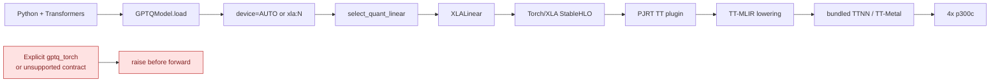
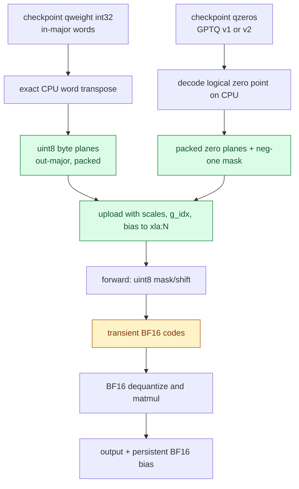
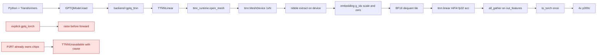
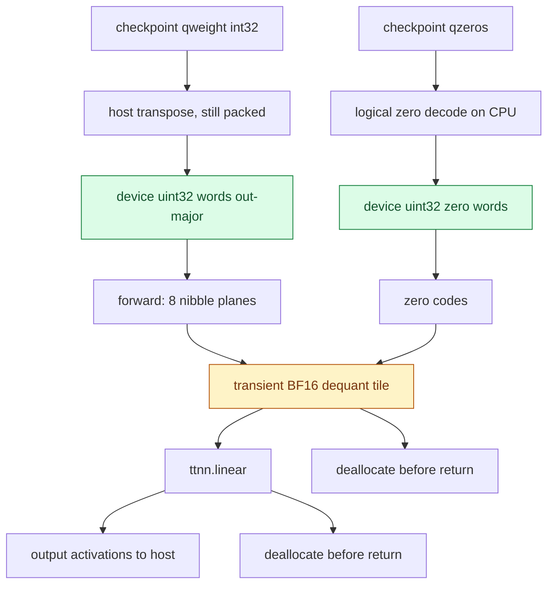
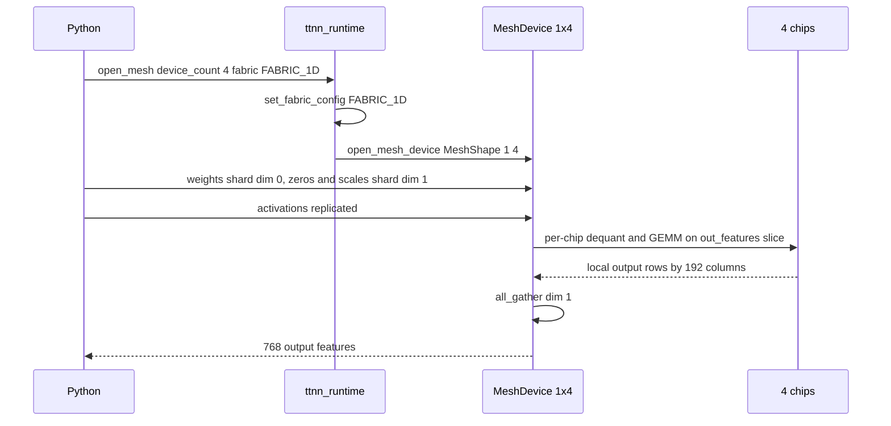
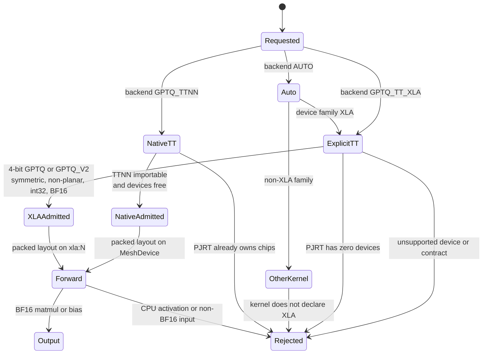

# Tenstorrent GPTQ execution

GPT-QModel uses the Torch/XLA device family for Tenstorrent instead of treating
the cards as CUDA, XPU, or a generic "all devices" fallback. The distinction is
required for both dispatch and correctness: Tenstorrent's current PJRT lowering
does not provide the exact packed-word integer operations used by the portable
Torch GPTQ kernel.

There are two Tenstorrent backends, both validated on four Blackhole p300c
cards:

| Backend | Kernel | Execution path | Reaches TTNN |
| --- | --- | --- | --- |
| `BACKEND.GPTQ_TT_XLA` | `XLALinear` | Python -> Torch/XLA -> StableHLO -> PJRT TT -> TT-MLIR | indirectly, bundled in the PJRT plugin |
| `BACKEND.GPTQ_TTNN` | `TTNNLinear` | Python -> `ttnn.MeshDevice` | directly, no StableHLO or PJRT |

`AUTO` still resolves to `XLALinear` so an existing model load never changes
execution backend silently; the native kernel must be requested explicitly.
Standard CPU PyTorch is used in both cases; no special PyTorch hardware build is
required.

The two backends are mutually exclusive within one process. TT-Metal allows a
single runtime owner per chip, and initializing the PJRT plugin is irreversible,
so a process that has used `XLALinear` cannot then open a `ttnn.MeshDevice`.

## Torch/XLA execution path

The Python model does not send a kernel directly to TT-Metal. PyTorch records
the graph, Torch/XLA converts it to StableHLO, the PJRT TT plugin lowers it
through TT-MLIR, and the bundled TT-Metal runtime issues device programs. For
the current kernel, the matmul itself executes on the card while nibble
expansion and dequantization are expressed as staged device operations.



`AUTO` considers `XLALinear` only when the selector family is `DEVICE.XLA`.
An explicit `BACKEND.GPTQ_TT_XLA` selects the same class and still validates the
device, format, dtype, layout, and shape contract. Lazy device probing means a
library import alone does not deliberately start PJRT or claim cards.

## Packed checkpoint conversion

The checkpoint remains GPTQ words, scales, zeros, and `g_idx` on disk. After
placement, `repack_gptq_for_tt()` builds an output-major packed layout on CPU:
it transposes the still-packed words, writes exact little-endian uint8 byte
planes, and then uploads those planes to the selected `xla:N` card. This avoids
the inexact 32-bit shift path on the device.

Forward expands the packed nibbles only for the active computation. No dense,
dequantized, or expanded weight cache survives the call.



The persistent layout is `weight_bytes[out, in/8, 4]`, plus packed zero planes,
`zero_neg_one`, BF16 scales, `g_idx`, and optional BF16 bias. It is invalidated
when the module is moved, a state dict is loaded, the checkpoint format changes,
or packed tensor versions change. The `_tt_layout` is rebuilt for the new card
after placement.

## Native TTNN execution path

`TTNNLinear` removes StableHLO and PJRT from the inference path. It opens a
`ttnn.MeshDevice` directly and expresses the entire GPTQ contract as TTNN ops,
so nibble extraction, zero-point correction, per-group scaling and the GEMM all
run on the Tensix cores.



### Why native integer ops matter

The Torch/XLA kernel uploads uint8 byte planes because PJRT's 32-bit signed
shift path can mislegalize or drop the high bit. Native TTNN does not have that
limitation: measured on the qualified host, `logical_right_shift` and
`bitwise_and` on `uint32` are bit-exact.

Not every dtype works. TT-Metal rejects bitwise/shift on `uint8` and `uint16`
with `Unsupported input dtype for bitwise/shift ... expected Int32, UInt32, or
UInt16` and `is not supported for binary operation LogicalRightShift`
respectively, so `uint32` is the only usable lane width. The packed words
therefore upload unchanged from the transposed checkpoint.

### Tensor lifecycle

Only packed tensors persist. The dequantized BF16 weight tile is a local
created per forward and deallocated before the call returns.



Measured per OPT-125M `q_proj` (`768x768`, group 128, 4-bit): the persistent
packed words occupy 294,912 bytes versus 1,179,648 bytes for a dense BF16 copy,
a 4x reduction. Retained `scales` and `bias` are the checkpoint's native
metadata, which the storage rule permits.

### GPTQ v1 zero-point correction

`_repack_zero_words` in `gptqmodel/utils/tt_packing.py` normalizes GPTQ v1's
serialized `zero_point - 1` into logical space while the codes are still
packed, because a per-nibble `+1` carry must not bleed into the adjacent field.
`TTNNLinear._logical_zeros` therefore reads the uploaded words as already
logical. Applying the `+1` a second time on device is a real defect that was
caught here: it produced exactly half the correct reconstructed weight
(`max abs err 0.107` instead of `0.0`).

### Tiled dequant cost

Stacking the eight nibble planes on the trailing tile dimension is pathologically
slow because that dimension is not tile-aligned. Stacking on dim 0 and permuting
is equivalent and much cheaper. Measured for `[768, 96]` packed words on
Blackhole p300c:

| Operation | Time |
| --- | --- |
| stack 8 planes on trailing dim | 3.35 ms |
| 4-way stack on trailing dim | 14.46 ms |
| stack 8 planes on dim 0 + permute | 0.03 ms + 0.13 ms |
| full forward, 1 chip | 1.24 ms |

### Math fidelity

TT-Metal defaults to `MathFidelity.LoFi` with `math_approx_mode`. Measured on
real OPT-125M `q_proj` data against an independent FP32 oracle:

| Configuration | Max abs error | PCC |
| --- | --- | --- |
| `LoFi` + `math_approx_mode` (default) | 0.0456 | 0.999979 |
| `HiFi2` + fp32 dest | 0.0238 | 0.999994 |
| `HiFi4` + fp32 dest | 0.0093 | 0.999998 |

`TTNNLinear` pins `HiFi4` with `fp32_dest_acc_en` and `math_approx_mode=False`,
which measured no latency difference at row counts 6, 64 and 128. The residual
is the Tensix FMA floor: storing inputs as `float32` instead of BF16 does not
reduce it (`max abs 0.00164` against float64 with FP32 storage).

## Multi-card mesh networking

The four p300c cards form one fabric domain. TTNN exposes them as
`MeshDevice`, and tensor parallelism shards `out_features` across the mesh:
each chip owns a contiguous slice of output features together with the matching
zero-point and scale columns, so every chip computes an already-correct GEMM
and `all_gather` reassembles the output features.



Operational requirements and measured behavior:

| Item | Finding |
| --- | --- |
| Fabric default | `FabricConfig.DISABLED`; `all_gather` fails with `Trying to get un-initialized fabric context` until `set_fabric_config(FABRIC_1D)` runs *before* the mesh opens |
| Physical mesh shapes | `get_physical_mesh_shapes()` reports `2x2`; both `1x4` and `2x2` open successfully |
| Ethernet links | only one link is discovered between these four cards, so collectives run over that single link |
| Fabric 1D all_gather accuracy | numerically exact (four-times sum matched) |
| 4-chip vs 1-chip output | bit-identical for the same layer |
| 4-chip vs 1-chip latency | 2.0 ms vs 1.24 ms per OPT-125M `q_proj` layer; the collective dominates once dequant is cheap, so width-only sharding is not a decode win at this size |
| `all_gather` on replicated tensors | concatenates along dim 0, so host readback of a replicated tensor returns N copies, not one |

XLA device mapping is separate: `torch_xla` exposes `xla:0` .. `xla:3`, one per
chip, and `XLALinear` places one layer per card with no collective. It does not
use TTNN mesh networking.

## Device family and lazy probing

Before this change, portable kernels declared `DEVICE.ALL`, so Tenstorrent could
be admitted by accident. Their unpack path then used an integer shift that
Tenstorrent currently lowers through f32, which can corrupt high GPTQ nibbles.
The current implementation removes that silent path.

| Old mechanism | New mechanism | Evidence |
| --- | --- | --- |
| `TorchLinear.SUPPORTS_DEVICES = [DEVICE.ALL]` admitted every unknown family | Explicit non-XLA family list; `validate_device()` rejects XLA with guidance | `gptqmodel/nn_modules/qlinear/torch.py:189`, `torch.py:279` |
| Portable unpack accepted XLA | Raises instead of producing approximate codes | `gptqmodel/nn_modules/qlinear/torch.py:95` |
| No XLA family existed | `DEVICE.XLA` is explicit and maps to `xla:N` | `gptqmodel/models/_const.py:56`, `_const.py:74` |
| Device discovery did not distinguish runtime probes from imports | Runtime discovery returns XLA cards; module initialization uses a probe-free selector | `gptqmodel/utils/torch.py:604`, `torch.py:625` |
| `ALL_DEVICES` captured at import time | `all_torch_devices()` performs discovery only on request | `gptqmodel/utils/torch.py:673` |
| No TT kernel backend | `BACKEND.GPTQ_TT_XLA` maps only to `XLALinear` | `gptqmodel/utils/backend.py:26`, `gptqmodel/nn_modules/qlinear/tt_xla.py:41` |

`torch_xla` itself initializes PJRT on import, and an installed `accelerate`
imports it by default during GPT-QModel startup. GPT-QModel does not cache an
import-time device list and does not make its own availability probe at module
scope; callers that require hardware use the explicit XLA path. A host that
must start the process before claiming cards can set `USE_TORCH_XLA=0`, which
disables Accelerate's probe; GPT-QModel then claims devices only when an
explicit XLA operation needs `require_xla_runtime()`.

## GPTQ kernel conversion matrix

`XLALinear` and `TTNNLinear` both declare `DEVICE.XLA`, because Tenstorrent
selection is a device family while the backend chooses the runtime. Every other
GPTQ-capable kernel keeps its declared native family and fails closed on XLA.
This table is the complete registered GPTQ conversion inventory.

| Kernel | Checkpoint formats | Devices and XLA policy |
| --- | --- | --- |
| `AllSparkLinear` | GPTQ, GPTQ_V2 | CUDA, ROCm; reject XLA |
| `BitblasLinear` | BitBLAS, GPTQ, GPTQ_V2 | CUDA; reject XLA |
| `ExllamaV2Linear` | GPTQ, GPTQ_V2 | CUDA; reject XLA |
| `MacheteLinear` | GPTQ | CUDA; reject XLA |
| `MarlinLinear` | GPTQ, GPTQ_V2, Marlin | CUDA; reject XLA |
| `MlxQuantLinear` | GPTQ, GPTQ_V2, GPTQ_P | MPS; reject XLA |
| `SwordfishLinear` | GPTQ | CUDA; reject XLA |
| `XLALinear` | GPTQ, GPTQ_V2 | XLA/Tenstorrent; admitted, AUTO default |
| `TTNNLinear` | GPTQ, GPTQ_V2 | Tenstorrent native TTNN; admitted, explicit only |
| `TorchAtenLinear` | GPTQ, GPTQ_V2 | CPU; reject XLA |
| `TorchCpuAvx512Linear` | GPTQ, GPTQ_V2 | CPU; reject XLA |
| `TorchFusedLinear` | GPTQ, GPTQ_V2 | CPU, XPU; reject XLA |
| `TorchInt8Linear` | GPTQ, GPTQ_V2 | CPU; reject XLA |
| `TorchLinear` | GPTQ, GPTQ_V2, GPTQ_P | CPU, CUDA, ROCm, XPU, NPU, MPS; reject XLA |
| `TritonV2Linear` | GPTQ, GPTQ_V2 | CUDA; reject XLA |
| `W4AFP8Linear` | GPTQ, GPTQ_V2 | CUDA; reject XLA |
| `W4ANVFP4Linear` | GPTQ, GPTQ_V2 | CUDA; reject XLA |

The rejection is an intentional semantic conversion boundary, not a missing
format translation. Moving a packed checkpoint to XLA without its kernel's
layout and arithmetic contract would yield plausible but incorrect output.

## Failure contract



| Situation | Behavior |
| --- | --- |
| Explicit `gptq_torch` on XLA | `NotImplementedError` with native-kernel guidance |
| AUTO on XLA with supported GPTQ | Selects `XLALinear` |
| Other GPTQ-capable kernel requested on XLA | Kernel family validation rejects it |
| FP16 activation or transfer | Rejected; Tenstorrent rounds FP16 to BF16 on transfer |
| Bits other than 4; planar layout; asymmetric zeros; non-int32 words | Rejected before layout construction |
| In/out features not divisible by 8 | Rejected by validation |
| No addressable PJRT devices | `validate_once()` rejects kernel initialization |
| CPU activation sent to `XLALinear.forward()` | `RuntimeError` before any device operation |
| Training or adapters | Not supported |
| Host readback | Call `torch_xla.sync(wait=True)` before observing results |
| Explicit `gptq_ttnn` while PJRT owns the chips | `TTNNUnavailable` naming the conflicting runtime |
| `gptq_ttnn` on a mesh whose size does not divide `out_features` | `NotImplementedError` at layout build |
| `TTNNLinear.forward()` with a non-CPU activation | `RuntimeError`; the kernel performs its own upload |
| `TTNNLinear` with `in_features` or `out_features` not divisible by 8 | Rejected by validation |
| `ttnn` not importable | `TTNNUnavailable` pointing at the pinned requirements file |

## Numerical qualification

Both kernels are measured against an independent Torch oracle that unpacks the
checkpoint, reconstructs weights, and accumulates in FP32 before a single BF16
rounding. Real OPT-125M layer-0 `q_proj` checkpoint data (`768x768`, group 128,
GPTQ v1 with bias) is used for the native kernel.

Measured on `tt-quietbox` 2026-11-10:

| Check | `XLALinear` | `TTNNLinear` 1 chip | `TTNNLinear` 4 chips |
| --- | --- | --- | --- |
| Device dequantized weights vs CPU oracle | bit-identical | bit-identical | bit-identical |
| PCC vs FP32 oracle | 0.999999 | 0.99999875 | 0.99999875 |
| Max absolute error | 0.00135 | 0.01563 | 0.01563 |
| Normalized output error | 0.00056 | 0.00056 | 0.00056 |
| Packed weight retained | yes | yes | yes |
| Expanded BF16 weight cache retained | no | no | no |

The native per-layer figures come from the FP32 oracle above; the `XLALinear`
row is the existing byte-plane path. Absolute error differs because the two
kernels round the output once from different intermediate precisions; the
normalized error, which is the repository's acceptance metric, matches.

The synthetic hardware test (`GPTQMODEL_TEST_TTNN=1`) runs a GPTQ-v1 layer with
bias on both 1 and 4 chips and asserts bit-exact packed-code round trip, PCC
`>= 0.999`, normalized error `<= 2e-3`, bounded BF16 ULP distance on material
magnitudes, and that no dense weight cache survives three forwards.

Because TT-Metal allows one owner per chip, `tests/conftest.py` orders the
native hardware test before the Torch/XLA one when both gates are enabled;
otherwise the second backend cannot open the devices. Both pass in that order
(`23 passed`).

## Install and versions

The pinned environment is in
[`requirements/tenstorrent-py312.txt`](../requirements/tenstorrent-py312.txt)
and can be installed by
[`requirements/install-tenstorrent-py312.sh`](../requirements/install-tenstorrent-py312.sh).
It is deliberately separate from the global package requirements because the
PJRT plugin is available only from Tenstorrent's index and its CPU Torch pin is
older than GPT-QModel's declared runtime floor. The manifest contains the
compatible base GPT-QModel dependencies plus the TT tools. After installing
that complete set, the script installs the local GPT-QModel checkout with
`--no-deps` so pip does not re-resolve and replace the validated Torch ABI.

```bash
PYTHON_BIN="$HOME/.pyenv/versions/3.12.16/bin/python" \
  requirements/install-tenstorrent-py312.sh /path/to/gptqmodel
```

The validated Python pins are listed below. This records installed package
versions; it is not permission to replace GPT-QModel's global requirements.

| Package | Validated pin |
| --- | --- |
| Python | CPython 3.12.16, GIL enabled |
| `torch` | `2.11.0+cpu` |
| `torch-xla` | `2.9.0+gited8a445` |
| `pjrt-plugin-tt` | `1.5.0.dev20260831000501` |
| `jax` / `jaxlib` | `0.7.1` |
| `numpy` | `1.26.4` |
| `accelerate` | `1.15.0` |
| `transformers` | `5.22.2` |
| `safetensors` | `0.8.0` |
| `click` | `8.3.1` |
| `PyYAML` | `6.0.3` |
| `pyluwen` | `0.10.0` |
| `tt-lang` | `1.1.5.dev20260704+light` |
| `tt-smi` | `6.8.1` |
| `tt-flash` | `4.2.0` |
| `tt-topology` | `1.2.20` |
| `tt-umd` | `0.9.17` |
| `tt-tools-common` | `1.6.0` |
| `sfpi` | `7.69.0` |
| `tenstorrent-dkms` | `2.12.0` |
| `tenstorrent-tools` | `1.4.1` |

`python -m pip check` reports known cross-tool conflicts on the qualified host:
`huggingface-hub` prefers Click `>=8.4.2`; `tt-flash` pins PyYAML `6.0.2`; and
`tt-topology` pins pyluwen `~=0.8.5`. The model runtime works with the plugin's
Click `8.3.1` and PyYAML `6.0.3`. If topology or flashing tooling needs a
different ABI, install that maintenance tool in its own environment rather than
mutating the validated inference environment.

`tt-flash` is the firmware/SPI maintenance utility. It does not flash weights
and is not in the inference execution path. Firmware updates are intentionally
outside this change.

## Scope and follow-up

This change implements the following:

- Explicit `DEVICE.XLA` and `BACKEND.GPTQ_TT_XLA` routing.
- Exact packed 4-bit GPTQ and GPTQ-v2 checkpoint conversion.
- Lazy runtime probing and fail-closed non-TT kernel dispatch.
- Real four-card `XLALinear` numerical validation.
- Native `BACKEND.GPTQ_TTNN` / `TTNNLinear` with on-device nibble extraction,
  `g_idx` expansion, BF16 dequantization and `HiFi4` GEMM.
- Tensor-parallel sharding of `out_features` across a `1xN` TTNN mesh with
  `FABRIC_1D` `all_gather`, measured bit-identical to the single-chip result.
- Single-owner mesh lifecycle in `gptqmodel/utils/ttnn_runtime.py`, with
  fail-closed errors when another runtime already owns the chips.

The following remain future work and are not claimed here:

- A hand-written TT-Metal tile kernel that dequantizes into the matmul operand
  inside one program. The current native path issues separate TTNN ops, so the
  dequantized BF16 tile is materialized per forward (transiently, then freed)
  rather than fused into the GEMM. No custom C++ kernel is built here.
- A post-init repacker that writes a TT-native tile ABI directly, avoiding the
  device-side nibble expansion entirely.
- Multi-card model-level tensor parallelism. Only the per-layer sharded GEMM is
  measured; at OPT-125M widths the `all_gather` dominates, so a real decode win
  needs hidden-dimension sharding or larger per-chip tiles.
- `fabric` beyond `FABRIC_1D`, and 2-D mesh sharding with `cluster_axis`.
- On-device GPTQ quantization and calibration.
- Promoting `TTNNLinear` into `AUTO`. It stays explicit-only until model-level
  token parity is measured, matching the standard set by `XLALinear`.

