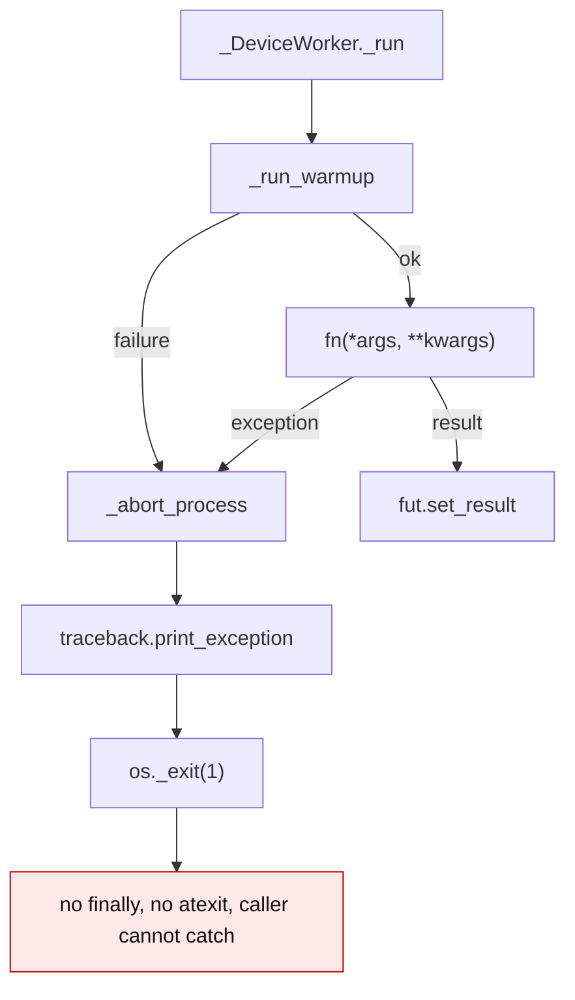
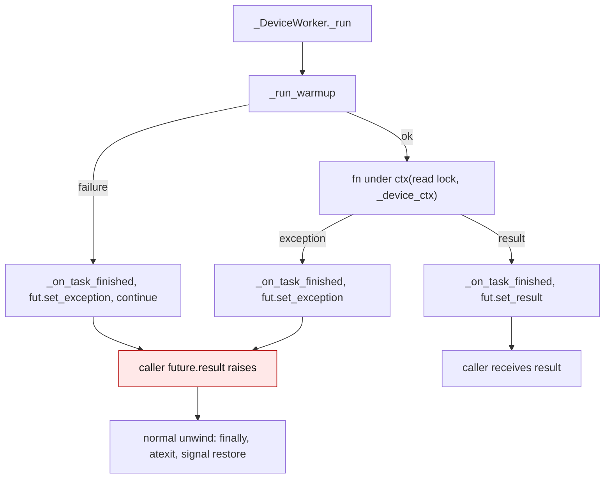
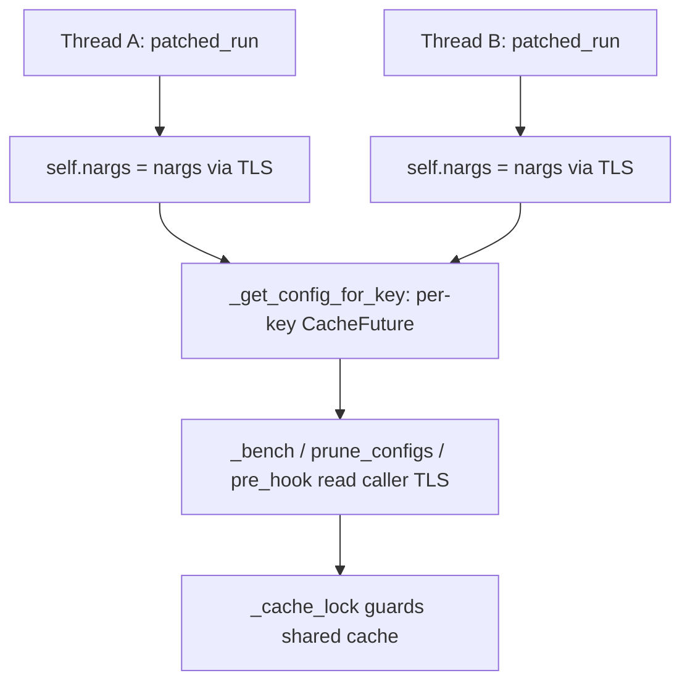

# Device thread pool error propagation

`DeviceThreadPool` runs quantization and inference work on worker threads, one
per device. A task can fail with `torch.OutOfMemoryError`, a validation
`ValueError`, a CUDA error from `event.synchronize()`, or an `OSError` from the
async log writer. The contract is that the failure reaches the caller through
the returned future and the interpreter keeps unwinding normally.

Before this change, `_DeviceWorker._run` called `_abort_process` after setting
the future exception. `_abort_process` printed the traceback and called
`os._exit(1)`, so `finally` blocks, `atexit` handlers (including the pool join
and tempdir cleanup), checkpoint signal restore, and the caller's `try/except`
were all skipped. Whether the caller observed the future first was a race, and
a warmup failure took the same path.

## Old flow

## New flow

The worker keeps running. `_WorkerWarmupState` caches a warmup error, so later
tasks on that worker raise the same exception instead of hanging. There is no
fail-fast mode: a caller that wants to abort after an error can re-raise it
after cleanup. `LoopProcessor.log_save_async` attaches a done-callback that
logs a failed asynchronous write because it does not consume its future.

## Related free-threaded state

The same change makes two other process-wide pieces safe to use from the
worker threads.

### Triton autotuner `nargs`

`Autotuner.nargs` and `Autotuner.best_config` are data descriptors backed by a
per-instance `threading.local()`. `CustomizedTritonAutoTuner` passes `nargs`
explicitly to `_bench`/`prune_configs`, keeps a thread-local `nargs` property,
and guards its cache check-then-set with `_cache_lock`.

### Hessian workspace pool and JIT environment

`gptqmodel.quantization.gptq.release_workspace_cache()` increments
`_WORKSPACE_GENERATION`, then drops `_WORKSPACE_SLOTS`/`_WORKSPACE_CACHE` for
every device key. A lease that is still running sees the generation change and
drops its slot instead of repopulating the pool. `LoopProcessor.finalize()`
calls it with the rest of the run's shared state.

`_merged_cuda_arch_flags()` turns a merged `TORCH_CUDA_ARCH_LIST` into explicit
`-gencode` entries passed through `extra_cuda_cflags`; `_temporary_merged_cuda_arch_override`
is gone. `extension.load(..., verbose=...)` and
`TorchOpsJitExtension.load(verbose=...)` replace the temporary
`GPTQMODEL_EXT_VERBOSE` mutation in the pack-block and floatx loaders.

## Before / after

Line numbers are from the branch base, `origin/main` at `00163850`.

| Path | Before | After |
| --- | --- | --- |
| Task exception | `_abort_process` after `fut.set_exception` (`gptqmodel/utils/threadx.py:556-562`, `570-581`) | exception stays on the future; worker continues (`_DeviceWorker._run`) |
| Warmup failure | `_abort_process` + `return` (`gptqmodel/utils/threadx.py:531-535`) | future fails; `_WorkerWarmupState` caches the error |
| Sync worker | already only set the exception (`_SyncWorker.submit`, `threadx.py:605-627`) | unchanged; both worker kinds now agree |
| Async log writer | fire-and-forget future (`gptqmodel/looper/loop_processor.py:563`) | done-callback logs the exception |
| Triton patch `nargs` | shared `self.nargs` set/reset (`gptqmodel/utils/nogil_patcher.py:257`, `291`) | thread-local descriptor; shared cache keeps `_cache_lock` |
| GGUF autotuner | shared `self.nargs` and unlocked `self.cache` (`gptqmodel/nn_modules/triton_utils/custom_autotune.py:93-123`) | explicit `nargs` argument + TLS property; `_cache_lock` |
| Hessian workspace | module-level slots survive the run (`gptqmodel/quantization/gptq.py:110-111`, `231-289`) | `release_workspace_cache()` called from `LoopProcessor.finalize()` |
| JIT arch override | temporary `TORCH_CUDA_ARCH_LIST` rewrite (`gptqmodel/utils/cpp.py:952-969`, `1911-1914`) | explicit `-gencode` flags in `extra_cuda_cflags` |
| JIT verbosity | temporary `GPTQMODEL_EXT_VERBOSE` (`gptqmodel/utils/cpp.py:2193-2203`, `2229-2237`) | explicit `verbose=` argument |

## Failure contract

| Situation | Result |
| --- | --- |
| Submitted task raises | `future.result()` raises the original exception; pool stays usable |
| Warmup raises | first task's future raises; later tasks raise the cached error |
| Async log write raises | future callback logs it; quantization is not terminated |
| Two threads run one autotuned kernel | each `_bench`/`prune_configs` sees its own `nargs` |
| `release_workspace_cache()` races an active lease | lease drops its slot; the pool stays empty |
| `TORCH_CUDA_ARCH_LIST` is set during a build | environment is unchanged; flags travel in `extra_cuda_cflags` |

Regression coverage lives in `tests/test_threadx_error_propagation.py`,
`tests/test_triton_autotuner_concurrency.py`,
`tests/test_gptq_workspace_release.py`, and the JIT tests in
`tests/test_torch_ops_jit_extension.py`. Issue #3972 introduced this contract.
