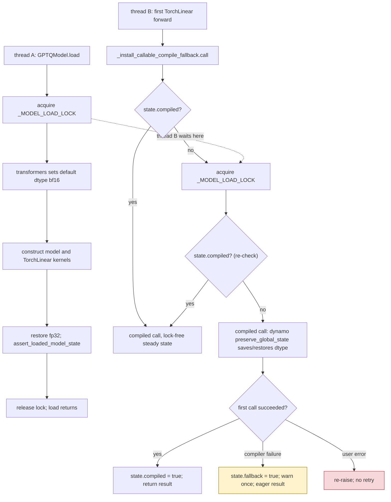
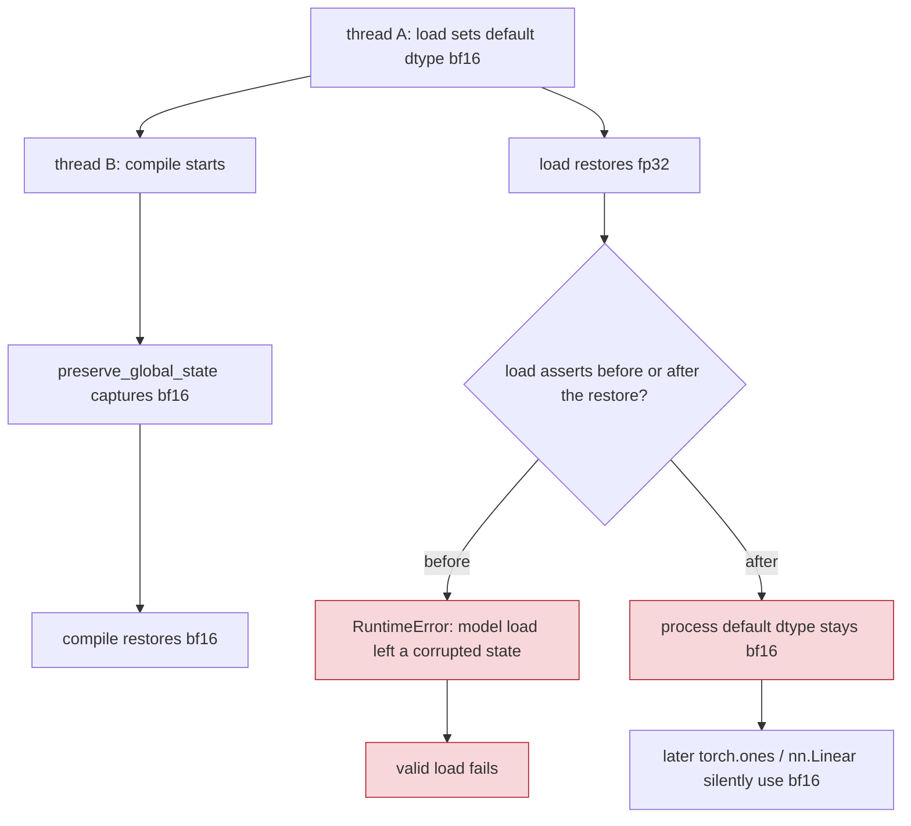
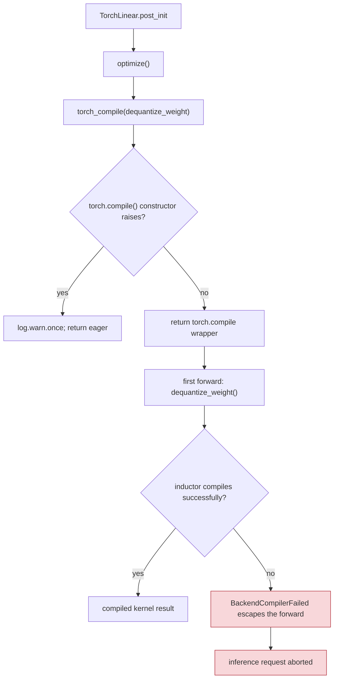
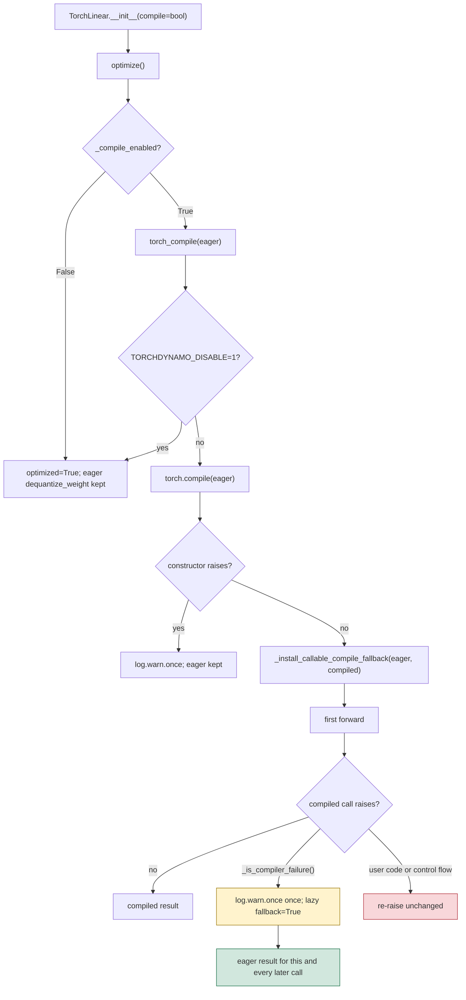

<!-- SPDX-FileCopyrightText: 2026 ModelCloud.ai -->
<!-- SPDX-License-Identifier: Apache-2.0 -->

# Torch compile fallback

Kernel-level compile and graph-capture capability is declared per kernel and
tabulated in [the kernel compile matrix](kernel-compile-matrix.md); this page
covers what happens when a compile fails at runtime.

`TorchLinear.optimize()` compiles its dequantize path by default, and
`BaseQModel.optimize()` compiles the whole model wrapper. Both go through
`gptqmodel.utils.torch.torch_compile`. That helper used to guard only the
`torch.compile(...)` constructor. Inductor does not compile there: it compiles on
the first invocation, after `post_init()` has already returned. A failing
compile worker therefore escaped from a normal forward and aborted the inference
request.

## First-use compile shares the model-load lock (#5127)

Model construction serializes the process-global `torch.set_default_dtype`
through `_MODEL_LOAD_LOCK` (`gptqmodel/models/loader.py:1449`): transformers'
`from_pretrained`/`from_config` saves, sets and restores it. Dynamo's
`preserve_global_state` does the same save/restore around every trace
(`torch/_dynamo/convert_frame.py`), including the lazy first trace of
`TorchLinear.dequantize_weight`. Before this change that trace ran outside the
lock, so a compile could capture a load's bf16 window and restore bf16 after the
load restored fp32, leaving the process default dtype wrong for the rest of the
process; or it could restore bf16 while the load was still asserting its
invariant, failing a valid load.

`model_global_state_lock()` (`gptqmodel/utils/torch.py:432`) resolves the same
re-entrant loader lock. The callable and module compile proxies hold it only
for the first (compiling) invocation; `TorchLinear.optimize()`
(`gptqmodel/nn_modules/qlinear/torch.py:467`) holds it while it constructs the
dynamo wrapper. Once the first call succeeds, `state["compiled"]` is set and
steady-state forwards never take the lock.

The lock is an `RLock` and the loader already holds it during
`TorchLinear.post_init()`, so the nested `optimize()` entry is re-entrant and
cannot deadlock. A compile that is reached from an ordinary forward waits for
the in-flight load instead of mutating the dtype under it.

### Failure path without the lock

| Mechanism | Before | After |
| --- | --- | --- |
| First `TorchLinear` trace vs. load | no shared lock; compile ran from the forward thread while `_MODEL_LOAD_LOCK` was held by a load | `model_global_state_lock()` in `_install_callable_compile_fallback.call` (`utils/torch.py:448`) and `_install_module_compile_fallback.forward` (`utils/torch.py:495`) |
| `optimize()` wrapper construction | unlocked (`nn_modules/qlinear/torch.py:435` at `e2f9676c6`) | lock held around `torch_compile` and the adapter (`nn_modules/qlinear/torch.py:467`) |
| Dynamo-internal lookup failure | `KeyError` from `get_guard_fail_reason` escaped a plain forward | `LookupError` whose innermost frame is under `torch/_dynamo/` is a compiler failure (`utils/torch.py:338`) |
| Steady-state forwards | lock-free | still lock-free: `state["compiled"]` short-circuits the lock |

## Old flow

| Removed mechanism | Location |
| --- | --- |
| Construction-only `try/except` around `torch.compile` | `gptqmodel/utils/torch.py:249-253` (before this change) |
| Error classification limited to "did `torch.compile` raise?" | `gptqmodel/utils/torch.py:249-253` |
| No caller-facing way to disable compilation | `gptqmodel/nn_modules/qlinear/torch.py:327-344` |

## New flow

`_is_compiler_failure()` decides which failures may degrade to eager:

| Exception | Falls back to eager | Reason |
| --- | --- | --- |
| `torch._dynamo.exc.BackendCompilerFailed` | yes | Inductor/backend failed; includes `RuntimeError: Attempting to use a closed pool` |
| `torch._dynamo.exc.TorchRuntimeError` | yes | A backend runtime failure wrapped by dynamo |
| other `TorchDynamoException` (e.g. `Unsupported`) | only when `fullgraph=False` | A capture failure is soft unless the caller demanded one graph |
| any exception under `fullgraph=True` | no | The single-graph contract must fail closed |
| `RuntimeError` whose innermost frame is inside `torch/_dynamo/`, `torch/_inductor/`, or `torch/_functorch/` | yes | Compile workers raise outside the traced frame |
| `LookupError` (`KeyError`/`IndexError`) whose innermost frame is inside those packages | yes | Dynamo's guard bookkeeping raises `KeyError` from `get_guard_fail_reason` when a concurrent compile changes global state (#5127) |
| `RuntimeError` from traced user code | no | Its innermost frame is the user body; retrying would run it twice and hide the real error |
| `ValueError` / `TypeError` from traced user code | no | Not a compiler failure |
| `KeyboardInterrupt` / `SystemExit` | no | Control flow must always propagate |

Dynamo's `eval_frame.compile_wrapper` frame sits between the caller and the
traced body, so "the traceback contains a compiler frame" would also match user
code raising `RuntimeError`. Only the innermost frame identifies the origin.

The fallback is armed lazily and permanently: the first compiler failure drops
the compiled callable, logs once, and runs `dequantize_weight` / the module
forward eagerly. Later calls never re-enter the broken compiler.

`BaseQModel.optimize()` compiles the model's `forward` in place rather than
replacing `self.model`, because `generate()` calls the original module's
`generate` and would otherwise never enter the compiled wrapper (#4669). The
compiled proxy keeps `self.model` an `nn.Module`; when `torch.compile` returns
an unusable object the eager forward is kept and the replacement is reported
once instead of being stored where a callable is required.

## Opting out

| Control | Scope | Notes |
| --- | --- | --- |
| `TorchLinear(..., compile=False)` | one kernel | Skips `torch.compile`; the module is still marked `optimized` so no later `optimize()` retries it |
| `QuantizeConfig(compile=False)` | every kernel built from that config | Propagated through `quant_linear_init_kwargs()`; runtime-only and never serialized into a checkpoint |
| `TORCHDYNAMO_DISABLE=1` | the whole process | PyTorch's own kill switch; `torch_compile` returns the eager callable without importing dynamo |

`compile` is deliberately not persisted. A checkpoint compiled on one host can
be unusable on another (a dead inductor worker pool, a different Triton
toolchain), so the loading host decides.

## Tests

`tests/test_torch_compile_fallback.py` pins the contract: a first-call
`BackendCompilerFailed` yields the eager result and is not retried, a
dynamo-internal `KeyError` falls back to eager, user-code and control-flow
exceptions still propagate, `fullgraph=True` still fails closed, a compiled
module falls back to its own `forward` and stays an `nn.Module`, `compile=False`
skips compilation, and the config field stays runtime-only.
`tests/test_model_load_lock_4204.py` pins the cross-thread invariant: a load is
held in its bf16 window while another thread performs the first `TorchLinear`
forward, and the process default dtype must still be float32 afterwards.
