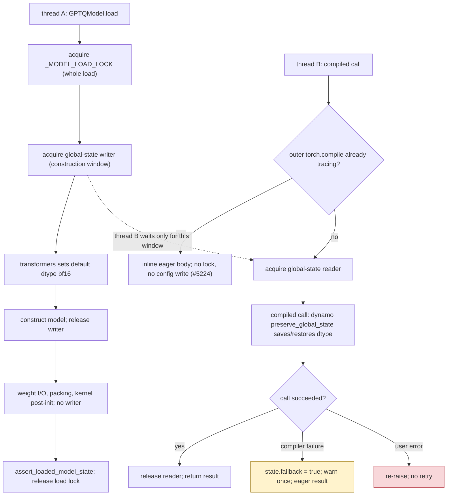
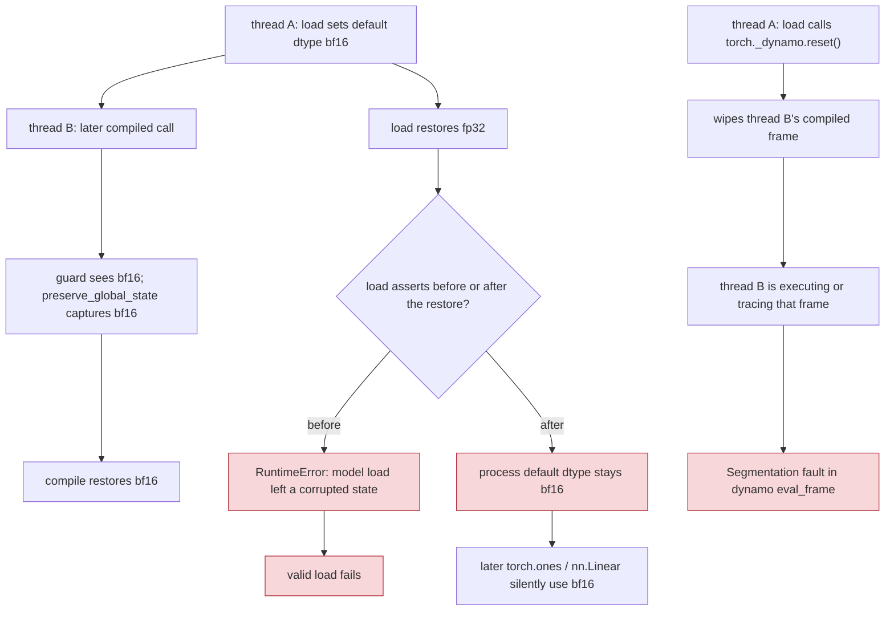
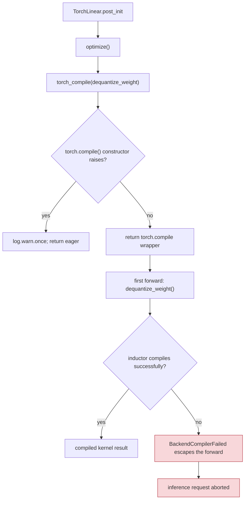
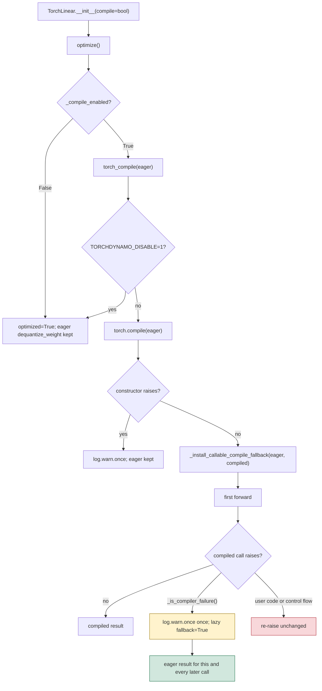

<!-- SPDX-FileCopyrightText: 2026 ModelCloud.ai -->
<!-- SPDX-License-Identifier: Apache-2.0 -->

# Torch compile fallback

Kernel-level compile and graph-capture capability is declared per kernel and
tabulated in [the kernel compile matrix](kernel-compile-matrix.md); this page
covers what happens when a compile fails at runtime.

`TorchLinear.optimize()` compiles its dequantize path by default, and
`BaseQModel.optimize()` compiles the whole model wrapper. Both go through
`gptqmodel.utils.torch.torch_compile`. That helper used to guard only the
`torch.compile(...)` constructor. Inductor does not compile there: it compiles on
the first invocation, after `post_init()` has already returned. A failing
compile worker therefore escaped from a normal forward and aborted the inference
request.

## Compiled calls share the global-state lock (#5127, #5209, #5268)

Model construction saves, sets and restores the process-global
`torch.set_default_dtype` (transformers' `local_torch_dtype`, called from
`from_pretrained`/`from_config`). Dynamo's `preserve_global_state` does the same
save/restore around every trace (`torch/_dynamo/convert_frame.py`), and its
`GLOBAL_STATE` guard re-reads the default dtype on every compiled call. Before
#5159 the lazy first trace of `TorchLinear.dequantize_weight` ran outside the
lock, so a compile could capture a load's bf16 window and restore bf16 after the
load restored fp32, leaving the process default dtype wrong for the rest of the
process; or it could restore bf16 while the load was still asserting its
invariant, failing a valid load.

#5159 held `_MODEL_LOAD_LOCK` only for the first invocation. Every later call
still ran lock-free, and a later call re-enters dynamo tracing whenever a guard
changes -- a load's bf16 window is exactly such a change. Two failures followed
(#5209):

- `from_quantized` also called `torch._dynamo.reset()` on every load. That wipes
  every compiled frame in the process, including another model's `optimize()`d
  forward and the caller's own `torch.compile` functions, while their threads
  may be running them. On a GIL build that segfaults inside dynamo's frame
  evaluation.
- Without the reset, the later call re-traced inside the bf16 window and
  restored bf16 after the load restored fp32 (the #5127 failure again), or the
  load failed its own `assert_loaded_model_state` invariant.

#5251 then made every compiled call hold `_MODEL_LOAD_LOCK`, the lock a load
holds for its whole body. That is correct but serializes every compiled forward
in the process and stalls each one for the full duration of any concurrent load
or save (#5268).

The fix splits the two concerns:

- `_MODEL_GLOBAL_STATE_LOCK` (`gptqmodel/models/loader.py`) is a process-global
  reader/writer lock. `model_global_state_lock()`
  (`gptqmodel/utils/torch.py`) resolves it.
- A compiled call takes the **reader** side for the duration of the call
  (`_install_callable_compile_fallback.call`,
  `_install_module_compile_fallback.forward`). Readers run concurrently, so
  compiled forwards from different threads and models overlap.
- Every transformers construction site takes the **writer** side for the
  construction call only: `from_pretrained`, `from_quantized`'s `from_config`,
  the offload shell (`build_shell_model`), the save-side shell rebuild, the
  compressed-tensors dequant path, the TT block-float path and the norm-tuning
  teacher. Weight I/O, repacking and kernel post-init stay outside it.
- `TorchLinear.optimize()` (`gptqmodel/nn_modules/qlinear/torch.py`) takes the
  writer while it installs the dynamo wrapper (dynamo config and wrapper
  construction).
- `from_quantized` still never calls `torch._dynamo.reset()`.

The writer is re-entrant for its owning thread, so a load may run compiled code
(e.g. `TorchLinear.post_init` during a load) without deadlocking, and a nested
compiled call is re-entrant on the reader side.

Concurrent compiled forwards take the reader together and are not serialized; a
compiled forward waits only while a construction holds the writer. The
steady-state cost is one uncontended reader acquire (a mutex-protected counter)
per compiled call, not the loader's re-entrant lock.

### Failure paths without the shared lock

| Mechanism | Before | After |
| --- | --- | --- |
| Compiled call vs. construction | #5251 held `_MODEL_LOAD_LOCK` for every call, serializing all compiled forwards and stalling them for a whole load (#5268) | shared reader on `_MODEL_GLOBAL_STATE_LOCK`; only a construction's writer excludes it |
| Load-vs-load | `_MODEL_LOAD_LOCK` for the whole load | unchanged: `_MODEL_LOAD_LOCK` for the whole load |
| Default-dtype window | held under the load lock; a lock-free re-trace could capture bf16 (#5209) | writer around the construction call only |
| `from_quantized` dynamo reset | unconditional `torch._dynamo.reset()` discarded every other model's compiled frames and crashed a concurrent forward (#5209) | no reset; a load never discards another model's frames |
| `optimize()` wrapper construction | `_MODEL_LOAD_LOCK` (`nn_modules/qlinear/torch.py:472`) | global-state writer around `torch_compile` and the adapter |
| Dynamo-internal lookup failure | `KeyError` from `get_guard_fail_reason` escaped a plain forward | `LookupError` whose innermost frame is under `torch/_dynamo/` is a compiler failure (`utils/torch.py:338`) |
| Steady-state forwards | one uncontended `RLock` acquire per compiled call, but serialized across threads | one uncontended reader acquire per compiled call; forwards overlap |

## Old flow

| Removed mechanism | Location |
| --- | --- |
| Construction-only `try/except` around `torch.compile` | `gptqmodel/utils/torch.py:249-253` (before this change) |
| Error classification limited to "did `torch.compile` raise?" | `gptqmodel/utils/torch.py:249-253` |
| No caller-facing way to disable compilation | `gptqmodel/nn_modules/qlinear/torch.py:327-344` |

## New flow

`_is_compiler_failure()` decides which failures may degrade to eager:

| Exception | Falls back to eager | Reason |
| --- | --- | --- |
| `torch._dynamo.exc.BackendCompilerFailed` | yes | Inductor/backend failed; includes `RuntimeError: Attempting to use a closed pool` |
| `torch._dynamo.exc.TorchRuntimeError` | yes | A backend runtime failure wrapped by dynamo |
| other `TorchDynamoException` (e.g. `Unsupported`) | only when `fullgraph=False` | A capture failure is soft unless the caller demanded one graph |
| any exception under `fullgraph=True` | no | The single-graph contract must fail closed |
| `RuntimeError` whose innermost frame is inside `torch/_dynamo/`, `torch/_inductor/`, or `torch/_functorch/` | yes | Compile workers raise outside the traced frame |
| `LookupError` (`KeyError`/`IndexError`) whose innermost frame is inside those packages | yes | Dynamo's guard bookkeeping raises `KeyError` from `get_guard_fail_reason` when a concurrent compile changes global state (#5127) |
| `RuntimeError` from traced user code | no | Its innermost frame is the user body; retrying would run it twice and hide the real error |
| `ValueError` / `TypeError` from traced user code | no | Not a compiler failure |
| `KeyboardInterrupt` / `SystemExit` | no | Control flow must always propagate |

Dynamo's `eval_frame.compile_wrapper` frame sits between the caller and the
traced body, so "the traceback contains a compiler frame" would also match user
code raising `RuntimeError`. Only the innermost frame identifies the origin.

The fallback is armed lazily and permanently: the first compiler failure drops
the compiled callable, logs once, and runs `dequantize_weight` / the module
forward eagerly. Later calls never re-enter the broken compiler.

`BaseQModel.optimize()` compiles the model's `forward` in place rather than
replacing `self.model`, because `generate()` calls the original module's
`generate` and would otherwise never enter the compiled wrapper (#4669). The
compiled proxy keeps `self.model` an `nn.Module`; when `torch.compile` returns
an unusable object the eager forward is kept and the replacement is reported
once instead of being stored where a callable is required.

## Opting out

| Control | Scope | Notes |
| --- | --- | --- |
| `TorchLinear(..., compile=False)` | one kernel | Skips `torch.compile`; the module is still marked `optimized` so no later `optimize()` retries it |
| `QuantizeConfig(compile=False)` | every kernel built from that config | Propagated through `quant_linear_init_kwargs()`; runtime-only and never serialized into a checkpoint |
| `TORCHDYNAMO_DISABLE=1` | the whole process | PyTorch's own kill switch; `torch_compile` returns the eager callable without importing dynamo |

`compile` is deliberately not persisted. A checkpoint compiled on one host can
be unusable on another (a dead inductor worker pool, a different Triton
toolchain), so the loading host decides.

## Tests

`tests/test_torch_compile_fallback.py` pins the contract: a first-call
`BackendCompilerFailed` yields the eager result and is not retried, a
dynamo-internal `KeyError` falls back to eager, user-code and control-flow
exceptions still propagate, `fullgraph=True` still fails closed, a compiled
module falls back to its own `forward` and stays an `nn.Module`, `compile=False`
skips compilation, and the config field stays runtime-only.
`tests/test_model_load_lock_4204.py` pins the cross-thread invariant: a load is
held in its bf16 window while another thread performs the first `TorchLinear`
forward, and the process default dtype must still be float32 afterwards.
`tests/test_compile_load_race_5209.py` pins the #5209 contract (no dynamo reset,
a re-trace waits for the dtype window, repeated concurrent loads keep dtype and
logits). `tests/test_compile_lock_scope_5268.py` pins the #5268 contract: two
warm compiled forwards reach a barrier together, a compiled forward does not
wait for `_MODEL_LOAD_LOCK`, and the global-state lock shares readers while
excluding them from a writer.
