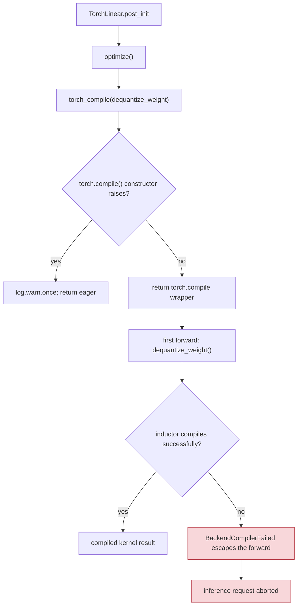
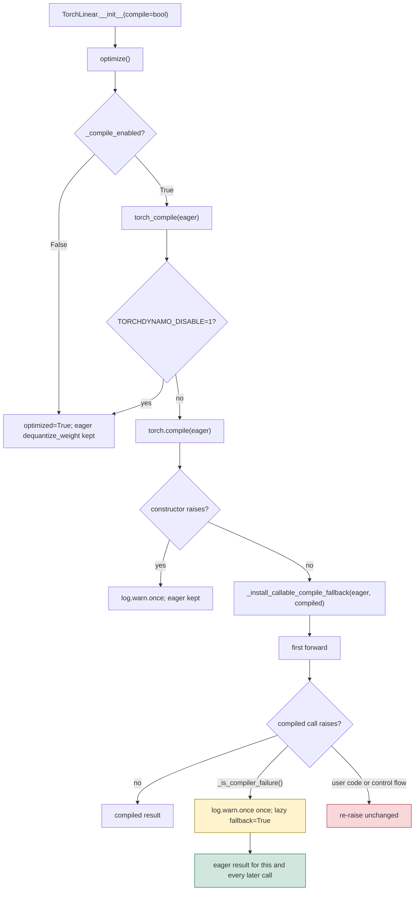
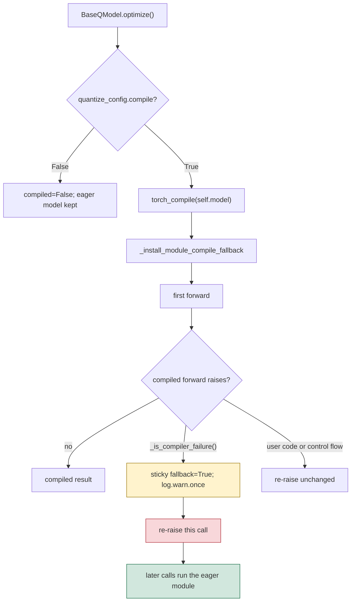

<!-- SPDX-FileCopyrightText: 2026 ModelCloud.ai -->
<!-- SPDX-License-Identifier: Apache-2.0 -->

# Torch compile fallback

`TorchLinear.optimize()` compiles its dequantize path by default, and
`BaseQModel.optimize()` compiles the whole model wrapper. Both go through
`gptqmodel.utils.torch.torch_compile`. That helper used to guard only the
`torch.compile(...)` constructor. Inductor does not compile there: it compiles on
the first invocation, after `post_init()` has already returned. A failing
compile worker therefore escaped from a normal forward and aborted the inference
request.

## Old flow

| Removed mechanism | Location |
| --- | --- |
| Construction-only `try/except` around `torch.compile` | `gptqmodel/utils/torch.py:249-253` (before this change) |
| Error classification limited to "did `torch.compile` raise?" | `gptqmodel/utils/torch.py:249-253` |
| No caller-facing way to disable compilation | `gptqmodel/nn_modules/qlinear/torch.py:327-344` |

## New flow

`_is_compiler_failure()` decides which failures may degrade to eager:

| Exception | Falls back to eager | Reason |
| --- | --- | --- |
| `torch._dynamo.exc.BackendCompilerFailed` | yes, unless `fullgraph=True` | Inductor/backend failed; includes `RuntimeError: Attempting to use a closed pool` |
| `torch._dynamo.exc.TorchRuntimeError` | yes, unless `fullgraph=True` | A backend runtime failure wrapped by dynamo |
| other `TorchDynamoException` (e.g. `Unsupported`) | only when `fullgraph=False` | A capture failure is soft unless the caller demanded one graph |
| any exception under `fullgraph=True` | no | The single-graph contract must fail closed |
| `RuntimeError` whose innermost frame is inside `torch/_dynamo/`, `torch/_inductor/`, or `torch/_functorch/` | yes | Compile workers raise outside the traced frame |
| `RuntimeError` from traced user code | no | Its innermost frame is the user body; retrying would run it twice and hide the real error |
| `ValueError` / `TypeError` from traced user code | no | Not a compiler failure |
| `KeyboardInterrupt` / `SystemExit` | no | Control flow must always propagate |

Dynamo's `eval_frame.compile_wrapper` frame sits between the caller and the
traced body, so "the traceback contains a compiler frame" would also match user
code raising `RuntimeError`. Only the innermost frame identifies the origin.

The fallback is armed lazily and permanently: the first compiler failure logs
once and stops calling the compiled callable, and later calls go straight to
`dequantize_weight`. The compiled reference is still held by the wrapper, so
this is a call-time switch, not a release.

`BaseQModel.optimize()` assigns the result to `self.model`, so a module input
must stay an `nn.Module`. When `torch.compile` returns anything else, the eager
module is kept and the unusable replacement is reported once instead of being
stored where a child module is required.

### Module forwards are not retried

With `fullgraph=False` dynamo compiles and runs one graph segment at a time, so
an earlier segment of the same forward may already have executed (KV-cache
writes, in-place ops, RNG). Retrying the module would apply those effects twice,
so the failing call surfaces and only later calls use the eager module. The
callable path keeps its retry because `dequantize_weight` and the other wrapped
decode functions are pure: recomputing them changes nothing that survives the
call.

## Opting out

| Control | Scope | Notes |
| --- | --- | --- |
| `TorchLinear(..., compile=False)` | one kernel | Skips `torch.compile`; the module is still marked `optimized` so no later `optimize()` retries it |
| `QuantizeConfig(compile=False)` | `GPTQModel.optimize()` and every `TorchLinear` built from that config | Stops the whole-model compile and is propagated through `quant_linear_init_kwargs()`; runtime-only and never serialized into a checkpoint |
| `TORCHDYNAMO_DISABLE=1` | the whole process | PyTorch's own kill switch; `torch_compile` returns the eager callable without importing dynamo |

`compile` is deliberately not persisted. A checkpoint compiled on one host can
be unusable on another (a dead inductor worker pool, a different Triton
toolchain), so the loading host decides.

Method-specific configs (`ParoConfig`, `VPTQConfig`, `NF12ADConfig`, the FP8 and
bitsandbytes configs) override `quant_linear_init_kwargs()` and do not carry
`compile`, so their kernels still compile on their own `optimize()` path. Use
`TORCHDYNAMO_DISABLE=1` when those methods must stay eager.

## Tests

`tests/test_torch_compile_fallback.py` pins the contract: a first-call
`BackendCompilerFailed` yields the eager result and is not retried, user-code and
control-flow exceptions still propagate, `fullgraph=True` still fails closed, a
compiled module falls back to its own `forward` and stays an `nn.Module`,
`compile=False` skips compilation, and the config field stays runtime-only.
