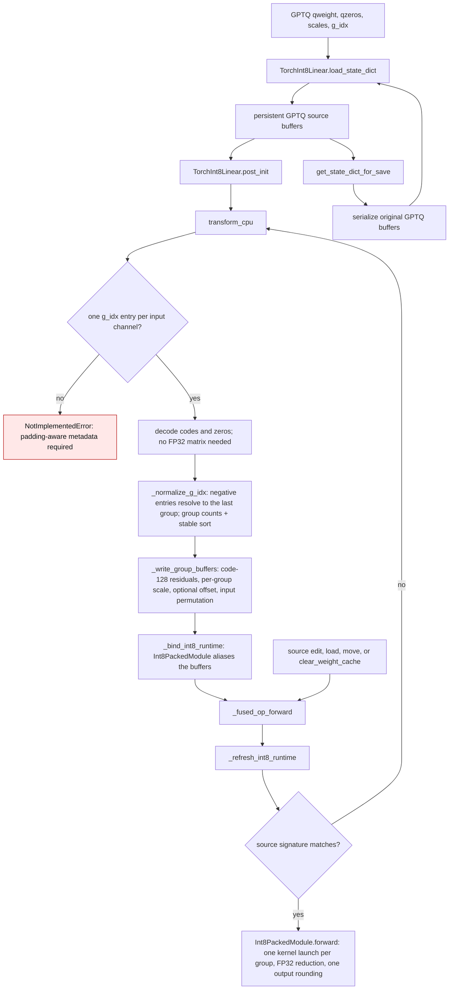

# Torch INT8 checkpoint lifecycle and group-preserving layout

`TorchInt8Linear` accepts an 8-bit GPTQ checkpoint. Its persistent source is
`qweight`, `qzeros`, `scales`, and `g_idx` (plus optional `bias`). The CPU INT8
runtime is a derived, non-persistent layout. The source cannot be discarded
after `post_init`: GPT-QModel's save writer collects persistent buffers and must
reproduce the original GPTQ checkpoint.

## The problem with one scale per output channel

The original CPU INT8 kernel re-quantized the decoded checkpoint matrix to a
single symmetric scale per output channel:

```
channel_scale[n] = max_k |W[k, n]| / 127
code[k, n]       = round(W[k, n] / channel_scale[n])
```

A GPTQ checkpoint is **group-quantized**: `scales[g_idx[k], n]` may legitimately
differ by orders of magnitude across the groups that touch one output channel.
A per-channel scale must cover the largest group, so every code in a smaller
group truncates toward zero. When two groups differ by 1024x, the whole small
group rounds to `0` and its contribution to the matmul disappears.

Measured on `model.layers.0.mlp.gate_proj` of an 8-bit Qwen2.5-0.5B GPTQ
checkpoint (group 128, 7 groups): the per-channel requantization changed the
weight matrix by **7.9e-3** relative, while the group-preserving layout below is
**bit-exact** against the checkpoint decode. The kernel's own arithmetic error
against the fp64 checkpoint decode is `2.1e-4` — the same as `BACKEND.TORCH`.

## The new flow



| Mechanism | Before | After |
| --- | --- | --- |
| Runtime numerics | Per-output-channel symmetric requantization of the decoded matrix (`_requantize_to_int8`) | The checkpoint's own `code` and per-group `scales`, repacked without re-quantizing |
| Buffer names | `int8_weight_nk` `[N, K]`, `int8_channel_scale` `[N]` | `int8_weight_gnk` `[G, N, W]`, `int8_group_scale` `[G, N]`, optional `int8_group_offset` `[G, N]`, `int8_input_perm` `[K]` |
| Zero points | Folded into the per-channel scale by construction | Stored as the signed residual `code - 128`; an asymmetric checkpoint keeps a per-group additive offset, symmetric checkpoints store none |
| Activation order | Input order | Channels are sorted into group order once (`int8_input_perm`); the executor permutes activations, which is exact for integer-coded dot products |
| Ragged last group | Not representable | Padded to the widest group and executed with zero pad columns |
| Matmul | One `aten::_weight_int8pack_mm` call | One call per group, FP32 accumulation, one output rounding and one bias epilogue |
| Fusion | Concatenated `[N, K]` codes on the output axis | Concatenated `[G, N, W]` codes and `[G, N]` metadata on the output axis; sources must share `int8_input_perm` |

The runtime is still **8-bit codes plus group scales**, not an expanded
lower-bit weight cache: nothing denser than the checkpoint is retained.
`Int8PackedModule` aliases the runtime buffers, and no dense weight survives a
conversion or a forward. Normal tensor version counters detect edits; writes to
inference tensors without a version counter require `clear_weight_cache()`
before the next forward.

`FusionKernelSpec` concatenates the group-preserving codes for its executor.
Source leaves retain their original GPTQ checkpoint buffers. The fused executor
uses its concatenated runtime codes; a direct leaf forward rebuilds from that
leaf's source only when its source signature changed.

## Measured CPU fixture

For a 512-input, 64-output 8-bit GPTQ layer with group size 128 (4 groups) and
no bias:

| Storage | Bytes after `post_init` |
| --- | ---: |
| Original GPTQ checkpoint buffers | 35,584 |
| Group-preserving runtime codes, scales, and permutation | 37,888 |
| Previous per-channel runtime codes and scales | 33,024 |
| Dense weight cache | 0 |

The `+4,864` bytes are the per-group `scales` rows (`[4, 64]` instead of
`[64]`) plus the `int64` input permutation; the `int8` code count is unchanged.
A 512-by-64 FP32 dequantized conversion matrix is 131,072 transient bytes and is
no longer materialized during `transform_cpu`.

Inference accuracy against an independent fp64 decode of the same checkpoint on
this fixture: relative error `2.1e-4`; the per-channel layout was `7.4e-3`.
FP16/BF16 visible outputs match the fp64 oracle inside the `2e-3` inference gate.

## Contract limits

- Exactly one `g_idx` entry per input channel is required. Checkpoints whose
  packed words carry zero-filled tail codes are truncated to `in_features`; a
  mismatch raises instead of silently mis-indexing groups.
- Negative `g_idx` entries are the packer's padding marker and resolve to the
  last group, matching `pack_block`. The group counts and the channel
  permutation use the same normalized value; the dequantized export gathers
  each group's exact rows, so empty and ragged groups keep their own bounds.
- 8-bit sources only. Expanding a 2/4-bit checkpoint into persistent INT8
  remains rejected by `_require_native_int8`.
- The activation-order permutation must be identical across fused siblings;
  otherwise the projections are not fused.
