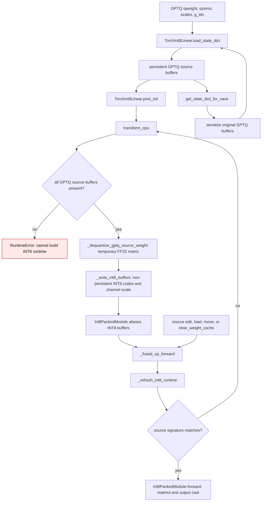

# Torch INT8 checkpoint lifecycle

`TorchInt8Linear` accepts an 8-bit GPTQ checkpoint. Its persistent source is
`qweight`, `qzeros`, `scales`, and `g_idx` (plus optional `bias`). The CPU INT8
matrix and per-channel scale are a derived, non-persistent runtime layout.
The source cannot be discarded after `post_init`: GPT-QModel's save writer
collects persistent buffers and must reproduce the original GPTQ checkpoint.

| Mechanism | Before | After |
| --- | --- | --- |
| Checkpoint ownership | `gptqmodel/nn_modules/qlinear/torch_int8.py:177-185` deleted all four GPTQ buffers after conversion | `post_init` keeps the original packed checkpoint buffers; the derived INT8 buffers remain non-persistent |
| Save | `gptqmodel/utils/model.py:2357` collected only persistent buffers, so the quantized layer contributed no weights | The same writer collects `qweight`, `qzeros`, `scales`, and `g_idx`, with optional bias |
| Source updates | The runtime INT8 layout had no source to rebuild from after `post_init` | `_source_signature`, `_refresh_int8_runtime`, and `clear_weight_cache` rebuild from the current GPTQ buffers after mutation, replacement, state load, or move |
| Fusion | `FusionKernelSpec` bound native INT8 views without a source signature | `prepare` refreshes each leaf, while `rebind` records its current source signature and preserves the shared INT8 views |

The source and runtime weights both use **8-bit codes**; the runtime copy is a
requantization to a per-channel native INT8 layout, not an expanded lower-bit
weight cache. `Int8PackedModule` aliases the runtime buffers. No dense weight
is retained after conversion or a forward. `transform_cpu` creates temporary
full-matrix decode and requantization intermediates and releases them before
returning. Normal tensor
version counters detect edits; writes to inference tensors without a version
counter require `clear_weight_cache()` before the next forward.

`FusionKernelSpec` concatenates native INT8 codes for its executor. Source
leaves retain their original GPTQ checkpoint buffers. The fused executor uses
its concatenated runtime codes; a direct leaf forward rebuilds from that leaf's
source only when its source signature changed.

## Measured CPU fixture

For a 512-input, 64-output 8-bit GPTQ layer with group size 32 and no bias:

| Storage | Bytes after `post_init` |
| --- | ---: |
| Original GPTQ checkpoint buffers | 37,888 |
| Native INT8 codes and channel scales | 33,024 |
| Unique retained buffers, including the aliased `Int8PackedModule` | 70,912 |
| Dense weight cache | 0 |

A 512-by-64 FP32 dequantized conversion matrix is 131,072 transient bytes;
other decode/requantization intermediates also exist, and total temporary peak
was not measured. With one CPU thread, 30 warmups, then the median of five
200-forward batches on a 7-by-512 FP32 input was 0.171859 ms on main and
0.177204 ms with checkpoint preservation. The prior checkpoint had zero saved
weight bytes. FP16/BF16 visible outputs matched an independent INT8 oracle
exactly; FP32 maximum absolute error was 9.537e-7 in this fixture.
