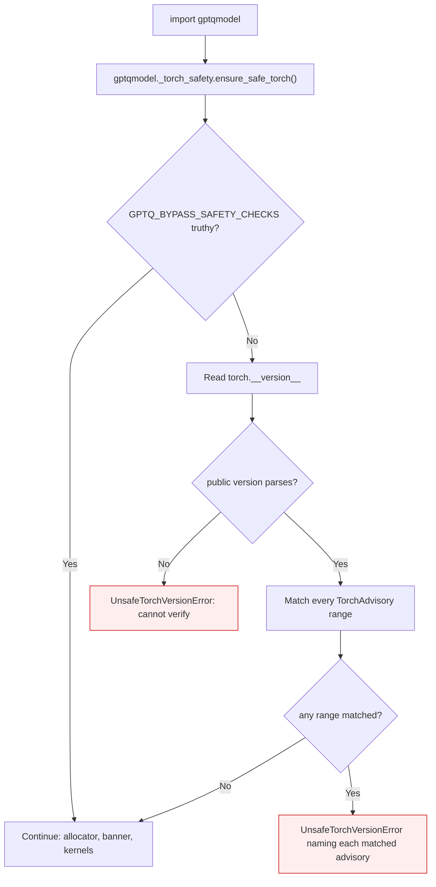

<!-- SPDX-FileCopyrightText: 2026 ModelCloud.ai -->
<!-- SPDX-License-Identifier: Apache-2.0 -->

# PyTorch runtime safety gate

GPT-QModel loads checkpoints and executes kernels through whichever PyTorch it
is imported against. A PyTorch release covered by an advisory on that surface is
therefore not a supported runtime: continuing would turn a dependency problem
into silent corruption or data disclosure. The gate below runs before the CUDA
allocator is initialized, before a device is opened, and before any checkpoint
is read.

## Affected ranges

| Advisory | Component | Affected | Patched |
| --- | --- | --- | --- |
| [GHSA-rrmf-rvhw-rf47](https://github.com/advisories/GHSA-rrmf-rvhw-rf47) (CVE-2025-3000) | `torch.jit.script` memory corruption | `<= 2.12.1` | `2.13.0` |
| [GHSA-v32g-mr63-3j83](https://github.com/pytorch/pytorch/security/advisories/GHSA-v32g-mr63-3j83) | `torch.load(weights_only=True)` arbitrary file read | `>= 2.14.0, < 2.15.0` | `2.15.0` |

The two advisories are published in different GitHub databases, so their working
links differ: `GHSA-rrmf-rvhw-rf47` is in the global Advisory Database, while
`GHSA-v32g-mr63-3j83` is a `pytorch/pytorch` repository advisory with no global
entry. Each URL above resolves; the opposite form of either one returns 404.

The second advisory has no CVE assigned, so the gate names only its GHSA id.

## Supported releases

```text
2.13.x  or  >= 2.15.0
```

That set is the complement of the table, not a single floor. The ranges do not
form a prefix — `torch.jit.script` is fixed in 2.13.0, while the `weights_only`
defect is introduced in 2.14.0 and fixed in 2.15.0 — so a single `>= 2.13.0`
bound would clear the vulnerable 2.14.x line. `safe_torch_releases_hint()`
derives the text above from `TORCH_ADVISORIES`, so it cannot drift from the
table.

## Flow



`ensure_safe_torch()` is the first statement in `gptqmodel/__init__.py`, before
`apply_default_alloc_conf()` and `gptqmodel.rocm_llc`. Both of those import
Torch state that cannot be undone, so a late check would already have initialized
the runtime it is meant to reject. The implementation lives in the standalone
module `gptqmodel/_torch_safety.py` because importing `gptqmodel.utils` is
itself the side effect being guarded against; `gptqmodel.utils.security`
re-exports the same names for ordinary callers.

## Previous behavior

Before the range table, one bound answered the question for the whole policy
(`gptqmodel/_torch_safety.py:80`, `current <= Version(LAST_VULNERABLE_TORCH_VERSION)`).

| Mechanism | Before | After |
| --- | --- | --- |
| Decision input | One `LAST_VULNERABLE_TORCH_VERSION` constant | `TORCH_ADVISORIES`, one record per advisory |
| 2.14.0 / 2.14.1 | Accepted (above the 2.12.1 bound) | Rejected by `GHSA-v32g-mr63-3j83` |
| 2.13.0 | Accepted | Accepted (between the two ranges) |
| 2.15.0 | Accepted | Accepted (past the second patch) |
| Error text | Always named the `torch.jit.script` advisory | Names the advisory whose range matched |
| Safe-version hint | `>= 2.13.0` | Derived complement, `2.13.x or >= 2.15.0` |

## Why the public version is compared

PEP 440 orders a local label *after* its base version:

```python
>>> Version("2.14.1+cu128") > Version("2.14.1")
True
```

A naive `Version(torch.__version__) <= Version("2.12.1")` therefore returns
`False` for every `2.12.1+cuXXX` build — exactly the population that installs
these CUDA wheels. The gate compares `Version(raw).public` instead, so
`2.12.1+cu121`, `2.12.1+rocm6.4`, `2.14.1+cu128`, and the bare releases are all
classified by their base version.

## Pre-releases

Membership is decided on the `major.minor.patch` release tuple, and a
pre-release of the *patched* release counts as affected:

| Version | Classification | Why |
| --- | --- | --- |
| `2.14.0.dev1` | affected | Release tuple `2.14.0` is inside the `weights_only` range |
| `2.13.0.dev2` | affected | Predates the `2.13.0` patch it is named after |
| `2.15.0.dev1` | affected | Predates the `2.15.0` patch it is named after |
| `2.16.0.dev20261102` | accepted | Release tuple is past every range |

An unparseable version raises rather than passing: an unidentifiable runtime
cannot be cleared for checkpoint loading.

## Python 3.10

There is no patched Torch for CPython 3.10. `2.14.x` is inside the
`weights_only` range and `2.15.0` publishes no `cp310` wheel, so `requirements.txt`
pins the only release that both installs on 3.10 and clears the gate:

```text
torch>=2.13.0,<2.14.0; python_version < "3.11"
torch>=2.15.0; python_version >= "3.11"
```

Python 3.11 and newer install the patched `2.15.0` line. Dropping 3.10 would
remove the ceiling; until then the ceiling is the honest declaration.

## Failure contract

| Situation | Before | After |
| --- | --- | --- |
| `torch.__version__ = "2.12.1+cu121"` | Imported and ran | `UnsafeTorchVersionError` naming `GHSA-rrmf-rvhw-rf47` |
| `torch.__version__ = "2.14.1+cu128"` | Imported and ran | `UnsafeTorchVersionError` naming `GHSA-v32g-mr63-3j83` |
| `torch.__version__ = "2.13.0"` | Imported and ran | Unchanged |
| `torch.__version__ = "2.15.0"` | Imported and ran | Unchanged |
| Unparseable version | Imported and ran | `UnsafeTorchVersionError`: cannot verify |
| `GPTQ_BYPASS_SAFETY_CHECKS=1` | No effect | Gate skipped |
| `GPTQ_BYPASS_SAFETY_CHECKS=0` | No effect | Gate enforced |

The error text names the matched advisory, its CVE when one exists, the patch
version, the advisory URL, the `pip` command, the supported set, and the
override.

## The override

`GPTQ_BYPASS_SAFETY_CHECKS` is the only way past the gate. It is a pre-import
safety-valve, not a behavior switch: at this point in the import sequence no
`QuantizeConfig`, API argument, or device selection exists, so the
config-object rule in `AGENTS.md` has nothing to route through. It is
documented, single-purpose, and reported in the pull request that introduced it.

Two supported environments set it, both deliberately:

| Environment | Pinned Torch | Why the override is required |
| --- | --- | --- |
| Unit-test matrices (`.github/workflows/unit_tests.yml`, `unit_tests_reusable.yml`) | `2.11.0`, `2.12.0` | Cover older CUDA images; remove the override once `TORCH_VERSION` reaches `2.13.0` |
| Tenstorrent CPython 3.12 (`requirements/install-tenstorrent-py312.sh`) | `2.11.0+cpu` | `pjrt-plugin-tt` has no newer compatible Torch/XLA stack |

The Tenstorrent installer exports the override, verifies that `import gptqmodel`
succeeds with it, warns if the import ever starts succeeding without it, and
prints the `export` line for the user's shells. See
[Tenstorrent install and versions](tenstorrent.md#install-and-versions).

## Validation

| Test | Invariant |
| --- | --- |
| `test_affected_versions_are_rejected` | Every affected release in both ranges raises, names only its own advisory, and includes the URL, patch version, upgrade command and override |
| `test_safe_versions_are_accepted` | `2.13.x` and `>= 2.15.0` pass, including local labels and dev builds |
| `test_advisory_table_is_self_consistent` | Unique ids, `https` URLs, and each patch boundary outside its own range |
| `test_affected_ranges_do_not_overlap` | No release needs two different upgrade targets |
| `test_safe_release_hint_excludes_every_affected_line` | The hint never advertises `2.14.x` |
| `test_legacy_aliases_describe_the_jit_script_advisory` | The `#3920` constants still describe the advisory they were named for |
| `test_local_label_does_not_hide_the_affected_range` | `+cu` labels cannot hide either range |
| `test_unparseable_version_fails_closed` | An unidentifiable version raises |
| `test_bypass_flag_reads_only_truthy_values` | Only `1/true/yes/on/y` bypass |
| `test_bypass_defaults_to_the_environment` | The environment decides when no argument is passed |
| `test_current_runtime_is_accepted` | Safe runtime passes; the pinned matrix skips instead of failing |
| `test_imported_runtime_was_cleared_by_the_gate` | A vulnerable runtime was only imported behind the override |
| `test_package_import_fails_before_cuda_initialization` | A fresh import fails with no startup banner |
| `test_package_import_fails_for_the_weights_only_advisory` | The `2.14.x` range is rejected at import |
| `test_package_import_succeeds_between_the_advisory_ranges` | `2.13.0` imports |
| `test_package_import_succeeds_with_the_explicit_bypass` | The same failing import succeeds with the override |

Measured on this host (torch 2.16.0.dev20261102+cu130):

```text
$ python -c 'import torch; torch.__version__ = "2.14.1+cu128"; import gptqmodel'
UnsafeTorchVersionError: GPT-QModel cannot start on this PyTorch runtime: the imported release (2.14.1+cu128) is affected by:
  - GHSA-v32g-mr63-3j83: `torch.load(weights_only=True)` arbitrary file read; patched in 2.15.0
    https://github.com/pytorch/pytorch/security/advisories/GHSA-v32g-mr63-3j83
Upgrade with: pip install --upgrade 'torch>=2.15.0'
Supported releases are 2.13.x or >= 2.15.0.
To run this exact build anyway, set GPTQ_BYPASS_SAFETY_CHECKS=1. That override is unsupported.
```

`pytest tests/test_torch_safety_gate.py -q` reports 40 passed. Under the pinned
matrix conditions (`GPTQ_BYPASS_SAFETY_CHECKS=1` with
`torch.__version__ = "2.11.0+cpu"` or `"2.12.0+cu130"`) it reports 39 passed and
1 skipped, which is the configuration the old unconditional assertion failed
(issue #3933).

## Adding an advisory

Append a `TorchAdvisory` to `TORCH_ADVISORIES` with the advisory id, the CVE when
one exists, the inclusive `introduced` release (or `None`), the first `patched`
release, and a resolving URL. The hint, the error text and the per-version
classification all derive from the table. Then:

1. add the affected and accepted spellings to `tests/test_torch_safety_gate.py`;
2. re-check `requirements.txt` and the pinned CI / Tenstorrent matrices against
   the new range;
3. update the table at the top of this page.

An advisory that affects a *different* surface does not belong in this gate; the
gate only covers runtimes that GPT-QModel itself loads and executes through.
