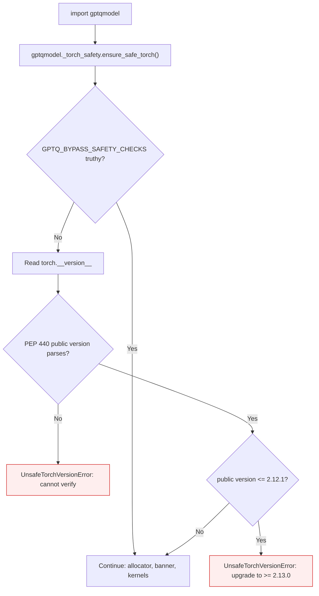

<!-- SPDX-FileCopyrightText: 2026 ModelCloud.ai -->
<!-- SPDX-License-Identifier: Apache-2.0 -->

# PyTorch runtime safety gate

GPT-QModel loads checkpoints and executes kernels through whichever PyTorch it
is imported against. A PyTorch release with a known memory-corruption defect is
therefore not a supported runtime: continuing would turn a dependency problem
into silent data corruption. The gate below runs before the CUDA allocator is
initialized, before a device is opened, and before any checkpoint is read.

## Affected range

| Field | Value |
| --- | --- |
| Advisory | [GHSA-rrmf-rvhw-rf47](https://github.com/pytorch/pytorch/security/advisories/GHSA-rrmf-rvhw-rf47) |
| CVE | CVE-2025-3000 |
| Component | `torch.jit.script` memory corruption |
| Affected | `torch <= 2.12.1` |
| Patched | `2.13.0` |

The advisory is rated Low by GitHub (CVSS 3.1 5.3). This gate encodes the
affected range and its patch boundary, not the score: the defect corrupts
memory in the same runtime that decodes quantized weights.

## Flow



`ensure_safe_torch()` is the first statement in `gptqmodel/__init__.py`, before
`apply_default_alloc_conf()` and `gptqmodel.rocm_llc`. Both of those import
Torch state that cannot be undone, so a late check would already have initialized
the runtime it is meant to reject. The implementation lives in the standalone
module `gptqmodel/_torch_safety.py` because importing `gptqmodel.utils` is
itself the side effect being guarded against; `gptqmodel.utils.security`
re-exports the same names for ordinary callers.

## Why the public version is compared

PEP 440 orders a local label *after* its base version:

```python
>>> Version("2.12.1+cu121") > Version("2.12.1")
True
```

A naive `Version(torch.__version__) <= Version("2.12.1")` therefore returns
`False` for every `2.12.1+cuXXX` build — exactly the population that installs
these CUDA wheels. The gate compares `Version(raw).public` instead, so
`2.12.1+cu121`, `2.12.1+rocm6.4`, and plain `2.12.1` are all rejected.

An unparseable version raises rather than passing: an unidentifiable runtime
cannot be cleared for checkpoint loading.

## Failure contract

| Situation | Before | After |
| --- | --- | --- |
| `torch.__version__ = "2.12.1+cu121"` | Imported and ran | `UnsafeTorchVersionError` naming the advisory and the upgrade command |
| `torch.__version__ = "2.11.0"` | Imported and ran | `UnsafeTorchVersionError` |
| `torch.__version__ = "2.13.0"` | Imported and ran | Unchanged |
| Unparseable version | Imported and ran | `UnsafeTorchVersionError` |
| `GPTQ_BYPASS_SAFETY_CHECKS=1` | No effect | Gate skipped, warning-free |
| `GPTQ_BYPASS_SAFETY_CHECKS=0` | No effect | Gate enforced |

The error text names the advisory, the CVE, the patched version, the `pip`
command, and the override.

## The override

`GPTQ_BYPASS_SAFETY_CHECKS` is the only way past the gate. It is a pre-import
safety-valve, not a behavior switch: at this point in the import sequence no
`QuantizeConfig`, API argument, or device selection exists, so the
config-object rule in `AGENTS.md` has nothing to route through. It is
documented, single-purpose, and reported in the pull request that introduced it.

The pinned CI matrix sets it explicitly for `TORCH_VERSION` 2.11.0 / 2.12.0.
Remove those overrides when the images ship `>= 2.13.0`.

## Validation

| Test | Invariant |
| --- | --- |
| `test_affected_versions_are_rejected` | Nine affected spellings raise, including `+cu` and `+rocm` local labels |
| `test_patched_and_newer_versions_pass` | `2.13.0` and newer pass, including dev builds |
| `test_local_label_does_not_hide_the_affected_range` | `2.12.1+cu121` sorts above `2.12.1` and is still rejected |
| `test_unparseable_version_fails_closed` | An unidentifiable version raises |
| `test_bypass_flag_reads_only_truthy_values` | Only `1/true/yes/on/y` bypass |
| `test_bypass_defaults_to_the_environment` | The environment decides when no argument is passed |
| `test_package_import_fails_before_cuda_initialization` | A fresh import fails with no startup banner |
| `test_package_import_succeeds_with_the_explicit_bypass` | The same import succeeds with the override |

Measured on this host (torch 2.16.0.dev20261102+cu130):

```
$ python -c 'import torch; torch.__version__ = "2.12.1+cu121"; import gptqmodel'
UnsafeTorchVersionError: GPT-QModel requires PyTorch >= 2.13.0: the imported runtime
(2.12.1+cu121) is affected by GHSA-rrmf-rvhw-rf47 (CVE-2025-3000) ...
```

`pytest tests/test_torch_safety_gate.py -q` reports 22 passed; disabling the
`ensure_safe_torch()` call makes `test_package_import_fails_before_cuda_initialization`
fail, so the test pins the wiring rather than only the helper.

## Not in scope

[GHSA-v32g-mr63-3j83](https://github.com/pytorch/pytorch/security/advisories/GHSA-v32g-mr63-3j83)
(`torch.load(weights_only=True)` arbitrary file read, `>= 2.14.0`, patched in
`2.15.0`) is a separate advisory with a different affected range. This gate
encodes only the `<= 2.12.1` range requested here; extending it needs its own
range table and a re-check of the pinned matrix.
