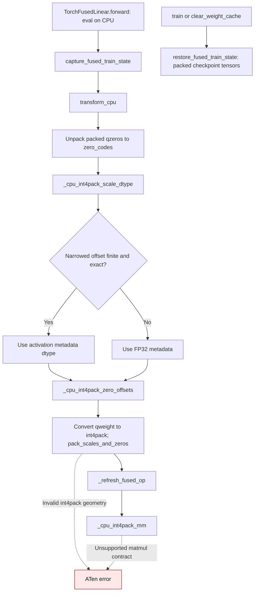
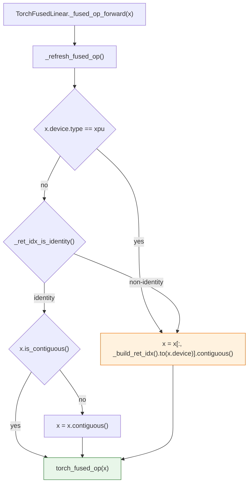
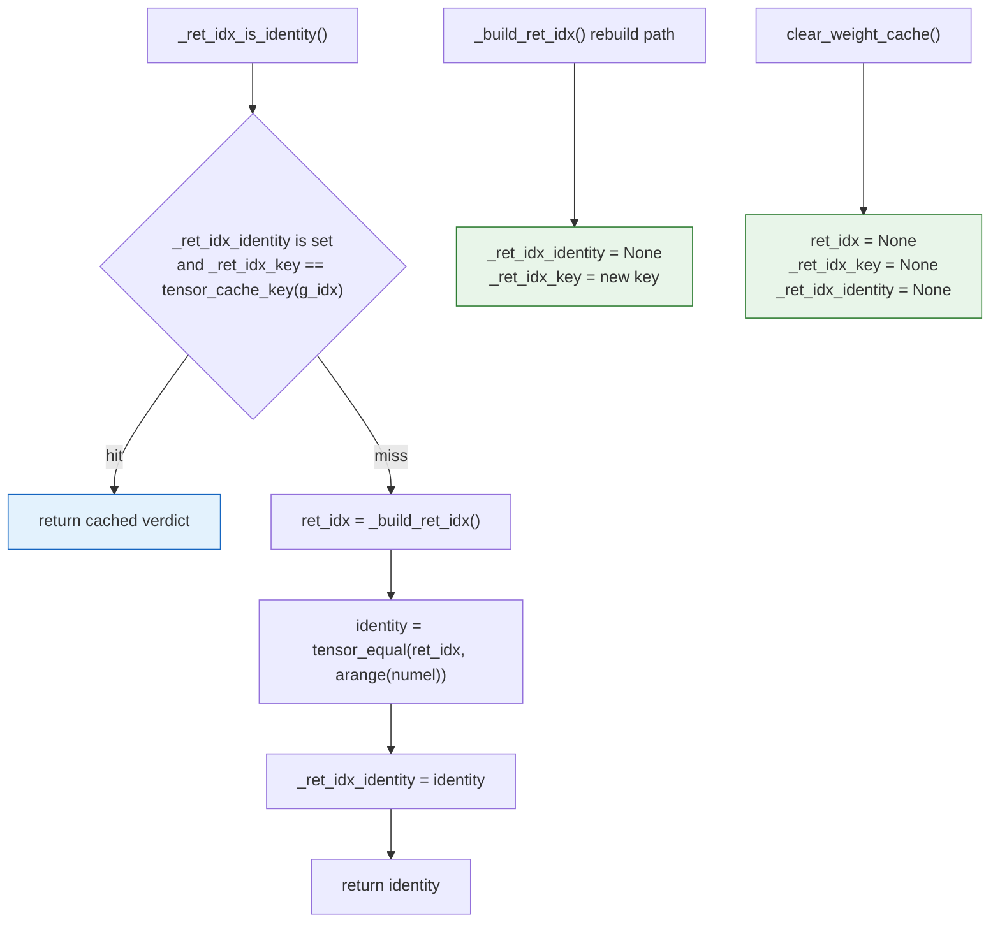

```
# SPDX-FileCopyrightText: 2024-2025 ModelCloud.ai
# SPDX-FileCopyrightText: 2024-2025 qubitium@modelcloud.ai
# SPDX-License-Identifier: Apache-2.0
# Contact: qubitium@modelcloud.ai, x.com/qubitium
```

# Torch Fused INT4 Transformations

This note explains what `TorchFusedLinear.transform_xpu` and `transform_cpu`
do to GPTQ-format tensors before calling the fused `torch.ops.aten` kernels.
The goal is to document the exact tensor shapes, the axis permutations, and the
bit packing order expected by `aten._weight_int4pack_mm_*` so you do not need to
reverse engineer the loops in `gptqmodel/nn_modules/qlinear/torch_fused.py:175-219`.

## Terminology and starting layout

Let:

* `I` – number of input features.
* `O` – number of output features.
* `B` – quantization bits (always 4 here).
* `W` – number of bits stored per lane in `pack_dtype` (`W = 32` by default).
* `pack_factor = W / B` – how many quantized values share one lane (8 when `B=4`).
* `group_size` – number of input channels that share one `(scale, zero)` pair.
* `G = ceil(I / group_size)` – number of groups (and rows in `scales`/`qzeros`).

Immediately after loading a GPTQ v2 checkpoint:

```
qweight : [I / pack_factor, O]    dtype = pack_dtype (int32)
qzeros  : [G, O / pack_factor]    dtype = pack_dtype (int32)
scales  : [G, O]                  dtype = fp16
g_idx   : [I]                     dtype = int32   (maps input channel -> group id)
```

Each entry of `qweight`/`qzeros` is a 32-bit lane that packs `pack_factor`
4-bit nibbles. Conceptually, a single column of `qweight` (one output channel)
looks like this before unpacking:

```
raw lane bits (int32) → [in_{k+7}] [in_{k+6}] … [in_{k+1}] [in_{k}]
bit positions         → 31..28    27..24          7..4      3..0
```

## `transform_xpu(dtype)`

The XPU path needs tensors that match
`aten._weight_int4pack_mm_with_scales_and_zeros`. The routine performs five
steps:

1. **Scales cast** – `self.scales = self.scales.clone().to(dtype)`. No layout changes.
2. **Unpack `qzeros`** – expand each 32-bit lane into `pack_factor` nibbles, mask
   with `0xF`, then reshape to `[G, O]`.

   ```
   Before unpack (per group g):
       qzeros[g] = [ lane_0, lane_1, … ]  (each lane holds 8 outputs)
   After unpack:
       zeros[g]  = [ z_{0}, z_{1}, …, z_{O-1} ]

       lane layout
       ┌──────────── 32 bits ────────────┐
       | z_{b+7} | … | z_{b+1} | z_{b} |
       └────────────────────────────────┘   ← reshaped into consecutive columns
   ```

3. **Unpack and reorder `qweight`** – identical nibble extraction produces a
   tensor shaped `[I, O]`. It is then re-indexed with `ret_idx` so that input
   rows follow the `g_idx` schedule used during quantization, and finally
   transposed to `[O, I]`. At this point every row corresponds to one output
   channel and every column corresponds to an *unpacked* input channel.

   ```
   weight_full (after transpose):
         input columns →
       ┌───────────────────────────────────────────┐
   out0│ w00 w01 w02 w03 w04 w05 w06 w07 … w0(I-1) │
   out1│ w10 w11 w12 w13 w14 w15 w16 w17 … w1(I-1) │
       │  ⋮                                        │
   ```

4. **Pack rows into XPU layout** – the double `for` loop rebuilds `int32`
   lanes, but now the rows are `O` (output channels) instead of packed input
   clusters. The resulting tensor has shape `[O, I / pack_factor]`.

   ```
   packed[row=j, col=k] stores inputs (8 values) = 
       weight_full[j, 8k + i]  for i = 0..7

   31..28   27..24   23..20   19..16   15..12   11..8   7..4    3..0
   [in+7]   [in+6]   [in+5]   [in+4]   [in+3]   [in+2]  [in+1]  [in+0]
   ```

5. **Finalize buffers** – `self.qweight = packed.contiguous()` (int32) and
   `self.qzeros = zeros.contiguous()` (float, `[G, O]`). These, together with
   `self.scales`, match the signature of
   `aten._weight_int4pack_mm_with_scales_and_zeros(x, qweight, group_size, scales, qzeros)`.

For XPU execution, `_fused_op_forward` keeps the main-branch behavior: it
always gathers with `ret_idx` and materializes a contiguous zero-offset copy.
The identity fast path is CPU-only, because the XPU kernel has no coverage for
activation views with a non-zero storage offset.

This applies the inverse of the group-wise reordering performed in step 3,
ensuring that column `i` of `qweight` always multiplies the same logical input
channel the calibration used.

### Visual summary (XPU)

```
             ┌─────────────┐      unpack+permute      ┌─────────────┐
raw qweight →│ I/8  ×  O   │ ───────────────────────→ │   O × I      │
             └─────────────┘                          └─────────────┘
                                                   pack rows ↓
                                                   ┌─────────────┐
                                                   │ O × (I/8)   │  int32 lanes
                                                   └─────────────┘

raw qzeros  → [G × O/8] lanes ──unpack──► zeros [G × O]
scales      → [G × O] (cast to `dtype`)
```

## `transform_cpu(dtype)`

The CPU path shares the unpack/reorder logic but delegates the final packing to
PyTorch’s helper so the layout matches
`aten._weight_int4pack_mm_for_cpu`. Steps:

1. **Unpack zero codes and choose metadata dtype** – unpack each packed GPTQ
   `qzeros` lane into `[G, O]` integer codes. `_cpu_int4pack_scale_dtype`
   checks whether the resulting affine offsets remain finite and exact in the
   activation dtype; it selects FP32 metadata when narrowing would lose the
   offset. Cast `scales` to that compute dtype.
2. **Unpack + reorder `qweight`** – same as step 3 above, yielding
   `weight_full = [O, I]` with 4-bit integers.
3. **Convert to int4pack** – `torch.ops.aten._convert_weight_to_int4pack_for_cpu`
   repacks that matrix into `torch.uint8` tiles of shape `[O, I * B / 8]`
   (i.e., `I/2` columns when `B=4`). Each byte stores two adjacent inputs.

   ```
   byte layout (per output row j):
   bits 7..4 → weight_full[j, 2k+1]
   bits 3..0 → weight_full[j, 2k]
   ```

   The helper currently requires both `O` and `I` to be multiples of 16; the op
   raises `_convert_weight_to_int4pack_cpu : expect N to be dividable by 16`
   otherwise.

4. **Convert zero codes and merge metadata** –
   `_cpu_int4pack_zero_offsets` computes `(8 - zero_code) * scale`. The fused
   CPU kernel dequantizes a nibble as `(code - 8) * scale + offset`, which now
   equals GPTQ's `(code - zero_code) * scale`. `pack_scales_and_zeros` stacks
   scales and offsets along the last dimension:

   ```
   scales_and_zeros[g, o] = [ scale[g, o], zero[g, o] ]    shape = [G, O, 2]

   group g
     ┌──────── out dimension ────────┐
     │ [ s, z ]  [ s, z ]  …  [ s, z ] │
     └─────────────────────────────────┘
   ```

   The stored integer `qzeros` become affine offsets only for the transformed
   inference layout. `capture_fused_train_state` keeps the packed checkpoint
   tensors for eval-to-train restoration and explicit cache clearing.

5. **Buffers used at runtime** – `self.qweight` is now the `uint8`
   int4pack tensor, `self.scales_and_zeros` stores the merged metadata, and
   `_fused_op_forward` calls
   `aten._weight_int4pack_mm_for_cpu(x, qweight_uint8, group_size, scales_and_zeros)`.

### Visual summary (CPU)

```
weight_full (O × I, ints) ──_convert_weight_to_int4pack_for_cpu──►
┌──────────────┐                                             ┌──────────────┐
│  O × I       │                                             │ O × (I/2)    │ uint8
└──────────────┘                                             └──────────────┘
     ↑                                                         ↑
     └───────── unpack & transpose from raw qweight ───────────┘

packed qzeros (G × O/8) ──unpack──► zero codes (G × O)
zero codes + scales ──(8 - code) * scale──► affine offsets (G × O)
scales + offsets ──pack_scales_and_zeros──► (G × O × 2)
```

### Asymmetric zero-point lifecycle



| Mechanism | Before | After |
| --- | --- | --- |
| GPTQ CPU zero points | `transform_cpu` replaced packed `qzeros` with `zeros_like(scales)` (`gptqmodel/nn_modules/qlinear/torch_fused.py:281` before this change). | It unpacks the checkpoint codes and stores `(8 - zero_code) * scale` offsets (`gptqmodel/nn_modules/qlinear/torch_fused.py:272-295`). |
| Narrow offset range | `scales` were cast directly to the activation dtype. | `_cpu_int4pack_scale_dtype` chooses FP32 when low-precision offsets would be nonfinite or inexact (`gptqmodel/nn_modules/qlinear/torch_fused.py:277`). |
| Eval-to-train | Packed checkpoint buffers were already snapshotted. | The same packed snapshot is restored on `train()` and `clear_weight_cache()`; the regression checks asymmetric codes survive both paths. |

On `origin/main` at `520809c8`, a two-group packed checkpoint with codes 12,
zero codes 3 and 11, and scale 0.25 returned 64 instead of 80 for group size
32 and 256 instead of 320 for group size 128. The CPU regression decodes
packed words independently in Python, checks group sizes 32/128, FP16/BF16,
and both activation-order modes, then verifies the packed-only storage and
eval-to-train restoration.

With two BF16 activation rows and 32 outputs on a single CPU thread, the
independent packed-word oracle and corrected fused output agreed exactly after
BF16 output rounding. Three warmups and 20 timed forwards gave:

| Group size | Checkpoint bytes | Reachable tensor storage after forward | Median forward |
| --- | ---: | ---: | ---: |
| 32 | 1,440 | 3,264 bytes | 0.0293 ms |
| 128 | 5,280 | 10,944 bytes | 0.0502 ms |

The reachable count deduplicates storage pointers and includes packed checkpoint
snapshots, transformed packed weights, affine metadata, and small indexing
buffers. No dense or expanded weight is retained. `transform_cpu` temporarily
unpacks a full `[I, O]` code matrix and an `int32` copy for the ATen packer;
these are released before inference forwards. No temporary peak was measured.

Asymmetric GPTQ fused CPU zero-point conversion was corrected in
[PR #3746](https://github.com/ModelCloud/GPTQModel/pull/3746).

## Activation permutation and fused matmul

Both device paths share the same `ret_idx` derivation, but only the CPU path
takes the identity fast path. `ret_idx` is built once from `g_idx` so that
unpacked rows can be restored to the calibration order:



`desc_act=False` checkpoints have `g_idx == arange(I) // group_size`, so the
permutation is the identity and the CPU gather is a no-op copy that is skipped
entirely. `TorchAtenLinear` and `TorchCpuAvx512Linear` already used this guard;
`TorchFusedLinear` now reuses it instead of gathering unconditionally on CPU.
XPU still gathers unconditionally to preserve the main-branch zero-offset copy.

The matmul then multiplies the (possibly reordered) `x` with the packed
`qweight`:

* XPU: `aten._weight_int4pack_mm_with_scales_and_zeros`
  consumes `qweight[int32][O, I/8]`, `scales[G, O]`, and `qzeros[G, O]`.
* CPU: `aten._weight_int4pack_mm_for_cpu`
  consumes `qweight[uint8][O, I/2]` and `scales_and_zeros[G, O, 2]`.

Because the same `ret_idx` is used for both the unpacked weight (during packing)
and the activation tensor (during inference), every nibble in the packed matrix
aligns with the correct logical input column.

### Identity-verdict cache and invalidation

`_ret_idx_is_identity()` lives on `PackableQuantLinear`
(`gptqmodel/nn_modules/qlinear/__init__.py`) so every kernel that reorders
activations shares one implementation. The verdict is cached in
`_ret_idx_identity` and validated against `_ret_idx_key`, which holds
`tensor_cache_key(g_idx)`; repeated forwards therefore stay O(1).



A stale `True` paired with a new `_ret_idx_key` would skip a required gather and
silently return wrong values, so every path that changes the permutation must
drop the verdict:

| Path | Effect on `_ret_idx_identity` |
| --- | --- |
| `_build_ret_idx()` rebuild (key miss) | cleared, recomputed on the next check |
| `_build_ret_idx()` cache hit | untouched, the key still matches |
| `_build_ret_idx()` called explicitly by a caller | cleared by the rebuild path |
| `g_idx` replaced or mutated without an explicit rebuild (versioned tensor) | key mismatch forces a recompute |
| `clear_weight_cache()` (state-dict load, `_apply` device/dtype move) | cleared with `ret_idx` and `_ret_idx_key` |

For inference tensors, `tensor_cache_key()` has no version counter to observe an
in-place write. A `g_idx` mutated in place inside `InferenceMode` without an
explicit `clear_weight_cache()` can therefore still serve a stale verdict; this
is the same contract documented in
`gptqmodel/nn_modules/qlinear/_runtime_cache.py`.

## Comparing XPU vs CPU transformations

Although both device paths share the same unpack → reorder → transpose steps,
they diverge in how the packed tensors are laid out and what the fused matmul
expects afterward. The table below highlights the key differences for quick
debugging.

| Aspect                     | XPU (`transform_xpu`)                                          | CPU (`transform_cpu`)                                             |
|----------------------------|---------------------------------------------------------------|-------------------------------------------------------------------|
| Packed `qweight` shape     | `[O, I / 8]`, dtype `int32`                                    | `[O, I / 2]`, dtype `uint8`                                       |
| Bits per storage lane      | 32-bit lane packs 8 inputs; nibble order `[in+7 … in+0]`       | 8-bit lane packs 2 inputs; high nibble = odd, low nibble = even   |
| Packing direction          | Manual double-loop packs along **columns** of `weight_full`    | `_convert_weight_to_int4pack_for_cpu` packs along **columns** into bytes |
| Per-group zeros            | Unpacked integer codes `[G, O]` passed separately               | Converted to `(8 - zero_code) * scale` offsets and merged with scales |
| Scale format               | One tensor per group (`scales[G, O]`)                          | Concatenated `[..., 0] = scale`, `[..., 1] = affine offset` (`float`) |
| Fused kernel call          | `_weight_int4pack_mm_with_scales_and_zeros(x, qW, gsz, s, z)`  | `_weight_int4pack_mm_for_cpu(x, qW, gsz, scales_and_zeros)`       |
| Alignment requirements     | Determined by manual pack loop (only needs `I % 8 == 0`)       | Kernel enforces `I % 16 == 0` and `O % 16 == 0`                   |
| Activation permutation     | always `x[:, ret_idx].contiguous()` (zero-offset copy)          | gather only when `_ret_idx_is_identity()` is false; otherwise `x.contiguous()` when needed |

Visually, you can think of the difference as *row-major lane packing* (XPU)
versus *byte-tiling* (CPU):

```
XPU:  | int32 lane | = [w7][w6][w5][w4][w3][w2][w1][w0]
CPU:  | uint8 lane | = [w1][w0]
```

Both forms originate from the same `[O, I]` intermediate; the divergence is only
in the final storage type, accompanying metadata, and fused operator ABI.

## AWQ compatibility (`torch_fused_awq.py`)

`TorchFusedAwqLinear` (`gptqmodel/nn_modules/qlinear/torch_fused_awq.py`)
reuses the CPU fused kernel while accepting checkpoints emitted by the AWQ
tooling. The module always expects `qweight` to be stored in the AWQ layout
`[in_features, out_features / pack_factor]`, meaning each row corresponds to a
single logical input channel. `transform_cpu_awq` performs its own CPU
int4pack transform:

1. **Unpack AWQ rows** – `unpack_awq` expands each column lane into eight
   outputs, yielding `iweight[int8][I, O]` and `izeros[int8][G, O]`. Both
   tensors are then permuted with `reverse_awq_order` (the inverse of
   `quantization.awq.utils.packing_utils.AWQ_ORDER`) so the columns match the
   logical transformer layout expected by GPTQ.
2. **Normalize zero codes** – AWQ stores integer zero points per output channel.
   `transform_cpu_awq` converts them into floating offsets compatible with the
   fused kernel using `(2^{bits-1} - izeros) * scales_fp32`. It chooses FP32
   metadata when the offset cannot safely be narrowed.
3. **Pack the output-major codes** – `transform_cpu_awq` transposes `iweight`
   and calls `_convert_weight_to_int4pack_for_cpu` directly. It does not call
   `TorchFusedLinear.transform_cpu`.
4. **Build AWQ affine metadata** – The AWQ path independently selects a safe
   metadata dtype, computes `(8 - izeros) * scales`, and calls
   `pack_scales_and_zeros`. The GPTQ zero-code fix does not change AWQ packing.

Because the shim runs entirely on the CPU path, `TorchFusedAwqLinear`
currently raises `NotImplementedError` when asked to run the fused transform on
`xpu` devices. If the module has not been transformed yet (or fused ops are
unavailable), inference falls back to the dense AWQ matmul computed by
`awq_weight_dequantize`, which simply dequantizes the cached AWQ tensors on the fly.

## Quick reference

| Stage                          | Shape / dtype (int4)                                      | Notes                                          |
|--------------------------------|-----------------------------------------------------------|------------------------------------------------|
| Raw `qweight`                  | `[I / 8, O]`, `int32`                                     | 8 nibbles per lane                             |
| After unpack + transpose       | `[O, I]`, `int8` (values in `[0, 15]`)                     | Used by both device paths                      |
| Packed XPU `qweight`           | `[O, I / 8]`, `int32`                                     | Bits `[3:0]` hold the lowest-numbered channel  |
| Packed CPU `qweight`           | `[O, I / 2]`, `uint8`                                     | High nibble = odd input, low nibble = even     |
| `qzeros` (post-XPU transform)  | `[G, O]`, matches `scales`                                | Passed separately to the XPU fused op          |
| `scales_and_zeros` (CPU only)  | `[G, O, 2]`, float                                        | `[..., 0] = scale`, `[..., 1] = affine offset` |
| Raw AWQ `qweight`              | `[I, O / 8]`, `int32`                                     | Rows are single inputs packed across outputs   |
| Unpacked AWQ weights/zeros     | `iweight[I, O]`, `izeros[G, O]`, `int8`                    | Produced by `unpack_awq` + `reverse_awq_order` |
| AWQ zero offsets (final)       | `[G, O]`, FP16 or FP32                                   | `(2^{bits-1} - izeros) * scales`; merged via `pack_scales_and_zeros` |

These details mirror the expectations of the Intel XPU and CPU fused matmul
kernels, and the ASCII layouts above describe how rows/columns line up inside
every packed tensor before the fused matmul executes.
