# Transformers 5.22 model compatibility

Transformers 5.22 changed three things that GPT-QModel's model definitions and
lazy checkpoint loader depended on:

1. some checkpoint conversion maps are registered under the **model class
   name** instead of `config.model_type`;
2. several Mamba-family mixers lost their explicit `slow_forward` /
   `cuda_kernels_forward` / `torch_forward` entry points and the fused
   `falcon_mamba_inner_fn` symbol;
3. some non-persistent buffers are still created in `__init__` but are absent
   from the checkpoint, so a lazy shell leaves them on META.

The sections below describe the shipped behaviour for the loader, the
GPT-NeoX save path, the FalconMamba / Zamba / Nemotron-H patch guards, the
Nemotron-H tree root, and the Falcon-H1 / FalconMamba buffer restoration.
Sections E-I of issue #4040 (LFM2-MoE, GLM-4.x MoE, mllama, Kimi-Linear,
HRM-Text, glmasr) are described after the A-D sections below.

## A. Checkpoint conversion maps are class-keyed

`LazyTurtle.infer_hf_conversion_map_reversed()` in
`gptqmodel/utils/structure.py:1725` resolves runtime names back to checkpoint
names. Before this change it queried the Transformers registry with
`config.model_type` only (`gptqmodel/utils/structure.py:1693` on `main`).
GPT-NeoX registers its `^embed_out\.` -> `lm_head.` rename under
`GPTNeoXForCausalLM`, so the lookup returned `None`, LazyTurtle kept looking
for `lm_head.weight`, and every GPT-NeoX save ended in
`FileNotFoundError: Offloaded tensor 'lm_head.weight' not found`
(`gptqmodel/utils/model.py:2362`).

The lookup now tries an explicit definition alias, then `config.model_type`,
then `type(model).__name__`, then `config.architectures`.

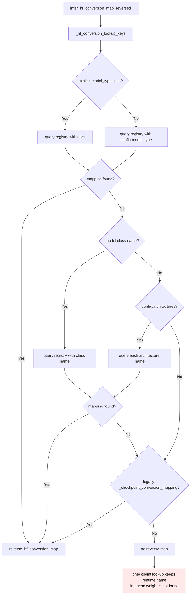

The GPT-NeoX definition also declares `lm_head = "lm_head"`
(`gptqmodel/models/definitions/gpt_neox.py:11`), because the runtime module was
renamed from `embed_out` to `lm_head`; the conversion map bridges it back to
`embed_out.weight` in the checkpoint. The lookup is generic, so
`NemotronH_Omni_Reasoning_V3`, `MtpModel`, and any future class-keyed
registration work without a model-specific special case.

## B. Mixer patches are installed only when the legacy API exists

`monkey_patch()` replaces the upstream mixer `forward` to keep quantized
projections on the Torch path. Transformers 5.22 removed the symbols those
replacements call. The replacement is now installed only when the mixer class
still exposes the methods it uses; otherwise the upstream forward is kept,
which already selects the eager path outside training.

| Family | Old symbol used by the patch | Guard |
| --- | --- | --- |
| FalconMamba | `falcon_mamba_inner_fn`, `slow_forward`, `cuda_kernels_forward` | module symbols probed with `getattr`; class must expose both forward methods |
| Zamba v1 | `slow_forward`, `cuda_kernels_forward` | class must expose both forward methods |
| Nemotron-H | `torch_forward`, `cuda_kernels_forward` | class must expose both forward methods |

Before the guard, FalconMamba failed at import
(`gptqmodel/models/definitions/falcon_mamba.py:70` on `main`), while Zamba and
Nemotron-H installed a replacement that raised `AttributeError` on first use
(`gptqmodel/models/definitions/zamba.py:75`,
`gptqmodel/models/definitions/nemotron_h.py:75` on `main`).

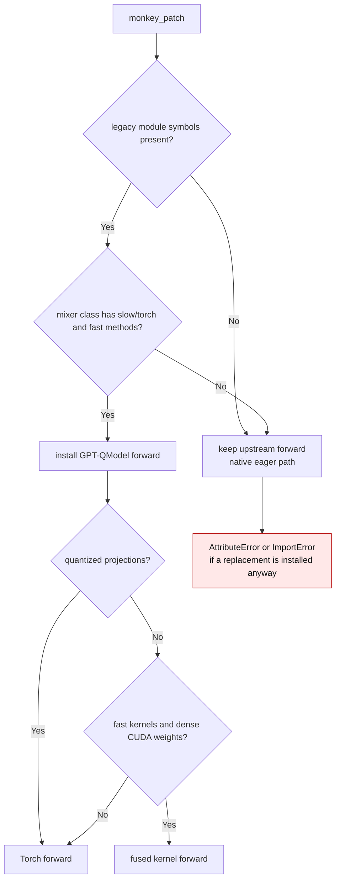

## C. Nemotron-H tree root is `model`

Transformers 5.22 registers `nemotron_h`'s `backbone.` -> `model.` rename in
the checkpoint conversion map, so the native runtime tree is
`model.layers.*`. The definition now declares `model` as its root
(`gptqmodel/models/definitions/nemotron_h.py:23`) instead of `backbone`
(`gptqmodel/models/definitions/nemotron_h.py:16` on `main`). The
`monkey_patch` layer walk accepts either `self.model.model.layers` (native
5.22) or `self.model.backbone.layers` (older remote code).

With the wrong root, layer resolution returned `None` and
`looper/stage_inputs_capture.py:206` raised
`TypeError: 'NoneType' object is not subscriptable`.

## D. Non-persistent buffers are rebuilt after a lazy load

`LazyTurtle` materializes decoder modules from checkpoint tensors. Buffers
created in `__init__` with `persistent=False` never reach the checkpoint, so
they stay on META and `looper/module_looper.py:1354` reports
`Lazy forward direct-state materialization left META tensors under ...`.

| Family | Buffer | Restoration |
| --- | --- | --- |
| Falcon-H1 | `mamba.mup_vector` | `FalconH1QModel._restore_falcon_h1_mup_buffers()` re-registers `compute_mup_vector(config)` in `after_model_load` and `pre_quantize_generate_hook_start` |
| FalconMamba | `mixer.dt_layernorm.weight`, `mixer.b_layernorm.weight`, `mixer.c_layernorm.weight` | `_restore_falcon_mamba_rms_buffers()` fills the 5.22 `FalconMambaWeightlessRMSNorm` weights in addition to the legacy `dt_rms` / `b_c_rms` buffers |

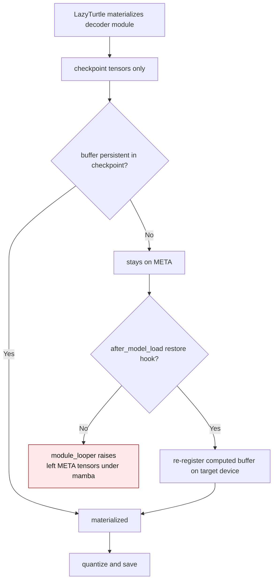

The restore hooks keep an already materialized buffer untouched, so they are
idempotent for ordinary (non-lazy) loads.

## J. Native remote-code RoPE, load, and generate (issue #4093 items 7-12)

Six remote-code gaps share one rule: a compatibility shim has to reproduce the
*contract* the remote code was written against, and it must not leak into
transformers' own probes. Item 10 is the silent one: a native model loaded for
evaluation kept uninitialized RoPE buffers, so every baseline was wrong while
quantized reloads were correct.

### J.1 Native rotary buffers are restored after every load (item 10)

Transformers 5 initializes a model on the meta device and materializes every
non-persistent buffer the checkpoint does not own with `torch.empty_like`
(`PreTrainedModel._move_missing_keys_from_meta_to_device`). Its default
`_init_weights` re-derives a native rotary module's `inv_freq` only when the
module exposes `original_inv_freq`. Every legacy remote-code family overrides
`_init_weights`, so the default restore never runs and `inv_freq` (plus
DeciLM's `cos_cached`/`sin_cached`) stays uninitialized. The quantize path was
unaffected because LazyTurtle restores meta buffers while materializing a
layer; the native eval branch (`gptqmodel/models/loader.py`, plain
`from_pretrained`) had no equivalent step.

`restore_init_owned_rotary_buffers()` (`gptqmodel/utils/structure.py:917`) now
runs once in `BaseQModel.__init__` (`gptqmodel/models/base.py:745`) for every
load path. It rebuilds each affected module's direct non-persistent buffers
from a CPU constructor template (`_build_module_init_template`, the same
builder LazyTurtle uses), so the value comes from the module's own constructor
arguments rather than from the code under test.

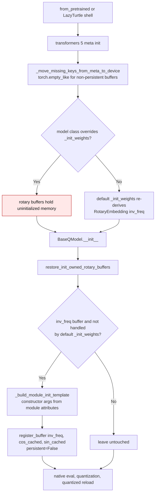

Meta shells are skipped so the lazy quantization path keeps its own restore on
materialization. A model that uses the default `_init_weights` and exposes
`original_inv_freq` is also skipped, which leaves native transformers rotary
modules untouched.

Wikitext-2 perplexity, 40 windows of 512 tokens, bf16, native load through
`GPTQModel.load(quantize_config=None)`, measured on an RTX 4090
(`GPU-d458708b-c760-bbf1-08fb-8b8803a2157d`). "Before" is the same command on
`origin/main`; "after" includes the restore.

| Checkpoint | Before | After |
| --- | --- | --- |
| `amd/Instella-3B-Instruct` | 704.70 | 23.06 |
| `LGAI-EXAONE/EXAONE-3.0-7.8B-Instruct` | 366.47 | 10.19 |
| `Deci/DeciLM-7B` | 1304.01 | 7.54 |

### J.2 Legacy unscaled RoPE stays `None` (item 9)

MiniCPM-2B and MobileLLM serialize `rope_scaling: null`. Transformers 5 fills a
default `{"rope_type": "default", "rope_theta": ...}` dict, and their legacy
`_init_rope` treats any non-None dict as scaled RoPE and indexes `["type"]`
(`KeyError: 'type'`). Only Nanbeige was special-cased on `main`
(`gptqmodel/utils/hf.py:1512`).

The policy is now decided from the config class itself:
`_declares_legacy_rope_field()` (`gptqmodel/utils/hf.py:1540`) returns True for
a remote config whose `__init__` declares `rope_scaling` and not
`rope_parameters`. For such a config, `_normalize_rope_parameters_config_compat`
(`gptqmodel/utils/hf.py:1572`) clears both aliases when the effective RoPE is
unscaled; genuinely scaled configs keep their dict and gain the legacy `type`
key. Native and modern remote configs declare `rope_parameters`, so they keep
the transformers-5 dict.

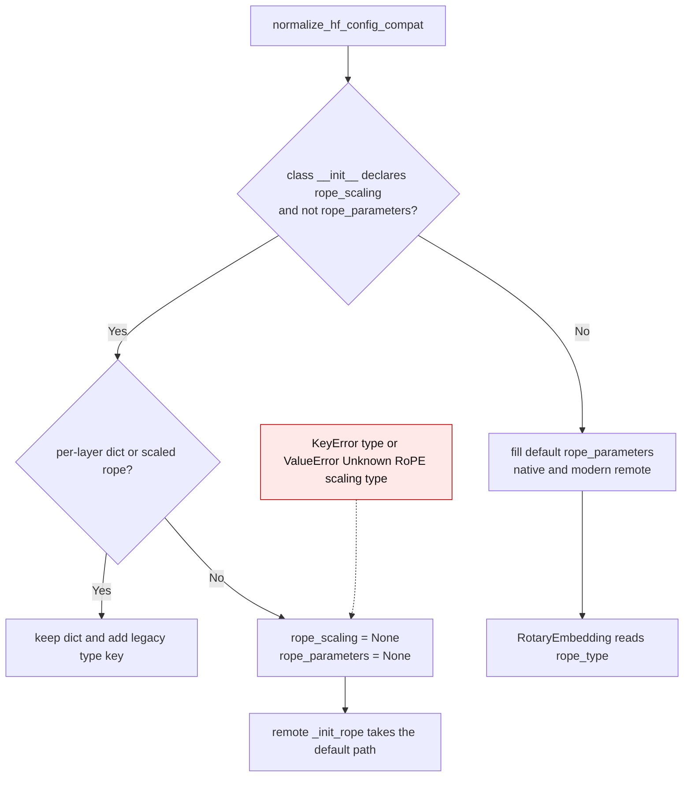

### J.3 ChatGLM generation (item 11)

`attribute_map["max_length"] = "seq_length"` is still required: ChatGLM's
`__init__` reads `config.max_length`. Transformers 5's
`_prepare_generation_config` also walks that attribute through
`_get_generation_parameters()` and raises
`You have modified the pretrained model configuration ... {'max_length': N}`.
The alias is now filtered from that probe on the remote config class
(`gptqmodel/utils/hf.py:1453`), and `num_hidden_layers` aliases `num_layers` so
cache sizing can read it. Both stay in `attribute_map`, so they are not
serialized.

`generate()` then hit two more transformers-5 gaps: `DynamicCache` is not
subscriptable by ChatGLM's legacy `get_masks`, and the remote
`_update_model_kwargs_for_generation` indexes an all-ones `attention_mask`
that transformers 5 replaces with `None`. `ChatGLMQModel.after_model_load`
(`gptqmodel/models/definitions/chatglm.py:33`) installs
`_patch_generation_compat` (`:39`): `generation_config.use_cache = False` keeps
the remote forward on its `past_key_values=None` path, and the replacement
update hook advances `position_ids` and only extends a real mask. Generation
re-prefills each step instead of using a KV cache.

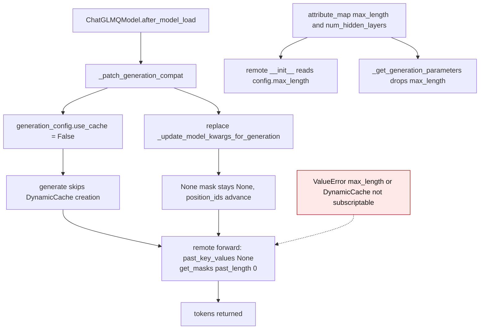

### J.4 `.bin` conversion normalizes legacy tied keys (item 8)

`LazyTurtle._convert_checkpoint_source_to_safetensors` calls
`save_pretrained` for pickle-only checkpoints. A remote class with
`_tied_weights_keys = ["lm_head.weight"]` made transformers 5 raise
`AttributeError: 'list' object has no attribute 'keys'`, and `maybe_create`
swallowed it, so the user saw only `Loader: can't open model path ... for
offload_to_disk`. The conversion now calls
`_normalize_legacy_tied_weights_keys` first
(`gptqmodel/utils/structure.py:1337`, the helper the quantized writer already
uses), and `maybe_create` raises a `RuntimeError` that names the path and
chains the original exception (`gptqmodel/utils/structure.py:1215`).

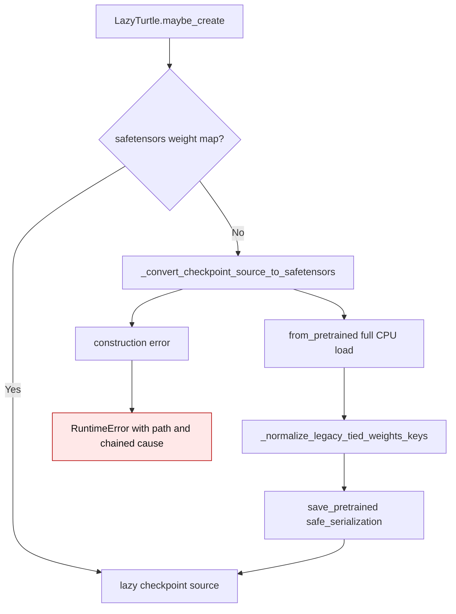

### J.5 AUTO_NF12 source-weight contract (item 7)

Spark-X2.5's decoder reads `self.mlp.gate_proj.weight.dtype`
(`modeling_spark.py:244`), and the legacy Llama-shaped families read
`self.q_proj.weight.dtype`. A packed `AutoNF12HookedLinear` has no dense
`weight`, so GPTQ failed under the default `auto_dtype_cast=auto_nf12`.
`from_linear` now attaches a one-element, all-zero view with the source dtype,
shape and device (`_source_weight_contract`,
`gptqmodel/utils/auto_dtype_cast.py:270`, assigned at `:311`). Zero strides
give the real shape without materializing the matrix, and a plain attribute
keeps it out of `state_dict()`.

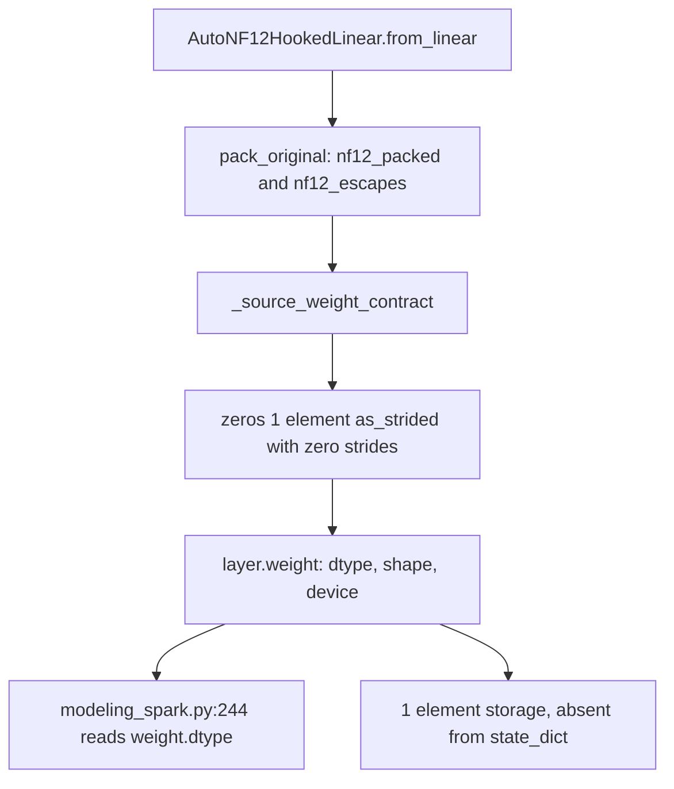

### J.6 Klear OutputRecorder (item 12)

`modeling_klear.py` imports `check_model_inputs` and `OutputRecorder` from
`transformers.utils.generic`. Transformers 5 moved `OutputRecorder` to
`transformers.utils.output_capturing`, so the remote module raised
`ImportError`. `_patch_transformers_remote_code_compat` now re-exports the real
recorder into `generic` next to the existing `check_model_inputs` shim
(`gptqmodel/utils/hf.py:996`).

| Area | Before (on `main`) | After |
| --- | --- | --- |
| Item 7 | `AutoNF12HookedLinear` has no `.weight` (`auto_dtype_cast.py:270`) | `_source_weight_contract` (`auto_dtype_cast.py:270`, assigned `:311`) |
| Item 8 | conversion saved without normalization (`structure.py:1198`); `maybe_create` swallowed the cause (`structure.py:1082`) | normalize at `structure.py:1337`; chained `RuntimeError` at `:1215` |
| Item 9 | Nanbeige-only branch (`hf.py:1512`) | class-declared policy (`hf.py:1540`, `:1572`) |
| Item 10 | native branch never restored buffers (`loader.py:1714`) | `base.py:745` calls `structure.py:917` |
| Item 11 | `max_length` only in `attribute_map` (`hf.py:1446`) | alias filtered from generation probe (`hf.py:1453`) + `chatglm.py:39` generation compat |
| Item 12 | only `check_model_inputs` shimmed (`hf.py:982`) | `OutputRecorder` re-export (`hf.py:996`) |

Limitations: ChatGLM generation runs without a KV cache, so decode is slower
than a cache-backed loop. The native rotary restore rebuilds buffers from the
module constructor; a remote rotary module whose constructor arguments are not
stored as attributes is left untouched (LazyTurtle keeps its own
materialization-time restore for the quantize path).

### J.7 Legacy cache-length shim follows the layer API (transformers 5.22)

Transformers 5 removed the deprecated cache-level `get_max_length()` and
`get_usable_length()` helpers that older remote decoders call, so
`_patch_transformers_remote_code_compat` reinstalls them. The reinstall was
gated on the *replacement* name `Cache.get_max_cache_shape` existing. In
transformers 5.22 that cache-level name is gone as well — the length query
moved to `CacheLayerMixin.get_max_length()` — so the gate never fired and every
remote decode that asks the cache for its limit still raised `AttributeError`.

The shim now installs whenever `Cache.get_max_length` is missing, and resolves
the value from the layer that owns it:

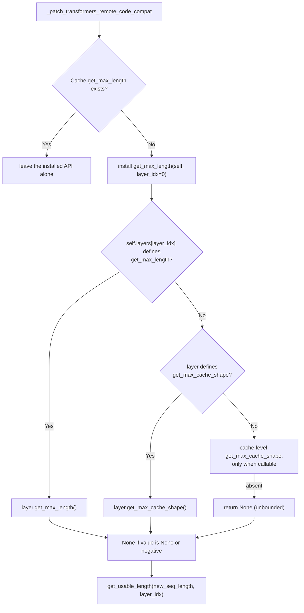

| Area | Before | After |
| --- | --- | --- |
| Install gate | `not hasattr(Cache, "get_max_length") and hasattr(Cache, "get_max_cache_shape")` (`utils/hf.py:1208`) | `not hasattr(Cache, "get_max_length")` (`utils/hf.py:1208`) |
| Value source | `self.get_max_cache_shape(layer_idx)` unconditionally (`utils/hf.py:1231`) | layer API first, cache-level shape only when callable, else `None` (`utils/hf.py:1233`) |
| Behaviour on 5.22 | shim not installed, `AttributeError` | shim installed, dynamic layers report `None` |

## K. Native loads run the pre-load hook; one legacy `generate()` adapter (issue #4121 items 2-3)

`GPTQModel.load(..., quantize_config=None)` (native evaluation) is a distinct
load branch in `models/loader.py`. It used to skip `before_model_load`, the hook
where a definition adapts the checkpoint's own remote code before
`from_pretrained` runs it. The hook ran for quantize and quantized reload only,
so the mask-helper shims that `OuroQModel`/`Spark2_5QModel` install there were
missing exactly when a native model called `generate()`
(`TypeError: create_causal_mask() got an unexpected keyword argument
'input_embeds'`).

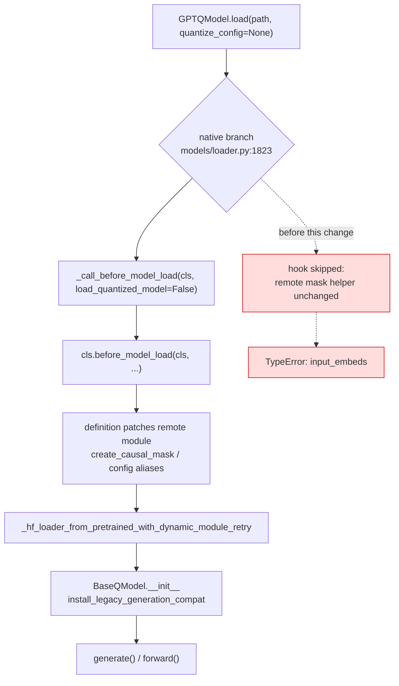

The same three-way call site now goes through one helper
(`gptqmodel/models/loader.py:886`), so a definition cannot be wired into one
load path and forgotten in another:

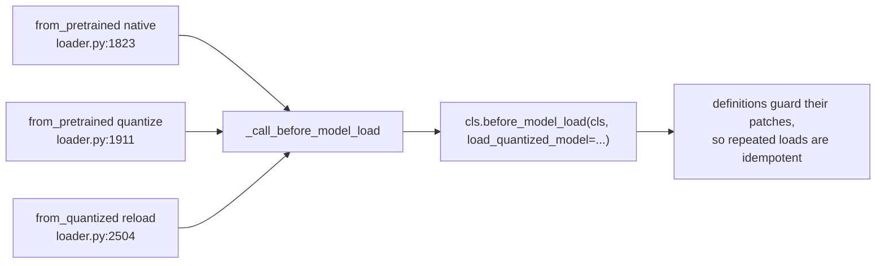

Item 3 is the generate half. #4108 fixed transformers-5 `generate()` for ChatGLM
only, by disabling the KV cache for that one family. The other legacy families
fail at the same boundary from different call sites, because transformers 5
hands `prepare_inputs_for_generation` a `DynamicCache` on the very first step,
while transformers 4 passed `None`, and the old tuple/attribute interface is
gone:

| Family | Failure on `main` | transformers-4 expectation |
| --- | --- | --- |
| DeciLM, Baichuan2 | `TypeError: 'DynamicCache' object is not subscriptable` | `past_key_values[0][0].shape[2]` |
| MiniCPM-2B-dpo | `AttributeError: 'DynamicCache' object has no attribute 'seen_tokens'` | `past_key_values.seen_tokens` |
| EXAONE-3 | `AttributeError: 'NoneType' object has no attribute 'shape'` | `cache_position` is a tensor |
| Nanbeige4.2 | `ValueError: max() iterable argument is empty` | `get_max_length()` is `None` before prefill |
| PanGu-alpha | `AttributeError: 'GPTPanguConfig' object has no attribute 'num_hidden_layers'` | layer count alias |

The fix is one adapter installed from `BaseQModel.__init__`
(`gptqmodel/models/base.py:774`) plus cache-side surface in
`_patch_transformers_remote_code_compat`. No family names appear in it:

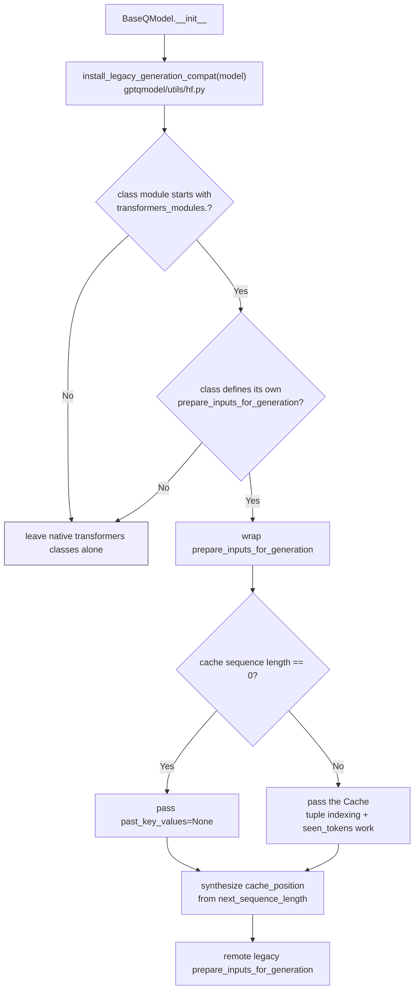

Cache-side surface, installed once per process by
`_patch_transformers_remote_code_compat` (`gptqmodel/utils/hf.py:858`):

| Symbol | Added by | Why |
| --- | --- | --- |
| `DynamicCache.__getitem__` | `hf.py:1118` | `cache[0][0].shape[2]`; an unwritten layer raises `IndexError` |
| `Cache.seen_tokens` | `hf.py:1098` | property over `get_seq_length()` |
| `Cache.get_usable_length` | `hf.py:1061` | treats transformers 5's `-1` sentinel as "unbounded", not `max_length - new_seq_length` |

The layer-count alias is generic too: any remote config that declares
`num_layers`/`n_layer`/`n_layers` but not `num_hidden_layers` gets an
`attribute_map` entry (`hf.py:1703`), so `DynamicCache` can size itself and the
checkpoint keeps its own field name. ChatGLM's `num_layers` alias now uses the
same helper instead of its own copy.

Failure contract: a cache that has not been written yet is reported as "no
past", never as an empty tuple that legacy code will index; a native
transformers class is never wrapped; a definition's hook runs on every load
path and must stay idempotent because quantize and reload can share a process.

## Measured behaviour

Tiny random models, GPTQ 4-bit, `group_size=32`, `desc_act=False`, saved and
reloaded with `BACKEND.TORCH`; relative logit error is measured against the
fp16 model and against an independent per-group RTN baseline. Measured on an
NVIDIA RTX 4090 (`GPU-d458708b-c760-bbf1-08fb-8b8803a2157d`).

| Family | GPTQ vs fp16 | RTN vs fp16 | Quantized linears |
| --- | --- | --- | --- |
| GPT-NeoX | 0.068 | 0.094 | 4/4 |
| FalconMamba | 0.109 | 0.113 | 6/6 declared (`dt_proj` is not in the definition) |
| Nemotron-H | 0.149 | 0.181 | 10/10 |
| Falcon-H1 | 0.079 | 0.103 | 18/18 |
| Zamba v1 | 0.00115 | 0.00122 | 18/18 declared (`shared_transf` is not in the definition) |

These numbers validate the compatibility fixes on small fixtures; they are not
quality claims for full checkpoints.

## Tests

| Test file | Invariant |
| --- | --- |
| `tests/test_lazy_turtle_conversion_mapping.py` | class-name and `config.architectures` lookups, GPT-NeoX `lm_head` -> `embed_out.weight` resolution |
| `tests/test_falcon_mamba_support.py` | patch guard on 5.22, real-model forward untouched, `{dt,b,c}_layernorm.weight` restoration |
| `tests/test_zamba_support.py` | patch guard when the legacy forward methods are absent |
| `tests/test_nemotron_h_support.py` | patch guard when the legacy forward methods are absent |
| `tests/module_tree/test_nemotron_h_model_tree.py` | real-model `model` tree root and native mixer projection coverage |
| `tests/test_falcon_h1_support.py` | `mup_vector` restoration and idempotence |
| `tests/module_tree/test_registered_module_plans.py` | updated Nemotron-H registry plan |
| `tests/test_remote_code_rotary_restore.py` | fp64 oracle for legacy `inv_freq`/cos/sin, meta-shell skip, native-style skip, idempotence |
| `tests/test_hf_config_compat.py` | legacy unscaled RoPE stays `None`, modern `rope_parameters` preserved, ChatGLM aliases, `OutputRecorder` shim, cache-length helpers restored from the layer API |
| `tests/test_lazy_turtle_conversion_mapping.py` | chained `.bin` conversion error, legacy tied-key normalization before save |
| `tests/test_spark2_5_support.py` | AUTO_NF12 source-weight dtype/shape/device contract |
| `tests/models/test_chatglm.py` | native and tiny from-config `generate()` |
| `tests/test_legacy_generation_compat.py` | native load runs `before_model_load`; empty cache becomes `None`; `cache[0][0]`/`seen_tokens`/`get_usable_length`; `num_layers`/`n_layer` -> `num_hidden_layers` |
| `tests/models/test_ouro.py`, `tests/models/test_spark2_5.py` | native `generate()` after the pre-load hook installs the mask-helper shim |
| `tests/models/test_deci.py`, `test_exaone.py`, `test_nanbeige42.py`, `test_minicpm.py`, `test_baichuan.py`, `test_pangu_alpha.py` | quantize+ARC path also asserts real generated text (`ASSERT_INFERENCE`) |

## E-I. Definition and calibration fixes (issue #4040)

The E-I fixes share one rule with A-D: a definition declares the *installed*
layout, and a silent miss is a bug. A family whose routed experts cannot be
resolved must not report success with only a coverage warning.

## LFM2-MoE routed experts and attention output

`gptqmodel/models/definitions/lfm2_moe.py` described the pre-5.22 module names.
Transformers 5.22 names the attention output `out_proj` and Defuser splits the
fused expert tensors into `gate_proj`/`up_proj`/`down_proj` per expert, while the
dense MLP keeps `w1`/`w3`/`w2`.

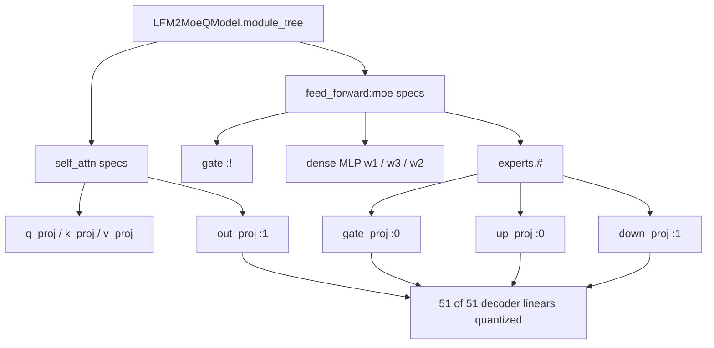

| Area | Before (5.22 layout) | After |
| --- | --- | --- |
| attention output | `self_attn.o_proj` resolved on no layer | `self_attn.out_proj` |
| routed experts | `experts.#.w1/w3/w2` resolved on no layer | `experts.#.gate_proj/up_proj/down_proj` |
| lifecycle hooks | `W1W3W2MoELifecycleHooks` | `GateUpDownMoELifecycleHooks` |
| dense MLP | `feed_forward.w1/w3/w2` | unchanged (dense layers still use `w1/w3/w2`) |

`tests/module_tree/test_moe_expert_coverage.py` now includes `lfm2_moe` in
`FIXED_MODELS`: every quantizable spec must resolve on at least one decoder
layer after Defuser's expert expansion. The old tree failed that assertion
because 13 of 51 linears (every routed expert plus the attention output) had no
match.

## GLM-4.x MoE router tuple

Defuser 0.0.30 replaced the GLM-4.5/4.6/4.7 and GLM-4.7-Flash MoE block with a
per-expert module whose `forward` passed the router result straight into
`route_tokens_to_experts`, which calls `.sigmoid()`. Transformers 5.22 routers
return `(router_logits, topk_weights, topk_indices)`, so the first MoE layer
raised `AttributeError: 'tuple' object has no attribute 'sigmoid'`.

Defuser 0.0.31 owns the fix: `route_tokens_to_experts` unwraps the tuple to the
raw logits and keeps its own grouped top-k selection, so the routing math is
byte-identical to the tensor path. GPT-QModel now requires `defuser>=0.0.31` and
no longer installs a local compatibility shim.

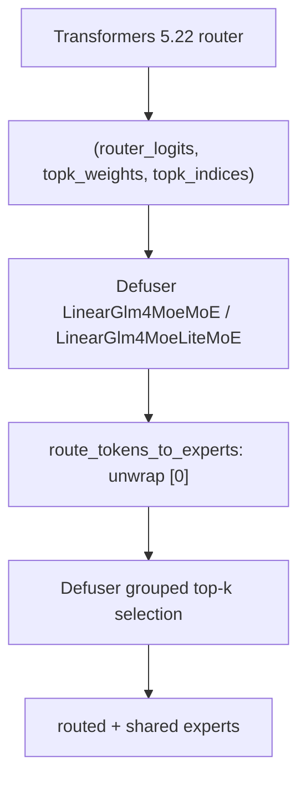

| Area | Before | After |
| --- | --- | --- |
| router input | 5.22 tuple reaches `.sigmoid()` | Defuser 0.0.31 unwraps `[0]` |
| routing math | crashes before selection | Defuser's grouped top-k unchanged |
| GPT-QModel | local `defuser_compat` shim | `defuser>=0.0.31` floor, no shim |

## Text-only Mllama

Transformers 5.22 ships `MllamaForCausalLM` for `MllamaTextConfig` but does not
register that config with `AutoModelForCausalLM`. `mllama.py` now registers the
pair and resolves the text-only layout (`model.model`) in addition to the two
multimodal layouts.

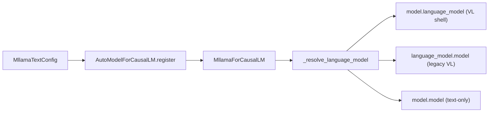

## Native Kimi-Linear dispatch

`MODEL_MAP["kimi_linear"]` still names `KimiLinearQModel`, which describes the
AttnRes/K3 `block_sparse_moe` checkpoint and requires the bounded K3 runner.
Native Transformers 5.22 `KimiLinearForCausalLM` has no AttnRes state and uses
`self_attn` plus `mlp.experts`/`mlp.shared_experts`. `check_and_get_model_definition`
now dispatches on config fields.

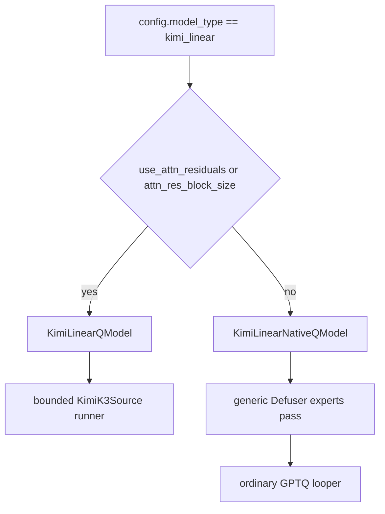

The native definition declares the linear-attention projections
(`q/k/v/o_proj`, `b_proj`, `g_a/g_b_proj`, `forget_gate.f_a/f_b_proj`), the MLA
projections (`q_a/q_b_proj`, `kv_a_proj_with_mqa`, `kv_b_proj`), and both MLP
branches. `KimiLinearNativeQModel.defuser_generic_experts` makes the loader call
Defuser's generic `update_module` pass, because Defuser has no registry entry for
this model type.

## HRM-Text recurrent calibration

HRM-Text runs the L stack `H_cycles * L_cycles` times and the H stack
`H_cycles` times. The flattened L0, L1, H0, H1 chain only saw the first
invocation, and H0's real input is `z_H + final_norm(z_L)`, not the L1 output.
`HrmTextQModel` now captures every invocation with full-model forward hooks and
serves each layer its own invocation batches through `pre_quantize`.

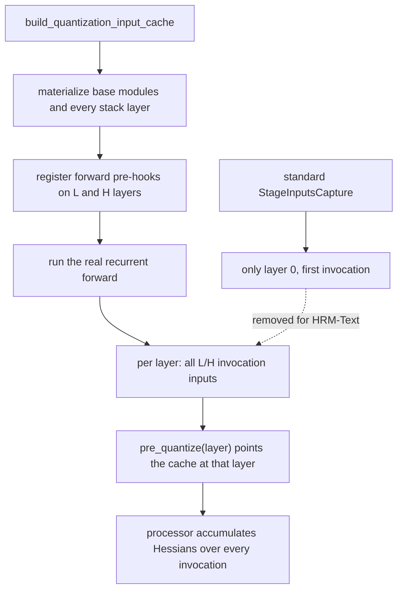

| Area | Before | After |
| --- | --- | --- |
| L stack inputs | first invocation only | `H_cycles * L_cycles` invocations |
| H stack inputs | flattened L1 output | `z_H + final_norm(z_L)` per cycle |
| Hessian coverage | one cycle | every invocation |

Limitation: the capture materializes the complete HRM-Text model for one
calibration pass. HRM-Text is a ~1B-parameter family, so this is bounded, but a
larger recurrent family would need a streaming replay instead.

## "Also" list

| Family | Before | After |
| --- | --- | --- |
| GLM-ASR | `AutoModel` built `GlmAsrModel`, whose layers are `language_model.layers` and which has no `lm_head` | `AutoModelForMultimodalLM` builds `GlmAsrForConditionalGeneration`; tree is `model.language_model.layers`, `lm_head` is top-level |
| Llama 4 | `lm_head` defaulted to `lm_head` | `Llama4QModel.lm_head = "language_model.lm_head"` |
| Qwen2.5-Omni | `pre_lm_head_norm_module` was `thinker.model.norm` | candidate list covers `thinker.model.language_model.norm` and the legacy path |
| MiMo-V2-Flash | Hub `model_type` `mimo_v2_flash` had no definition | `MimoV2FlashQModel` registered with the native `model.layers` tree and generic experts pass |
| DeepSeek-V4 | GPTQ/AWQ/RTN target layers stayed META until the first subset forward | non-packed methods materialize the layer eagerly; EXL3 keeps the packed lazy boundary |

DeepSeek-V4's remaining failure was `attn_hc`/`ffn_hc`/router-bias tensors plus
every projection still on `meta` when the first subset rehomed the layer.
`_keeps_packed_target_layer_lazy` restricts the lazy boundary to EXL3 and the
auto-module decoder; GPTQ/AWQ/RTN now call `BaseQModel.pre_quantize`, which
materializes the whole layer from LazyTurtle.

## Validation

Tiny random checkpoints were run end to end on the CUDA and ROCm venvs: GPTQ
4-bit, `group_size=32`, `desc_act=False`, save, reload with `BACKEND.TORCH`,
and logits against fp16 and an RTN baseline. Numbers below are the CUDA
RTX 4090 run; the ROCm R9700 run matched within run-to-run noise.

| Family | GPTQ vs fp16 | RTN vs fp16 | Quantized linears |
| --- | --- | --- | --- |
| LFM2-MoE | 0.0837 | 0.1213 | 51/51 decoder (13/51 before) |
| GLM-4.5 MoE | 0.0158 | 0.0603 | 26/26 decoder |
| Mllama text | 0.0242 | 0.0555 | 14/14 decoder |
| Native Kimi-Linear | 0.0209 | 0.0541 | 32/32 decoder |
| HRM-Text | 0.0008 | 0.0016 | 32/32 decoder |
| GLM-ASR | 0.0162 | 0.0507 | 14/14 text decoder |
| MiMo-V2-Flash | 0.0355 | 0.1134 | 23/23 decoder |
| DeepSeek-V4 | 0.0249 | 0.0286 | 48/48 decoder |

These are fixture checks, not quality claims for full checkpoints. The `lm_head`
is excluded from the coverage counts because the default configuration does not
quantize it.
