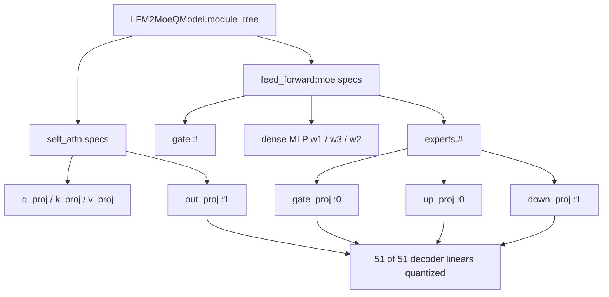
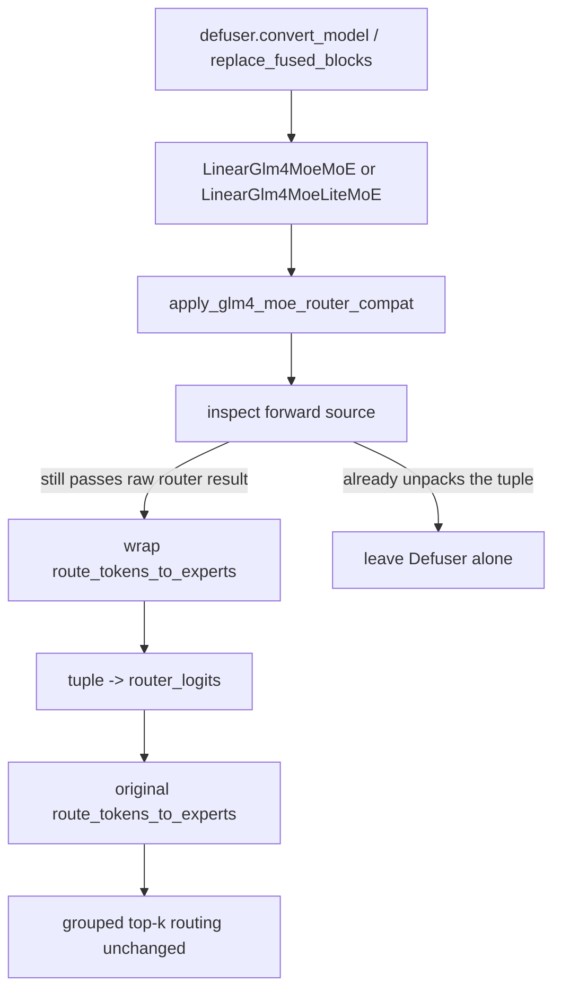
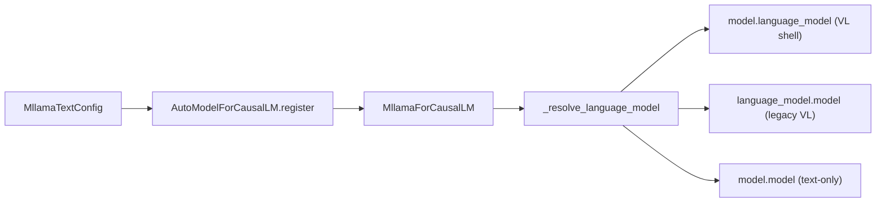
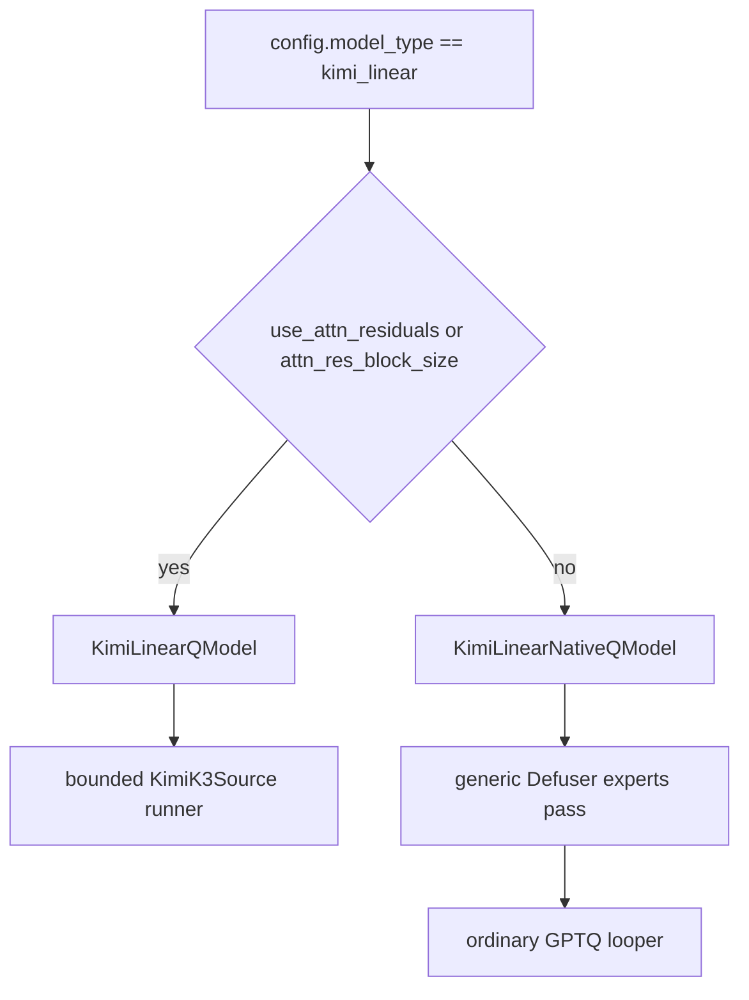
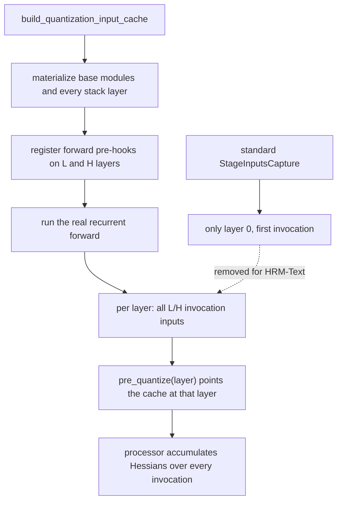

# Transformers 5.22 model compatibility

Transformers 5.22 moved several decoder layouts, fused per-expert checkpoint
tensors into 3-D parameters, and changed two router return signatures. GPT-QModel
resolves model definitions from the installed Transformers layout, so each of
those changes either silently skipped quantizable projections or crashed the
first forward. This page records the model-tree and calibration decisions that
keep those families working. It is the reference for the fixes in issue #4040
sections E-I and the "Also" list; sections A-D are documented by their own PR.

The rule behind every fix is the same: a definition declares the *installed*
layout, and a silent miss is a bug. A family whose routed experts cannot be
resolved must not report success with only a coverage warning.

## LFM2-MoE routed experts and attention output

`gptqmodel/models/definitions/lfm2_moe.py` described the pre-5.22 module names.
Transformers 5.22 names the attention output `out_proj` and Defuser splits the
fused expert tensors into `gate_proj`/`up_proj`/`down_proj` per expert, while the
dense MLP keeps `w1`/`w3`/`w2`.

| Area | Before (5.22 layout) | After |
| --- | --- | --- |
| attention output | `self_attn.o_proj` resolved on no layer | `self_attn.out_proj` |
| routed experts | `experts.#.w1/w3/w2` resolved on no layer | `experts.#.gate_proj/up_proj/down_proj` |
| lifecycle hooks | `W1W3W2MoELifecycleHooks` | `GateUpDownMoELifecycleHooks` |
| dense MLP | `feed_forward.w1/w3/w2` | unchanged (dense layers still use `w1/w3/w2`) |

`tests/module_tree/test_moe_expert_coverage.py` now includes `lfm2_moe` in
`FIXED_MODELS`: every quantizable spec must resolve on at least one decoder
layer after Defuser's expert expansion. The old tree failed that assertion
because 13 of 51 linears (every routed expert plus the attention output) had no
match.

## GLM-4.x MoE router tuple shim

Defuser 0.0.30 replaces the GLM-4.5/4.6/4.7 and GLM-4.7-Flash MoE block with a
per-expert module. Its `forward` passes the router result straight into
`route_tokens_to_experts`, which calls `.sigmoid()`. Transformers 5.22 routers
return `(router_logits, topk_weights, topk_indices)`, so the first MoE layer
raised `AttributeError: 'tuple' object has no attribute 'sigmoid'`.

| Area | Before | After |
| --- | --- | --- |
| router input | 5.22 tuple reaches `.sigmoid()` | `gptqmodel/utils/defuser_compat.py` unwraps `[0]` |
| routing math | crashes before selection | delegates to Defuser's original method |
| future Defuser fix | n/a | source gate skips the shim when `forward` unpacks the tuple |

The authoritative fix belongs in Defuser. The GPT-QModel shim is installed from
`_convert_model_with_defuser` and `hf_load.convert_fused_modules`, so both the
quantize and reload paths get it.

## Text-only Mllama

Transformers 5.22 ships `MllamaForCausalLM` for `MllamaTextConfig` but does not
register that config with `AutoModelForCausalLM`. `mllama.py` now registers the
pair and resolves the text-only layout (`model.model`) in addition to the two
multimodal layouts.

## Native Kimi-Linear dispatch

`MODEL_MAP["kimi_linear"]` still names `KimiLinearQModel`, which describes the
AttnRes/K3 `block_sparse_moe` checkpoint and requires the bounded K3 runner.
Native Transformers 5.22 `KimiLinearForCausalLM` has no AttnRes state and uses
`self_attn` plus `mlp.experts`/`mlp.shared_experts`. `check_and_get_model_definition`
now dispatches on config fields.

The native definition declares the linear-attention projections
(`q/k/v/o_proj`, `b_proj`, `g_a/g_b_proj`, `forget_gate.f_a/f_b_proj`), the MLA
projections (`q_a/q_b_proj`, `kv_a_proj_with_mqa`, `kv_b_proj`), and both MLP
branches. `KimiLinearNativeQModel.defuser_generic_experts` makes the loader call
Defuser's generic `update_module` pass, because Defuser has no registry entry for
this model type.

## HRM-Text recurrent calibration

HRM-Text runs the L stack `H_cycles * L_cycles` times and the H stack
`H_cycles` times. The flattened L0, L1, H0, H1 chain only saw the first
invocation, and H0's real input is `z_H + final_norm(z_L)`, not the L1 output.
`HrmTextQModel` now captures every invocation with full-model forward hooks and
serves each layer its own invocation batches through `pre_quantize`.

| Area | Before | After |
| --- | --- | --- |
| L stack inputs | first invocation only | `H_cycles * L_cycles` invocations |
| H stack inputs | flattened L1 output | `z_H + final_norm(z_L)` per cycle |
| Hessian coverage | one cycle | every invocation |

Limitation: the capture materializes the complete HRM-Text model for one
calibration pass. HRM-Text is a ~1B-parameter family, so this is bounded, but a
larger recurrent family would need a streaming replay instead.

## "Also" list

| Family | Before | After |
| --- | --- | --- |
| GLM-ASR | `AutoModel` built `GlmAsrModel`, whose layers are `language_model.layers` and which has no `lm_head` | `AutoModelForMultimodalLM` builds `GlmAsrForConditionalGeneration`; tree is `model.language_model.layers`, `lm_head` is top-level |
| Llama 4 | `lm_head` defaulted to `lm_head` | `Llama4QModel.lm_head = "language_model.lm_head"` |
| Qwen2.5-Omni | `pre_lm_head_norm_module` was `thinker.model.norm` | candidate list covers `thinker.model.language_model.norm` and the legacy path |
| MiMo-V2-Flash | Hub `model_type` `mimo_v2_flash` had no definition | `MimoV2FlashQModel` registered with the native `model.layers` tree and generic experts pass |
| DeepSeek-V4 | GPTQ/AWQ/RTN target layers stayed META until the first subset forward | non-packed methods materialize the layer eagerly; EXL3 keeps the packed lazy boundary |

DeepSeek-V4's remaining failure was `attn_hc`/`ffn_hc`/router-bias tensors plus
every projection still on `meta` when the first subset rehomed the layer.
`_keeps_packed_target_layer_lazy` restricts the lazy boundary to EXL3 and the
auto-module decoder; GPTQ/AWQ/RTN now call `BaseQModel.pre_quantize`, which
materializes the whole layer from LazyTurtle.

## Validation

Tiny random checkpoints were run end to end on the CUDA venv: GPTQ 4-bit, save,
reload with the TORCH backend, logits against fp16 and an RTN baseline. The
numbers and linear coverage are recorded in the pull request for #4040.
