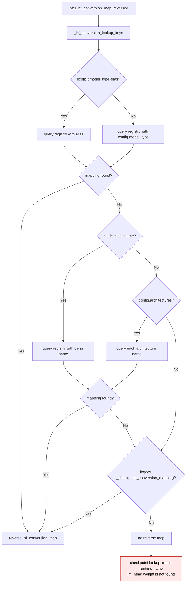
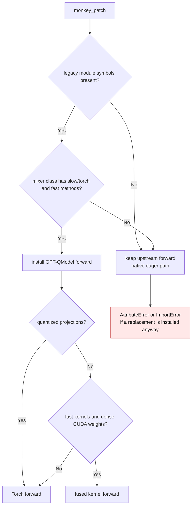
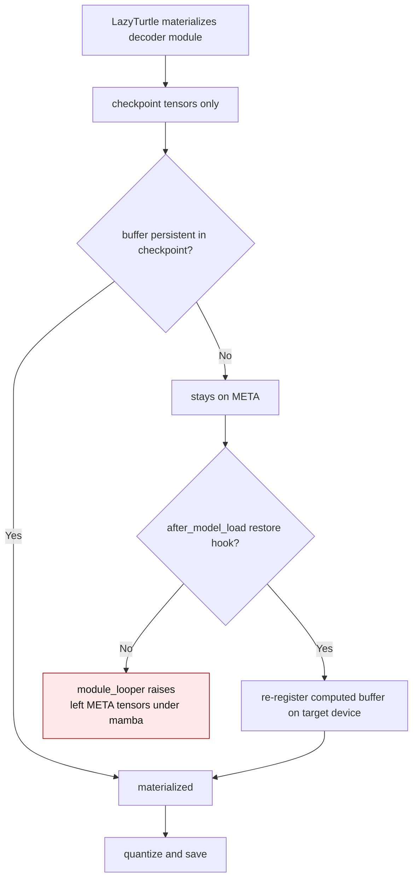
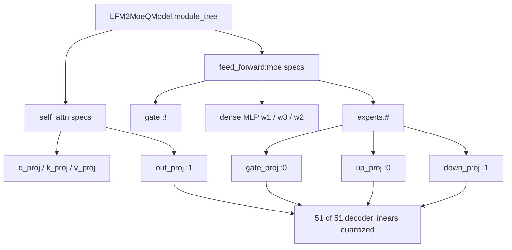
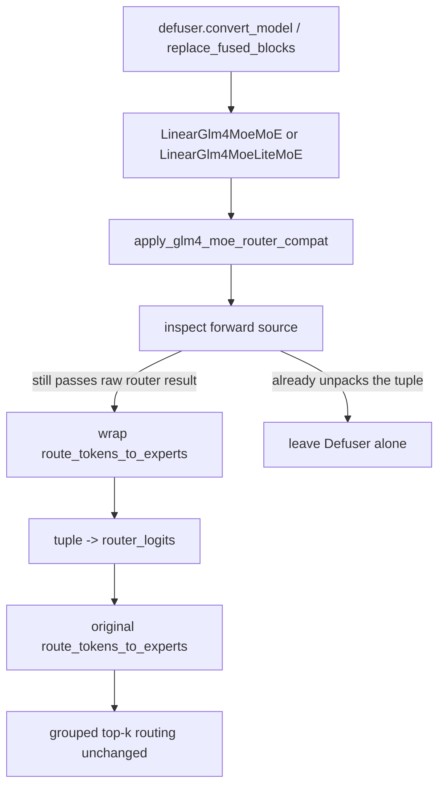
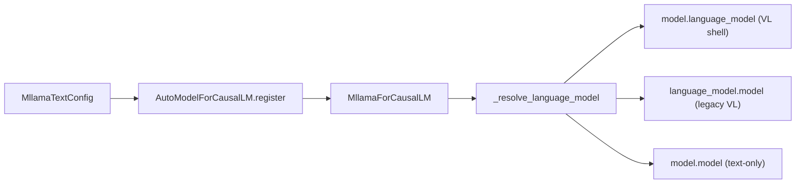
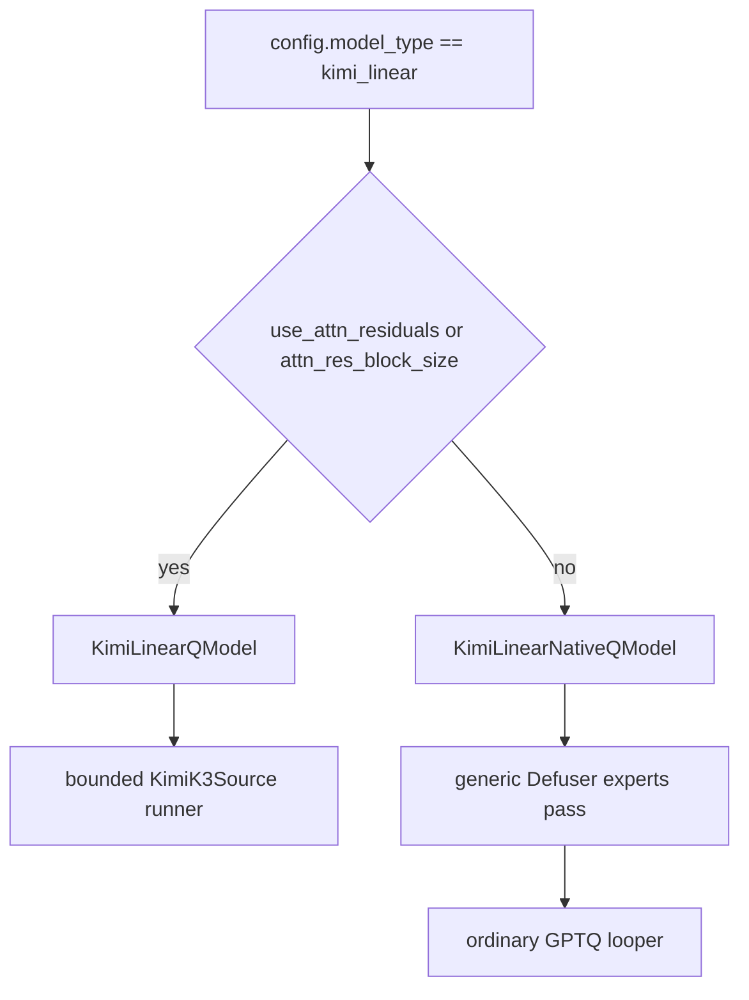
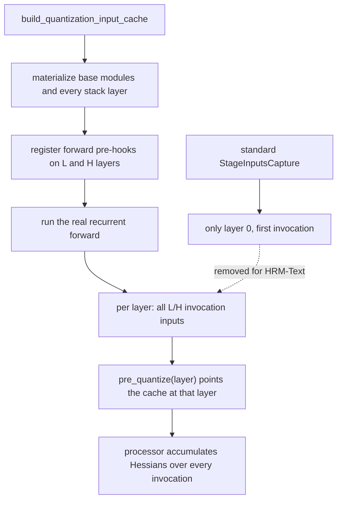

# Transformers 5.22 model compatibility

Transformers 5.22 changed three things that GPT-QModel's model definitions and
lazy checkpoint loader depended on:

1. some checkpoint conversion maps are registered under the **model class
   name** instead of `config.model_type`;
2. several Mamba-family mixers lost their explicit `slow_forward` /
   `cuda_kernels_forward` / `torch_forward` entry points and the fused
   `falcon_mamba_inner_fn` symbol;
3. some non-persistent buffers are still created in `__init__` but are absent
   from the checkpoint, so a lazy shell leaves them on META.

The sections below describe the shipped behaviour for the loader, the
GPT-NeoX save path, the FalconMamba / Zamba / Nemotron-H patch guards, the
Nemotron-H tree root, and the Falcon-H1 / FalconMamba buffer restoration.
Sections E-I of issue #4040 (LFM2-MoE, GLM-4.x MoE, mllama, Kimi-Linear,
HRM-Text, glmasr) are described after the A-D sections below.

## A. Checkpoint conversion maps are class-keyed

`LazyTurtle.infer_hf_conversion_map_reversed()` in
`gptqmodel/utils/structure.py:1725` resolves runtime names back to checkpoint
names. Before this change it queried the Transformers registry with
`config.model_type` only (`gptqmodel/utils/structure.py:1693` on `main`).
GPT-NeoX registers its `^embed_out\.` -> `lm_head.` rename under
`GPTNeoXForCausalLM`, so the lookup returned `None`, LazyTurtle kept looking
for `lm_head.weight`, and every GPT-NeoX save ended in
`FileNotFoundError: Offloaded tensor 'lm_head.weight' not found`
(`gptqmodel/utils/model.py:2362`).

The lookup now tries an explicit definition alias, then `config.model_type`,
then `type(model).__name__`, then `config.architectures`.

The GPT-NeoX definition also declares `lm_head = "lm_head"`
(`gptqmodel/models/definitions/gpt_neox.py:11`), because the runtime module was
renamed from `embed_out` to `lm_head`; the conversion map bridges it back to
`embed_out.weight` in the checkpoint. The lookup is generic, so
`NemotronH_Omni_Reasoning_V3`, `MtpModel`, and any future class-keyed
registration work without a model-specific special case.

## B. Mixer patches are installed only when the legacy API exists

`monkey_patch()` replaces the upstream mixer `forward` to keep quantized
projections on the Torch path. Transformers 5.22 removed the symbols those
replacements call. The replacement is now installed only when the mixer class
still exposes the methods it uses; otherwise the upstream forward is kept,
which already selects the eager path outside training.

| Family | Old symbol used by the patch | Guard |
| --- | --- | --- |
| FalconMamba | `falcon_mamba_inner_fn`, `slow_forward`, `cuda_kernels_forward` | module symbols probed with `getattr`; class must expose both forward methods |
| Zamba v1 | `slow_forward`, `cuda_kernels_forward` | class must expose both forward methods |
| Nemotron-H | `torch_forward`, `cuda_kernels_forward` | class must expose both forward methods |

Before the guard, FalconMamba failed at import
(`gptqmodel/models/definitions/falcon_mamba.py:70` on `main`), while Zamba and
Nemotron-H installed a replacement that raised `AttributeError` on first use
(`gptqmodel/models/definitions/zamba.py:75`,
`gptqmodel/models/definitions/nemotron_h.py:75` on `main`).

## C. Nemotron-H tree root is `model`

Transformers 5.22 registers `nemotron_h`'s `backbone.` -> `model.` rename in
the checkpoint conversion map, so the native runtime tree is
`model.layers.*`. The definition now declares `model` as its root
(`gptqmodel/models/definitions/nemotron_h.py:23`) instead of `backbone`
(`gptqmodel/models/definitions/nemotron_h.py:16` on `main`). The
`monkey_patch` layer walk accepts either `self.model.model.layers` (native
5.22) or `self.model.backbone.layers` (older remote code).

With the wrong root, layer resolution returned `None` and
`looper/stage_inputs_capture.py:206` raised
`TypeError: 'NoneType' object is not subscriptable`.

## D. Non-persistent buffers are rebuilt after a lazy load

`LazyTurtle` materializes decoder modules from checkpoint tensors. Buffers
created in `__init__` with `persistent=False` never reach the checkpoint, so
they stay on META and `looper/module_looper.py:1354` reports
`Lazy forward direct-state materialization left META tensors under ...`.

| Family | Buffer | Restoration |
| --- | --- | --- |
| Falcon-H1 | `mamba.mup_vector` | `FalconH1QModel._restore_falcon_h1_mup_buffers()` re-registers `compute_mup_vector(config)` in `after_model_load` and `pre_quantize_generate_hook_start` |
| FalconMamba | `mixer.dt_layernorm.weight`, `mixer.b_layernorm.weight`, `mixer.c_layernorm.weight` | `_restore_falcon_mamba_rms_buffers()` fills the 5.22 `FalconMambaWeightlessRMSNorm` weights in addition to the legacy `dt_rms` / `b_c_rms` buffers |

The restore hooks keep an already materialized buffer untouched, so they are
idempotent for ordinary (non-lazy) loads.

## Measured behaviour

Tiny random models, GPTQ 4-bit, `group_size=32`, `desc_act=False`, saved and
reloaded with `BACKEND.TORCH`; relative logit error is measured against the
fp16 model and against an independent per-group RTN baseline. Measured on an
NVIDIA RTX 4090 (`GPU-d458708b-c760-bbf1-08fb-8b8803a2157d`).

| Family | GPTQ vs fp16 | RTN vs fp16 | Quantized linears |
| --- | --- | --- | --- |
| GPT-NeoX | 0.068 | 0.094 | 4/4 |
| FalconMamba | 0.109 | 0.113 | 6/6 declared (`dt_proj` is not in the definition) |
| Nemotron-H | 0.149 | 0.181 | 10/10 |
| Falcon-H1 | 0.079 | 0.103 | 18/18 |
| Zamba v1 | 0.00115 | 0.00122 | 18/18 declared (`shared_transf` is not in the definition) |

These numbers validate the compatibility fixes on small fixtures; they are not
quality claims for full checkpoints.

## Tests

| Test file | Invariant |
| --- | --- |
| `tests/test_lazy_turtle_conversion_mapping.py` | class-name and `config.architectures` lookups, GPT-NeoX `lm_head` -> `embed_out.weight` resolution |
| `tests/test_falcon_mamba_support.py` | patch guard on 5.22, real-model forward untouched, `{dt,b,c}_layernorm.weight` restoration |
| `tests/test_zamba_support.py` | patch guard when the legacy forward methods are absent |
| `tests/test_nemotron_h_support.py` | patch guard when the legacy forward methods are absent |
| `tests/module_tree/test_nemotron_h_model_tree.py` | real-model `model` tree root and native mixer projection coverage |
| `tests/test_falcon_h1_support.py` | `mup_vector` restoration and idempotence |
| `tests/module_tree/test_registered_module_plans.py` | updated Nemotron-H registry plan |

## E-I. Definition and calibration fixes (issue #4040)

The E-I fixes share one rule with A-D: a definition declares the *installed*
layout, and a silent miss is a bug. A family whose routed experts cannot be
resolved must not report success with only a coverage warning.

## LFM2-MoE routed experts and attention output

`gptqmodel/models/definitions/lfm2_moe.py` described the pre-5.22 module names.
Transformers 5.22 names the attention output `out_proj` and Defuser splits the
fused expert tensors into `gate_proj`/`up_proj`/`down_proj` per expert, while the
dense MLP keeps `w1`/`w3`/`w2`.

| Area | Before (5.22 layout) | After |
| --- | --- | --- |
| attention output | `self_attn.o_proj` resolved on no layer | `self_attn.out_proj` |
| routed experts | `experts.#.w1/w3/w2` resolved on no layer | `experts.#.gate_proj/up_proj/down_proj` |
| lifecycle hooks | `W1W3W2MoELifecycleHooks` | `GateUpDownMoELifecycleHooks` |
| dense MLP | `feed_forward.w1/w3/w2` | unchanged (dense layers still use `w1/w3/w2`) |

`tests/module_tree/test_moe_expert_coverage.py` now includes `lfm2_moe` in
`FIXED_MODELS`: every quantizable spec must resolve on at least one decoder
layer after Defuser's expert expansion. The old tree failed that assertion
because 13 of 51 linears (every routed expert plus the attention output) had no
match.

## GLM-4.x MoE router tuple shim

Defuser 0.0.30 replaces the GLM-4.5/4.6/4.7 and GLM-4.7-Flash MoE block with a
per-expert module. Its `forward` passes the router result straight into
`route_tokens_to_experts`, which calls `.sigmoid()`. Transformers 5.22 routers
return `(router_logits, topk_weights, topk_indices)`, so the first MoE layer
raised `AttributeError: 'tuple' object has no attribute 'sigmoid'`.

| Area | Before | After |
| --- | --- | --- |
| router input | 5.22 tuple reaches `.sigmoid()` | `gptqmodel/utils/defuser_compat.py` unwraps `[0]` |
| routing math | crashes before selection | delegates to Defuser's original method |
| future Defuser fix | n/a | source gate skips the shim when `forward` unpacks the tuple |

The authoritative fix belongs in Defuser. The GPT-QModel shim is installed from
`_convert_model_with_defuser` and `hf_load.convert_fused_modules`, so both the
quantize and reload paths get it.

## Text-only Mllama

Transformers 5.22 ships `MllamaForCausalLM` for `MllamaTextConfig` but does not
register that config with `AutoModelForCausalLM`. `mllama.py` now registers the
pair and resolves the text-only layout (`model.model`) in addition to the two
multimodal layouts.

## Native Kimi-Linear dispatch

`MODEL_MAP["kimi_linear"]` still names `KimiLinearQModel`, which describes the
AttnRes/K3 `block_sparse_moe` checkpoint and requires the bounded K3 runner.
Native Transformers 5.22 `KimiLinearForCausalLM` has no AttnRes state and uses
`self_attn` plus `mlp.experts`/`mlp.shared_experts`. `check_and_get_model_definition`
now dispatches on config fields.

The native definition declares the linear-attention projections
(`q/k/v/o_proj`, `b_proj`, `g_a/g_b_proj`, `forget_gate.f_a/f_b_proj`), the MLA
projections (`q_a/q_b_proj`, `kv_a_proj_with_mqa`, `kv_b_proj`), and both MLP
branches. `KimiLinearNativeQModel.defuser_generic_experts` makes the loader call
Defuser's generic `update_module` pass, because Defuser has no registry entry for
this model type.

## HRM-Text recurrent calibration

HRM-Text runs the L stack `H_cycles * L_cycles` times and the H stack
`H_cycles` times. The flattened L0, L1, H0, H1 chain only saw the first
invocation, and H0's real input is `z_H + final_norm(z_L)`, not the L1 output.
`HrmTextQModel` now captures every invocation with full-model forward hooks and
serves each layer its own invocation batches through `pre_quantize`.

| Area | Before | After |
| --- | --- | --- |
| L stack inputs | first invocation only | `H_cycles * L_cycles` invocations |
| H stack inputs | flattened L1 output | `z_H + final_norm(z_L)` per cycle |
| Hessian coverage | one cycle | every invocation |

Limitation: the capture materializes the complete HRM-Text model for one
calibration pass. HRM-Text is a ~1B-parameter family, so this is bounded, but a
larger recurrent family would need a streaming replay instead.

## "Also" list

| Family | Before | After |
| --- | --- | --- |
| GLM-ASR | `AutoModel` built `GlmAsrModel`, whose layers are `language_model.layers` and which has no `lm_head` | `AutoModelForMultimodalLM` builds `GlmAsrForConditionalGeneration`; tree is `model.language_model.layers`, `lm_head` is top-level |
| Llama 4 | `lm_head` defaulted to `lm_head` | `Llama4QModel.lm_head = "language_model.lm_head"` |
| Qwen2.5-Omni | `pre_lm_head_norm_module` was `thinker.model.norm` | candidate list covers `thinker.model.language_model.norm` and the legacy path |
| MiMo-V2-Flash | Hub `model_type` `mimo_v2_flash` had no definition | `MimoV2FlashQModel` registered with the native `model.layers` tree and generic experts pass |
| DeepSeek-V4 | GPTQ/AWQ/RTN target layers stayed META until the first subset forward | non-packed methods materialize the layer eagerly; EXL3 keeps the packed lazy boundary |

DeepSeek-V4's remaining failure was `attn_hc`/`ffn_hc`/router-bias tensors plus
every projection still on `meta` when the first subset rehomed the layer.
`_keeps_packed_target_layer_lazy` restricts the lazy boundary to EXL3 and the
auto-module decoder; GPTQ/AWQ/RTN now call `BaseQModel.pre_quantize`, which
materializes the whole layer from LazyTurtle.

## Validation

Tiny random checkpoints were run end to end on the CUDA and ROCm venvs: GPTQ
4-bit, `group_size=32`, `desc_act=False`, save, reload with `BACKEND.TORCH`,
and logits against fp16 and an RTN baseline. Numbers below are the CUDA
RTX 4090 run; the ROCm R9700 run matched within run-to-run noise.

| Family | GPTQ vs fp16 | RTN vs fp16 | Quantized linears |
| --- | --- | --- | --- |
| LFM2-MoE | 0.0837 | 0.1213 | 51/51 decoder (13/51 before) |
| GLM-4.5 MoE | 0.0158 | 0.0603 | 26/26 decoder |
| Mllama text | 0.0242 | 0.0555 | 14/14 decoder |
| Native Kimi-Linear | 0.0209 | 0.0541 | 32/32 decoder |
| HRM-Text | 0.0008 | 0.0016 | 32/32 decoder |
| GLM-ASR | 0.0162 | 0.0507 | 14/14 text decoder |
| MiMo-V2-Flash | 0.0355 | 0.1134 | 23/23 decoder |
| DeepSeek-V4 | 0.0249 | 0.0286 | 48/48 decoder |

These are fixture checks, not quality claims for full checkpoints. The `lm_head`
is excluded from the coverage counts because the default configuration does not
quantize it.
