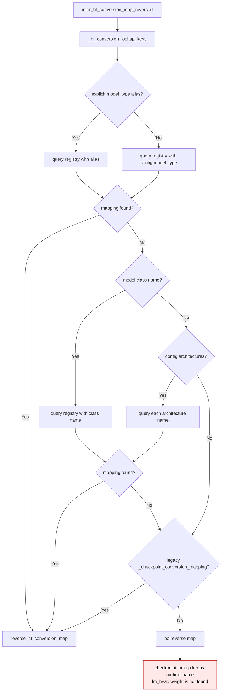
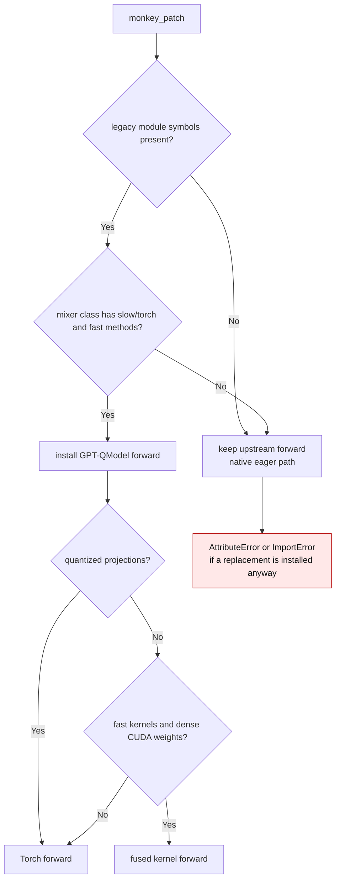
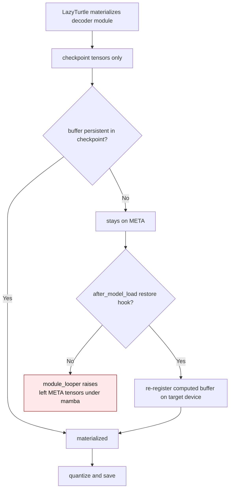

# Transformers 5.22 model compatibility

Transformers 5.22 changed three things that GPT-QModel's model definitions and
lazy checkpoint loader depended on:

1. some checkpoint conversion maps are registered under the **model class
   name** instead of `config.model_type`;
2. several Mamba-family mixers lost their explicit `slow_forward` /
   `cuda_kernels_forward` / `torch_forward` entry points and the fused
   `falcon_mamba_inner_fn` symbol;
3. some non-persistent buffers are still created in `__init__` but are absent
   from the checkpoint, so a lazy shell leaves them on META.

The sections below describe the shipped behaviour for the loader, the
GPT-NeoX save path, the FalconMamba / Zamba / Nemotron-H patch guards, the
Nemotron-H tree root, and the Falcon-H1 / FalconMamba buffer restoration.
Sections E-I of issue #4040 (LFM2-MoE, GLM-4.x MoE, mllama, Kimi-Linear,
HRM-Text, glmasr) are owned by a separate change and are not described here.

## A. Checkpoint conversion maps are class-keyed

`LazyTurtle.infer_hf_conversion_map_reversed()` in
`gptqmodel/utils/structure.py:1725` resolves runtime names back to checkpoint
names. Before this change it queried the Transformers registry with
`config.model_type` only (`gptqmodel/utils/structure.py:1693` on `main`).
GPT-NeoX registers its `^embed_out\.` -> `lm_head.` rename under
`GPTNeoXForCausalLM`, so the lookup returned `None`, LazyTurtle kept looking
for `lm_head.weight`, and every GPT-NeoX save ended in
`FileNotFoundError: Offloaded tensor 'lm_head.weight' not found`
(`gptqmodel/utils/model.py:2362`).

The lookup now tries an explicit definition alias, then `config.model_type`,
then `type(model).__name__`, then `config.architectures`.

The GPT-NeoX definition also declares `lm_head = "lm_head"`
(`gptqmodel/models/definitions/gpt_neox.py:11`), because the runtime module was
renamed from `embed_out` to `lm_head`; the conversion map bridges it back to
`embed_out.weight` in the checkpoint. The lookup is generic, so
`NemotronH_Omni_Reasoning_V3`, `MtpModel`, and any future class-keyed
registration work without a model-specific special case.

## B. Mixer patches are installed only when the legacy API exists

`monkey_patch()` replaces the upstream mixer `forward` to keep quantized
projections on the Torch path. Transformers 5.22 removed the symbols those
replacements call. The replacement is now installed only when the mixer class
still exposes the methods it uses; otherwise the upstream forward is kept,
which already selects the eager path outside training.

| Family | Old symbol used by the patch | Guard |
| --- | --- | --- |
| FalconMamba | `falcon_mamba_inner_fn`, `slow_forward`, `cuda_kernels_forward` | module symbols probed with `getattr`; class must expose both forward methods |
| Zamba v1 | `slow_forward`, `cuda_kernels_forward` | class must expose both forward methods |
| Nemotron-H | `torch_forward`, `cuda_kernels_forward` | class must expose both forward methods |

Before the guard, FalconMamba failed at import
(`gptqmodel/models/definitions/falcon_mamba.py:70` on `main`), while Zamba and
Nemotron-H installed a replacement that raised `AttributeError` on first use
(`gptqmodel/models/definitions/zamba.py:75`,
`gptqmodel/models/definitions/nemotron_h.py:75` on `main`).

## C. Nemotron-H tree root is `model`

Transformers 5.22 registers `nemotron_h`'s `backbone.` -> `model.` rename in
the checkpoint conversion map, so the native runtime tree is
`model.layers.*`. The definition now declares `model` as its root
(`gptqmodel/models/definitions/nemotron_h.py:23`) instead of `backbone`
(`gptqmodel/models/definitions/nemotron_h.py:16` on `main`). The
`monkey_patch` layer walk accepts either `self.model.model.layers` (native
5.22) or `self.model.backbone.layers` (older remote code).

With the wrong root, layer resolution returned `None` and
`looper/stage_inputs_capture.py:206` raised
`TypeError: 'NoneType' object is not subscriptable`.

## D. Non-persistent buffers are rebuilt after a lazy load

`LazyTurtle` materializes decoder modules from checkpoint tensors. Buffers
created in `__init__` with `persistent=False` never reach the checkpoint, so
they stay on META and `looper/module_looper.py:1354` reports
`Lazy forward direct-state materialization left META tensors under ...`.

| Family | Buffer | Restoration |
| --- | --- | --- |
| Falcon-H1 | `mamba.mup_vector` | `FalconH1QModel._restore_falcon_h1_mup_buffers()` re-registers `compute_mup_vector(config)` in `after_model_load` and `pre_quantize_generate_hook_start` |
| FalconMamba | `mixer.dt_layernorm.weight`, `mixer.b_layernorm.weight`, `mixer.c_layernorm.weight` | `_restore_falcon_mamba_rms_buffers()` fills the 5.22 `FalconMambaWeightlessRMSNorm` weights in addition to the legacy `dt_rms` / `b_c_rms` buffers |

The restore hooks keep an already materialized buffer untouched, so they are
idempotent for ordinary (non-lazy) loads.

## Measured behaviour

Tiny random models, GPTQ 4-bit, `group_size=32`, `desc_act=False`, saved and
reloaded with `BACKEND.TORCH`; relative logit error is measured against the
fp16 model and against an independent per-group RTN baseline. Measured on an
NVIDIA RTX 4090 (`GPU-d458708b-c760-bbf1-08fb-8b8803a2157d`).

| Family | GPTQ vs fp16 | RTN vs fp16 | Quantized linears |
| --- | --- | --- | --- |
| GPT-NeoX | 0.068 | 0.094 | 4/4 |
| FalconMamba | 0.109 | 0.113 | 6/6 declared (`dt_proj` is not in the definition) |
| Nemotron-H | 0.149 | 0.181 | 10/10 |
| Falcon-H1 | 0.079 | 0.103 | 18/18 |
| Zamba v1 | 0.00115 | 0.00122 | 18/18 declared (`shared_transf` is not in the definition) |

These numbers validate the compatibility fixes on small fixtures; they are not
quality claims for full checkpoints.

## Tests

| Test file | Invariant |
| --- | --- |
| `tests/test_lazy_turtle_conversion_mapping.py` | class-name and `config.architectures` lookups, GPT-NeoX `lm_head` -> `embed_out.weight` resolution |
| `tests/test_falcon_mamba_support.py` | patch guard on 5.22, real-model forward untouched, `{dt,b,c}_layernorm.weight` restoration |
| `tests/test_zamba_support.py` | patch guard when the legacy forward methods are absent |
| `tests/test_nemotron_h_support.py` | patch guard when the legacy forward methods are absent |
| `tests/module_tree/test_nemotron_h_model_tree.py` | real-model `model` tree root and native mixer projection coverage |
| `tests/test_falcon_h1_support.py` | `mup_vector` restoration and idempotence |
| `tests/module_tree/test_registered_module_plans.py` | updated Nemotron-H registry plan |
