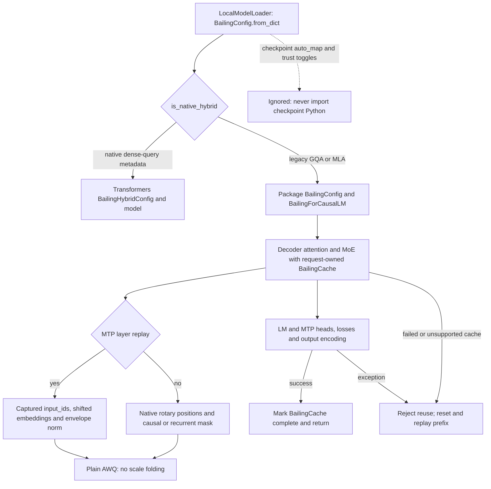
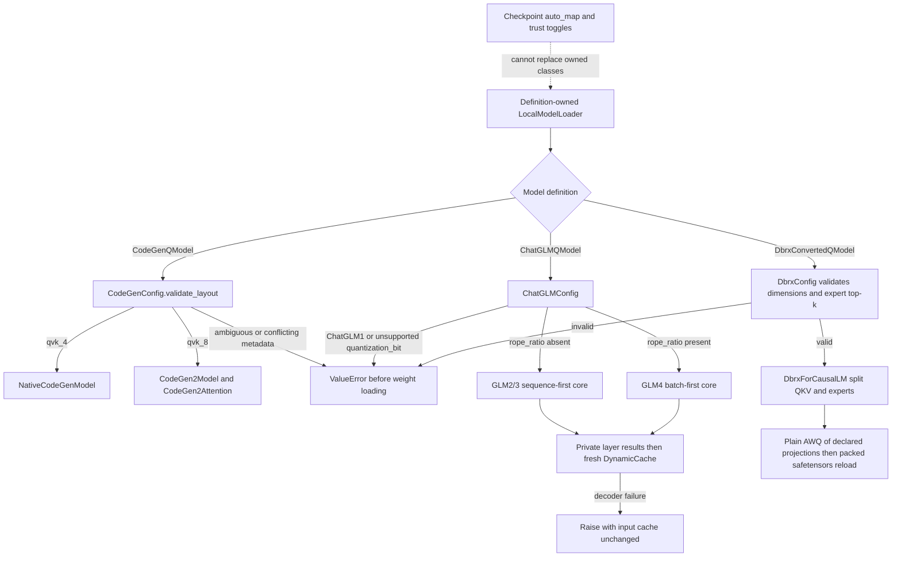
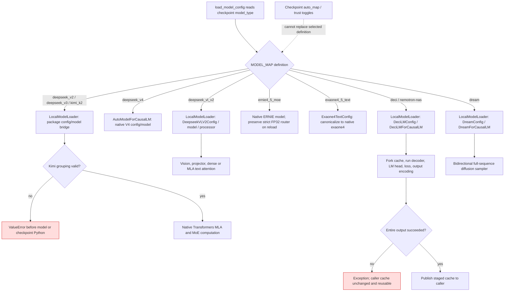
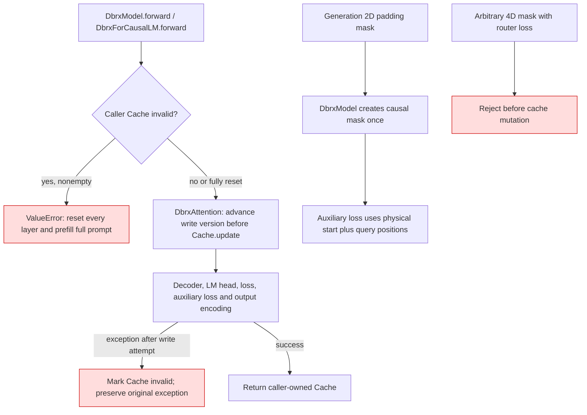
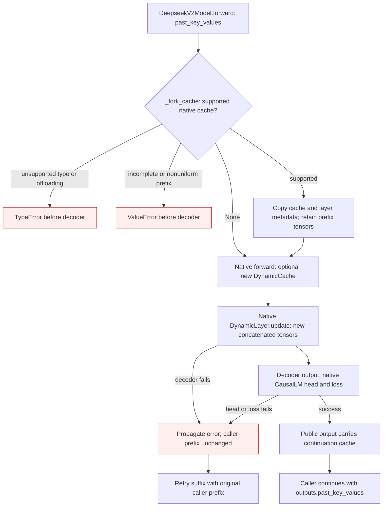
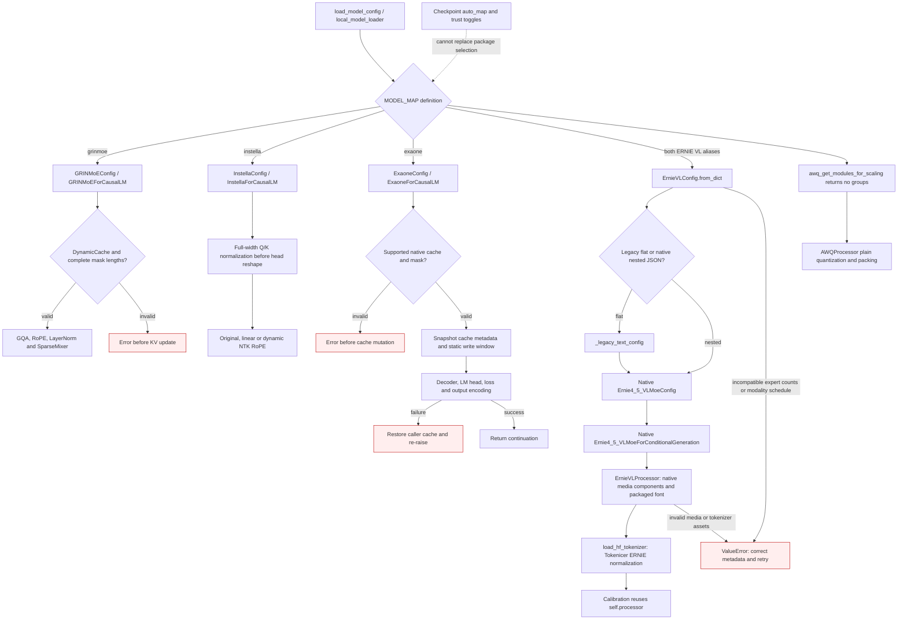

# GPT-QModel Transformers 5 model ports

GPT-QModel requires `transformers>=5.23.0`, the latest stable release when this
migration was qualified. Transformers 5.23.0 requires Python 3.11 or newer;
the project's Python requirement follows that floor. Transformers 4.x and
older Transformers 5 releases are outside this dependency contract.

Definitions select package-owned implementations through `LocalModelLoader`.
Checkpoint `auto_map`, API trust, and the safety bypass cannot replace these
config/model classes. See [implementation selection](trust-remote-code-isolation.md)
for the complete selection and failure flow.

Definitions with exact native Transformers 5 support retain their native
implementation. Their rows record checkpoint/layout qualification and any
definition ownership corrections alongside the package-owned ports.

| Definition / model type | Implementation and provenance | CPU validation | AWQ policy | Limits |
| --- | --- | --- | --- | --- |
| `DeepSeekV2QModel` / `deepseek_v2` | [Native-derived compatibility and pinned legacy source](../gptqmodel/models/ports/deepseek_v2/README.md) | Lite/full MLA, dense/periodic/shared MoE, top-k normalization, native expert conversion, cache/generation and safetensors round trips, malicious metadata matrix | Actual CPU plain quantization and packing; no scale groups | No GPU/trained-checkpoint quality, FlashAttention, distributed experts or full packed-checkpoint round trip; expert parallelism rejected |
| `DeepSeekV3QModel` / `deepseek_v3`, `kimi_k2` | [Native bridge, checkpoint conversion and pinned Kimi/DeepSeek provenance](../gptqmodel/models/ports/deepseek_v3/PROVENANCE.md) | Dense/split-Q MLA, published-layout grouped routing, cache/generation, MTP ownership, malicious metadata isolation and safetensors reload | Real CPU plain AWQ/INT4 packing, no scale folding | Kimi partial-group routing rejected; no GPU, trained-checkpoint accuracy or production FP8 qualification |
| `DeepSeekV4QModel` / `deepseek_v4` | [Native Transformers 5.23 and pinned BF16 checkpoint schema](../gptqmodel/models/ports/deepseek_v4/README.md) | Six sliding/CSA/HCA and expert variants, full 34,223-key target schema, source routing oracle, cache/generation and malicious metadata isolation | Plain AWQ packs 16 tiny linears across six layouts; no scale groups | BF16 checkpoint metadata gated (HTTP 401); no trained weights, GPU, FP8/FP4, MTP accuracy or packed export qualification |
| `DeepSeekVLV2QModel` / `deepseek_vl_v2` | [Local vision, language and processor port; pinned source, licenses and notices](../gptqmodel/models/ports/deepseek_vl_v2/PORTING.md) | Published tiny/small/base meta key inventories (2582/5639/6973); independent dense/MLA, vision and MoE oracles, image-dependent logits, cache/generation, safetensors reload and hostile metadata isolation | Actual CPU plain AWQ staging/packing for decoder linears; no scale groups | Eager text attention only; no trained-weight accuracy, GPU/FlashAttention, tensor/expert parallel or fusion qualification |
| `DeciLMQModel` / `deci`, `nemotron-nas` | [Heterogeneous GQA, sink cache, pinned source and Apache license](../gptqmodel/models/ports/decilm/README.md) | Nine NAS attention/FFN combinations, exact published meta ownership, sink boundaries, cache failure/retry through LM output, generation and safetensors reload | Actual CPU plain AWQ pack/save/reload; no scale groups | No GPU/trained evaluation or native AWQ folding; shifted-sink continuation chunks must be shorter than window minus sinks; eager/SDPA only |
| `DreamQModel` / `dream` | [Pinned Dream source and Apache license](../gptqmodel/models/ports/dream/README.md), [diffusion flow](../gptqmodel/models/ports/dream/docs/local-loading-and-diffusion-generation.md) | MHA/GQA/MQA, bidirectional masks, four diffusion samplers, cache and restart, 339-key published meta schema, malicious metadata isolation and safetensors reload | Actual CPU plain AWQ packing of 14 linears; no scale groups | No trained 7B evaluation, GPU, FlashAttention or sliding-window qualification; uncached Hub/tokenizer loading unverified |
| `ChatGLMQModel` / `chatglm` | [GLM2/3/4 pinned sources and licenses](../gptqmodel/models/ports/chatglm/PROVENANCE.md), [selection/cache coverage](../gptqmodel/models/ports/chatglm/COVERAGE.md) | Published 200/200/284-key meta schemas; independent FP32/FP16/BF16 MQA/MHA equations, prefix tuning, generation, cache retry/reorder, repeated safetensors reload and public hostile metadata matrix | Eight actual CPU plain-AWQ quantize/save/reload variants; no scale groups | No trained-checkpoint quality, GPU or long-context qualification; GLM2 rotary uses GLM3-style FP32 frequencies; static/sliding caches and tokenizer-specific chat helpers unsupported; ChatGLM1 rejected |
| `CodeGenQModel` / `codegen` | [CodeGen/CodeGen2 partition and checkpoint provenance](../gptqmodel/models/ports/codegen/PROVENANCE.md); native four partitions, package-owned eight partitions | Independent per-head equations, exact native four-partition parity, legacy metadata/mask validation, cache/generation, FP32/FP16/BF16 safetensors reload, public hostile metadata matrix and full-size meta ownership | Actual plain quantization of all four decoder linears; no scale groups | No trained multi-GB/GPU accuracy, packed quantized reload or multi-GPU concurrency qualification; ambiguous legacy metadata requires explicit `qkv_layout` |
| `DbrxConvertedQModel` / `dbrx_converted` | [Converted DBRX sources, Databricks license and cache/mask lifecycle](../gptqmodel/models/ports/dbrx_converted/PROVENANCE.md) | Both pinned 2203-key indexes match full meta state; independent FP32/FP16/BF16 equations, failed decoder/head/loss cache invalidation and reset/retry, physical-position static padding masks, beam generation, hostile metadata isolation and safetensors reload | Public CPU plain-AWQ quantize/pack/save/reload of all 26 tiny linears; routers and norms stay dense | Cache failure requires reset and full-prefix refill; arbitrary 4D masks unsupported for router loss; eager only, no GPU, trained 132B quality, compilation, SDPA/FlashAttention or fusion qualification |
| `Ernie4_5_MoeQModel` / `ernie4_5_moe` | [Native Transformers 5.23 selection and checkpoint ownership](../gptqmodel/models/ports/ernie4_5_moe/README.md) | Pinned 5504-key checkpoint index, numbered/native expert conversion, dense router-statistics ownership, cache/generation, hostile metadata isolation, and FP16/BF16 exact-FP32 router reload | Actual CPU plain-AWQ quantize/pack/reload of 23 projections; no scale groups | Native MTP remains excluded; no GPU, trained 21B, non-dynamic cache or fusion qualification |
| `Ernie4_5_VLMoeQModel` / `ernie4_5_moe_vl`, `ernie4_5_vl_moe` | [Native ERNIE VL, legacy metadata, processor and font provenance](../gptqmodel/models/ports/ernie4_5_vl_moe/README.md) | Dense/sparse/mixed layouts, native expert conversion, actual image/video preprocessing and forwards, processor reuse, generation, safetensors reload and hostile metadata isolation | Actual CPU plain AWQ packs 7 dense or 19 sparse linears; no scale groups | Requires Tokenicer 0.0.17 changes; no trained 28B, GPU, long-context or legacy-alias fusion qualification |
| `ExaOneQModel` / `exaone` | [EXAONE 3.0/3.5 source and rollback flow](../gptqmodel/models/ports/exaone/PROVENANCE.md), [validation](../gptqmodel/models/ports/exaone/VALIDATION.md) | Published 3.0/3.5 meta/index layouts, independent six-mode RoPE oracle, MHA/GQA/MQA, static/dynamic cache rollback through LM output, greedy/beam generation and safetensors reload | Public CPU plain-AWQ calibration/packing/save/reload of 14 tiny linears; no scale groups | No trained-checkpoint quality, GPU, FlashAttention or fusion qualification; unsupported cache layers/offloading rejected |
| `GrinMoeQModel` / `grinmoe` | [Pinned Microsoft GRIN-MoE source and SparseMixer flow](../gptqmodel/models/ports/grinmoe/PROVENANCE.md), [validation](../gptqmodel/models/ports/grinmoe/VALIDATION.md) | Exact 1957-key published meta schema, independent routing/attention equations, inspected source parity, cache/generation, dense/packed safetensors reload and public hostile metadata matrix | Actual CPU plain AWQ packs every supported projection; norms/router unchanged; no scale groups | Native dynamic cache only; eager and SDPA retain distinct source window semantics; no GPU, trained-checkpoint quality or fusion qualification |
| `InstellaQModel` / `instella` | [Pinned AMD Instella source](../gptqmodel/models/ports/instella/PROVENANCE.md), [selection and qualification](../gptqmodel/models/ports/instella/COVERAGE.md) | Exact 399-key published meta schema, full-width Q/K norms, MHA/GQA/MQA, eager/SDPA low-precision forwards, static/dynamic cache, generation, scaled-RoPE reload and hostile metadata isolation | Actual CPU plain AWQ packs seven decoder linears; Q/K norms stay dense; no scale groups | Research-only RAIL-MS source terms retained; failed cache needs reset; no trained 3B, GPU, FlashAttention or fusion qualification |
| `Exaone4QModel`, `Exaone4_5QModel` / `exaone4`, `exaone4_5_text`, `exaone4_5` | [Native text/vision alias, checkpoint schemas and flow](../gptqmodel/models/ports/exaone4/README.md) | Published 707/1064-key reduced index contracts, MHA/GQA, cache/generation, image/video processor input, hostile metadata isolation and safetensors reload | Actual CPU plain-AWQ quantization of decoder linears; no scale groups | Native MTP omitted; no trained-checkpoint quality, GPU packed kernels or fusion qualification |
| `BailingMoeQModel` / `bailing_moe`, `bailing_hybrid` | [Ling dense/MLA/hybrid/MTP provenance](../gptqmodel/models/ports/bailing_moe/README.md) | Three full meta indexes; dense GQA, normalized heads, low-rank/dense-query MLA, recurrence, MTP replay, generation, safetensors reload and head/loss failure-reset coverage | Actual CPU plain quantization/packing/inference; no scale groups | No GPU, trained evaluation, fused FLA or full public quantize/save/load qualification |
| `ApertusQModel`, `Apertus1p5TextQModel`, `Apertus1p5QModel` / `apertus`, `apertus1p5_text`, `apertus1p5` | [Native Apertus and package-owned 1.5 text/multimodal qualification](../gptqmodel/models/ports/apertus/README.md); pinned Apache-2.0 Swiss AI fork | Native text oracle; full/pruned output vocabularies, bias/activation variants, live CPU/meta ownership, eager/decoder-SDPA cache/generation and safetensors reload, actual image/audio processor and embedding splice, public hostile metadata matrix | Actual CPU plain quantization of every decoder projection across layouts, including failure/retry; no scale folding/search | Official gated checkpoint returned HTTP 401: no trained weights, official tokenizer/chat template or checkpoint key audit; no GPU/FlashAttention/CUDA xIELU, packed GPTQ/AWQ roundtrip or fusion qualification; vision attention remains the source's fixed implementation |
| `AgnesQModel` / `agnes` | [Agnes 3.0 Flash multimodal port and pinned Apache-2.0 provenance](../gptqmodel/models/ports/agnes/README.md) | Full 1506-key checkpoint schema; independent FP64 delta recurrence and image/video patch oracles; mixed/homogeneous attention and parallel FFN layouts, media/cache/beam/failure-reset behavior, real local processor save/reload, public malicious model/processor metadata matrix | Actual plain AWQ quantization for both FFN layouts; delta state/norm/convolution tensors stay dense; no scale groups | No GPU/FP16, trained-checkpoint load/quality, video file decoder or fused FLA/CUDA qualification; recurrent crop/assisted rollback explicitly unsupported |
| `BaiChuanQModel` / `baichuan` | [Baichuan 1/2 source and layout provenance](../gptqmodel/models/ports/baichuan/PROVENANCE.md); pinned Apache-2.0 sources for 7B/13B variants | Independent FP32/FP16/BF16 oracles for all four variants; fused QKV, RoPE/ALiBi and normalized heads, cache/generation, malicious metadata matrix, safetensors round trips and live CPU/meta ownership; both 13B index schemas audited | Actual plain AWQ processor quantizes all five decoder linears; norms and Baichuan 1 persistent rotary buffer stay dense; retry idempotence | No GPU, trained-checkpoint or monolithic 7B payload audit; static/tuple/offloaded caches, AWQ scale search/replay, upstream chat/quantizer helpers and fusion unqualified |
| `BrumbyQModel` / `brumby` | [Manifest AI 14B/4B and retention 1.0.7 provenance](../gptqmodel/models/ports/brumby/PROVENANCE.md); Apache-2.0 | Exact full-size meta/index schemas; portable degree-2 retention, GQA, Q/K norms, dynamic/linear/default RoPE, independent CPU recurrence oracle, cache continuation/compression/rollback, padding, generation, repeated safetensors reload and public trust/bypass isolation | Actual CPU plain AWQ quantization and packing of all seven linears; gates and norms stay dense; no scale groups | No publisher CUDA/Triton-kernel parity, GPU packing or trained-checkpoint quality qualification; KV-only/static/offloaded caches and speculative rollback rejected |
| `AfMoeQModel` / `afmoe` | [Native Afmoe / Trinity qualification](../gptqmodel/models/ports/afmoe/README.md); Transformers 5.23.0 Apache-2.0 implementation; pinned Mini/Nano/Large index schemas and checkpoint license recorded locally | Full meta inventories match all three checkpoint schemas; unequal attention/residual widths; dense/MoE ownership, native conversion and routing oracle, cache/generation, public trust/bypass matrix, safetensors retry/round trips | Tested plain quantization for all declared linears; norms, router and expert bias stay dense | CPU pseudoquantization; no GPU packing/kernel or trained-checkpoint quality qualification; no scaling/folding claim |
| `InternLMQModel` / `internlm` | [InternLM 1 port](../gptqmodel/models/ports/internlm/README.md); Apache-2.0; upstream revision `96e127d08d851a88cac736a9b091dd953ae1b873` | Independent FP32/FP16/BF16 numerical oracle; biased/unbiased origin/dynamic rotary; eager/SDPA; generation/cache/beam lifecycle; public dense load and safetensors reload; live meta-model weight ownership; all 14 linears in two-layer AWQ quantization/reload | Tested plain quantization, zero scale-fold groups | No GPU or trained 7B numerical/quality qualification; fusion and foreign/static/quantized KV caches unsupported |

Only integrated implementations are listed here. This table does not qualify
other definitions, architectures, kernels, or trained checkpoints by analogy.

### Bailing / Ling selection and replay

`BailingMoeQModel` owns both aliases through `LocalModelLoader`. Its
[pinned source and validation reference](../gptqmodel/models/ports/bailing_moe/README.md)
records original Ling softmax GQA and normalized heads, V2 dense GQA, both MLA
query projections, hybrid recurrence, MTP ownership and two-layer replay.
Full meta inventories match the three pinned checkpoint indexes. The CPU port
uses plain AWQ, with real quantization/packing/inference tests; no GPU, trained
evaluation, fused FLA or full public quantize/save/load qualification is claimed.

Previously the definition required checkpoint Python and omitted MTP envelope
owners (`gptqmodel/models/definitions/bailing_moe.py:12-13,26-29` at `22bea1201`).
The local config/model now select the layout and own the MTP projection and
norms; the existing native layout delegates to Transformers 5.



### CodeGen layout and ChatGLM / converted DBRX loading

Before these ports, `definitions/chatglm.py:13-14,33-85` and
`definitions/dbrx_converted.py:10-11` at `22bea1201` required checkpoint code;
ChatGLM additionally patched its generation hooks. CodeGen had no owned loader
(`definitions/codegen.py:9`), allowing native attention's four partitions to
reinterpret CodeGen2 eight-partition weights. The shipped definitions select
their package classes explicitly; layout metadata never grants checkpoint code
execution. [CodeGen evidence](../gptqmodel/models/ports/codegen/PROVENANCE.md),
[ChatGLM evidence](../gptqmodel/models/ports/chatglm/COVERAGE.md) and
[DBRX evidence](../gptqmodel/models/ports/dbrx_converted/PROVENANCE.md) include
pinned sources, before/after references and regression commands.



The DBRX loader reads `max_seq_len` alongside other context-length keys, including
on quantized reload; it no longer substitutes 4096 for a published context size.
ChatGLM preserves caller cache ownership by assembling a fresh output cache only
after all layers succeed. Both CodeGen layouts and ChatGLM use plain AWQ, too;
none of these ports claims qualified source folding or scale search.

## Native bridges, sparse decoders and diffusion

DeepSeek V2 and V3 use package-owned config/model bridges to the applicable
Transformers 5 implementations. V4 uses the native `AutoModelForCausalLM` mapping
directly: `DeepSeekV4QModel.loader` explicitly overrides the V3 local loader,
which cannot construct V4 layers or read its `mlp_layer_types`. Kimi-K2
canonicalizes its source alias for V3 checkpoint conversion and rejects
partial-group routing. DeepSeek-VL2 owns its vision/text model and processor;
selecting it no longer patches the global Transformers Llama attention class.
ERNIE MoE uses the exact native Transformers 5 implementation, including its
strict FP32 router policy on quantized reload. EXAONE 4 uses native model
execution for both its canonical and legacy 4.5 text identities; 4.5 vision
also remains native. Deci/Nemotron-NAS and Dream have package-owned models;
the former handles heterogeneous attention/FFN and sink caches, while Dream
uses full-sequence bidirectional denoising for generation. DBRX invalidates a
caller cache on post-write failures and requires reset/full-prefix refill.



| Selection or state boundary | Before | Shipped behavior and evidence |
| --- | --- | --- |
| DeepSeek V4 model construction | `definitions/deepseek_v4.py:1410` inherited V3's package loader after the V3 port; a V4 config failed `mlp_layer_types` validation | `DeepSeekV4QModel.loader = AutoModelForCausalLM` selects the native V4 model; public hostile-map loading and V3/V4 sibling tests exercise both paths |
| DeepSeek-VL2 configuration | `definitions/deepseek_vl_v2.py:24-25,168-169` required checkpoint Python and `AutoProcessor` discovery | `DeepSeekVLV2QModel.loader` selects local config/model/processor and reuses the selected tokenizer and config; poisoned checkpoint maps cannot replace them |
| DeepSeek-VL2 global attention | `utils/hf.py:1696-1830` installed a `DeepSeekVLV2CompatLlamaAttention` globally before reading the local config; an unrelated native Llama forward failed with three attention outputs | `patch_remote_code_before_config_load` is inert; the local port uses its own attention implementation and an actual public load followed by native Llama forward stays intact |
| ERNIE MoE strict FP32 router | `utils/model.py:3452-3590` restored explicit quantized metadata only, narrowing native `gate.weight` and `moe_statics` on reload | `_native_fp32_checkpoint_names` selects exact native-policy dense slots and `_restore_checkpoint_buffers` restores FP32 values, including disk-offloaded payloads, without widening packed quantized state |
| EXAONE 4.5 text alias | `definitions/exaone4.py:8` inherited AutoModel; no `exaone4_5_text` AutoConfig mapping existed | `Exaone4TextConfig.from_pretrained` validates the alias and builds native `Exaone4Config` / `Exaone4ForCausalLM` without checkpoint Python |
| Kimi-K2 routing | Checkpoint alias required remote modeling code and offered partial-group semantics that differ from native V3 | `ports/deepseek_v3/configuration_deepseek_v3.py` retains the source alias while canonicalizing the native config; invalid grouping raises before model loading |
| Deci cache ownership | Decoder could publish a warm cache before LM head, loss or tuple encoding failed | `ports/decilm/modeling_decilm.py` stages the decoder cache through the complete LM output; failures leave caller identities, tensors and counters intact |
| DBRX cache and static padding | `ports/dbrx_converted/modeling_dbrx.py:263-298,354-379` left a mutated cache reusable after head/loss failures; `:270-271,367-369` rejected static 4D generation masks or selected future padding for router loss | Nested cache guards invalidate on post-write failure and require reset/full prefill; model-owned causal masking and physical cache positions preserve padding semantics |
| Dream generation | Old checkpoint code supplied diffusion sampling and attempted a remote RoPE compatibility shim | `ports/dream/generation_utils.py` runs four local sampling algorithms over full sequences; no checkpoint Python is selected or global RoPE registry patched |



The exact model plans and license/weight-provenance boundaries are recorded in
the linked per-model references above. CPU/meta qualification and plain-AWQ
policy vary by family; these checks do not establish GPU or trained-checkpoint
accuracy. DeepSeek V2's normalized router now computes FP32 selected
probabilities without the redundant scaling that overflowed at extreme finite
factors. Derived rotary frequencies are regenerated in FP32 from native config
after casts and reloads. Its continuation and failure contract is shown below.



Only ordinary non-offloaded native `DynamicCache`/`DynamicLayer` prefixes are
supported here. This differs from EXAONE 3, which supports native dynamic and
static layers and restores the caller cache on a failed write, and Instella,
which requires resetting a cache after decoder failure. See the respective
port references for exact cache contracts and before/after source lines.

## GRIN-MoE, Instella, EXAONE 3 and ERNIE VL selection

GRIN-MoE, Instella and EXAONE 3 have no exact native Transformers 5.23 mapping.
Their definitions select the package-owned config and model. Both ERNIE VL
aliases select package adapters for configuration and processing around the
exact native model; the adapters translate legacy JSON and never import its
checkpoint decoder hook. All four families explicitly use plain AWQ.



| Mechanism | Before | Shipped behavior |
| --- | --- | --- |
| GRIN-MoE selection | Base `22bea1201`, `definitions/grinmoe.py:11-12`: remote trust and inherited auto loader | `GrinMoeQModel.loader` selects package config/model; explicit empty AWQ groups preserve plain quantization |
| Instella selection and norms | Base `22bea1201`, `definitions/instella.py:12,25`: remote loader and omitted Q/K norms | `InstellaQModel.loader` owns selection; `module_tree` includes non-quantized full-width Q/K norms before projections |
| EXAONE 3 selection | Base `22bea1201`, `definitions/exaone.py:10-11`: checkpoint Python required | `ExaOneQModel.loader` selects package config/model; `_rollback_cache_on_error` protects decoder/head/loss/output failures |
| ERNIE VL model and processor | Base `22bea1201`, `definitions/ernie4_5_vl_moe.py:28,397-398,419-427`: auto model/processor and dynamic decoder import | Package config/model/processor selection, native model re-export, no decoder hook, selected processor reused for calibration |
| DeepSeek V2 continuation | Base `da3ecd85c`, `ports/deepseek_v2/modeling_deepseek_v2.py:102-132`: inherited forward mutated caller prefix | `_fork_cache` isolates metadata and native concatenation replaces tensors; only returned `past_key_values` carries the continuation |

ERNIE VL uses a packaged Roboto font for native video timestamps. Its bytes
match pinned upstream SHA-256
`56a45233d29f11b4dfb86d248e921939d115778f87325e7ae8cc108383d6664d`;
the source distribution includes `*.ttf`, licenses and notices. Native ERNIE
tokenizer normalization requires the changes in
[Tokenicer PR 64](https://github.com/ModelCloud/Tokenicer/pull/64), version
0.0.17. This prerequisite is not a claim that the dependency has been released.

The combined CPU port, module-plan, AWQ, loader, processor and security batch
passed **1173 tests with 14 skips** in 60.14 seconds on Transformers 5.23.0,
Torch 2.15.0+cpu and Python 3.14.6t (`PYTHON_GIL=0`). This batch covers the
four families above and the DeepSeek V2 follow-up; it does not establish
accelerator kernels, trained-weight quality or all-registry leaf coverage.
The related fusion inventory, registry and AWQ-family batch passed 674 tests
with 477 skips; unavailable NVIDIA kernels and unrelated optional fixtures
remain unqualified.

Run the InternLM checks from the repository root:

```shell
python -m pytest tests/test_internlm_local_port.py tests/module_tree/test_internlm_local_port.py tests/module_tree/test_registered_module_plans.py -q --tb=short
```
