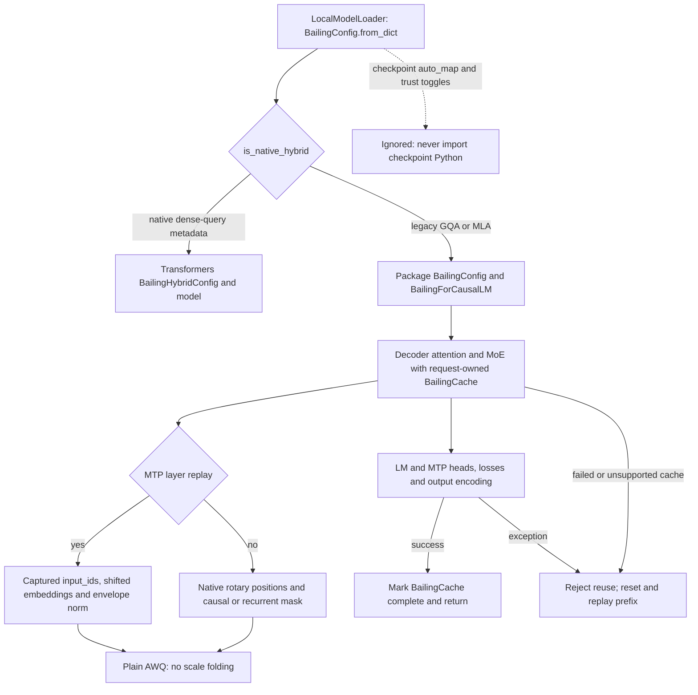
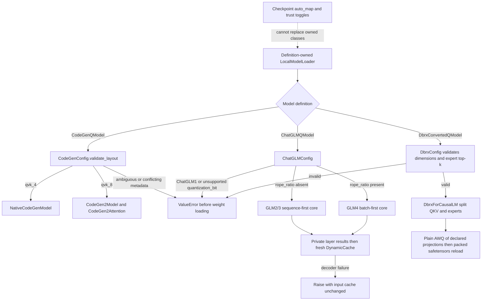
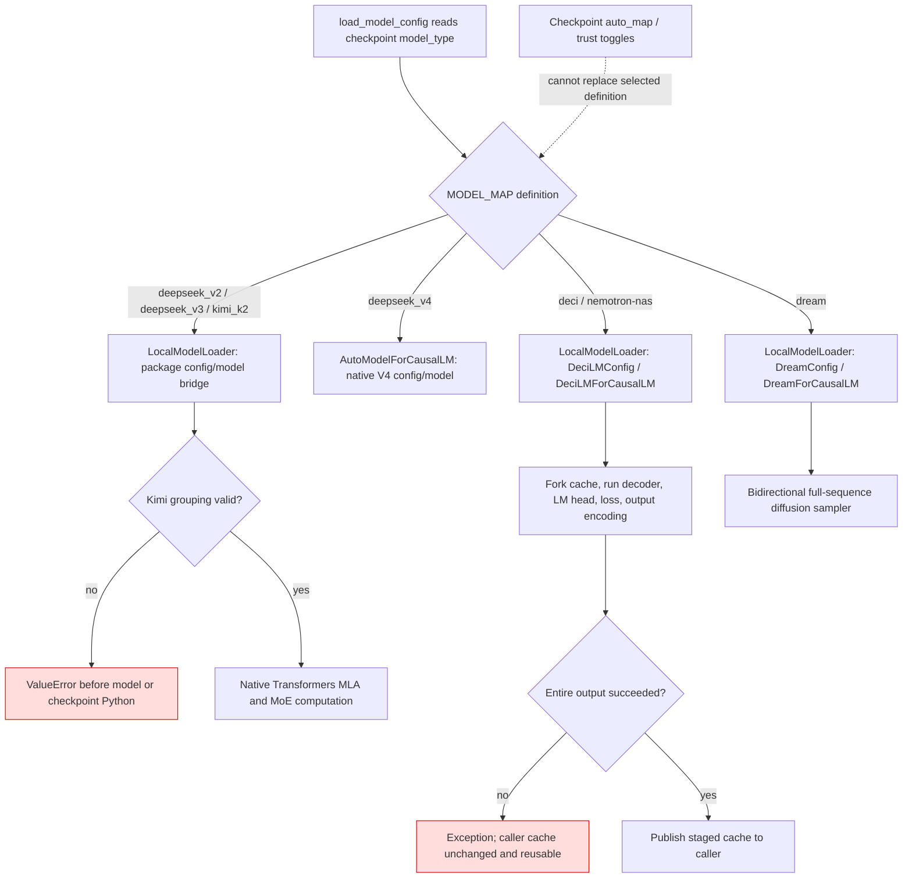

# GPT-QModel Transformers 5 model ports

Definitions select package-owned implementations through `LocalModelLoader`.
Checkpoint `auto_map`, API trust, and the safety bypass cannot replace these
config/model classes. See [implementation selection](trust-remote-code-isolation.md)
for the complete selection and failure flow.

Definitions with exact native Transformers 5 support retain their native
implementation. Their rows record checkpoint/layout qualification and any
definition ownership corrections alongside the package-owned ports.

| Definition / model type | Implementation and provenance | CPU validation | AWQ policy | Limits |
| --- | --- | --- | --- | --- |
| `DeepSeekV2QModel` / `deepseek_v2` | [Native-derived compatibility and pinned legacy source](../gptqmodel/models/ports/deepseek_v2/README.md) | Lite/full MLA, dense/periodic/shared MoE, top-k normalization, native expert conversion, cache/generation and safetensors round trips, malicious metadata matrix | Actual CPU plain quantization and packing; no scale groups | No GPU/trained-checkpoint quality, FlashAttention, distributed experts or full packed-checkpoint round trip; expert parallelism rejected |
| `DeepSeekV3QModel` / `deepseek_v3`, `kimi_k2` | [Native bridge, checkpoint conversion and pinned Kimi/DeepSeek provenance](../gptqmodel/models/ports/deepseek_v3/PROVENANCE.md) | Dense/split-Q MLA, published-layout grouped routing, cache/generation, MTP ownership, malicious metadata isolation and safetensors reload | Real CPU plain AWQ/INT4 packing, no scale folding | Kimi partial-group routing rejected; no GPU, trained-checkpoint accuracy or production FP8 qualification |
| `DeepSeekV4QModel` / `deepseek_v4` | [Native Transformers 5.23 and pinned BF16 checkpoint schema](../gptqmodel/models/ports/deepseek_v4/README.md) | Six sliding/CSA/HCA and expert variants, full 34,223-key target schema, source routing oracle, cache/generation and malicious metadata isolation | Plain AWQ packs 16 tiny linears across six layouts; no scale groups | BF16 checkpoint metadata gated (HTTP 401); no trained weights, GPU, FP8/FP4, MTP accuracy or packed export qualification |
| `DeciLMQModel` / `deci`, `nemotron-nas` | [Heterogeneous GQA, sink cache, pinned source and Apache license](../gptqmodel/models/ports/decilm/README.md) | Nine NAS attention/FFN combinations, exact published meta ownership, sink boundaries, cache failure/retry through LM output, generation and safetensors reload | Actual CPU plain AWQ pack/save/reload; no scale groups | No GPU/trained evaluation or native AWQ folding; shifted-sink continuation chunks must be shorter than window minus sinks; eager/SDPA only |
| `DreamQModel` / `dream` | [Pinned Dream source and Apache license](../gptqmodel/models/ports/dream/README.md), [diffusion flow](../gptqmodel/models/ports/dream/docs/local-loading-and-diffusion-generation.md) | MHA/GQA/MQA, bidirectional masks, four diffusion samplers, cache and restart, 339-key published meta schema, malicious metadata isolation and safetensors reload | Actual CPU plain AWQ packing of 14 linears; no scale groups | No trained 7B evaluation, GPU, FlashAttention or sliding-window qualification; uncached Hub/tokenizer loading unverified |
| `ChatGLMQModel` / `chatglm` | [GLM2/3/4 pinned sources and licenses](../gptqmodel/models/ports/chatglm/PROVENANCE.md), [selection/cache coverage](../gptqmodel/models/ports/chatglm/COVERAGE.md) | Published 200/200/284-key meta schemas; independent FP32/FP16/BF16 MQA/MHA equations, prefix tuning, generation, cache retry/reorder, repeated safetensors reload and public hostile metadata matrix | Eight actual CPU plain-AWQ quantize/save/reload variants; no scale groups | No trained-checkpoint quality, GPU or long-context qualification; GLM2 rotary uses GLM3-style FP32 frequencies; static/sliding caches and tokenizer-specific chat helpers unsupported; ChatGLM1 rejected |
| `CodeGenQModel` / `codegen` | [CodeGen/CodeGen2 partition and checkpoint provenance](../gptqmodel/models/ports/codegen/PROVENANCE.md); native four partitions, package-owned eight partitions | Independent per-head equations, exact native four-partition parity, legacy metadata/mask validation, cache/generation, FP32/FP16/BF16 safetensors reload, public hostile metadata matrix and full-size meta ownership | Actual plain quantization of all four decoder linears; no scale groups | No trained multi-GB/GPU accuracy, packed quantized reload or multi-GPU concurrency qualification; ambiguous legacy metadata requires explicit `qkv_layout` |
| `DbrxConvertedQModel` / `dbrx_converted` | [Converted DBRX sources, Databricks license and notice](../gptqmodel/models/ports/dbrx_converted/PROVENANCE.md) | Both pinned 2203-key indexes match full meta state; independent FP32/FP16/BF16 MHA/GQA/MQA and MoE equations, dynamic/static cache, beam generation, public hostile metadata matrix and safetensors reload | Public CPU plain-AWQ quantize/pack/save/reload of all 26 tiny linears; routers and norms stay dense | Eager only; no GPU, trained 132B quality, compilation, SDPA/FlashAttention, training, fusion or AWQ scale-fold/search qualification |
| `BailingMoeQModel` / `bailing_moe`, `bailing_hybrid` | [Ling dense/MLA/hybrid/MTP provenance](../gptqmodel/models/ports/bailing_moe/README.md) | Three full meta indexes; dense GQA, normalized heads, low-rank/dense-query MLA, recurrence, MTP replay, generation, safetensors reload and head/loss failure-reset coverage | Actual CPU plain quantization/packing/inference; no scale groups | No GPU, trained evaluation, fused FLA or full public quantize/save/load qualification |
| `ApertusQModel`, `Apertus1p5TextQModel`, `Apertus1p5QModel` / `apertus`, `apertus1p5_text`, `apertus1p5` | [Native Apertus and package-owned 1.5 text/multimodal qualification](../gptqmodel/models/ports/apertus/README.md); pinned Apache-2.0 Swiss AI fork | Native text oracle; full/pruned output vocabularies, bias/activation variants, live CPU/meta ownership, eager/decoder-SDPA cache/generation and safetensors reload, actual image/audio processor and embedding splice, public hostile metadata matrix | Actual CPU plain quantization of every decoder projection across layouts, including failure/retry; no scale folding/search | Official gated checkpoint returned HTTP 401: no trained weights, official tokenizer/chat template or checkpoint key audit; no GPU/FlashAttention/CUDA xIELU, packed GPTQ/AWQ roundtrip or fusion qualification; vision attention remains the source's fixed implementation |
| `AgnesQModel` / `agnes` | [Agnes 3.0 Flash multimodal port and pinned Apache-2.0 provenance](../gptqmodel/models/ports/agnes/README.md) | Full 1506-key checkpoint schema; independent FP64 delta recurrence and image/video patch oracles; mixed/homogeneous attention and parallel FFN layouts, media/cache/beam/failure-reset behavior, real local processor save/reload, public malicious model/processor metadata matrix | Actual plain AWQ quantization for both FFN layouts; delta state/norm/convolution tensors stay dense; no scale groups | No GPU/FP16, trained-checkpoint load/quality, video file decoder or fused FLA/CUDA qualification; recurrent crop/assisted rollback explicitly unsupported |
| `BaiChuanQModel` / `baichuan` | [Baichuan 1/2 source and layout provenance](../gptqmodel/models/ports/baichuan/PROVENANCE.md); pinned Apache-2.0 sources for 7B/13B variants | Independent FP32/FP16/BF16 oracles for all four variants; fused QKV, RoPE/ALiBi and normalized heads, cache/generation, malicious metadata matrix, safetensors round trips and live CPU/meta ownership; both 13B index schemas audited | Actual plain AWQ processor quantizes all five decoder linears; norms and Baichuan 1 persistent rotary buffer stay dense; retry idempotence | No GPU, trained-checkpoint or monolithic 7B payload audit; static/tuple/offloaded caches, AWQ scale search/replay, upstream chat/quantizer helpers and fusion unqualified |
| `BrumbyQModel` / `brumby` | [Manifest AI 14B/4B and retention 1.0.7 provenance](../gptqmodel/models/ports/brumby/PROVENANCE.md); Apache-2.0 | Exact full-size meta/index schemas; portable degree-2 retention, GQA, Q/K norms, dynamic/linear/default RoPE, independent CPU recurrence oracle, cache continuation/compression/rollback, padding, generation, repeated safetensors reload and public trust/bypass isolation | Actual CPU plain AWQ quantization and packing of all seven linears; gates and norms stay dense; no scale groups | No publisher CUDA/Triton-kernel parity, GPU packing or trained-checkpoint quality qualification; KV-only/static/offloaded caches and speculative rollback rejected |
| `AfMoeQModel` / `afmoe` | [Native Afmoe / Trinity qualification](../gptqmodel/models/ports/afmoe/README.md); Transformers 5.23.0 Apache-2.0 implementation; pinned Mini/Nano/Large index schemas and checkpoint license recorded locally | Full meta inventories match all three checkpoint schemas; unequal attention/residual widths; dense/MoE ownership, native conversion and routing oracle, cache/generation, public trust/bypass matrix, safetensors retry/round trips | Tested plain quantization for all declared linears; norms, router and expert bias stay dense | CPU pseudoquantization; no GPU packing/kernel or trained-checkpoint quality qualification; no scaling/folding claim |
| `InternLMQModel` / `internlm` | [InternLM 1 port](../gptqmodel/models/ports/internlm/README.md); Apache-2.0; upstream revision `96e127d08d851a88cac736a9b091dd953ae1b873` | Independent FP32/FP16/BF16 numerical oracle; biased/unbiased origin/dynamic rotary; eager/SDPA; generation/cache/beam lifecycle; public dense load and safetensors reload; live meta-model weight ownership; all 14 linears in two-layer AWQ quantization/reload | Tested plain quantization, zero scale-fold groups | No GPU or trained 7B numerical/quality qualification; fusion and foreign/static/quantized KV caches unsupported |

Only integrated implementations are listed here. This table does not qualify
other definitions, architectures, kernels, or trained checkpoints by analogy.

### Bailing / Ling selection and replay

`BailingMoeQModel` owns both aliases through `LocalModelLoader`. Its
[pinned source and validation reference](../gptqmodel/models/ports/bailing_moe/README.md)
records original Ling softmax GQA and normalized heads, V2 dense GQA, both MLA
query projections, hybrid recurrence, MTP ownership and two-layer replay.
Full meta inventories match the three pinned checkpoint indexes. The CPU port
uses plain AWQ, with real quantization/packing/inference tests; no GPU, trained
evaluation, fused FLA or full public quantize/save/load qualification is claimed.

Previously the definition required checkpoint Python and omitted MTP envelope
owners (`gptqmodel/models/definitions/bailing_moe.py:12-13,26-29` at `22bea1201`).
The local config/model now select the layout and own the MTP projection and
norms; the existing native layout delegates to Transformers 5.



### CodeGen layout and ChatGLM / converted DBRX loading

Before these ports, `definitions/chatglm.py:13-14,33-85` and
`definitions/dbrx_converted.py:10-11` at `22bea1201` required checkpoint code;
ChatGLM additionally patched its generation hooks. CodeGen had no owned loader
(`definitions/codegen.py:9`), allowing native attention's four partitions to
reinterpret CodeGen2 eight-partition weights. The shipped definitions select
their package classes explicitly; layout metadata never grants checkpoint code
execution. [CodeGen evidence](../gptqmodel/models/ports/codegen/PROVENANCE.md),
[ChatGLM evidence](../gptqmodel/models/ports/chatglm/COVERAGE.md) and
[DBRX evidence](../gptqmodel/models/ports/dbrx_converted/PROVENANCE.md) include
pinned sources, before/after references and regression commands.



The DBRX loader reads `max_seq_len` alongside other context-length keys, including
on quantized reload; it no longer substitutes 4096 for a published context size.
ChatGLM preserves caller cache ownership by assembling a fresh output cache only
after all layers succeed. Both CodeGen layouts and ChatGLM use plain AWQ, too;
none of these ports claims qualified source folding or scale search.

## Native bridges, sparse decoders and diffusion

DeepSeek V2 and V3 use package-owned config/model bridges to the applicable
Transformers 5 implementations. V4 uses the native `AutoModelForCausalLM` mapping
directly: `DeepSeekV4QModel.loader` explicitly overrides the V3 local loader,
which cannot construct V4 layers or read its `mlp_layer_types`. Kimi-K2
canonicalizes its source alias for V3 checkpoint conversion and rejects
partial-group routing. Deci/Nemotron-NAS and Dream have package-owned models;
the former handles heterogeneous attention/FFN and sink caches, while Dream
uses full-sequence bidirectional denoising for generation.



| Selection or state boundary | Before | Shipped behavior and evidence |
| --- | --- | --- |
| DeepSeek V4 model construction | `definitions/deepseek_v4.py:1410` inherited V3's package loader after the V3 port; a V4 config failed `mlp_layer_types` validation | `DeepSeekV4QModel.loader = AutoModelForCausalLM` selects the native V4 model; public hostile-map loading and V3/V4 sibling tests exercise both paths |
| Kimi-K2 routing | Checkpoint alias required remote modeling code and offered partial-group semantics that differ from native V3 | `ports/deepseek_v3/configuration_deepseek_v3.py` retains the source alias while canonicalizing the native config; invalid grouping raises before model loading |
| Deci cache ownership | Decoder could publish a warm cache before LM head, loss or tuple encoding failed | `ports/decilm/modeling_decilm.py` stages the decoder cache through the complete LM output; failures leave caller identities, tensors and counters intact |
| Dream generation | Old checkpoint code supplied diffusion sampling and attempted a remote RoPE compatibility shim | `ports/dream/generation_utils.py` runs four local sampling algorithms over full sequences; no checkpoint Python is selected or global RoPE registry patched |

The exact model plans and license/weight-provenance boundaries are recorded in
the linked per-model references above. CPU/meta qualification and plain-AWQ
policy vary by family; these checks do not establish GPU or trained-checkpoint
accuracy. DeepSeek V2 router/cache/dtype follow-up is in progress and must
pass its failure/retry regressions before those paths can be called qualified.

Run the InternLM checks from the repository root:

```shell
python -m pytest tests/test_internlm_local_port.py tests/module_tree/test_internlm_local_port.py tests/module_tree/test_registered_module_plans.py -q --tb=short
```
