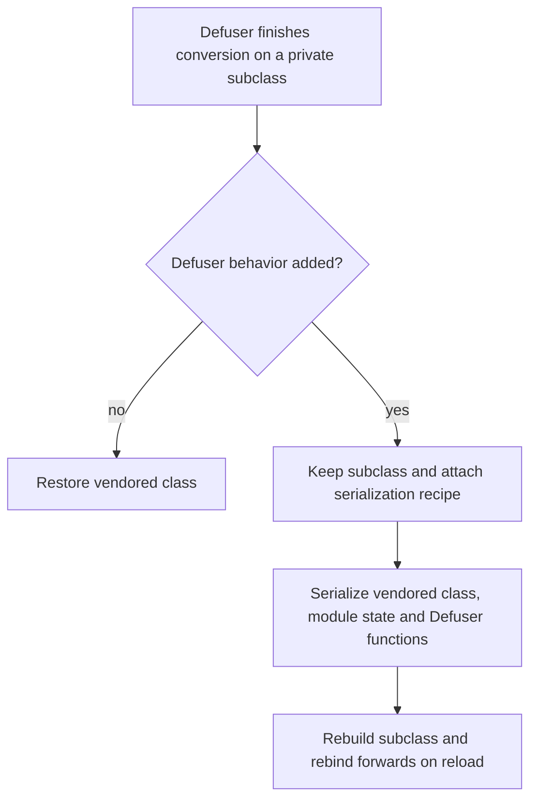

# GPT-QModel Transformers 5 model ports

GPT-QModel requires `transformers>=5.23.0,<5.24` and Python 3.11+, and it
quantizes, runs inference and trains **only** on the Transformers 5.23 ABI.

The requirement is pinned to one Transformers minor release on purpose. The
vendored families in `gptqmodel/models/ports/native/` are verbatim 5.23 sources
that subclass and call Transformers' framework internals (`PreTrainedModel`,
cache layers, masking, attention dispatch, conversion mappings, tokenizer and
processor backends), and that framework ABI is only stable within a minor
release. Supporting a new minor (for example 5.24) is a deliberate re-vendor,
not a requirement bump: re-run `scripts/vendor_transformers_ports.py --refresh`
against the new source, re-apply GPT-QModel's modernizations, regenerate the
parity fixtures (`scripts/generate_native_port_parity_fixtures.py`), and pass
`tests/test_native_port_parity.py`, `tests/test_native_auto_registry.py` and
the `tests/test_native_definition_loading_*.py` suites before widening the pin
in `requirements.txt`.

## Porting policy

- **Every supported model is ported.** Each `MODEL_MAP` definition selects its
  implementation through a `LocalModelLoader` (`gptqmodel/models/local.py`)
  whose config and modeling code live in `gptqmodel/models/ports/<port>/`.
  This includes models that Transformers implements natively: GPT-QModel
  carries its own copy so a Transformers upgrade cannot change its math,
  module names or checkpoint keys.
- **Framework infrastructure only.** Ports may import Transformers' framework
  layer (`PreTrainedModel`, configs, `cache_utils`, `masking_utils`, the
  attention-function registry, RoPE utilities, `GradientCheckpointingLayer`,
  `GenerationMixin`, outputs, initialization, processing/tokenization base
  classes, utils). They never import `transformers.models.*`.
- **No backward compatibility.** Ports are written to the 5.23 conventions:
  no `cache_position`, no tuple or legacy caches, no `rope_scaling` reads, no
  `return_dict` tuple plumbing, no version checks or import fallbacks for
  Transformers symbols. Released configs with old field names are converted
  once at config-parse time.
- **No global changes.** GPT-QModel never patches, monkeypatches or registers
  into Transformers, the HF ecosystem (Optimum, OpenVINO, safetensors,
  `huggingface_hub`) or other libraries (Accelerate, Defuser, torch, Triton),
  not even temporarily or scoped; this includes `AutoConfig`/`AutoModel`,
  quantizer registries and assigning onto (vendored) model classes at load
  time. The sole exception is the model-global-state construction guard
  (#5304, #5421): it wraps Transformers' `PreTrainedModel.get_init_context` /
  `_from_config` and the `modeling_utils.local_torch_dtype` /
  `modeling_utils.apply_patches` / `initialization.no_tie_weights` contexts so
  concurrent constructions cannot observe another thread's process-global
  window. The wrappers are pass-through and installed once at import; they are
  the only entries allowed by `tests/test_transformers_unpatched.py`.
  Accelerate offload uses GPT-QModel's own `GPTQModelAlignDevicesHook`,
  and per-model fixes go on the loaded instance. GPT-QModel checkpoints load
  with `GPTQModel.load`; loading GPT-QModel-only features through plain
  Transformers is unsupported. `tests/test_transformers_unpatched.py` enforces
  it. Checkpoint `auto_map`,
  `trust_remote_code` and the safety bypass cannot replace a definition-owned
  loader. Checkpoint Python for an unsupported model still needs both
  `trust_remote_code=True` and `GPTQ_BYPASS_SAFETY_CHECKS=1`, and runs on
  unmodified Transformers 5.23 without compatibility shims. See
  [implementation selection](trust-remote-code-isolation.md).
- **Enforced.** `tests/test_model_port_policy.py` fails on a definition
  without a `LocalModelLoader`, a `transformers.models.*` import (or top-level
  model-family re-export such as `AutoConfig`) anywhere in `gptqmodel/` outside
  its commented unsupported-model exceptions, dynamic class resolution on the
  `transformers` package (`getattr(transformers, <name>)`,
  `import_module("transformers.models...")`), or a stale pre-5.23 pattern in a
  port. Checkpoint-declared class names (tokenizer, processor and
  sub-processor types, `architectures`) select only vendored or framework
  classes; `tests/test_no_transformers_family_imports.py` checks at runtime
  that supported loads import no `transformers.models.<family>` module. Defuser sees vendored classes under their `transformers.models` class
  path during conversion, so they get exactly Defuser's native treatment
  without GPT-QModel patching Transformers. The porting procedure is in the
  [model-porting skill](../.agents/skills/gptqmodel-model-porting/SKILL.md).

Ports keep the copyright headers of the sources they derive from. Port
directories carry `NOTICE` files and any license text that differs from the
repository's Apache-2.0 `LICENSE`.

## Vendored Transformers families

`gptqmodel/models/ports/native/<family>` is generated from the Transformers
5.23 sources by `scripts/vendor_transformers_ports.py`; the generator is the
source of truth. GPT-QModel's hand edits (5.23-convention rewrites such as
`capture_outputs`/`can_return_tuple` instead of legacy return paths) are
recorded as `scripts/vendor_patches/<family>.patch` and applied after copying,
and `native/MANIFEST.json` pins each generated file (sha256 and
`verbatim`/`patched`/`generated`). To change a vendored file, edit it, run
`python scripts/vendor_transformers_ports.py <transformers/src/transformers> . --record-patches`
and commit the file with its patch and the manifest.
`tests/test_native_vendor_manifest.py` regenerates the tree and requires byte
equality. `tests/test_native_port_parity.py` requires every vendored class to
equal native Transformers bit-exactly for the default forward,
`output_hidden_states`, `output_attentions`, `return_dict=False`, a cached
decode step, the loss and greedy `generate`. A rewrite that cannot reproduce
native tuple semantics stays verbatim, with an exact
`STALE_PATTERN_EXCEPTIONS` entry in `tests/test_model_port_policy.py`.

## Optional dependencies

| Extra | Packages | Used by |
| --- | --- | --- |
| `vision` | `timm`, `einops` (torchvision must match the installed torch) | DeepSeek-VL2, LLaVA-Qwen2, legacy MiniCPM-V, OpenVLA, ZDTaichu5, InternS1 stochastic depth |
| `minicpm-o` | `vector-quantize-pytorch` | MiniCPM-o 2.6 TTS codec |
| `pangu-alpha` | `jieba` | PanGu-α tokenizer |

Text-only loading never imports these backends. Using a component without its
backend raises `ImportError` naming the extra.

## Defuser-converted models in Python

Defuser identifies vendored classes by their original Transformers class paths
during conversion. GPT-QModel presents those paths on private subclasses.
Unmodified modules return to their vendored class after conversion. Modules
with Defuser behavior keep a private subclass and its serialization recipe.

| Boundary | Before | After |
| --- | --- | --- |
| Serialize a retained subclass | Pickle tried to look up the generated subclass as a global vendored class | The recipe records the original vendored class and the Defuser runtime behavior |
| Restore bound forwards | Pickle resolved methods by a name the module did not expose | Importable Defuser functions are rebound after restoring module state |

This supports in-memory model interoperability with `torch.save(model)`.
Published checkpoints continue to use safetensors.

## Integrated definitions

| Definition / model type | Implementation | Limits |
| --- | --- | --- |
| `Raon1MiniQModel` / `raon1_mini` | Owned RDA/MLA, mHC and SiTU-MoE | Persistent byte weights/scales only; no trained quality, GPU, native MXFP8 GEMM, extended context, fusion or performance qualification |
| `Spark2_5QModel` / `spark2_5` | Owned packed-QKV/head-gated hybrid decoder | No trained quality, GPU, model disk placement, extended context, fusion or concurrent-execution qualification |
| `RwgQModel`, `FalconQModel` | Native Falcon, historical RW config adapter and local ALiBi repair | RW1B source/meta only; 180B config inaccessible. No trained quality, GPU/FlashAttention, extended context or fusion qualification |
| `TeleChat2QModel` / `telechat` | Owned TeleChat/TeleChat2 decoder and source tokenizer dialects | Apache code notices do not grant model-artifact commercial rights; later model cards reference community terms. Original requested 7B endpoint inaccessible; no trained/GPU/fusion qualification |
| `SolarOpen2QModel` / `solar_open2` | Owned hybrid GQA/KDA decoder and Upstage provenance | Apache source and separate Upstage Solar artifact license with derivative-model branding conditions. No trained payload, GPU, FLA, fusion, million-token context or concurrent execution qualification |
| `Ovis2_5QModel` / `ovis2_5` | Owned Qwen3/SigLIP2 NaViT soft-visual-vocabulary binding and Apache notices | Native Ovis2 remains separate; no trained-payload quality, GPU, fusion, concurrency or foreign-cache qualification |
| `Ovis2_6_MoeQModel`, `Ovis2_6_NextQModel` | Owned NaViT/visual-vocabulary wrapper and native Qwen3 MoE/Next decoders | No trained-payload quality, GPU, optimized FLA, fusion, concurrency or foreign-cache qualification |
| `OvisQModel` / `ovis` | Package-owned Ovis 1.0/1.5/1.6 visual vocabulary and pinned Apache notices | Native Ovis2 is separate; no trained weights, GPU, fusion, concurrent execution, foreign cache or AWQ fold/search qualification |
| `Qwen3QModel` / `qwen3`, released Marin-32B | Exact native Qwen3 and pinned Qwen/Marin assets and licenses | Raw `marin` fails explicitly; no trained weights, GPU, new fusion, foreign cache, parallel or full-context qualification |
| `QwenQModel` / original `qwen` | Owned fused-QKV/TikToken port, pinned sources and separate code/release licenses | Code Apache; separate Tongyi release and 1.8B research terms retained. No trained weights, GPU, fusion, foreign caches or parallel execution qualification |
| `Phi4MMGPTQ` / legacy `phi4mm` | Owned LoRA/vision/audio binding, pinned MIT source and assets | Native `phi4_multimodal` remains distinct; no trained weights, GPU, fusion, foreign caches, whole-model offload or parallel execution qualification |
| `Qwen2VLQModel` / `qwen2_vl`, `qwen2_vl_text` | Exact native composite/headless selection and Apache provenance | Headless feature extraction rejects generation; no trained weights, GPU, new fusion or foreign-cache qualification |
| `Qwen2_5_VLQModel` / `qwen2_5_vl`, `qwen2_5_vl_text` | Exact native composite/headless selection, Apache source and retained Qwen3B research license | Headless generation rejected; published width 37 cannot satisfy TorchAWQ packing. No trained weights, GPU or new fusion qualification |
| `QwenDriveQModel` / `qwen_drive` | Owned root VLM wrapper over native Qwen3.5, Apache source and pinned assets | VLM only; planner, perception and official scene processor unqualified. No trained weights, GPU, fold/search or fusion qualification; two static protocol diagnostics remain |
| `SenseNovaLoopQModel` / `sensenova_loop` | Owned fixed-count Loop plan, per-visit caches and FP32 mHC routers over native Qwen3.5; pinned Apache source | Adaptive `loop_gate` ignored (preserved on save); DynamicCache only. No trained weights, GPU, fusion or static-cache qualification |
| `KlearQModel` / `klear` | Package-owned dense/MoE port, pinned Base/Instruct sources and Apache notices | No trained-weight, GPU, FlashAttention, fusion, parallel or compiler qualification |
| `KimiK3QModel`, `KimiLinearQModel` / AttnRes variants | Package-owned MLA/KDA, vision and K3 TikToken/XTML; exact native delegation for ordinary KimiLinear | No trained-weight, GPU, fused FLA, FlashAttention, MTP, video, parallel or compiler qualification |
| `DeepSeekV2QModel` / `deepseek_v2` | Native-derived compatibility and pinned legacy source | No GPU/trained-checkpoint quality, FlashAttention, distributed experts or full packed-checkpoint round trip; expert parallelism rejected |
| `DeepSeekV3QModel` / `deepseek_v3`, `kimi_k2` | Native bridge, checkpoint conversion and pinned Kimi/DeepSeek provenance | Kimi partial-group routing rejected; no GPU, trained-checkpoint accuracy or production FP8 qualification |
| `DeepSeekV4QModel` / `deepseek_v4` | Native Transformers 5.23 and pinned BF16 checkpoint schema | BF16 checkpoint metadata gated (HTTP 401); no trained weights, GPU, FP8/FP4, MTP accuracy or packed export qualification |
| `DeepSeekV41FlashQModel` / `deepseek_v41` | Package-owned text decoder, Engram hashing and dSpark stages from the pinned DeepSeek-V4.1-Flash reference (MIT); reference-oracle and key-inventory tests | Explicit calibration API only; vision tower not ported; FP8/FP4 kernels and activation fake-quantization not simulated; padded batches rejected; no trained weights or GPU qualification |
| `DeepSeekVLV2QModel` / `deepseek_vl_v2` | Local vision, language and processor port; pinned source, licenses and notices | Eager text attention only; no trained-weight accuracy, GPU/FlashAttention, tensor/expert parallel or fusion qualification |
| `DeciLMQModel` / `deci`, `nemotron-nas` | Heterogeneous GQA, sink cache, pinned source and Apache license | No GPU/trained evaluation or native AWQ folding; shifted-sink continuation chunks must be shorter than window minus sinks; eager/SDPA only |
| `DreamQModel` / `dream` | Pinned Dream source and Apache license, diffusion flow | No trained 7B evaluation, GPU, FlashAttention or sliding-window qualification; uncached Hub/tokenizer loading unverified |
| `ChatGLMQModel` / `chatglm` | GLM2/3/4 pinned sources and licenses, selection/cache coverage | No trained-checkpoint quality, GPU or long-context qualification; GLM2 rotary uses GLM3-style FP32 frequencies; static/sliding caches and tokenizer-specific chat helpers unsupported; ChatGLM1 rejected |
| `CodeGenQModel` / `codegen` | CodeGen/CodeGen2 partition and checkpoint provenance; native four partitions, package-owned eight partitions | No trained multi-GB/GPU accuracy, packed quantized reload or multi-GPU concurrency qualification; ambiguous legacy metadata requires explicit `qkv_layout` |
| `DbrxConvertedQModel` / `dbrx_converted` | Converted DBRX sources, Databricks license and cache/mask lifecycle | Cache failure requires reset and full-prefix refill; arbitrary 4D masks unsupported for router loss; eager only, no GPU, trained 132B quality, compilation, SDPA/FlashAttention or fusion qualification |
| `Ernie4_5_MoeQModel` / `ernie4_5_moe` | Native Transformers 5.23 selection and checkpoint ownership | Native MTP remains excluded; no GPU, trained 21B, non-dynamic cache or fusion qualification |
| `Ernie4_5_VLMoeQModel` / `ernie4_5_moe_vl`, `ernie4_5_vl_moe` | Native ERNIE VL, legacy metadata, processor and font provenance | Requires Tokenicer 0.0.17 changes; no trained 28B, GPU, long-context or legacy-alias fusion qualification |
| `ExaOneQModel` / `exaone` | EXAONE 3.0/3.5 source and rollback flow, validation | No trained-checkpoint quality, GPU, FlashAttention or fusion qualification; unsupported cache layers/offloading rejected |
| `GrinMoeQModel` / `grinmoe` | Pinned Microsoft GRIN-MoE source and SparseMixer flow, validation | Native dynamic cache only; eager and SDPA retain distinct source window semantics; no GPU, trained-checkpoint quality or fusion qualification |
| `InstellaQModel` / `instella` | Clean-room Apache-2.0 implementation from a behavioral spec, golden fixtures, selection and qualification | Code is Apache-2.0 (weights keep AMD's RAIL-MS license); failed cache needs reset; cached dynamic-NTK crossing differs from full recomputation; no trained 3B, GPU, FlashAttention or fusion qualification |
| `HymbaQModel` / `hymba` | Pinned NVIDIA hybrid, cache and calibration flow, provenance, coverage | Failed hybrid cache requires reset; no trained 1.5B, accelerator kernels/packing, offload or multi-GPU qualification |
| `InternLM2QModel` / `internlm2` (InternLM2/2.5) | Pinned InternLM2/2.5 sources, packed layout and cache limits | No trained 1.8B/7B/20B or GPU qualification; static/foreign caches and fusion unsupported; cached NTK boundary crossing differs from full-sequence recomputation |
| `Exaone4QModel`, `Exaone4_5QModel` / `exaone4`, `exaone4_5_text`, `exaone4_5` | Native text/vision alias, checkpoint schemas and flow | Native MTP omitted; no trained-checkpoint quality, GPU packed kernels or fusion qualification |
| `BailingMoeQModel` / `bailing_moe`, `bailing_hybrid` | Ling dense/MLA/hybrid/MTP provenance | No GPU, trained evaluation, fused FLA or full public quantize/save/load qualification |
| `ApertusQModel`, `Apertus1p5TextQModel`, `Apertus1p5QModel` / `apertus`, `apertus1p5_text`, `apertus1p5` | Native Apertus and package-owned 1.5 text/multimodal qualification; pinned Apache-2.0 Swiss AI fork | Official gated checkpoint returned HTTP 401: no trained weights, official tokenizer/chat template or checkpoint key audit; no GPU/FlashAttention/CUDA xIELU, packed GPTQ/AWQ roundtrip or fusion qualification; vision attention remains the source's fixed implementation |
| `AgnesQModel` / `agnes` | Agnes 3.0 Flash multimodal port and pinned Apache-2.0 provenance | No GPU/FP16, trained-checkpoint load/quality, video file decoder or fused FLA/CUDA qualification; recurrent crop/assisted rollback explicitly unsupported |
| `BaiChuanQModel` / `baichuan` | Baichuan 1/2 source and layout provenance; pinned Apache-2.0 sources for 7B/13B variants | No GPU, trained-checkpoint or monolithic 7B payload audit; static/tuple/offloaded caches, AWQ scale search/replay, upstream chat/quantizer helpers and fusion unqualified |
| `BrumbyQModel` / `brumby` | Manifest AI 14B/4B and retention 1.0.7 provenance; Apache-2.0 | No publisher CUDA/Triton-kernel parity, GPU packing or trained-checkpoint quality qualification; KV-only/static/offloaded caches and speculative rollback rejected |
| `AfMoeQModel` / `afmoe` | Native Afmoe / Trinity qualification; Transformers 5.23.0 Apache-2.0 implementation; pinned Mini/Nano/Large index schemas and checkpoint license recorded locally | CPU pseudoquantization; no GPU packing/kernel or trained-checkpoint quality qualification; no scaling/folding claim |
| `InternLMQModel` / `internlm` | InternLM 1 port; Apache-2.0; upstream revision `96e127d08d851a88cac736a9b091dd953ae1b873` | No GPU or trained 7B numerical/quality qualification; fusion and foreign/static/quantized KV caches unsupported |
| `LFM3QModel` / `lfm3` | Native Transformers 5 text model and checkpoint schema | No trained weights, GPU, fused convolution, compiler, concurrent execution or fusion qualification |
| `LFM3VLQModel` / `lfm3_vl` | Native model and fixed native media components | No trained weights, GPU, FlashAttention, concurrent execution or fusion qualification |
| `LFM3OmniQModel` / `lfm3_omni` | Pinned package-owned model, processor and codec | Dynamic text/codec cache only; beams/multiple returns rejected; no trained weights, GPU, live transcription quality, concurrent execution or fusion qualification |
| `KimiK25QModel` / `kimi_k25` | Native multimodal model, distinct TikToken/tool renderer and media adapters | Extended legacy media budgets/custom timestamps rejected; no trained weights, GPU, concurrent execution, compiler or fusion qualification |
| `LLaDA2MoeQModel` / `llada2_moe` | Pinned packed-QKV diffusion MoE and six released decoder policies; Apache-2.0 | Ambiguous versions require explicit `llada_version`; no trained weights, GPU/FlashAttention, concurrent execution, compile, non-dynamic caches, scale folding or fusion qualification |
| `InternVLChatQModel` / `internvl_chat` | Package-owned legacy wrapper/vision port and pinned licenses; native decoders and package-owned InternLM2 | Eager vision only; unmerged LoRA requires adapter merge; no trained weights, GPU/FlashAttention, distributed or fusion qualification |
| `K2HorizonQModel` / `k2_horizon` | Pinned IFM dense/MoVA/sparse-MoE sources, Apache license and notice | DynamicCache only; no trained weights, GPU/FlashAttention/FlexAttention, sliding-window, distributed or fusion qualification |
| `InternS2PreviewQModel` / `intern_s2_preview` | Pinned hybrid model, processor and distinct scientific tokenizer, Apache-2.0 provenance | PROT/XNA semantics differ from S1; no trained weights, GPU/fused FLA/FlashAttention, concurrent execution, static/offloaded/arbitrary-beam caches or MTP qualification |
| `InternS1QModel` / `interns1` | Pinned dense/MoE model, vision, media processor and scientific tokenizer; Apache-2.0 | IUPAC/FASTA semantics differ from S2; no trained weights, GPU/FlashAttention/FlexAttention, concurrent execution, training, RDKit chemistry or video-file decoding qualification |
| `LlamaQModel` legacy aliases / `longllama`, `stablelm_epoch`, `yi` | Pinned source, license and native-class selection | No trained weights, GPU, concurrent execution, compiler or fusion qualification; memory eviction prevents speculative cache cropping |
| `MimoQModel` / `mimo` | Pinned XiaomiMiMo source and original MIT/repository notices | Distinct from native MiMo-V2-Flash; no speculative MTP decoding, trained-weight, GPU, concurrent execution or fusion qualification |
| `LlavaQwen2QModel` / `llava_qwen2` | Pinned Apple/S2 sources, licenses and acknowledgements | No video, trained weights, GPU, concurrent execution or fusion qualification; 103 port-wide static diagnostics remain documented |
| `LocateAnythingQModel` / `locateanything` | Clean-room Apache-2.0 implementation compatible with the released checkpoint format (see the port NOTICE); native Qwen2/Qwen3 decoders | No trained weights, GPU/Magi/FlashAttention, compiler, concurrent execution or fusion qualification; decoded PIL frames only, no container/live video qualification |
| `MageVLQModel` / `mage_vl` | Pinned Microsoft source, Apache/MIT licenses and notices | Neural DCVC rejected; traditional codec lifecycle fixture only; optional StreamMind gate unqualified; no trained weights, GPU, concurrent execution or fusion qualification |
| `MiniCPMGPTQ` / `minicpm` | Original MiniCPM scaled dense/8x2B MoE port, Apache-2.0 | Tokenicer candidate required for legacy serialized-BPE normalization; no trained weights, actual 128k execution, GPU or fusion qualification |
| `MiniCPMVQModel` / `minicpmv` | Six legacy MiniCPM-V vision/resampler/decoder layouts, Apache-2.0 | Native MiniCPM-V 4.6 remains separate; no trained weights, GPU, foreign-cache or fusion qualification |
| `MiniMaxQModel`, `MiniMaxM2GPTQ` | Owned Text-01 hybrid attention/cache and exact native M2, MIT/Apache notices | No trained weights, GPU, long-context RoPE or fusion qualification |
| `MimoV2QModel` / `mimo_v2` | Source-matched XiaomiMiMo hybrid decoder, pinned provenance and MIT notices | Separate from original MiMo and native MiMo-V2-Flash; no trained weights, GPU or fusion qualification |
| `MobileLLMQModel` / `mobilellm` | Clean-room Apache-2.0 implementation from a behavioral specification (see the port's NOTICE); checkpoint-format compatible | Official HF assets returned HTTP 401: architecture qualification only; no released-checkpoint/tokenizer or trained-weight quality claim; published weights keep their own license terms |

Only the definitions listed here are qualified. Rows do not qualify other
architectures, kernels or trained checkpoints by analogy.
