# GPT-QModel Transformers 5 model ports

GPT-QModel requires `transformers>=5.23.0`, the latest stable release when this
migration was qualified. Transformers 5.23.0 requires Python 3.11 or newer;
the project's Python requirement follows that floor. Transformers 4.x and
older Transformers 5 releases are outside this dependency contract.

Definitions select package-owned implementations through `LocalModelLoader`.
Checkpoint `auto_map`, API trust, and the safety bypass cannot replace these
config/model classes. See [implementation selection](trust-remote-code-isolation.md)
for the complete selection and failure flow.

Definitions with exact native Transformers 5 support retain their native
implementation. Their rows record checkpoint/layout qualification and any
definition ownership corrections alongside the package-owned ports.

Current integrated qualification uses Python 3.14.6t with `PYTHON_GIL=0`,
Torch 2.15.0 CPU, Transformers 5.23.0, SentencePiece 0.2.1, TikToken 0.12.0,
timm 1.0.22 and Tokenicer's unreleased 0.0.19 runtime candidate
`4f23746c7aeac3bf054d1d0dd7dc66e951468989` from
[Tokenicer PR #66](https://github.com/ModelCloud/Tokenicer/pull/66).
The dependency floor does not imply that this candidate is published.

| Integrated batch on the final Tokenicer runtime candidate | Result |
| --- | --- |
| Registry, fusion admission, ordering, AWQ plain/fold policy, loader/security/processor/config, norm lifecycle/teacher, Ouro support and native Nemotron-H | 999 passed, 466 skipped, 19 warnings; 73.68s |
| Baichuan model/tokenizer/rotary, owned tokenizer options/loading, InternLM tokenizers, ChatGLM, DeepSeek-V3 and MOSS | 673 passed, no skips, 2 warnings; 114.24s |
| OpenVLA model/module plan, stage capture and multimodal calibration | 293 passed, no skips, 3 warnings; 41.25s |
| Mage-VL model/module plan, including codec metadata failure/retry and explicit API configuration | 51 passed, no skips, 2 warnings; 6.54s |
| Ovis model/module plan and generation wrapper, original MiniCPM model/module plan | 356 passed, no skips, 13 warnings; 25.33s |

The 466 skips are 460 NVIDIA-only Marlin tests, three unavailable Pangu
checkpoint fixtures, two non-buildable CausalLM families (`opt350` and
`muse_glimmer`), and one missing optional PEFT dependency. These batches overlap
and are not additive. Port-local evidence and older batches below retain their
stated dependency revisions; they are not claims of accelerator or trained-model
quality coverage on this checkout.

| Definition / model type | Implementation and provenance | CPU validation | AWQ policy | Limits |
| --- | --- | --- | --- | --- |
| `OvisQModel` / `ovis` | [Package-owned Ovis 1.0/1.5/1.6 visual vocabulary and pinned Apache notices](../gptqmodel/models/ports/ovis/README.md) | Eight release indexes and four full header inventories, independent vision/media merge equations, native Llama/Qwen2/Gemma2 decoders, released generation policy, hostile metadata, cache and safetensors reload | Eight public image-calibrated plain-AWQ cases, all 14 decoder linears, dense exclusions and two exact reloads; no scale groups | Native Ovis2 is separate; no trained weights, GPU, fusion, concurrent execution, foreign cache or AWQ fold/search qualification |
| `KlearQModel` / `klear` | [Package-owned dense/MoE port, pinned Base/Instruct sources and Apache notices](../gptqmodel/models/ports/klear/README.md) | Full 25,059-key meta inventory, independent attention/routing equations, requested-dtype loading, cache/generation, hostile metadata and safetensors reload | Real public plain AWQ dense/MoE/mixed packing and two save/reload cycles; no scale groups | No trained-weight, GPU, FlashAttention, fusion, parallel or compiler qualification |
| `KimiK3QModel`, `KimiLinearQModel` / AttnRes variants | [Package-owned MLA/KDA, vision and K3 TikToken/XTML; exact native delegation for ordinary KimiLinear](../gptqmodel/models/ports/kimi_k3/README.md) | Independent float64 MLA/KDA and MoE oracles, CPU/meta owners, exact tokenizer IDs, image-conditioned logits, cache/generation, failure/retry and public loads | AttnRes rejects ordinary GPTQ/AWQ before mutation; existing bounded runner retained | No trained-weight, GPU, fused FLA, FlashAttention, MTP, video, parallel or compiler qualification |
| `DeepSeekV2QModel` / `deepseek_v2` | [Native-derived compatibility and pinned legacy source](../gptqmodel/models/ports/deepseek_v2/README.md) | Lite/full MLA, dense/periodic/shared MoE, top-k normalization, native expert conversion, cache/generation and safetensors round trips, malicious metadata matrix | Actual CPU plain quantization and packing; no scale groups | No GPU/trained-checkpoint quality, FlashAttention, distributed experts or full packed-checkpoint round trip; expert parallelism rejected |
| `DeepSeekV3QModel` / `deepseek_v3`, `kimi_k2` | [Native bridge, checkpoint conversion and pinned Kimi/DeepSeek provenance](../gptqmodel/models/ports/deepseek_v3/PROVENANCE.md) | Dense/split-Q MLA, grouped routing, cache/generation, MTP ownership, standalone K2 TikToken IDs/chat/tools, native DeepSeek ByteLevel BPE IDs, hostile metadata and safetensors reload | Real CPU plain AWQ/INT4 packing, no scale folding | Kimi partial-group routing rejected; no GPU, trained-checkpoint accuracy or production FP8 qualification |
| `DeepSeekV4QModel` / `deepseek_v4` | [Native Transformers 5.23 and pinned BF16 checkpoint schema](../gptqmodel/models/ports/deepseek_v4/README.md) | Six sliding/CSA/HCA and expert variants, full 34,223-key target schema, source routing oracle, cache/generation and malicious metadata isolation | Plain AWQ packs 16 tiny linears across six layouts; no scale groups | BF16 checkpoint metadata gated (HTTP 401); no trained weights, GPU, FP8/FP4, MTP accuracy or packed export qualification |
| `DeepSeekVLV2QModel` / `deepseek_vl_v2` | [Local vision, language and processor port; pinned source, licenses and notices](../gptqmodel/models/ports/deepseek_vl_v2/PORTING.md) | Published tiny/small/base meta key inventories (2582/5639/6973); independent dense/MLA, vision and MoE oracles, image-dependent logits, cache/generation, safetensors reload and hostile metadata isolation | Actual CPU plain AWQ staging/packing for decoder linears; no scale groups | Eager text attention only; no trained-weight accuracy, GPU/FlashAttention, tensor/expert parallel or fusion qualification |
| `DeciLMQModel` / `deci`, `nemotron-nas` | [Heterogeneous GQA, sink cache, pinned source and Apache license](../gptqmodel/models/ports/decilm/README.md) | Nine NAS attention/FFN combinations, exact published meta ownership, sink boundaries, cache failure/retry through LM output, generation and safetensors reload | Actual CPU plain AWQ pack/save/reload; no scale groups | No GPU/trained evaluation or native AWQ folding; shifted-sink continuation chunks must be shorter than window minus sinks; eager/SDPA only |
| `DreamQModel` / `dream` | [Pinned Dream source and Apache license](../gptqmodel/models/ports/dream/README.md), [diffusion flow](../gptqmodel/models/ports/dream/docs/local-loading-and-diffusion-generation.md) | MHA/GQA/MQA, bidirectional masks, four diffusion samplers, cache and restart, 339-key published meta schema, malicious metadata isolation and safetensors reload | Actual CPU plain AWQ packing of 14 linears; no scale groups | No trained 7B evaluation, GPU, FlashAttention or sliding-window qualification; uncached Hub/tokenizer loading unverified |
| `ChatGLMQModel` / `chatglm` | [GLM2/3/4 pinned sources and licenses](../gptqmodel/models/ports/chatglm/PROVENANCE.md), [selection/cache coverage](../gptqmodel/models/ports/chatglm/COVERAGE.md) | Published 200/200/284-key meta schemas; independent FP32/FP16/BF16 MQA/MHA equations, prefix tuning, generation, cache retry/reorder, repeated safetensors reload and public hostile metadata matrix | Eight actual CPU plain-AWQ quantize/save/reload variants; no scale groups | No trained-checkpoint quality, GPU or long-context qualification; GLM2 rotary uses GLM3-style FP32 frequencies; static/sliding caches and tokenizer-specific chat helpers unsupported; ChatGLM1 rejected |
| `CodeGenQModel` / `codegen` | [CodeGen/CodeGen2 partition and checkpoint provenance](../gptqmodel/models/ports/codegen/PROVENANCE.md); native four partitions, package-owned eight partitions | Independent per-head equations, exact native four-partition parity, legacy metadata/mask validation, cache/generation, FP32/FP16/BF16 safetensors reload, public hostile metadata matrix and full-size meta ownership | Actual plain quantization of all four decoder linears; no scale groups | No trained multi-GB/GPU accuracy, packed quantized reload or multi-GPU concurrency qualification; ambiguous legacy metadata requires explicit `qkv_layout` |
| `DbrxConvertedQModel` / `dbrx_converted` | [Converted DBRX sources, Databricks license and cache/mask lifecycle](../gptqmodel/models/ports/dbrx_converted/PROVENANCE.md) | Both pinned 2203-key indexes match full meta state; independent FP32/FP16/BF16 equations, failed decoder/head/loss cache invalidation and reset/retry, physical-position static padding masks, beam generation, hostile metadata isolation and safetensors reload | Public CPU plain-AWQ quantize/pack/save/reload of all 26 tiny linears; routers and norms stay dense | Cache failure requires reset and full-prefix refill; arbitrary 4D masks unsupported for router loss; eager only, no GPU, trained 132B quality, compilation, SDPA/FlashAttention or fusion qualification |
| `Ernie4_5_MoeQModel` / `ernie4_5_moe` | [Native Transformers 5.23 selection and checkpoint ownership](../gptqmodel/models/ports/ernie4_5_moe/README.md) | Pinned 5504-key checkpoint index, numbered/native expert conversion, dense router-statistics ownership, cache/generation, hostile metadata isolation, and FP16/BF16 exact-FP32 router reload | Actual CPU plain-AWQ quantize/pack/reload of 23 projections; no scale groups | Native MTP remains excluded; no GPU, trained 21B, non-dynamic cache or fusion qualification |
| `Ernie4_5_VLMoeQModel` / `ernie4_5_moe_vl`, `ernie4_5_vl_moe` | [Native ERNIE VL, legacy metadata, processor and font provenance](../gptqmodel/models/ports/ernie4_5_vl_moe/README.md) | Dense/sparse/mixed layouts, native expert conversion, actual image/video preprocessing and forwards, processor reuse, generation, safetensors reload and hostile metadata isolation | Actual CPU plain AWQ packs 7 dense or 19 sparse linears; no scale groups | Requires Tokenicer 0.0.17 changes; no trained 28B, GPU, long-context or legacy-alias fusion qualification |
| `ExaOneQModel` / `exaone` | [EXAONE 3.0/3.5 source and rollback flow](../gptqmodel/models/ports/exaone/PROVENANCE.md), [validation](../gptqmodel/models/ports/exaone/VALIDATION.md) | Published 3.0/3.5 meta/index layouts, independent six-mode RoPE oracle, MHA/GQA/MQA, static/dynamic cache rollback through LM output, greedy/beam generation and safetensors reload | Public CPU plain-AWQ calibration/packing/save/reload of 14 tiny linears; no scale groups | No trained-checkpoint quality, GPU, FlashAttention or fusion qualification; unsupported cache layers/offloading rejected |
| `GrinMoeQModel` / `grinmoe` | [Pinned Microsoft GRIN-MoE source and SparseMixer flow](../gptqmodel/models/ports/grinmoe/PROVENANCE.md), [validation](../gptqmodel/models/ports/grinmoe/VALIDATION.md) | Exact 1957-key published meta schema, independent routing/attention equations, inspected source parity, cache/generation, dense/packed safetensors reload and public hostile metadata matrix | Actual CPU plain AWQ packs every supported projection; norms/router unchanged; no scale groups | Native dynamic cache only; eager and SDPA retain distinct source window semantics; no GPU, trained-checkpoint quality or fusion qualification |
| `InstellaQModel` / `instella` | [Pinned AMD Instella source](../gptqmodel/models/ports/instella/PROVENANCE.md), [selection and qualification](../gptqmodel/models/ports/instella/COVERAGE.md) | Exact 399-key published meta schema, full-width Q/K norms, MHA/GQA/MQA, eager/SDPA low-precision forwards, static/dynamic cache, generation, scaled-RoPE reload and hostile metadata isolation | Actual CPU plain AWQ packs seven decoder linears; Q/K norms stay dense; no scale groups | Research-only RAIL-MS source terms retained; failed cache needs reset; no trained 3B, GPU, FlashAttention or fusion qualification |
| `HymbaQModel` / `hymba` | [Pinned NVIDIA hybrid, cache and calibration flow](../gptqmodel/models/ports/hymba/README.md), [provenance](../gptqmodel/models/ports/hymba/PROVENANCE.md), [coverage](../gptqmodel/models/ports/hymba/COVERAGE.md) | Complete 611-key published meta inventory plus tied head alias, independent FP64 hybrid oracle, shared KV/memory, actual calibration-worker replay, generation, safetensors reload and public hostile metadata matrix | Actual CPU AWQProcessor plain staging across four layouts; SSM/norm/router state excluded; no scale groups | Failed hybrid cache requires reset; no trained 1.5B, accelerator kernels/packing, offload or multi-GPU qualification |
| `InternLM2QModel` / `internlm2` (InternLM2/2.5) | [Pinned InternLM2/2.5 sources, packed layout and cache limits](../gptqmodel/models/ports/internlm2/README.md) | Real published-layout meta ownership, KV-group-interleaved QKV, independent low-precision attention oracle, eager/SDPA, cache/generation, safetensors reload and public hostile metadata matrix | Actual CPU plain AWQ of all five decoder linears; no scale groups | No trained 1.8B/7B/20B or GPU qualification; static/foreign caches and fusion unsupported; cached NTK boundary crossing differs from full-sequence recomputation |
| `Exaone4QModel`, `Exaone4_5QModel` / `exaone4`, `exaone4_5_text`, `exaone4_5` | [Native text/vision alias, checkpoint schemas and flow](../gptqmodel/models/ports/exaone4/README.md) | Published 707/1064-key reduced index contracts, MHA/GQA, cache/generation, image/video processor input, hostile metadata isolation and safetensors reload | Actual CPU plain-AWQ quantization of decoder linears; no scale groups | Native MTP omitted; no trained-checkpoint quality, GPU packed kernels or fusion qualification |
| `BailingMoeQModel` / `bailing_moe`, `bailing_hybrid` | [Ling dense/MLA/hybrid/MTP provenance](../gptqmodel/models/ports/bailing_moe/README.md) | Three full meta indexes; dense GQA, normalized heads, low-rank/dense-query MLA, recurrence, MTP replay, generation, safetensors reload and head/loss failure-reset coverage | Actual CPU plain quantization/packing/inference; no scale groups | No GPU, trained evaluation, fused FLA or full public quantize/save/load qualification |
| `ApertusQModel`, `Apertus1p5TextQModel`, `Apertus1p5QModel` / `apertus`, `apertus1p5_text`, `apertus1p5` | [Native Apertus and package-owned 1.5 text/multimodal qualification](../gptqmodel/models/ports/apertus/README.md); pinned Apache-2.0 Swiss AI fork | Native text oracle; full/pruned output vocabularies, bias/activation variants, live CPU/meta ownership, eager/decoder-SDPA cache/generation and safetensors reload, actual image/audio processor and embedding splice, public hostile metadata matrix | Actual CPU plain quantization of every decoder projection across layouts, including failure/retry; no scale folding/search | Official gated checkpoint returned HTTP 401: no trained weights, official tokenizer/chat template or checkpoint key audit; no GPU/FlashAttention/CUDA xIELU, packed GPTQ/AWQ roundtrip or fusion qualification; vision attention remains the source's fixed implementation |
| `AgnesQModel` / `agnes` | [Agnes 3.0 Flash multimodal port and pinned Apache-2.0 provenance](../gptqmodel/models/ports/agnes/README.md) | Full 1506-key checkpoint schema; independent FP64 delta recurrence and image/video patch oracles; mixed/homogeneous attention and parallel FFN layouts, media/cache/beam/failure-reset behavior, real local processor save/reload, public malicious model/processor metadata matrix | Actual plain AWQ quantization for both FFN layouts; delta state/norm/convolution tensors stay dense; no scale groups | No GPU/FP16, trained-checkpoint load/quality, video file decoder or fused FLA/CUDA qualification; recurrent crop/assisted rollback explicitly unsupported |
| `BaiChuanQModel` / `baichuan` | [Baichuan 1/2 source and layout provenance](../gptqmodel/models/ports/baichuan/PROVENANCE.md); pinned Apache-2.0 sources for 7B/13B variants | Independent FP32/FP16/BF16 oracles for all four variants; fused QKV, RoPE/ALiBi and normalized heads, cache/generation, malicious metadata matrix, safetensors round trips and live CPU/meta ownership; both 13B index schemas audited | Actual plain AWQ processor quantizes all five decoder linears; norms and Baichuan 1 persistent rotary buffer stay dense; retry idempotence | No GPU, trained-checkpoint or monolithic 7B payload audit; static/tuple/offloaded caches, AWQ scale search/replay, upstream chat/quantizer helpers and fusion unqualified |
| `BrumbyQModel` / `brumby` | [Manifest AI 14B/4B and retention 1.0.7 provenance](../gptqmodel/models/ports/brumby/PROVENANCE.md); Apache-2.0 | Exact full-size meta/index schemas; portable degree-2 retention, GQA, Q/K norms, dynamic/linear/default RoPE, independent CPU recurrence oracle, cache continuation/compression/rollback, padding, generation, repeated safetensors reload and public trust/bypass isolation | Actual CPU plain AWQ quantization and packing of all seven linears; gates and norms stay dense; no scale groups | No publisher CUDA/Triton-kernel parity, GPU packing or trained-checkpoint quality qualification; KV-only/static/offloaded caches and speculative rollback rejected |
| `AfMoeQModel` / `afmoe` | [Native Afmoe / Trinity qualification](../gptqmodel/models/ports/afmoe/README.md); Transformers 5.23.0 Apache-2.0 implementation; pinned Mini/Nano/Large index schemas and checkpoint license recorded locally | Full meta inventories match all three checkpoint schemas; unequal attention/residual widths; dense/MoE ownership, native conversion and routing oracle, cache/generation, public trust/bypass matrix, safetensors retry/round trips | Tested plain quantization for all declared linears; norms, router and expert bias stay dense | CPU pseudoquantization; no GPU packing/kernel or trained-checkpoint quality qualification; no scaling/folding claim |
| `InternLMQModel` / `internlm` | [InternLM 1 port](../gptqmodel/models/ports/internlm/README.md); Apache-2.0; upstream revision `96e127d08d851a88cac736a9b091dd953ae1b873` | Independent FP32/FP16/BF16 numerical oracle; biased/unbiased origin/dynamic rotary; eager/SDPA; generation/cache/beam lifecycle; public dense load and safetensors reload; live meta-model weight ownership; all 14 linears in two-layer AWQ quantization/reload | Tested plain quantization, zero scale-fold groups | No GPU or trained 7B numerical/quality qualification; fusion and foreign/static/quantized KV caches unsupported |
| `LFM3QModel` / `lfm3` | [Native Transformers 5 text model and checkpoint schema](../gptqmodel/models/ports/lfm3/README.md) | 286-key metadata audit, independent bias/gate/sandwich owners, FP32/FP16/BF16 cache/generation and public hostile metadata | Public plain-AWQ pack/infer/safetensors reload; excluded convolutions and gates preserved | No trained weights, GPU, fused convolution, compiler, concurrent execution or fusion qualification |
| `LFM3VLQModel` / `lfm3_vl` | [Native model and fixed native media components](../gptqmodel/models/ports/lfm3_vl/README.md) | 424-key metadata audit, image/video/cache/generation, selected tokenizer and FP16 image calibration with integer IDs preserved | Six public MHA/GQA/MQA × bias plain-AWQ pack/infer/safetensors reloads; no scale groups | No trained weights, GPU, FlashAttention, concurrent execution or fusion qualification |
| `LFM3OmniQModel` / `lfm3_omni` | [Pinned package-owned model, processor and codec](../gptqmodel/models/ports/lfm3_omni/README.md) | 665 model and 203 codec checkpoint inventories; independent text oracles, image/video/audio inputs and text/audio/interleaved generation | Six public plain-AWQ decoder pack/infer/safetensors reloads; all nontext tensors preserved | Dynamic text/codec cache only; beams/multiple returns rejected; no trained weights, GPU, live transcription quality, concurrent execution or fusion qualification |
| `KimiK25QModel` / `kimi_k25` | [Native multimodal model, distinct TikToken/tool renderer and media adapters](../gptqmodel/models/ports/kimi_k25/README.md) | Exact 208550-key source-index inventory, ragged temporal pooling and spatial splits, real tokenizer IDs/tools, image/video/mixed generation and native-format saving | Four real public plain-AWQ dense/split-Q pack/infer/reload cases, including unsampled experts and `fallback=None` | Extended legacy media budgets/custom timestamps rejected; no trained weights, GPU, concurrent execution, compiler or fusion qualification |
| `LLaDA2MoeQModel` / `llada2_moe` | [Pinned packed-QKV diffusion MoE and six released decoder policies](../gptqmodel/models/ports/llada2/README.md); Apache-2.0 | Eight exact source checkpoint inventories, independent forward/decoding oracles, explicit version persistence, block visibility, cache and hostile metadata | Twelve public plain-AWQ pack/infer/two-reload cases across six policies and both disk-offload modes; strict FP32 routing state preserved | Ambiguous versions require explicit `llada_version`; no trained weights, GPU/FlashAttention, concurrent execution, compile, non-dynamic caches, scale folding or fusion qualification |
| `InternVLChatQModel` / `internvl_chat` | [Package-owned legacy wrapper/vision port and pinned licenses](../gptqmodel/models/ports/internvl_chat/README.md); native decoders and package-owned InternLM2 | Six decoder layouts, actual tiled PIL inputs, 657-key checkpoint inventory, cache/generation, safetensors and hostile nested metadata | Public CPU plain-AWQ quantize/pack/infer/save/reload for all six decoder layouts, preserving vision weights | Eager vision only; unmerged LoRA requires adapter merge; no trained weights, GPU/FlashAttention, distributed or fusion qualification |
| `K2HorizonQModel` / `k2_horizon` | [Pinned IFM dense/MoVA/sparse-MoE sources, Apache license and notice](../gptqmodel/models/ports/k2_horizon/README.md) | Exact 255/16998/34076-key meta inventories, independent eager/SDPA routing/attention oracles, cache/generation, dtype preservation and hostile metadata | Real processor coverage across variants; public dense/MoVA CPU plain-AWQ packing and safetensors reload with `fallback=None` | DynamicCache only; no trained weights, GPU/FlashAttention/FlexAttention, sliding-window, distributed or fusion qualification |
| `InternS2PreviewQModel` / `intern_s2_preview` | [Pinned hybrid model, processor and distinct scientific tokenizer](../gptqmodel/models/ports/intern_s2_preview/README.md), [Apache-2.0 provenance](../gptqmodel/models/ports/intern_s2_preview/PROVENANCE.md) | Exact 1313-key non-MTP schema, independent DeltaNet oracle, four attention orders/bias variants, cache continuations, image/video generation and FP32/FP16/BF16 time series | Public plain AWQ packs all 31 tiny hybrid decoder linears; exact packed/dense state and time-series save/reload parity | PROT/XNA semantics differ from S1; no trained weights, GPU/fused FLA/FlashAttention, concurrent execution, static/offloaded/arbitrary-beam caches or MTP qualification |
| `InternS1QModel` / `interns1` | [Pinned dense/MoE model, vision, media processor and scientific tokenizer](../gptqmodel/models/ports/interns1/README.md); Apache-2.0 | Actual 841/37630-key dense/MoE meta schemas; native Qwen3/Qwen3-MoE numerics, image/video/cache/generation, hostile metadata and repeated exact safetensors | Four public plain-AWQ pack/infer/media/save/reload layouts with `fallback=None`; every packed and dense tensor preserved | IUPAC/FASTA semantics differ from S2; no trained weights, GPU/FlashAttention/FlexAttention, concurrent execution, training, RDKit chemistry or video-file decoding qualification |
| `LlamaQModel` legacy aliases / `longllama`, `stablelm_epoch`, `yi` | [Pinned source, license and native-class selection](../gptqmodel/models/ports/llama/README.md) | Exact LongLLaMA/Epoch/Yi checkpoint schemas; independent memory/attention and Epoch equations; eleven native aliases and derived native loaders preserved | Nine public plain-AWQ cases, exact packed/dense state and strict FP32 rotary buffers through two safetensors reloads | No trained weights, GPU, concurrent execution, compiler or fusion qualification; memory eviction prevents speculative cache cropping |
| `MimoQModel` / `mimo` | [Pinned XiaomiMiMo source and original MIT/repository notices](../gptqmodel/models/ports/mimo/README.md) | Five exact 451-key source inventories; native Qwen2 extension with all auxiliary MTP owners, cache/generation and independent decoder/MTP equations | Six public plain-AWQ pack/infer/generation/reload cases; MTP stays dense | Distinct from native MiMo-V2-Flash; no speculative MTP decoding, trained-weight, GPU, concurrent execution or fusion qualification |
| `LlavaQwen2QModel` / `llava_qwen2` | [Pinned Apple/S2 sources, licenses and acknowledgements](../gptqmodel/models/ports/llava_qwen2/README.md) | Exact flat 924-key FastVLM-0.5B and 629-key vision inventories; independent vision/projector/Qwen2 equations, image/cache/beam generation | Four public image-conversation plain-AWQ pack/infer/reload cases; only image sentinel survives invalid-ID sanitization; excluded vision/projector/newline retained | No video, trained weights, GPU, concurrent execution or fusion qualification; 103 port-wide static diagnostics remain documented |
| `LocateAnythingQModel` / `locateanything` | [Pinned NVIDIA source, notices and full restrictive license](../gptqmodel/models/ports/locateanything/README.md); **noncommercial research/evaluation only**, including derivatives, subject to section 3.3's NVIDIA exception | Exact 770-key source schema, packed MoonViT, independent block-diffusion/Qwen2 and native Qwen3 equations, localization samplers and hostile metadata | Two public image-conversation plain-AWQ decoder pack/infer/safetensors reloads, preserving dense vision and projector | No trained weights, GPU/Magi/FlashAttention, compiler, concurrent execution or fusion qualification; decoded PIL frames only, no container/live video qualification |
| `MageVLQModel` / `mage_vl` | [Pinned Microsoft source, Apache/MIT licenses and notices](../gptqmodel/models/ports/mage_vl/README.md) | Exact 696-key source schema, independent custom vision/native Qwen3 equations, image/frame-video/cache/beam generation and hostile metadata | Three public image-conversation plain-AWQ pack/infer/two-safetensors-reload cases; all decoder linears packed and dense vision preserved | Neural DCVC rejected; traditional codec lifecycle fixture only; optional StreamMind gate unqualified; no trained weights, GPU, concurrent execution or fusion qualification |
| `MiniCPMGPTQ` / `minicpm` | [Original MiniCPM scaled dense/8x2B MoE port](../gptqmodel/models/ports/minicpm/README.md), Apache-2.0 | Seven source variants, 2437 real header entries, independent residual/rotary/MoE equations, missing-model-type selection, cache/generation and requested-dtype safetensors loading | Eight public plain-AWQ pack/infer/two-reload cases; no fold/search groups | Tokenicer candidate required for legacy serialized-BPE normalization; no trained weights, actual 128k execution, GPU or fusion qualification |
| `MiniCPMVQModel` / `minicpmv` | [Six legacy MiniCPM-V vision/resampler/decoder layouts](../gptqmodel/models/ports/minicpmv/README.md), Apache-2.0 | Exact 3719 pinned keys/shapes, independent muP/vision/resampler equations, image/cache/beam generation and hostile metadata | Twelve public image-calibrated plain-AWQ cases, preserving dense media owners through two reloads | Native MiniCPM-V 4.6 remains separate; no trained weights, GPU, foreign-cache or fusion qualification |
| `MiniMaxQModel`, `MiniMaxM2GPTQ` | [Owned Text-01 hybrid attention/cache and exact native M2](../gptqmodel/models/ports/minimax_m2/README.md), MIT/Apache notices | Both full pinned checkpoint indexes, partial RoPE, native versus owned cache semantics, independent equations, dtype/cache/generation and hostile metadata | Six public plain-AWQ offload/non-offload pack/infer/two-reload cases | No trained weights, GPU, long-context RoPE or fusion qualification |
| `MimoV2QModel` / `mimo_v2` | [Source-matched XiaomiMiMo hybrid decoder](../gptqmodel/models/ports/mimo_v2/README.md), pinned provenance and MIT notices | Exact source checkpoint schema, hybrid attention, independent equations, MTP ownership, requested-dtype/cache/generation and malicious metadata | Public plain-AWQ packing and exact dense exclusions | Separate from original MiMo and native MiMo-V2-Flash; no trained weights, GPU or fusion qualification |
| `MobileLLMQModel` / `mobilellm` | [Pinned public FAIR architecture source](../gptqmodel/models/ports/mobilellm/README.md), **FAIR Noncommercial Research License and AUP** | Five source training-config geometries; independent sharing/repeated-layer/rotary/cache equations, dtype/generation and hostile metadata | Twenty-four public plain-AWQ cases, all physical decoder linears and dense exclusions through two reloads | Official HF assets returned HTTP 401: architecture qualification only; no released-checkpoint/tokenizer or trained-weight quality claim; commercial use not granted |

| `MossQModel` / `moss` | [Pinned Moon-003 source, Apache code license and separate weight/data terms](../gptqmodel/models/ports/moss/README.md) | Three exact released schemas; four-way packed Q/V/K, parallel attention/MLP, independent equations, mixed-dtype cache, real tokenizer and hostile metadata | Four public plain-AWQ offload/non-offload cases with two exact reloads | Legacy source int4/int8 converter payloads unsupported; no trained weights, GPU or fusion qualification |
| `NanbeigeQModel` / `nanbeige` | [Pinned Apache source and checkpoint contract](../gptqmodel/models/ports/nanbeige/README.md) | Exact 201-key standard/Base schemas, physical recurrent decoder ownership, independent equations and cache behavior | Public plain-AWQ quantization and exact packed/dense safetensors reloads | No trained weights, GPU or fusion qualification |
| `NemotronHQModel` / `nemotron_h` | [Exact native Transformers 5 binding and pinned schemas](../gptqmodel/models/ports/nemotron_h/README.md) | Three complete released inventories, native Mamba/attention/dense/latent-MoE owners, independent equations, strict-FP32 state and hostile metadata | Eight public plain-AWQ offload/non-offload cases with two exact reloads | MTP payload preserved without execution; no trained weights, optimized Mamba, GPU or fusion qualification |
| `NemotronHPuzzleQModel` / `nemotron_h_puzzle` | [Owned heterogeneous decoder, OpenMDW/Apache licenses](../gptqmodel/models/ports/nemotron_h_puzzle/README.md) | Exact 41643-key decoder inventory, variable expert widths/top-k, latent projections, native Mamba, independent equations and cache | Three public plain-AWQ cases with exact packed/dense state and auxiliary MTP preservation | No trained weights, MTP decoding, optimized Mamba, GPU or fusion qualification |
| `NemotronLabsDiffusionQModel` / `nemotron_labs_diffusion` | [Owned tri-mode decoder and separate code/weight licenses](../gptqmodel/models/ports/nemotron_labs_diffusion/README.md) | Exact 237-key schema, bidirectional denoising, causal verification and independent sampler equations | Public plain-AWQ decoder packing and safetensors reloads | Distinct from causal Nemotron and Nemotron-H; no trained weights, GPU or fusion qualification |
| `NemotronOmniQModel` / `nemotron_h_omni` | [Native Nemotron-H/RADIO/Parakeet with owned legacy media binding](../gptqmodel/models/ports/nemotron_omni/README.md), Apache code and separate NOMA weights | All 7349 released tensor owners accounted for, legacy prefix/QKV conversion, temporal media merge, real tokenizer and hostile metadata | Four public image-calibrated plain-AWQ native/legacy × offload cases with two exact reloads | Preprocessing buffers preserved; no trained weights, arbitrary video containers, optimized Mamba, GPU or fusion qualification |
| `OuroQModel` / `ouro` | [Owned recurrent decoder, Apache source and pinned checkpoint schemas](../gptqmodel/models/ports/ouro/README.md) | All 1604 released keys/shapes, four sandwich norms, per-step dynamic KV cache, token-wise exits and independent recurrent equations | Six public plain-AWQ depth/offload cases, all decoder linears and dense exclusions through two reloads | No fold/search, trained weights, extended-context, static/offloaded/quantized caches, GPU or fusion qualification |
| `OpenVLAQModel` / `openvla` | [Pinned Prismatic model/processor/action port](../gptqmodel/models/ports/openvla/README.md), MIT code and retained Llama 2 tokenizer license/AUP | Exact 982-key schema, single/fused timm vision, native Llama/Mistral/Phi, independent vision/action equations, cache/generation and hostile metadata | Twelve public image-calibrated plain-AWQ cases across vision/decoder/offload layouts with two exact packed/dense reloads | No trained weights, robot quality, GPU, reused beam-cache or fusion qualification; 21 port static diagnostics remain documented |

Only integrated implementations are listed here. This table does not qualify
other definitions, architectures, kernels, or trained checkpoints by analogy.

### Recurrent, Nemotron and diffusion implementation selection

MOSS and Nanbeige retain their own packed-attention and recurrent semantics.
Ouro shares physical decoder weights across recurrent steps but gives every
step an independent KV slot and applies its source token-wise exit policy.
None selects a generic causal decoder by resemblance.

Nemotron-H uses the exact native Transformers 5 implementation. Puzzle owns
the heterogeneous decoder around native Mamba primitives. Nemotron-Omni uses
native Nemotron-H/RADIO/Parakeet with explicit legacy checkpoint conversion,
processor/tokenizer binding and temporal media merging. Nemotron Labs Diffusion
owns the distinct tri-mode decoder. Their loaders, trees and excluded Mamba
state are independently declared; sibling inheritance cannot replace a loader.

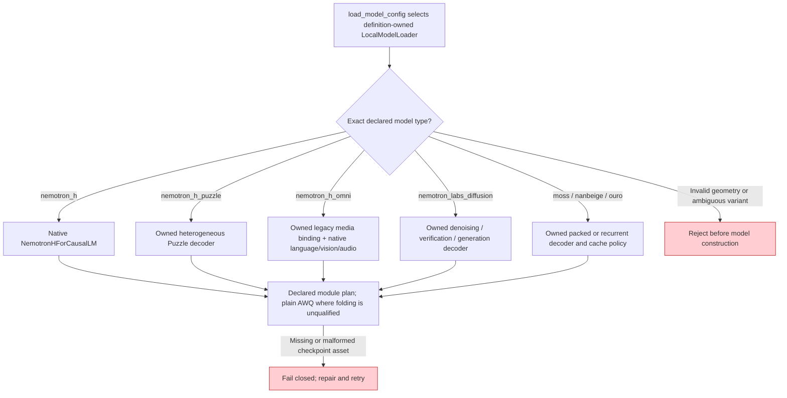

| Mechanism | Before | Current behavior |
| --- | --- | --- |
| Recurrent Ouro | `7181724a1^:gptqmodel/models/definitions/ouro.py:13-14,45-58` required remote trust and patched remote rotary/mask helpers | `definitions/ouro.py:15-21`: `LocalModelLoader` selects owned config/model; per-step caches and token-wise exits replace compatibility monkeypatches |
| Native Nemotron-H siblings | Historical native-only tests assumed Puzzle/Omni still loaded checkpoint Python | Each definition owns its loader and module tree; all three retain explicit excluded Mamba state |
| Legacy Omni tensors | `a963b1f0d^:gptqmodel/models/definitions/nemotron_omni.py:37-49` described `language_model.backbone.layers` | `definitions/nemotron_omni.py:48-60`: native `language_model.model.layers`, explicit legacy prefix/QKV conversion and preserved preprocessing buffers |
| Lazy expert storage | `7f84e0da7^:gptqmodel/utils/structure.py:2823-2826` offered only `gate_up_proj` | Try fused gated storage first, then separate gate/up tensors; missing shards raise and permit same-reader retry |

The [checkpoint materialization reference](checkpoint-owned-materialization.md)
records the shared placement, strict-FP32 and expert-storage contracts. These
ports do not qualify trained checkpoints or GPU execution. Pangu remains on a
licensing hold: the inspected custom upstream extension has no established
redistribution license. MiniCPM-o also remains excluded pending license clearance.

### OpenVLA model and action selection

[OpenVLA](../gptqmodel/models/ports/openvla/README.md) has no exact Transformers
5.23 mapping. The package owns the Prismatic config, single/fused timm vision
wrapper, image processor and action decoder, and explicitly selects native
Llama, Mistral or Phi text. Phi retains its Q/K norms, parallel MLP and final
LayerNorm; it is not substituted with a gated Llama MLP. The image-expanded
first-decoder inputs are independently checked during actual public AWQ.

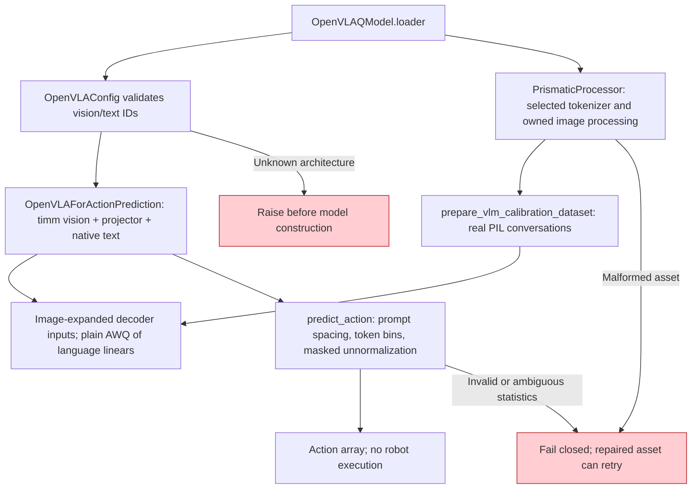

Before `a81cc785f`, `definitions/openvla.py:35,175-180` required remote trust
and used AutoProcessor discovery.
`gptqmodel/models/definitions/openvla.py:34-38` now declares config/model/processor
classes directly; `:67-68` explicitly selects plain AWQ. Checkpoint root,
nested-text, tokenizer and processor maps cannot replace these implementations,
even with trust plus the security bypass. The integration preserves the shared
conversation-calibration helper while combining the new loader import.

MIT source notices and the released tokenizer's separate Meta Llama 2 Community
License and acceptable-use policy ship together; the MIT source card does not
relicense tokenizer assets. No trained robot/model quality, GPU, foreign-cache,
compiler, concurrent execution, fold/search or fusion qualification is claimed.

### Ovis visual-vocabulary selection

`OvisQModel.loader` selects package-owned `OvisConfig`, `Ovis` and
`OvisProcessor`. Ovis 1.0 uses CLIP patch tokens; 1.5 additionally supports
SigLIP and plain/adaptive S2; 1.6 uses the partitioned visual vocabulary.
The text owners are native Llama, Qwen2 or Gemma2. Native `ovis2` remains a
separate definition. Unknown nested text types and unsupported native Gemma2
SDPA fail explicitly. The root wrapper retains released generation metadata
through `GenerationMixin` and repeated safetensors saves.

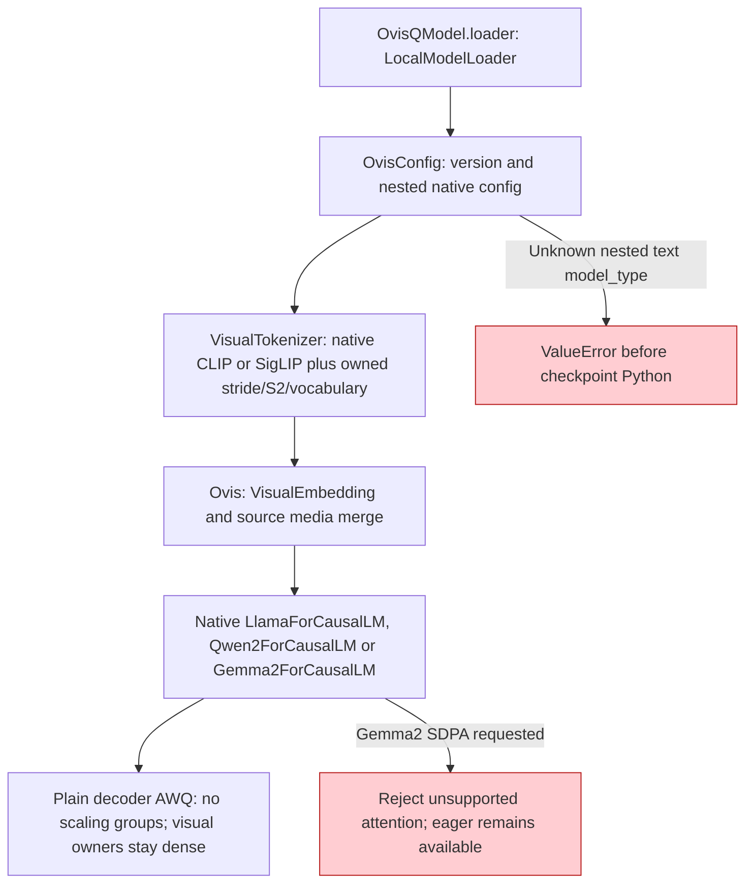

Before this port, `22bea1201:gptqmodel/models/definitions/ovis.py:21-31`
declared a visual-backbone remapping without owning the config/model/processor.
The definition now owns the config/model/processor,
binds the single normalized tokenizer and explicitly uses plain AWQ. Eight
pinned release indexes contain 6,588 keys; four full header inventories contain
3,499 shapes. The [port reference](../gptqmodel/models/ports/ovis/README.md)
records independent vision/merge equations, actual image-calibrated packing and
two exact reloads, real tokenizer assets, four red/green probes, Apache-2.0
source attribution and limitations. No trained-model, accelerator, fusion,
foreign-cache, concurrent execution or AWQ fold/search qualification is claimed.

### MiniCPM, MiniCPM-V, MiniMax and MiMo-V2 selection

Original MiniCPM owns scaled embeddings and residuals, optional W1/W3/W2 MoE,
and rotary/cache behavior. Configs omitting `model_type` can select this loader
only through the package-declared `MiniCPMForCausalLM` architecture. Ambiguous,
partial or conflicting architecture declarations fail before checkpoint Python.
The real 128k serialized-BPE tokenizer exposed a reusable Tokenicer issue; the
final 0.0.19 runtime candidate `4f23746c7aeac3bf054d1d0dd7dc66e951468989`
preserves its original token IDs. This candidate is installed from source;
publication of Tokenicer 0.0.19 remains a release prerequisite.

Legacy MiniCPM-V selects original/2/2.5/2.6/4/4.5 layouts with their own muP,
Llama, Qwen2 or Qwen3 decoder, vision tower and spatial/temporal resampler.
Its AWQ policy is explicitly plain. The separate native `minicpmv4_6`
definition retains its own loader, processor and hybrid AWQ policy.

Original MiniMax-Text-01 needs its source partial-RoPE and hybrid cache owner;
native MiniMax-M2 is selected directly. Both remain plain AWQ and excluded from
fusion. MiMo-V2 owns its hybrid attention implementation and dense auxiliary
state; source attention-sink bias is explicitly excluded from quantization.

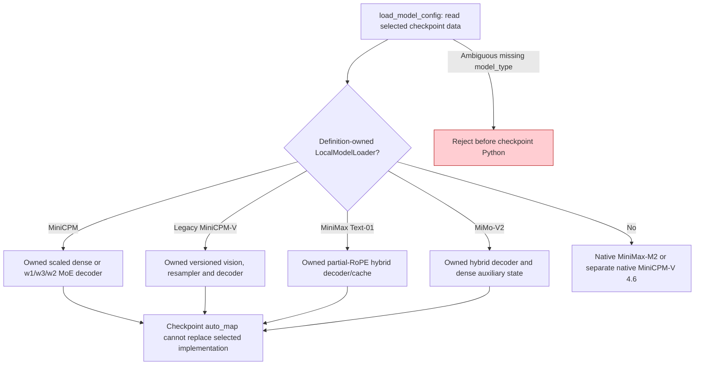

| Mechanism | Before | Current behavior |
| --- | --- | --- |
| Original MiniCPM | `5e8bfc029^:gptqmodel/models/definitions/minicpm.py` required checkpoint trust | Explicit owned config/model, declared missing-type architecture and plain AWQ |
| Legacy media wrapper | `fecb30425:gptqmodel/models/definitions/minicpmv.py` relied on checkpoint classes | Versioned owned media components; native 4.6 definition remains independent |
| Original MiniMax | `22bea1201:gptqmodel/models/definitions/minimax.py` delegated to AutoModel | Preserve source half-head rotary and hybrid cache explicitly |

MobileLLM's [full license and acceptable-use policy](../gptqmodel/models/ports/mobilellm/LICENSE)
remain packaged with its Apache attribution and notice. Official HF assets were
inaccessible, so its independently checked public-source architecture is not a
released-checkpoint inventory or tokenizer qualification. The MiniCPM-o port is
**excluded from integration**: the provenance audit found a broader ChatTTS
boundary spanning codec and repetition/generation helpers with historical
noncommercial/AGPL licensing. Including notices does not resolve that boundary.

[Checkpoint ownership during placement and materialization](checkpoint-owned-materialization.md)
documents the shared alias-map completion and native FP32 destination policy.
An earlier integration batch on Python 3.14.6t with `PYTHON_GIL=0`, Torch 2.15.0 CPU, Transformers 5.23.0,
Tokenicer source candidate `87794a5`, SentencePiece 0.2.1, TikToken 0.12.0 and
timm 1.0.22, the combined new-port/loader/security/registry/fusion/AWQ baseline
passed **1638 tests with 463 skips in 133.19 seconds**. The skips are 460
NVIDIA-only Marlin cases and three absent trained DeciLM/EXAONE/Nanbeige fixtures.
A separate placement/FP32/Klear/LLaDA2/ERNIE batch passed **478 tests without
skips in 55.14 seconds**. These overlapping batches are not additive.

### Bailing / Ling selection and replay

`BailingMoeQModel` owns both aliases through `LocalModelLoader`. Its
[pinned source and validation reference](../gptqmodel/models/ports/bailing_moe/README.md)
records original Ling softmax GQA and normalized heads, V2 dense GQA, both MLA
query projections, hybrid recurrence, MTP ownership and two-layer replay.
Full meta inventories match the three pinned checkpoint indexes. The CPU port
uses plain AWQ, with real quantization/packing/inference tests; no GPU, trained
evaluation, fused FLA or full public quantize/save/load qualification is claimed.

Previously the definition required checkpoint Python and omitted MTP envelope
owners (`gptqmodel/models/definitions/bailing_moe.py:12-13,26-29` at `22bea1201`).
The local config/model now select the layout and own the MTP projection and
norms; the existing native layout delegates to Transformers 5.

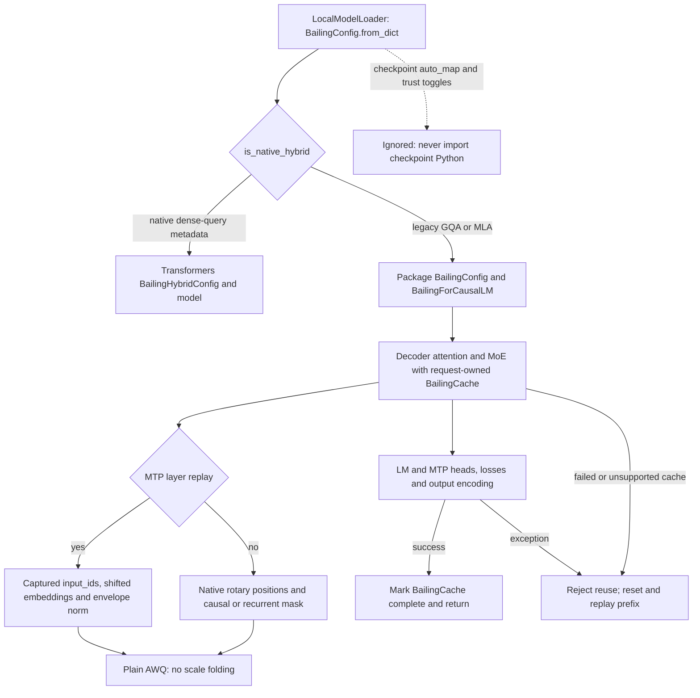

### CodeGen layout and ChatGLM / converted DBRX loading

Before these ports, `definitions/chatglm.py:13-14,33-85` and
`definitions/dbrx_converted.py:10-11` at `22bea1201` required checkpoint code;
ChatGLM additionally patched its generation hooks. CodeGen had no owned loader
(`definitions/codegen.py:9`), allowing native attention's four partitions to
reinterpret CodeGen2 eight-partition weights. The shipped definitions select
their package classes explicitly; layout metadata never grants checkpoint code
execution. [CodeGen evidence](../gptqmodel/models/ports/codegen/PROVENANCE.md),
[ChatGLM evidence](../gptqmodel/models/ports/chatglm/COVERAGE.md) and
[DBRX evidence](../gptqmodel/models/ports/dbrx_converted/PROVENANCE.md) include
pinned sources, before/after references and regression commands.

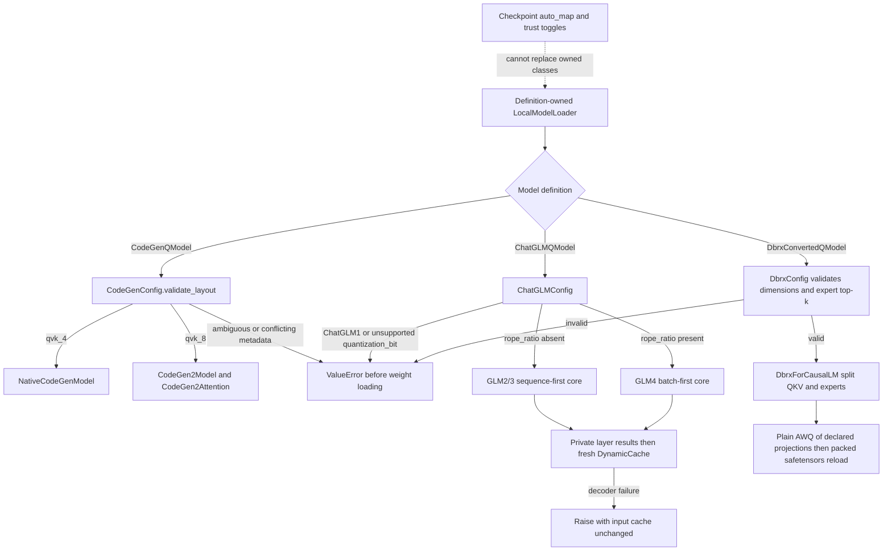

The DBRX loader reads `max_seq_len` alongside other context-length keys, including
on quantized reload; it no longer substitutes 4096 for a published context size.
ChatGLM preserves caller cache ownership by assembling a fresh output cache only
after all layers succeed. Both CodeGen layouts and ChatGLM use plain AWQ, too;
none of these ports claims qualified source folding or scale search.

## Native bridges, sparse decoders and diffusion

DeepSeek V2 and V3 use package-owned config/model bridges to the applicable
Transformers 5 implementations. V4 uses the native `AutoModelForCausalLM` mapping
directly: `DeepSeekV4QModel.loader` explicitly overrides the V3 local loader,
which cannot construct V4 layers or read its `mlp_layer_types`. Kimi-K2
canonicalizes its source alias for V3 checkpoint conversion and rejects
partial-group routing. DeepSeek-VL2 owns its vision/text model and processor;
selecting it no longer patches the global Transformers Llama attention class.
ERNIE MoE uses the exact native Transformers 5 implementation, including its
strict FP32 router policy on quantized reload. EXAONE 4 uses native model
execution for both its canonical and legacy 4.5 text identities; 4.5 vision
also remains native. Deci/Nemotron-NAS and Dream have package-owned models;
the former handles heterogeneous attention/FFN and sink caches, while Dream
uses full-sequence bidirectional denoising for generation. DBRX invalidates a
caller cache on post-write failures and requires reset/full-prefix refill.

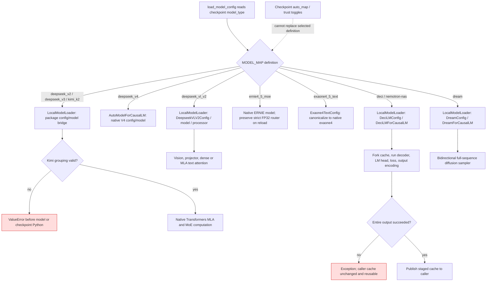

| Selection or state boundary | Before | Shipped behavior and evidence |
| --- | --- | --- |
| DeepSeek V4 model construction | `definitions/deepseek_v4.py:1410` inherited V3's package loader after the V3 port; a V4 config failed `mlp_layer_types` validation | `DeepSeekV4QModel.loader = AutoModelForCausalLM` selects the native V4 model; public hostile-map loading and V3/V4 sibling tests exercise both paths |
| DeepSeek-VL2 configuration | `definitions/deepseek_vl_v2.py:24-25,168-169` required checkpoint Python and `AutoProcessor` discovery | `DeepSeekVLV2QModel.loader` selects local config/model/processor and reuses the selected tokenizer and config; poisoned checkpoint maps cannot replace them |
| DeepSeek-VL2 global attention | `utils/hf.py:1696-1830` installed a `DeepSeekVLV2CompatLlamaAttention` globally before reading the local config; an unrelated native Llama forward failed with three attention outputs | `patch_remote_code_before_config_load` is inert; the local port uses its own attention implementation and an actual public load followed by native Llama forward stays intact |
| ERNIE MoE strict FP32 router | `utils/model.py:3452-3590` restored explicit quantized metadata only, narrowing native `gate.weight` and `moe_statics` on reload | `_native_fp32_checkpoint_names` selects exact native-policy dense slots and `_restore_checkpoint_buffers` restores FP32 values, including disk-offloaded payloads, without widening packed quantized state |
| EXAONE 4.5 text alias | `definitions/exaone4.py:8` inherited AutoModel; no `exaone4_5_text` AutoConfig mapping existed | `Exaone4TextConfig.from_pretrained` validates the alias and builds native `Exaone4Config` / `Exaone4ForCausalLM` without checkpoint Python |
| Kimi-K2 routing | Checkpoint alias required remote modeling code and offered partial-group semantics that differ from native V3 | `ports/deepseek_v3/configuration_deepseek_v3.py` retains the source alias while canonicalizing the native config; invalid grouping raises before model loading |
| Deci cache ownership | Decoder could publish a warm cache before LM head, loss or tuple encoding failed | `ports/decilm/modeling_decilm.py` stages the decoder cache through the complete LM output; failures leave caller identities, tensors and counters intact |
| DBRX cache and static padding | `ports/dbrx_converted/modeling_dbrx.py:263-298,354-379` left a mutated cache reusable after head/loss failures; `:270-271,367-369` rejected static 4D generation masks or selected future padding for router loss | Nested cache guards invalidate on post-write failure and require reset/full prefill; model-owned causal masking and physical cache positions preserve padding semantics |
| Dream generation | Old checkpoint code supplied diffusion sampling and attempted a remote RoPE compatibility shim | `ports/dream/generation_utils.py` runs four local sampling algorithms over full sequences; no checkpoint Python is selected or global RoPE registry patched |

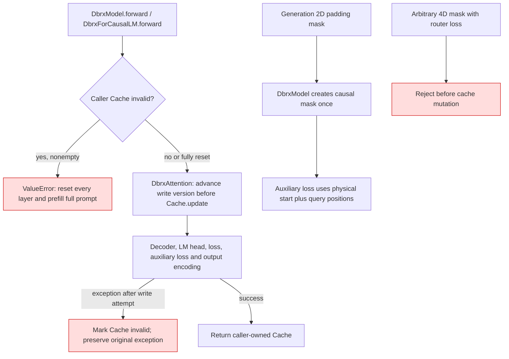

The exact model plans and license/weight-provenance boundaries are recorded in
the linked per-model references above. CPU/meta qualification and plain-AWQ
policy vary by family; these checks do not establish GPU or trained-checkpoint
accuracy. DeepSeek V2's normalized router now computes FP32 selected
probabilities without the redundant scaling that overflowed at extreme finite
factors. Derived rotary frequencies are regenerated in FP32 from native config
after casts and reloads. Its continuation and failure contract is shown below.

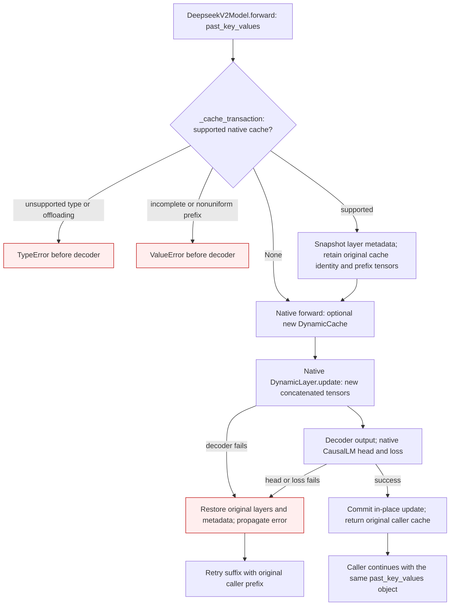

Only ordinary non-offloaded native `DynamicCache`/`DynamicLayer` prefixes are
supported here. This differs from EXAONE 3, which supports native dynamic and
static layers and restores the caller cache on a failed write, and Instella,
which requires resetting a cache after decoder failure. See the respective
port references for exact cache contracts and before/after source lines.

## GRIN-MoE, Instella, EXAONE 3 and ERNIE VL selection

GRIN-MoE, Instella and EXAONE 3 have no exact native Transformers 5.23 mapping.
Their definitions select the package-owned config and model. Both ERNIE VL
aliases select package adapters for configuration and processing around the
exact native model; the adapters translate legacy JSON and never import its
checkpoint decoder hook. All four families explicitly use plain AWQ.

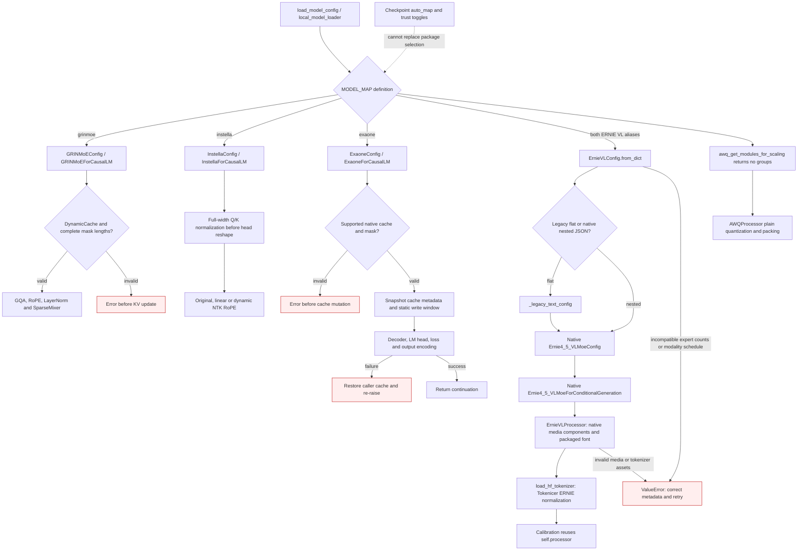

| Mechanism | Before | Shipped behavior |
| --- | --- | --- |
| GRIN-MoE selection | Base `22bea1201`, `definitions/grinmoe.py:11-12`: remote trust and inherited auto loader | `GrinMoeQModel.loader` selects package config/model; explicit empty AWQ groups preserve plain quantization |
| Instella selection and norms | Base `22bea1201`, `definitions/instella.py:12,25`: remote loader and omitted Q/K norms | `InstellaQModel.loader` owns selection; `module_tree` includes non-quantized full-width Q/K norms before projections |
| EXAONE 3 selection | Base `22bea1201`, `definitions/exaone.py:10-11`: checkpoint Python required | `ExaOneQModel.loader` selects package config/model; `_rollback_cache_on_error` protects decoder/head/loss/output failures |
| ERNIE VL model and processor | Base `22bea1201`, `definitions/ernie4_5_vl_moe.py:28,397-398,419-427`: auto model/processor and dynamic decoder import | Package config/model/processor selection, native model re-export, no decoder hook, selected processor reused for calibration |
| DeepSeek V2 continuation | Before `c1ec93caf`, `ports/deepseek_v2/modeling_deepseek_v2.py`: `_fork_cache` returned a different cache and left a retained caller handle stale | `_cache_transaction` preserves caller identity and in-place success, restoring exact prior metadata after decoder/head/loss/tuple failures |

ERNIE VL uses a packaged Roboto font for native video timestamps. Its bytes
match pinned upstream SHA-256
`56a45233d29f11b4dfb86d248e921939d115778f87325e7ae8cc108383d6664d`;
the source distribution includes `*.ttf`, licenses and notices. Native ERNIE
tokenizer normalization requires the changes in
[Tokenicer PR 64](https://github.com/ModelCloud/Tokenicer/pull/64), version
0.0.17. This prerequisite is not a claim that the dependency has been released.

The combined CPU port, module-plan, AWQ, loader, processor and security batch
passed **1173 tests with 14 skips** in 60.14 seconds on Transformers 5.23.0,
Torch 2.15.0+cpu and Python 3.14.6t (`PYTHON_GIL=0`). This batch covers the
four families above and the DeepSeek V2 follow-up; it does not establish
accelerator kernels, trained-weight quality or all-registry leaf coverage.
The related fusion inventory, registry and AWQ-family batch passed 674 tests
with 477 skips; unavailable NVIDIA kernels and unrelated optional fixtures
remain unqualified.

Run the InternLM checks from the repository root:

```shell
python -m pytest tests/test_internlm_local_port.py tests/module_tree/test_internlm_local_port.py tests/module_tree/test_registered_module_plans.py -q --tb=short
```

## Hymba hybrid replay and InternLM2 packed attention

Hymba uses its own parallel attention/SSM architecture and hybrid cache.
InternLM2/2.5 uses its original KV-group-interleaved packed QKV layout. Neither
definition selects a related Transformers architecture as a substitute.

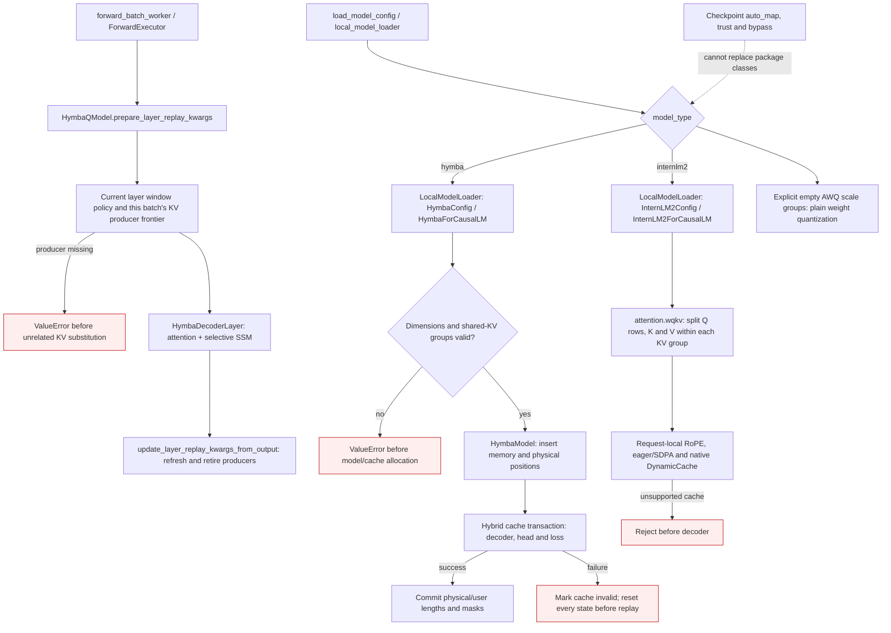

| Mechanism | Before | Shipped behavior |
| --- | --- | --- |
| Hymba construction | Base `22bea1201`, `definitions/hymba.py:12-22,45-55`: remote hook, mandatory CUDA dependencies and late config mutation | Package-selected native Hymba architecture; dimension/group validation in `HymbaConfig`; portable Torch recurrence |
| Hymba ownership and replay | Base `22bea1201`, `definitions/hymba.py:34-39`: omitted SSM state, nonexistent norm and expert zero; replay reused first-layer policy/previous KV | Explicit dense SSM/norm/router ownership, wildcard experts, actual `pre_moe_layernorm`; layer-owned window policy and batch-owned KV frontier |
| InternLM2 selection | Base `22bea1201`, `definitions/internlm2.py:10-11`: checkpoint trust and Transformers 4 pin | Direct package config/model, `output` head identity and source packed layout; no fusion admission |

Hymba cache rejection covers cross-request ownership and failed partial updates;
reset clears KV, convolution, SSM, masks, lengths and ownership together.
Its locking test rejects a second transaction before Torch access; this is not
evidence of concurrent accelerator execution. InternLM2's RoPE calculation is
request-local, but cached keys retain the source model's original rotations
when the NTK base changes. Read the linked references before selecting cache
operations or interpreting full-versus-chunked parity.

Combined Hymba, InternLM1/2, loader, security, registry, AWQ and calibration
helper validation passed **881 tests with 36 skips** in 43.97 seconds on the
CPU environment above. Skips cover unavailable NVIDIA paths and unrelated
generic-family fixtures. The final InternLM2 packed AWQ save/reload follow-up
then passed all **66 owned tests**, with no skips, in 4.79 seconds.

## Package-owned tokenizer selection

`LocalModelLoader.tokenizer_class` declares a full package class path per
definition. `load_hf_tokenizer` selects it using the outer model config's
`model_type`, preserving caller-supplied tokenizer instances. Shared checkpoint
class names do not select a tokenizer: Intern-S1 and Intern-S2 require distinct
scientific tokenization implementations despite both naming `InternS1Tokenizer`.
The individual ports own their scientific assets and numerical qualification.

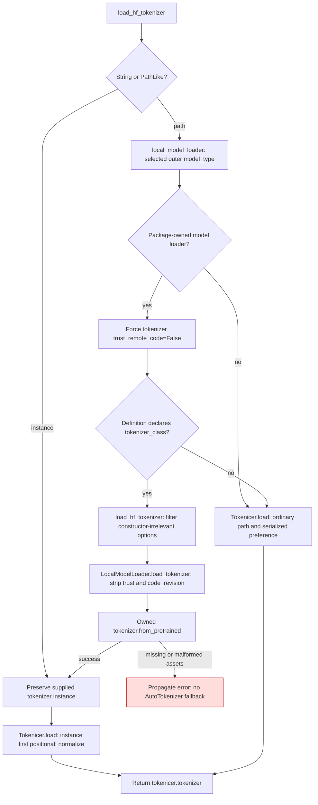

| Mechanism | Before | Shipped behavior |
| --- | --- | --- |
| Tokenizer implementation | Base `c72de4911`, `utils/hf.py:2802-2827`: every path went to Tokenicer auto discovery | `utils/hf.py:2812-2825`: definition-owned tokenizer paths instantiate directly; instances remain instances |
| Trust options | No package tokenizer entry point | `models/local.py:64-69`: package tokenizer loading discards `trust_remote_code` and `code_revision` |
| Local model without a custom tokenizer | `utils/hf.py` at `d3ea4d172:2816-2835` passed both caller opt-ins through to Tokenicer; a hostile tokenizer auto-map executed checkpoint Python | `utils/hf.py:2817-2820` disables tokenizer remote trust for every selected package model, including models using ordinary native tokenizer assets |
| Corrective normalization | Tokenicer owns normalization | Tokenicer still receives the selected instance and model config; no GPT-QModel normalization shim |
| Missing scientific assets | Auto-discovery could select checkpoint Python | Owned construction errors propagate; no generic tokenizer substitution or remote retry |

The package requires `tokenicer>=0.0.17`. Its
[published source](https://pypi.org/project/tokenicer/0.0.17/) archive has SHA-256
`24ba4e1f503e652df757365dd8d08ad145fe7a0f52bd74fb32fda2741489cef0`.
All five packaged Python files were independently compared byte-for-byte to the
merged upstream fix. Tokenicer handles generic trust enforcement and ordinary
serialized-tokenizer preference; unknown custom semantics fail closed rather
than silently substituting a generic tokenizer. See
[the upstream security change](https://github.com/ModelCloud/Tokenicer/pull/64).

The actual `GPTQModel.load` regression
`test_local_model_without_owned_tokenizer_cannot_import_checkpoint_python`
first produced **one failure and three passing controls**: only both trust
and bypass enabled imported the checkpoint marker code. After enforcing the
definition's tokenizer trust boundary, shared model/tokenizer/processor/security
and scientific-port suites passed **181 tests**, no skips, in 8.51 seconds.
All four combinations preserve exact native input IDs and decoding; explicit
unsupported checkpoint-code consent remains available outside package-owned
model definitions. Tokenicer still owns generic loading and normalization.

With the published 0.0.17 artifact installed, the owned tokenizer adapter,
processor/model/path/security tests, ERNIE VL, Hymba and InternLM2 runtime suites
passed **239 tests with no skips** in 25.37 seconds. Tests preserve ordinary
serialized-tokenizer preference/opt-out and supplied-instance identity, exercise
hostile outer/nested metadata across trust and bypass combinations, and verify
missing/corrupt owned assets fail without fallback and can be retried after repair.

Intern-S2 Preview declares its own
`gptqmodel.models.ports.intern_s2_preview.tokenization_interns1.InternS1Tokenizer`
path, alongside its local config, model and processor. Its five tokenizer assets
include separate SMILES, PROT and XNA vocabularies. The checkpoint's shared
`InternS1Tokenizer` class name does not select S1's IUPAC/FASTA implementation.
Missing XNA data fails even when a generic `tokenizer.json` exists; restoring the
asset permits retry. Its package processor creates native image/video components
directly and receives the normalized owned tokenizer instance. The
[S2 flow and numerical evidence](../gptqmodel/models/ports/intern_s2_preview/README.md)
also document the `linear_attn:!` state-parameter exclusion and mixed-dtype
time-series positional-buffer fix.

Intern-S1 selects its distinct
`gptqmodel.models.ports.interns1.tokenization_interns1.InternS1Tokenizer`
and package-owned multimodal model/processor, retaining native Qwen3/Qwen3-MoE
decoder execution. Both scientific ports validate all five required assets
before construction. This preserves the missing filename when Transformers
5.23 wraps vocabulary I/O errors: the independent combined run reproduced two
S2 and three S1 failures before the explicit guard. Filename-specific errors
and repaired same-path retries are checked for all five assets per port.

The combined S1/S2 scientific, public model/processor/tokenizer/security,
registry/fusion, shared AWQ and VLM calibration suites passed **1078 tests with
473 skips**, 63 warnings, in 37.92 seconds against the published Tokenicer
0.0.17. This includes the parent calibration-helper integration: an already
loaded package processor is reused and pretokenized inputs preserve the shared
text path. The exact command is:

```bash
OMP_NUM_THREADS=1 MKL_NUM_THREADS=1 PYTHON_GIL=0 python -s -m pytest \
  tests/test_interns1_local_port.py tests/module_tree/test_interns1_local_port.py \
  tests/test_intern_s2_preview_local_port.py tests/module_tree/test_intern_s2_preview_local_port.py \
  tests/test_local_tokenizer_loading.py tests/test_local_processor_loading.py \
  tests/test_local_model_loading.py tests/test_local_model_paths.py tests/test_trust_remote_code_isolation.py \
  tests/module_tree/test_registered_module_plans.py tests/module_tree/test_fusable_models.py \
  tests/test_awq_scaling_groups.py tests/test_awq_empty_groups.py \
  tests/test_vlm_mapping_calibration_4308.py tests/test_vlm_multimodal_calibration_4371.py \
  tests/test_vlm_pretokenized_calibration.py tests/test_vlm_calibration_metadata_columns_4455.py \
  -q --tb=short -o log_cli=false
```

The isolated Tenstorrent dependency manifest also pins Transformers 5.23.0 and
Tokenicer 0.0.17. Its new dependency contract first failed on both older pins
while the defuser control passed; after updating them, dependency and Torch
safety-gate suites passed **52 tests** in 10.57 seconds. This checks dependency
consistency, not a new TT hardware qualification.

## LFM3 native decoder ownership

LFM3 retains the Transformers 5.23 decoder. All three definitions explicitly
exclude `conv.conv` from quantization. Text LFM3 excludes native `self_attn.g_proj`
and the legacy `gate_proj` alias; native VL uses `g_proj`, while the package-owned
Omni decoder uses `gate_proj`. [Native-source evidence](../gptqmodel/models/ports/lfm3/COVERAGE.md)
records the convolution/gate relationships. The [media loading reference](#lfm3-media-and-kimi-k25-loading)
describes the distinct model and processor implementations.

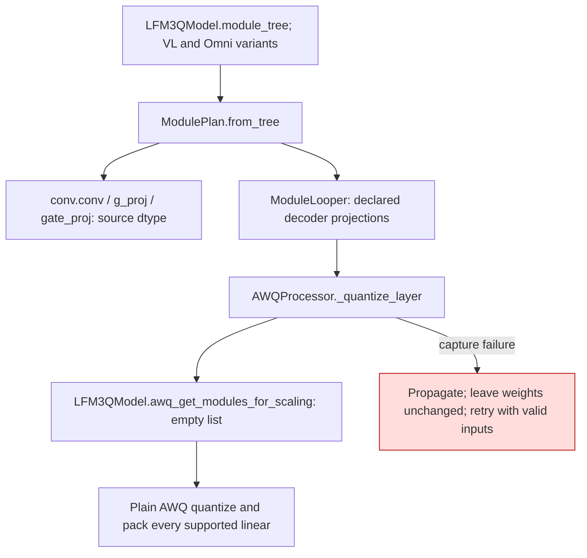

| Mechanism | Before | Shipped behavior |
| --- | --- | --- |
| Native dense leaves | Base `569c693de`, `definitions/lfm3.py:58-68`: depthwise kernel and native sigmoid gate undeclared | `definitions/lfm3.py:58-71`: nested depthwise owner and both text gate spellings explicitly excluded; VL/Omni declare their applicable gate |
| AWQ groups | Generic inference could cross nonlinear convolution/gating boundaries | `definitions/lfm3.py:80-83`: no scale groups; real CPU packing preserves all declared linear targets |

The parent independently reproduced both original registry failures. After the
fix and explicit registry snapshots, combined native coverage, support tests,
full leaf inventory, registry and required AWQ baseline passed **759 tests with
24 skips and 3 expected failures** in 83.56 seconds. Missing checkpoint/GPU
fixtures and existing expected failures remain unqualified. This earlier
decoder-only run did not qualify media or the Omni wrapper/audio. Subsequent
media qualification is recorded [below](#lfm3-media-and-kimi-k25-loading).

The AWQ unit CI then exposed two old synthetic tests that still required LFM3
fold groups. Those expectations now assert the plain policy; additional real
Transformers convolution/full/sliding sandwich layers confirm no scale groups.
`tests/test_awq_scale_folding.py` plus
`gptqmodel/models/ports/lfm3/tests/test_native_coverage.py` passed **84 tests**
with no skips in 4.01 seconds. The native suite checks actual quantization,
packing, dense-owner preservation and failed-capture repair/retry; a no-group
assertion alone is not counted as packing qualification.

## InternVL wrapper and K2-Horizon selection

InternVL-chat selects a package-owned vision/wrapper implementation and its
declared decoder. Llama, Qwen2, Qwen3, Qwen3-MoE and Phi3 retain their native
Transformers implementations; InternLM2 uses the sibling package port and
preserves checkpoint `output.*` keys. K2-Horizon selects its exact dense,
MoVA and sparse-MoE implementation. Neither path delegates to checkpoint Python.

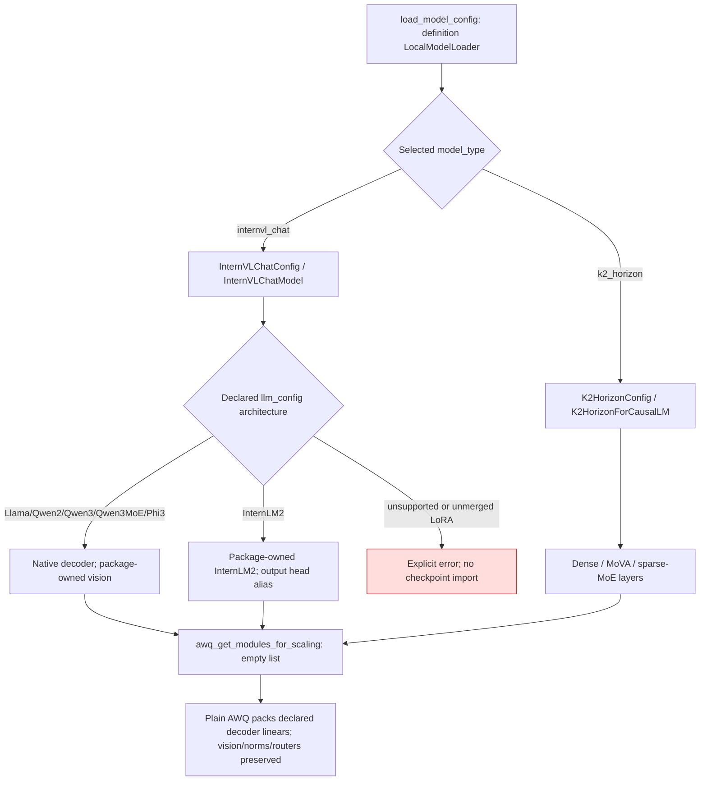

| Mechanism | Before | Shipped behavior |
| --- | --- | --- |
| InternVL wrapper | `22bea1201`, `definitions/internvl_chat.py:13,33`: `AutoModel` relied on checkpoint discovery | `definitions/internvl_chat.py:35-38`: exact package classes; six decoder layouts independently tested |
| K2-Horizon | `22bea1201`, `definitions/k2_horizon.py`: no native Transformers 5 mapping or local loader | `definitions/k2_horizon.py:124-127`: package-owned config/model preserves all three published checkpoint layouts |
| Shared AWQ fixture | `tests/test_awq_scaling_groups.py` derived K2/Instella from optional `/monster` checkpoints, skipping when absent | Real tiny package configurations run without trained weights; InternVL resolves `llm_config.vocab_size` |
| Fusion qualification | Fixture called both architectures missing custom/remote implementations | Explicit package-owned exclusions; no fusion backend newly admitted |

Combined InternVL/K2-Horizon, tokenizer/model/processor/security, registry,
fusion and shared AWQ validation passed **931 tests with 473 skips** and
23 warnings in 38.51 seconds. The command is:

```bash
OMP_NUM_THREADS=1 MKL_NUM_THREADS=1 PYTHON_GIL=0 python -s -m pytest \
  tests/test_internvl_chat_local_port.py tests/module_tree/test_internvl_chat_local_port.py \
  tests/test_k2_horizon_local_port.py tests/module_tree/test_k2_horizon_local_port.py \
  tests/test_local_tokenizer_loading.py tests/test_local_model_loading.py \
  tests/test_local_processor_loading.py tests/test_local_model_paths.py \
  tests/test_trust_remote_code_isolation.py tests/test_awq_scaling_groups.py \
  tests/test_awq_empty_groups.py tests/test_awq_moe_router_scaling.py \
  tests/test_awq_moe_bypass_4223.py tests/module_tree/test_registered_module_plans.py \
  tests/module_tree/test_fusable_models.py -q --tb=short -o log_cli=false
```

Skips concern unavailable NVIDIA fusion execution and unrelated optional model
fixtures. The two port suites run without skips. Central AWQ tests now use
real package-owned Instella/K2 configs, add EXAONE 3, GRIN-MoE, Hymba,
InternLM2 and InternVL decoder cases, and explicitly keep these families plain.
Wheel and sdist inspection verified all **87** then-integrated port audit,
font, license and notice assets, including Hymba's PDF license and both
InternVL licenses, alongside the Python/Transformers/Tokenicer dependency floors.

## Klear and Kimi implementation selection

Klear uses the packaged `KlearConfig` and `KlearMoeForCausalLM`. Its independent
published-checkpoint inventory includes dense, routed and shared expert state,
per-head Q/K norms and learned expert mixing. These exclusions are explicit in
the central registry case. Public dense/MoE/mixed plain-AWQ round trips preserve
the nonzero strict-FP32 routing bias and every excluded tensor; no scale-search
groups or fusion executor are admitted.

K3's `KimiConfigFactory` and `KimiModelFactory` distinguish the packaged AttnRes
implementation from ordinary native KimiLinear. The ordinary looper cannot
carry AttnRes `prefix_sum` and `block_residual` between layers, so its GPTQ/AWQ
entry points reject before mutation. The existing bounded runner remains the
explicit supported quantization boundary.

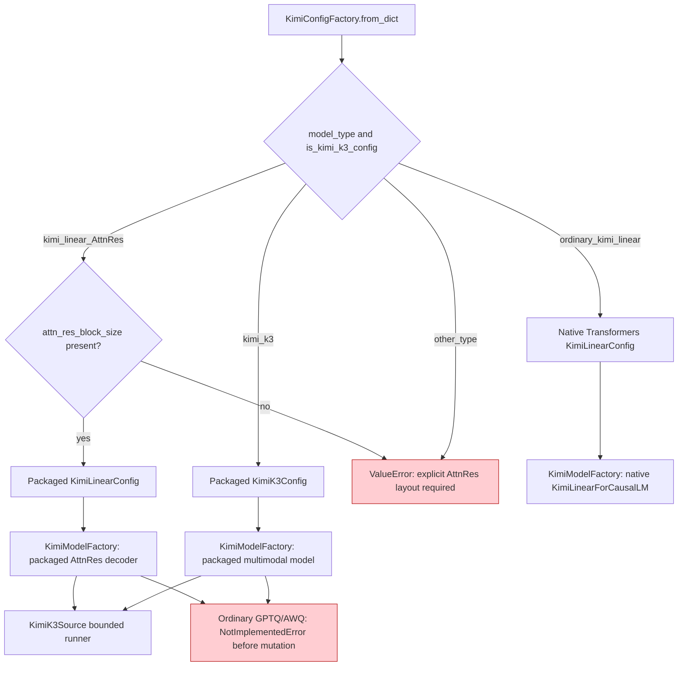

Tokenizer architecture is selected separately. Kimi-K2 uses its own pinned
DeepSeek-V3-owned TikToken implementation, including all 256 reserved IDs and
its native chat/tool rendering. K3 uses its distinct TikToken/XTML implementation.
Their qualified shared dependency floor is `tiktoken>=0.12.0`. Generic corrective
normalization still runs once in Tokenicer; model-specific tokenizer code does
not replace that normalization boundary.

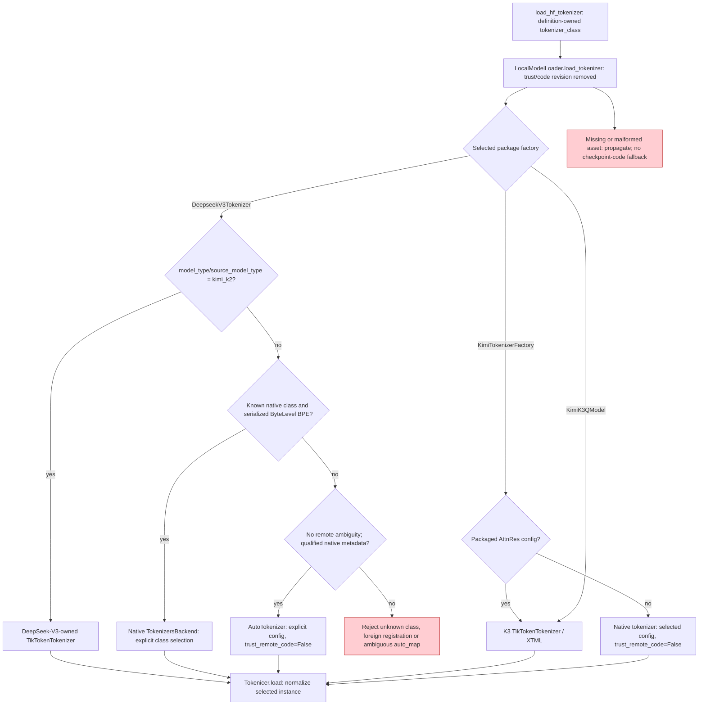

| Mechanism | Before | After and evidence |
| --- | --- | --- |
| Klear architecture | `definitions/klear.py:11` at `dbdc9a9c6`: generic/remote model resolution | `definitions/klear.py:12`: definition-owned config/model and full checkpoint-state exclusions; [source, flow and red/green evidence](../gptqmodel/models/ports/klear/README.md) |
| K3/native dispatch | `definitions/kimi_k3.py:26` at `dbdc9a9c6`: checkpoint implementation required for AttnRes | `ports/kimi_k3/configuration_kimi_k3.py:291` and `modeling_kimi_linear.py:1242`: exact native or packaged implementations; [pinned source and independent MLA/KDA oracles](../gptqmodel/models/ports/kimi_k3/README.md) |
| K2 tokenizer | `definitions/deepseek_v3.py:15-18` at `dbdc9a9c6`: no direct tokenizer declaration; AutoTokenizer could select the wrong slow tokenizer from hostile metadata | `ports/deepseek_v3/tokenization_deepseek_v3.py:15`: selects K2 directly, pins ordinary ByteLevel BPE to `TokenizersBackend`, and rejects ambiguity; [source SHA and red/green probes](../gptqmodel/models/ports/deepseek_v3/PROVENANCE.md) |

The combined parent-branch Klear/K3/K2-tokenizer/LFM3, registry, fusion,
tokenizer-boundary and strict-FP32 suite passed **1,049 tests with 475 skips**.
Skips concern unavailable trained-checkpoint fixtures and NVIDIA fusion execution.
The owned Klear, K3, K2-tokenizer and LFM3 suites passed. This CPU/meta evidence
does not qualify trained-weight quality, GPU/FlashAttention/fused FLA, multi-GPU,
concurrent execution, compilation, MTP or additional cache implementations.

```bash
OMP_NUM_THREADS=1 PYTHON_GIL=0 python -s -m pytest -q \
  tests/test_klear_local_port.py tests/module_tree/test_klear_local_port.py \
  tests/test_kimi_k3_local_port.py tests/module_tree/test_kimi_k3_local_port.py \
  tests/test_kimi_k3_support.py tests/module_tree/test_kimi_linear_native_tree.py \
  tests/module_tree/test_kimi_k3_fork_plan.py tests/module_tree/test_kimi_linear_fork_plan.py \
  tests/test_deepseek_v3_local_port.py tests/module_tree/test_deepseek_v3_local_port.py \
  tests/test_lfm3_local_port.py tests/module_tree/test_lfm3_local_port.py \
  tests/test_lfm3_support.py gptqmodel/models/ports/lfm3/tests/test_native_coverage.py \
  tests/module_tree/test_registered_module_plans.py tests/module_tree/test_fusable_models.py \
  tests/test_local_tokenizer_loading.py tests/test_native_fp32_checkpoint_loading.py \
  -xq --disable-warnings
```

## LFM3 media and Kimi-K2.5 loading

LFM3-VL selects native Transformers 5.23 config/model classes and an owned
processor loader with fixed native Qwen image/video components. LFM3-Omni
selects the pinned package-owned wrapper, decoder, media processor and codec;
the exact Omni architecture is absent from Transformers 5.23. Kimi-K2.5 reuses
native multimodal config, decoder and cache behavior with narrow vision/media
adapters and its own K2.5 tokenizer. The K2, K2.5 and K3 tokenizers retain
distinct IDs and chat/tool rendering; Tokenicer owns outer normalization.

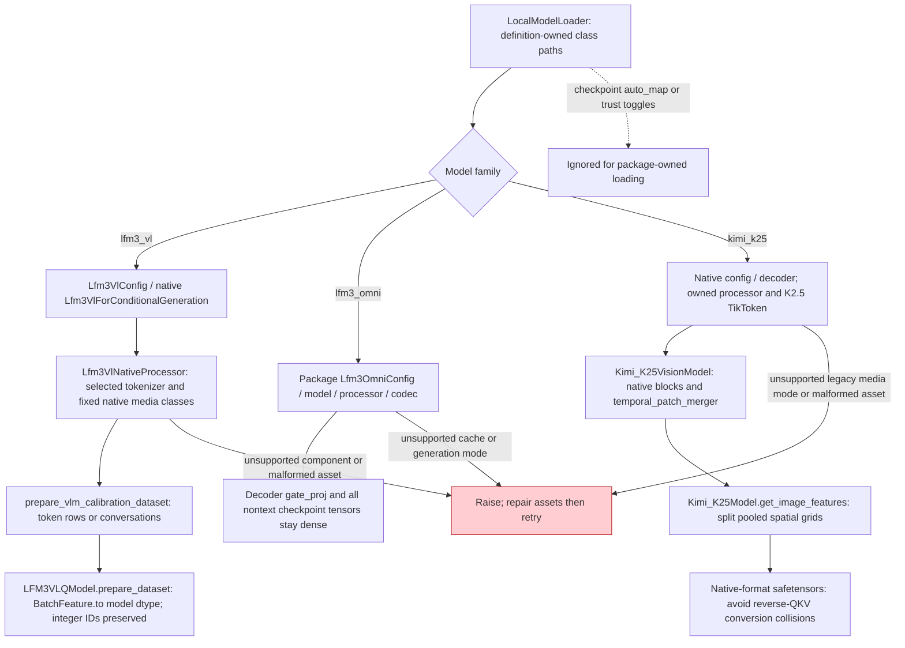

| Mechanism | Before at `3695dfd5a` | Shipped behavior and evidence |
| --- | --- | --- |
| LFM3-VL processor | `definitions/lfm3_vl.py:128-129`: AutoProcessor discovery | `definitions/lfm3_vl.py:132-137`, `ports/lfm3_vl/native.py:18-49`: selected tokenizer, explicit image/video classes; checkpoint-selected components rejected |
| FP16 image calibration | `definitions/lfm3_vl.py:149-156`: shared helper returned FP32 media | `definitions/lfm3_vl.py:163-177`: shared preparation retained, floating BatchFeature media cast to model dtype, integer IDs preserved |
| LFM3-Omni architecture | `definitions/lfm3_omni.py:29,65,124-125`: native AutoModel selector, required remote trust and AutoProcessor discovery | `definitions/lfm3_omni.py:30-34`: pinned local config/model/processor; [SHA provenance and licenses](../gptqmodel/models/ports/lfm3_omni/PROVENANCE.json) |
| Kimi-K2.5 selection | `definitions/kimi_k25.py:14,18,26-33`: remote trust and legacy decoder prefix | `definitions/kimi_k25.py:16-22,33-58`: native-backed owned loader and exact native decoder owners; [source, licenses and native failure probes](../gptqmodel/models/ports/kimi_k25/README.md) |
| Partial video chunks | Native rectangular temporal gather and repeated temporal split counts | `ports/kimi_k25/native.py:29-72`: native temporal merger followed by spatial-only split; independent full/partial clip oracles |

The combined K2/K2.5/K3, LFM3-VL/Omni, loader/security/tokenizer/processor,
registry/fusion and AWQ safety run passed **977 tests, with 475 skips**, in
51.70 seconds. A separate shared VLM calibration run passed **183 tests** in
2.97 seconds. The skipped cases require unavailable trained checkpoint fixtures
or NVIDIA fusion hardware. CPU/meta results do not qualify trained-weight
quality, GPU/FlashAttention/fused kernels, multi-GPU, concurrent execution,
compilation, training, additional cache modes or fusion.

The parent repeated the FP16 failure probe through the shared calibration
helper: disabling only `batch.to(dtype=self.model.dtype)` made
`tests/test_lfm3_vl_local_port.py::test_public_awq_plain_quantization_packs_all_decoder_linears[False-1]`
fail at the actual native patch embedding with `float != c10::Half`.
Restoring the cast preserves the shared calibration path and exact integer IDs.

```bash
OMP_NUM_THREADS=1 PYTHON_GIL=0 python -s -m pytest -q \
  tests/test_kimi_k25_local_port.py tests/module_tree/test_kimi_k25_local_port.py \
  tests/test_deepseek_v3_local_port.py tests/test_kimi_k3_local_port.py \
  tests/test_lfm3_vl_local_port.py tests/module_tree/test_lfm3_vl_local_port.py \
  tests/test_lfm3_omni_local_port.py tests/module_tree/test_lfm3_omni_local_port.py \
  tests/test_lfm3_support.py tests/test_local_model_loading.py tests/test_local_model_paths.py \
  tests/test_local_processor_loading.py tests/test_local_tokenizer_loading.py \
  tests/test_trust_remote_code_isolation.py tests/test_awq_empty_groups.py \
  tests/test_awq_scale_search_safety.py tests/module_tree/test_registered_module_plans.py \
  tests/module_tree/test_fusable_models.py -x --disable-warnings
OMP_NUM_THREADS=1 PYTHON_GIL=0 python -s -m pytest -q \
  tests/test_vlm_mapping_calibration_4308.py tests/test_vlm_calibration_metadata_columns_4455.py \
  tests/test_vlm_pretokenized_calibration.py tests/test_vlm_multimodal_calibration_4371.py \
  -x --disable-warnings
```

## LLaDA2 version selection and routing precision

The [LLaDA2 port](../gptqmodel/models/ports/llada2/README.md) preserves six
released decoder policies: `2.0`, `2.0-mini-preview`, `2.0-flash-preview`,
`2.0-cap`, `2.1` and `2.2`. Their packed-QKV checkpoint layout does not identify
the decoding policy. In particular, mini-preview returns the prompt and uses
greedy sampling at temperature zero; flash-preview follows CAP's multinomial
sampling and continuation-only return. Ambiguous metadata, including the old
`2.0-preview` spelling, fails with instructions to set `llada_version`.
Only the complete 2.2 block-routing/edit-token signature permits inference of
that version. Explicit selection persists through public loading and reload.

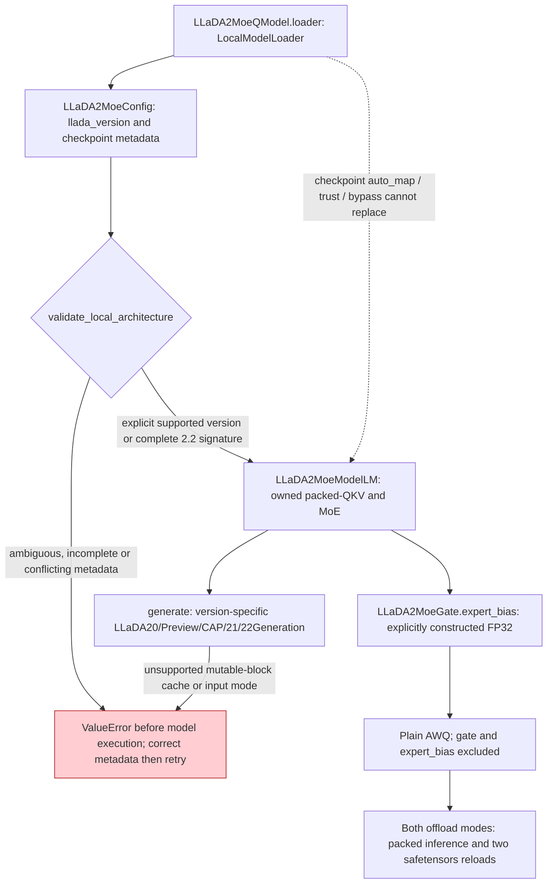

| Mechanism | Before at `fecb30425` | Shipped behavior and evidence |
| --- | --- | --- |
| Model selection | `definitions/llada2.py:34-53`: process-global attention-class patching | `definitions/llada2.py:8-11`: direct owned config/model; `ports/llada2/modeling_llada2_moe.py:764`: explicit generation dispatch |
| Decoder policy | Shared `llada2_moe` spelling could not distinguish released generation implementations | `ports/llada2/configuration_llada2_moe.py:138`: validated version and complete edit/routing signature; eight pinned checkpoint inventories in the port README |
| Routing precision | An implicit `torch.zeros` buffer follows the low-precision shell's default dtype | `ports/llada2/modeling_llada2_moe.py:201,506`: explicit FP32 construction plus strict checkpoint loading; independent Klear control preserves exact nonzero values through public AWQ |

The constructor defect was reproduced by removing only Klear's explicit FP32
buffer dtype: `test_public_awq_native_fp32_pack_and_two_reloads[lazy-fp16]`
then failed immediately after quantization with rounded FP16 routing values,
despite an independently exact FP32 source checkpoint. Restoring the explicit
dtype makes the four FP16/BF16 by disk-offload controls pass. LLaDA2 applies the
same constructor discipline. No shared LazyTurtle precision change was needed.
The conversion-cache test now mocks `load_model_config` at its current API
boundary and still checks the offload directory and final lease cleanup;
its focused rerun passed in 3.39 seconds.

## Llama aliases, MiMo and flat LLaVA-Qwen2 selection

These units use native code only when the pinned source has the same equations
and checkpoint owners. [Llama alias selection](../gptqmodel/models/ports/llama/README.md)
retains eleven exact native classes, owns LongLLaMA's memory implementation,
and adapts StableLM Epoch/Yi metadata to matching native classes.
[MiMo](../gptqmodel/models/ports/mimo/README.md) extends native Qwen2 with all
auxiliary MTP weights; ordinary generation follows the inspected decoder-only
forward. [Flat LLaVA-Qwen2](../gptqmodel/models/ports/llava_qwen2/README.md)
owns its flat wrapper, image insertion, FastViTHD and CLIP/S2 adapters. Native
`mimo_v2_flash` and composite `fast_vlm` are distinct architectures.

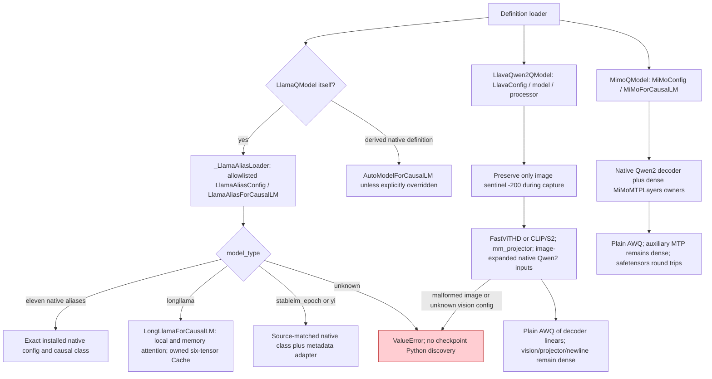

| Mechanism | Before | Shipped behavior and evidence |
| --- | --- | --- |
| Llama aliases at `990088bdb` | `definitions/llama.py:10-20`: inherited generic loading for missing legacy architectures | `definitions/llama.py:13-23`, `ports/llama/dispatch.py`: definition-scoped descriptor; derived native definitions retain their loader |
| LongLLaMA context | Remote Transformers 4 cache and memory implementation | `ports/llama/modeling_longllama.py`: explicit local K/V/positions and memory K/V/masks, eviction, continuation and cache immutability; unsupported speculative cropping fails |
| MiMo at `990088bdb` | `definitions/mimo.py`: inherited Qwen2-like tree omitted an owned model implementation | `definitions/mimo.py`: direct local classes; `ports/mimo/modeling_mimo.py:39-77`: auxiliary rotary pair adapted to native `position_embeddings` |
| LLaVA-Qwen2 at `990088bdb` | `definitions/llava_qwen2.py`: generic causal model and no image-aware capture policy | `definitions/llava_qwen2.py:15-33`: owned loader, explicit direct-meta newline owner and preservation of image sentinel only |

Pinned checkpoint inventories cover 263 LongLLaMA, 356 Epoch, 219 Yi-Coder,
451 MiMo and 924 FastVLM-0.5B keys; all three inspected FastVLM configurations
share the exact 629-key vision inventory. These are metadata and tiny-model
checks, without trained tensor payload qualification. The port READMEs retain
source revisions, original-file hashes and licenses/notices. FastViTHD lazily
uses `timm>=1.0.22`; the Apple acknowledgements ship with the package.

Fusion remains explicitly unqualified for all newly owned legacy layouts.
There is no trained-weight quality, GPU/FlashAttention, fused-kernel,
multi-GPU, concurrent model execution, compilation, training or additional
cache qualification. MiMo speculative MTP decoding and LLaVA video are not
implemented. LLaVA's port-wide Pyright run reports 103 diagnostics, described
in its README; no clean type-check claim is made. Its separate optional
Triton-dependent AWQ rank/empty suite was not collected successfully and is
outside the measured passing commands.

The combined Llama/MiMo/LLaVA/LLaDA2, precision/offload, loader/security,
registry/fusion and AWQ baseline run passed **1747 tests, with 471 skips**, in
69.86 seconds on Python 3.14.6t with `PYTHON_GIL=0`, Transformers 5.23.0,
Torch 2.15.0 CPU, released Tokenicer 0.0.17 and timm 1.0.22. Exactly 468 skips
require NVIDIA Marlin hardware; the other three require absent DeciLM,
EXAONE and Nanbeige checkpoint fixtures. Counts are for this combined checkout,
not the sum of independently reported port totals.

```bash
OMP_NUM_THREADS=1 PYTHON_GIL=0 python -s -m pytest -q \
  tests/test_mimo_local_port.py tests/module_tree/test_mimo_local_port.py \
  tests/test_llama_local_port.py tests/module_tree/test_llama_local_port.py \
  tests/test_llava_qwen2_local_port.py tests/module_tree/test_llava_qwen2_local_port.py \
  tests/test_llada2_local_port.py tests/module_tree/test_llada2_local_port.py \
  tests/test_lazy_native_fp32_materialization.py tests/test_native_fp32_checkpoint_loading.py \
  tests/test_lazy_turtle_conversion_cache.py tests/test_lazy_turtle_materialize_map.py \
  tests/test_lazy_turtle_conversion_mapping.py tests/test_lazy_sync_packed_modules.py \
  tests/test_stage_inputs_capture.py tests/test_local_model_loading.py tests/test_local_model_paths.py \
  tests/test_local_processor_loading.py tests/test_local_tokenizer_loading.py \
  tests/test_trust_remote_code_isolation.py tests/test_awq_empty_groups.py \
  tests/test_awq_scale_search_safety.py tests/test_awq_moe_router_scaling.py \
  tests/test_awq_position_kwargs.py tests/test_awq_scale_search_memory.py tests/test_bloom_awq_replay.py \
  tests/module_tree/test_awq_relationships.py tests/module_tree/test_bloom_awq_relationships.py \
  tests/module_tree/test_registered_module_plans.py tests/module_tree/test_definition_subset_ordering.py \
  tests/module_tree/test_fusable_models.py tests/test_internlm_local_port.py \
  tests/module_tree/test_internlm_local_port.py -x --tb=short --disable-warnings -rs
```
