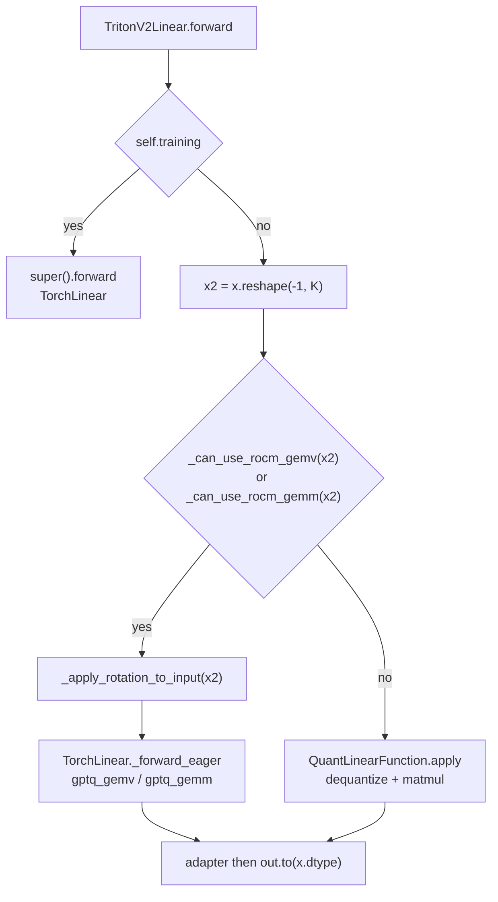
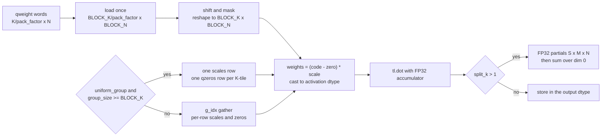
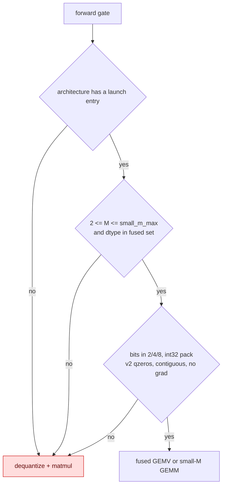

<!-- SPDX-FileCopyrightText: 2026 ModelCloud.ai
SPDX-License-Identifier: Apache-2.0 -->

# GPTQ Triton decode and small-M dispatch

GPTQ inference has two fused Triton kernels for the shapes where a full
dequantize + matmul is dominated by weight traffic:

- `gptq_gemv` for single-token decode (`M == 1`), and
- `gptq_gemm` for the small-batch band (`M` in 2..64 on Ada/Blackwell).

`TorchLinear` already dispatched to them from `_forward_eager`. The Triton
backend did not: `TritonV2Linear.forward` always called `QuantLinearFunction`,
which materializes the whole `K x N` weight before the matmul. The fused GEMM
also re-fetched every packed int32 word once per 4-bit lane and gathered
`g_idx`/`scales`/`qzeros` per element, so its measured win stopped at
`K <= 2048, N <= 2048, M <= 16`.

This page records the reroute, the packed-load rewrite, and the two contracts
that keep them honest: split-K off is bitwise identical to the old kernel, and
split-K on is never less accurate than the old kernel.

## TritonV2 forward

`TritonV2Linear.forward` now reshapes to 2-D and asks the inherited gates before
choosing a path. A gate miss keeps the original `QuantLinearFunction` path, so
3-bit, v1 qzeros, non-contiguous input, autograd, training and unregistered
architectures are unchanged.



## Packed-load small-M GEMM

The kernel loads each packed word once as a `[BLOCK_K / pack_factor,
BLOCK_N]` tile, extracts the lanes with shifts, and reshapes to
`[BLOCK_K, BLOCK_N]`. When `g_idx` is the identity mapping and the K-tile lies
inside one quantization group, scales and zero points are one `[BLOCK_N]` row
per K-tile; act-order keeps the per-row `g_idx` gather. The `tl.dot` call and
its FP32 accumulator are unchanged.



The gate and the fallback are explicit. Anything the kernel cannot represent
stays on the portable path:



## Launch selection

- Ada and Blackwell retile by `M`: `(BLOCK_M, BLOCK_N)` is `(16, 32)` for
  `M <= 16`, `(32, 64)` for `M <= 32` and `(64, 64)` for `M <= 64`.
  `BLOCK_K=128`, 4 warps, 2 stages.
- `M == 1` stays on `gptq_gemv`; it loses to the GEMV on `11008 x 4096`.
- Deterministic split-K picks the largest `S` in `{2, 4, 8}` with
  `K % (128 * S) == 0` and `K / S >= 512`, capped at 4 when `M > 32`. Partial
  sums are FP32 `[S, M, N]` and are reduced with `.sum(0)`; there are no
  atomics. CDNA4/RDNA4 keep their previously measured single-pass launch.

## Before and after

| Mechanism | Before (`main`) | After |
| --- | --- | --- |
| `TritonV2Linear.forward` (`tritonv2.py:149-175`) | always `QuantLinearFunction` | gates, then `TorchLinear._forward_eager` |
| packed words (`gptq_gemm.py:215-275`) | `[BLOCK_K, BLOCK_N]` addresses; each word fetched `32 / bits` times | one `[BLOCK_K / pack_factor, BLOCK_N]` load, unpacked in registers |
| scales / zeros | per-element gather even for identity `g_idx` | one `[BLOCK_N]` row per K-tile when the group is uniform |
| Ada gate (`gptq_gemm.py:144-146`, `arch.py:70-71`) | `M <= 16`, `K <= 2048`, `N <= 2048` | `M <= 64`, no K/N caps |
| Blackwell | no launch entry | `blackwell` entry, same kernel |
| split-K | none | deterministic FP32 partials, `S` in `{2, 4, 8}` |

## Contracts

- **Split-K off is bitwise equal** to the pre-rewrite `gptq_gemm`, for FP32 and
  the visible output, for bits 2/4/8, gs128, act-order on/off, FP16 and BF16.
  `test_ada_split_off_is_bitwise_equal_to_pre_rewrite_kernel` compares against a
  frozen copy of the old kernel with `torch.equal`.
- **Split-K on is no worse** than the single-pass kernel against an FP64 Torch
  oracle, and stays inside `1e-3 + 1e-5 * max|ref|`. On K=14336 the measured
  drift is about 5x-10x lower than the single-pass kernel.
- `M == 1` is never routed through the small-M GEMM.
- Unsupported widths, v1 qzeros, non-contiguous input and autograd keep the
  portable path; no environment switch selects a path.

## Validation

```bash
CUDA_VISIBLE_DEVICES=GPU-... PYTHONPATH=$PWD \
  /opt/venvs/cu130t/bin/python -m pytest -q tests/kernels/test_gptq_ada_gemm.py
CUDA_VISIBLE_DEVICES=GPU-... PYTHONPATH=$PWD \
  /opt/venvs/cu130t/bin/python -m pytest -q tests/kernels/test_tritonv2_dispatch.py
HIP_VISIBLE_DEVICES=1 PYTHONPATH=$PWD \
  /opt/venvs/rocm101t/bin/python -m pytest -q tests/kernels/test_gptq_rocm_gemm.py
```

Cold-L2 medians from `tests/benchmark/benchmark_gptq_triton_small_m.py` on an
RTX 4090 (SM 8.9), FP16, 4-bit gs=128, `triton.testing.do_bench` (L2 flushed
before every timed iteration), microseconds.

`TritonV2Linear.forward` (old `QuantLinearFunction` path vs new dispatch):

| K x N | M=1 | M=8 | M=64 |
| --- | --- | --- | --- |
| 4096 x 4096 | 78.9 to 20.5 (3.85x) | 53.3 to 18.4 (2.89x) | 63.6 to 25.8 (2.47x) |
| 4096 x 11008 | 204.8 to 45.1 (4.55x) | 232.5 to 39.9 (5.82x) | 244.0 to 64.5 (3.78x) |
| 11008 x 4096 | 231.2 to 48.1 (4.80x) | 201.1 to 53.3 (3.78x) | 204.1 to 74.8 (2.73x) |
| 4096 x 14336 | 267.3 to 54.3 (4.92x) | 321.5 to 50.6 (6.36x) | 323.6 to 82.7 (3.91x) |
| 14336 x 4096 | 322.6 to 59.4 (5.43x) | 282.0 to 54.1 (5.22x) | 299.0 to 68.6 (4.36x) |
| 2048 x 2048 | 31.0 to 12.1 (2.57x) | 28.7 to 11.3 (2.55x) | 27.5 to 16.4 (1.68x) |

`gptq_gemm` ("best today" is the pre-rewrite kernel inside its old gate,
otherwise dequantize + matmul):

| K x N | M=2 | M=8 | M=16 | M=64 |
| --- | --- | --- | --- | --- |
| 4096 x 4096 | 63.5 to 18.1 (3.52x) | 57.3 to 19.5 (2.95x) | 72.7 to 21.5 (3.38x) | 68.4 to 27.3 (2.50x) |
| 4096 x 11008 | 228.4 to 37.9 (6.03x) | 228.4 to 39.9 (5.72x) | 230.4 to 42.9 (5.38x) | 240.6 to 63.5 (3.79x) |
| 11008 x 4096 | 202.1 to 54.3 (3.72x) | 202.8 to 54.4 (3.72x) | 205.8 to 55.3 (3.72x) | 209.9 to 75.8 (2.77x) |
| 4096 x 14336 | 317.4 to 46.9 (6.76x) | 317.4 to 49.2 (6.46x) | 318.6 to 54.3 (5.87x) | 319.5 to 82.6 (3.87x) |
| 14336 x 4096 | 282.6 to 50.2 (5.63x) | 283.7 to 52.2 (5.43x) | 284.7 to 53.9 (5.29x) | 297.0 to 68.6 (4.33x) |
| 2048 x 2048 | 22.5 to 11.3 (2.00x) | 22.5 to 11.3 (2.00x) | 22.5 to 11.3 (2.00x) | 27.7 to 16.4 (1.69x) |

BF16 measured the same 1.4x-6.9x band. The Blackwell entry ships the same
packed-load kernel and gate. This host has no Blackwell GPU to re-measure, so
the entry follows the issue's indicative sm_120 report (1.3x-5.9x); no sm_120
timing was taken here.

Introduced in [PR #3999](https://github.com/ModelCloud/GPTQModel/pull/3999) for
[issue #3982](https://github.com/ModelCloud/GPTQModel/issues/3982).
