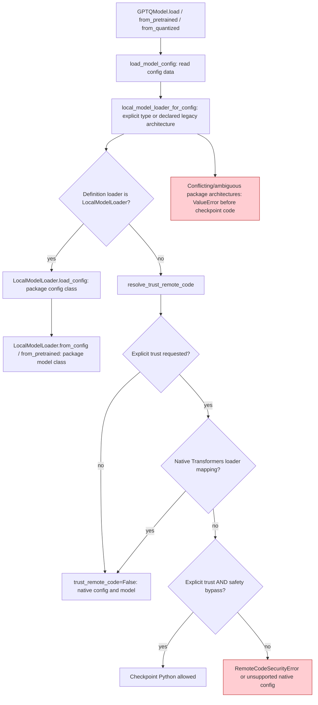
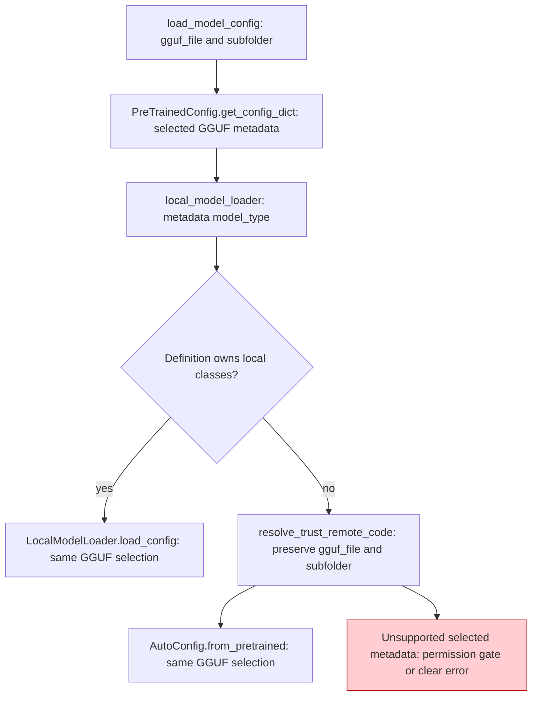
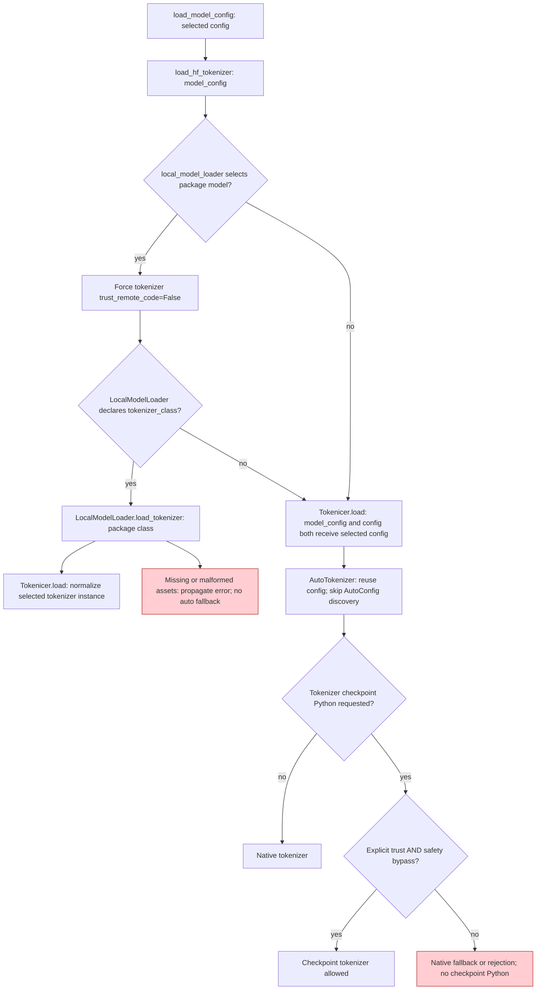
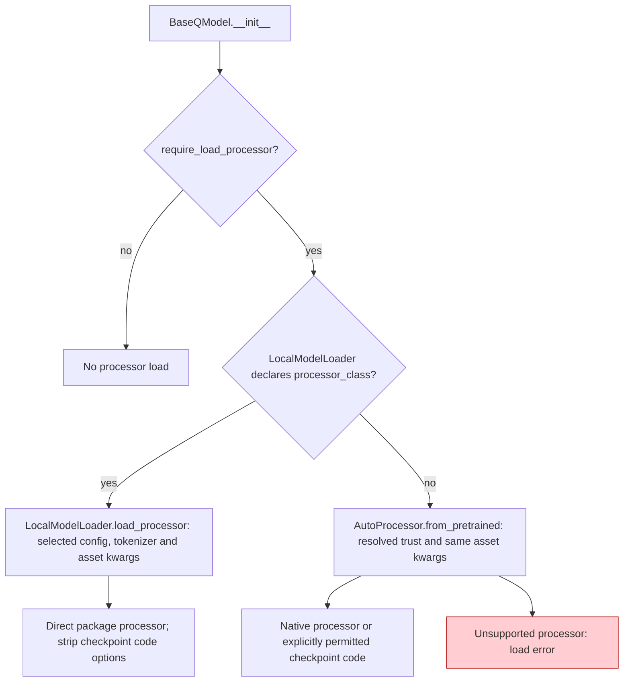
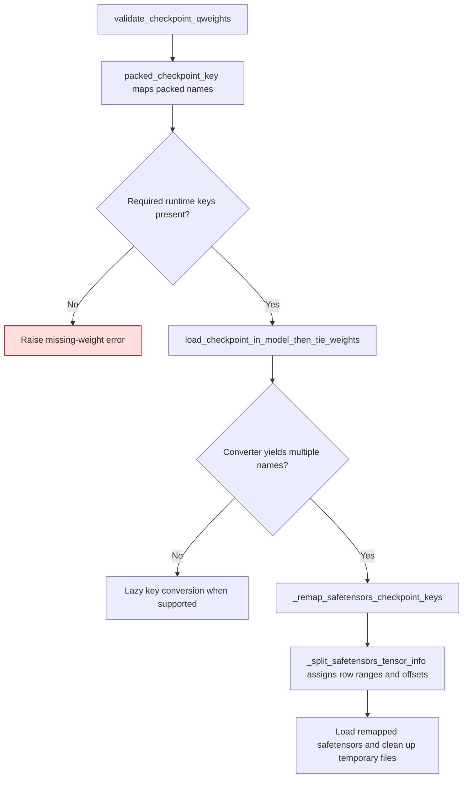
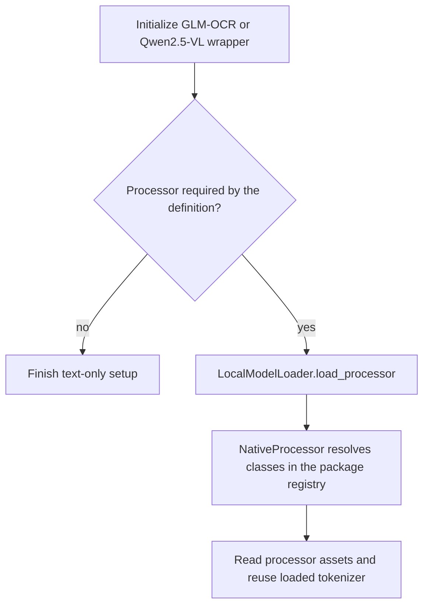

# Model implementation selection and checkpoint code

GPT-QModel targets Transformers 5. Model definitions use native Transformers
implementations or modeling code shipped inside `gptqmodel`. Checkpoint
`auto_map` entries are untrusted data and cannot override a local port.

## Selection policy

`load_model_config` reads configuration data with
`PreTrainedConfig.get_config_dict`, preserving revision, authentication and
subfolder options. A definition with a `LocalModelLoader` owns both its config
and model class. It imports those classes lazily, calls the config class
directly and constructs the model with `_from_config` or `from_pretrained`.
It never registers checkpoint classes globally with Transformers.



Legacy checkpoints may omit `model_type`. A local definition can explicitly
declare `LocalModelLoader.config_architectures=("MiniCPMForCausalLM",)` as trusted
package metadata. Both `load_model_config` and `resolve_trust_remote_code` use
`local_model_loader_for_config` before any checkpoint import. A present
`model_type` is authoritative, including an empty, null or unsupported value.
Only an absent key permits inference; every architecture must match the same
unique declared loader. Aliases sharing a loader do not create ambiguity.
Partial matches, malformed entries alongside a known name, and conflicting
package declarations raise even under explicit trust and the bypass. Unknown
families retain the ordinary security gate; neither checkpoint paths nor
`auto_map` determine package class names. Nothing is registered globally.

The existing security bypass is `GPTQ_BYPASS_SAFETY_CHECKS=1`. It is additional
consent: it does not turn trust on. For a remote-only implementation, both that
flag and the explicit API argument `trust_remote_code=True` are necessary.
Local ports ignore both for model/config selection. Native implementations
continue to override remote trust. The package-owned Ling loader selects dense
or MLA Bailing Hybrid layouts from `q_lora_rank`; checkpoint Python cannot
replace either layout.

`resolve_trust_remote_code(..., trust_remote_code=False)` returns immediately
without registering optional packages, reading a config or probing the Hub.
The actual config loader owns malformed/missing-asset diagnostics and rereads
repaired local data. An owned config is selected before the legacy Qwen-Drive
registration hook; the hook also checks definition ownership for direct native
probe and writer callers.

| Boundary | Before (`b444efaac:utils/hf.py`) | After |
| --- | --- | --- |
| Disabled trust | `resolve_trust_remote_code:1044-1068` registered optional packages and read config despite denying Python | Immediate `False`; config construction reports errors and permits repair/retry |
| Owned config | `load_model_config:1028` registered Qwen-Drive before selected config ownership | Selected raw config and `LocalModelLoader` first; owned definitions bypass optional registration |
| Legacy Ling marker | `3c177fbe7:gptqmodel/utils/hf.py:955-1022` maintained a second payload reader and `q_lora_rank` marker test | The package-owned Bailing config owns dense/MLA selection; no duplicate remote-layout marker reader |

The new `tests/test_local_model_loading.py` nodes
`test_disabled_trust_defers_config_errors_and_allows_repair` and
`test_owned_config_precedes_optional_qwen_drive_registration` first failed all
six cases at the premature config/optional-package boundaries. The corrected
implementation passes the complete loader, processor, tokenizer, Tokenicer
profile, trust-isolation, layout and Qwen-Drive support batch: **141 passed,
zero skipped, 15 warnings, 4.97s**, on Python 3.14.6t (`PYTHON_GIL=0`),
Transformers 5.23.0, Torch 2.15.0+cpu and released Tokenicer 0.0.19.
With the current Tokenicer 0.0.20 floor, the shared loader, path, processor,
tokenizer, trust-isolation, config, module-plan, fusion and AWQ-fold batch
passed **715 tests**. It skipped 460 NVIDIA Marlin cases and one optional
PEFT test on the CPU environment.

For GGUF checkpoints, the explicitly selected `gguf_file` remains the config
source through the data read, trust preflight and final construction, including
when a subfolder is selected. An unrelated `config.json` cannot veto that
selection or change its implementation policy. This also allows a
GGUF-only subfolder to load without a JSON config.



For a package-owned model, tokenizers never receive remote trust, including
definitions that use an ordinary native tokenizer rather than declaring a
custom package tokenizer. For other models, both explicit trust and the safety
bypass are required. This policy does not change Tokenicer normalization.
Tokenizer construction also receives the policy-selected config as Transformers'
`config` argument, separately from Tokenicer's `model_config` normalization
argument. This prevents AutoTokenizer from importing checkpoint `AutoConfig`
while initializing a tokenizer for a local or native model, even when tokenizer
trust and the bypass are both enabled.



Definitions can also declare `LocalModelLoader.processor_class`. For models
requiring a processor, `BaseQModel.__init__` selects that packaged class
directly and passes the already-selected model config and the underlying
Tokenicer-normalized tokenizer. Checkpoint processor `auto_map`, API trust and
the bypass cannot replace it. Class paths are validated by the same
`gptqmodel.` package restriction. The packaged processor must construct its
packaged image/video components directly rather than rediscovering checkpoint
classes through an auto loader.



Other processor loads use the resolved model trust. Definition pre-load hooks that
import checkpoint modules declare `before_model_load_requires_remote_code` and
run only when remote trust has been resolved and the bypass is enabled.

## Local model ports

Model ports use the shared loader contract. Put the config and model
implementation under a model-specific package
inside `gptqmodel`, preserving upstream license/attribution and recording the
source revision. Set the definition's loader explicitly:

```python
from ..local import LocalModelLoader

loader = LocalModelLoader(
    config_class="gptqmodel.models.model_name.configuration_model_name.ModelConfig",
    model_class="gptqmodel.models.model_name.modeling_model_name.ModelForCausalLM",
    # Optional for definitions with require_load_processor=True.
    processor_class="gptqmodel.models.model_name.processing_model_name.ModelProcessor",
)
```

These strings are trusted source metadata; never construct them from checkpoint
fields. Both must name classes in `gptqmodel`. The model class must implement
the Transformers 5 `PreTrainedModel` construction contract. Construction keeps
the existing shared model-load lock; the frozen loader metadata does not cache
mutable model instances or modify Transformers' global registries.

Remove obsolete Transformers 4 pins, remote import hooks and remote-trust
requirements when wiring each model. Port composite config/model construction as
well: nested `auto_map` must not cause checkpoint code execution. Qualify
checkpoint key/conversion mappings, generation/cache behavior, save/reload,
real-model module-plan ownership, and the model's explicit AWQ policy. Native
support must be verified against the checkpoint layout, not inferred from
similar model names. Do not replace an architecture with a lookalike.

### Remote-only tokenizers

Original Yi (`model_type: "Yi"`) and StableLM Epoch (`stablelm_epoch`) checkpoints
load with the package-owned model, but their released tokenizers (`YiTokenizer`,
`Arcade100kTokenizer`) exist only as checkpoint Python. A definition lists such
model types in `LocalModelLoader.remote_tokenizer_model_types`. Loading one always
logs that the tokenizer is unsafe checkpoint code and requires both
`trust_remote_code=True` and `GPTQ_BYPASS_SAFETY_CHECKS=1`; without both it raises
`RemoteCodeSecurityError`. No other package-owned model loads tokenizer Python from
the checkpoint.

## Load, save, export and retry boundaries

MiniCPM-o 4.5's `init_tts` checks remote-code permission before loading the
external StepAudio codec. The caller supplies a local `model_dir` for trusted
codec assets. `MiniCPMODuplex.from_existing_model` reuses an initialized codec
or forwards the caller's explicit directory and trust flag. Image, audio and
video URLs handled by MiniCPM-o use the shared bounded download helpers.

Legacy packed Unlimited-OCR checkpoints are validated against their translated
runtime keys before weight placement. Dense vision QKV tensors in the legacy
layout have three contiguous row ranges. The safetensors remapper publishes
each range as a separate tensor in the temporary header and index.



| Boundary | Previous behavior | Current behavior |
| --- | --- | --- |
| StepAudio assets | `MiniCPMO.init_tts` inferred the codec directory from the model checkpoint | Explicit caller-selected local assets and both trust permissions are required |
| Unlimited-OCR packed layout | The definition returned disk keys unchanged | `packed_checkpoint_key` translates legacy keys and `_split_safetensors_tensor_info` splits recorded shapes and offsets |

The public dispatchers, ordinary and quantized loaders, quantized re-save shell,
and compressed-tensors dequantizer use `load_model_config`. The dequantizer
also selects the definition's local model loader for shell construction.
`prepare_remote_model_init_compat` resolves the policy before any dynamic import.
The Kimi K3/K3.1 reference loaders require the same security bypass in addition
to explicit trust. The bypass is checked on each attempt; a previous successful
remote load is not permission for the next load.
Direct SGLang and vLLM engine helpers also enforce the bypass before forwarding
remote trust to an external engine. Their runtime architecture support remains
the responsibility of those engines.

| Mechanism | Previous behavior (base revision `bb36e7fb2`) | Current behavior |
| --- | --- | --- |
| `auto_map` import at load | `prepare_remote_model_init_compat()` called `get_class_from_dynamic_module()` with no trust argument (`gptqmodel/utils/hf.py:1900-1923`) | Returns before the import unless `trust_remote_code=True` (`gptqmodel/utils/hf.py:1902`) |
| Load call sites | `loader.py:1789` / `1801` and `1307` / `1313` did not pass the flag | Both pass `trust_remote_code=trust_remote_code` (`gptqmodel/models/loader.py:1313`, `1803`) |
| `auto_map` compat patches | Enabled whenever `auto_map` existed (`gptqmodel/utils/hf.py:1729-1735`) | Enabled only for `trust_remote_code=True` (`gptqmodel/utils/hf.py:1723`) |
| Re-save config | `AutoConfig.from_pretrained(..., trust_remote_code=True)` (`gptqmodel/models/writer.py:2638`) | `trust_remote_code=self.trust_remote_code` (`gptqmodel/models/writer.py:2638`) |
| Dequantize config/model | Hard-coded `True` (`gptqmodel/utils/model_dequant.py:335`, `354`) | `trust_remote_code` parameter threaded from `dequantize_model()` (`gptqmodel/utils/model_dequant.py:1994`) |
| Processor load | `self.require_trust_remote_code` (`gptqmodel/models/base.py:746`) | `self.trust_remote_code` (`gptqmodel/models/base.py:746`) |
| K3 reference exec | `load_calibration_reference(snapshot)` with no opt-in (`gptqmodel/utils/kimi_k3.py:24-57`) | Requires `trust_remote_code=True` (`gptqmodel/utils/kimi_k3.py:24`) |

Definition ownership and the security bypass additionally enforce the following
selection contract:

| Mechanism | Previous behavior (base revision `bb36e7fb2`) | Current behavior |
| --- | --- | --- |
| Remote-only implementation | Explicit trust alone allowed checkpoint Python (`gptqmodel/utils/hf.py:1011-1052`) | Explicit trust and the existing security bypass are both required |
| Legacy Bailing Hybrid layout | A `q_lora_rank` marker kept remote trust (`gptqmodel/utils/hf.py:1024-1038`) | Package-owned config selects dense/MLA; checkpoint Python cannot override it |
| Config selection | `AutoConfig.from_pretrained` selected checkpoint config classes (`gptqmodel/models/auto.py:643`, `gptqmodel/models/loader.py:1887,2440`) | Definition-owned config class first, then gated AutoConfig |
| Missing legacy `model_type` | Only `payload.get("model_type")` could select package code (`9ebb28f07:gptqmodel/utils/hf.py:1030,1060`) | Explicit opt-in architecture metadata in the package; unique complete match or clear conflict error |
| Re-save | Loaded config directly through AutoConfig (`gptqmodel/models/writer.py:2587`) | Uses the same local/native/security policy |
| Remote pre-load hooks | Could import checkpoint modules on a native load (`gptqmodel/models/loader.py:917-933`) | Declared remote hooks require resolved trust and the bypass |
| Tokenizer config discovery | AutoTokenizer could reload checkpoint `AutoConfig` despite a policy-selected local config | `load_hf_tokenizer` supplies the selected config through the existing Tokenicer API |
| Processor selection | Always entered `AutoProcessor.from_pretrained` (`464cfb05f:gptqmodel/models/base.py:1071`) | Optional definition-owned processor class receives selected config/tokenizer directly |
| Processor asset selection | Lost subfolder/revision/cache options at wrapper construction (`8f472e139:gptqmodel/models/base.py:1080-1090`) | All four dense/quantized wrapper construction paths pass filtered HF selection kwargs to the automatic processor loader |
| `auto_map` import at load | `prepare_remote_model_init_compat()` called `get_class_from_dynamic_module()` with no trust argument (`gptqmodel/utils/hf.py:1900-1923`) | Returns before the import unless `trust_remote_code=True` (`gptqmodel/utils/hf.py:1902`) |
| Load call sites | `loader.py:1789` / `1801` and `1307` / `1313` did not pass the flag | Both pass `trust_remote_code=trust_remote_code` (`gptqmodel/models/loader.py:1313`, `1803`) |
| `auto_map` compat patches | Enabled whenever `auto_map` existed (`gptqmodel/utils/hf.py:1729-1735`) | Enabled only for `trust_remote_code=True` (`gptqmodel/utils/hf.py:1723`) |
| Re-save config | `AutoConfig.from_pretrained(..., trust_remote_code=True)` (`gptqmodel/models/writer.py:2638`) | `trust_remote_code=self.trust_remote_code` (`gptqmodel/models/writer.py:2638`) |
| Dequantize config/model | Hard-coded `True` (`gptqmodel/utils/model_dequant.py:335`, `354`) | `trust_remote_code` parameter threaded from `dequantize_model()` (`gptqmodel/utils/model_dequant.py:1994`) |
| Processor load | `self.require_trust_remote_code` (`gptqmodel/models/base.py:746`) | `self.trust_remote_code` (`gptqmodel/models/base.py:746`) |
| K3 reference exec | `load_calibration_reference(snapshot)` with no opt-in (`gptqmodel/utils/kimi_k3.py:24-57`) | Requires `trust_remote_code=True` (`gptqmodel/utils/kimi_k3.py:24`) |

Tests in `tests/test_local_model_loading.py` exercise public load rejection,
actual checkpoint config and model imports under explicit bypass, permission
revocation, native/local precedence, all three public dispatchers, lazy local
meta construction, native multimodal mappings and subfolder selection.
They establish dispatch and security behavior, not numerical qualification of
the separate model ports.

GLM-OCR and composite Qwen2.5-VL declare `NativeProcessor` in their
`LocalModelLoader`. GLM-OCR uses the vendored GLM-4.6V processor, image
processor and video processor. Qwen2.5-VL uses its vendored processor and
continues to skip processor construction for text-only loads.

| Boundary | Before | After |
| --- | --- | --- |
| GLM-OCR and composite Qwen2.5-VL | `BaseQModel` delegated processor selection to Transformers `AutoProcessor` | The definition selects the vendored processor resolver |
| Processor components | Transformers resolves processor classes | `NativeProcessor` loads package-owned media components and uses the tokenizer already chosen by GPT-QModel |



Automatic processor initialization preserves the model/tokenizer asset selection,
including `subfolder`, `revision`, cache and authentication options. Both package
and native processors receive `get_config_selection_kwargs`; checkpoint code
options cannot enter through that argument. Invalid or absent processor assets
raise normally. `tests/test_local_processor_loading.py` exercises root/nested
public loads, hostile trust/bypass combinations, removal and repair of the actual
selected asset, and exact model-logit parity after retry. Before propagation all
eight public selection cases fail (missing forwarded options or the root asset);
the focused suite passes all 13 cases after the fix. Its processor is a boundary
fixture reading a real asset, rather than a model/media numerical oracle.

The missing-type regression uses a real tiny owned InternLM checkpoint under a
neutral root/subfolder and a temporary trusted architecture declaration; it does
not assert support by importing the checkpoint. It covers both trust values,
all three bypass states, actual exact FP32 logits, successful load followed by
conflicting/malformed metadata and repaired retry, explicit-type precedence,
and two incompatible package declarations. The new nodes initially report seven
failures/four passes because package selection is missed; the complete shared
loader/paths/processor/tokenizer suite passes 114 cases in 4.09 seconds after
the fix. Dtype and attention implementation are selected explicitly in the
fixture so the selection test does not compare different compute policies.
