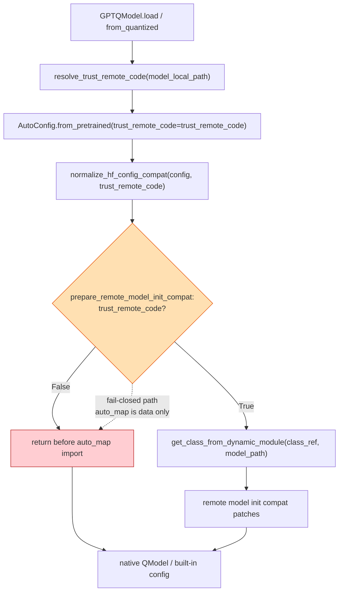
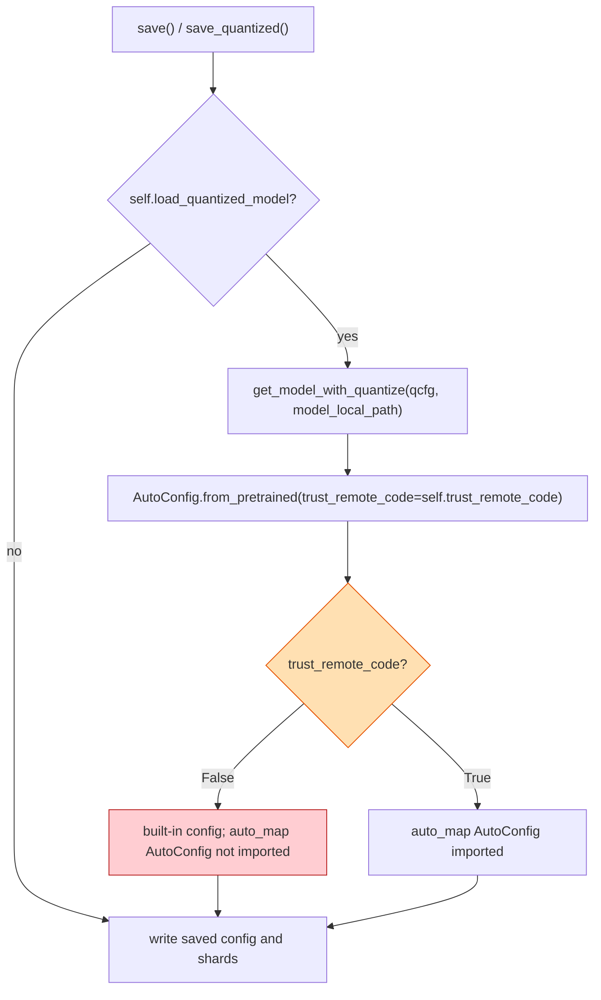
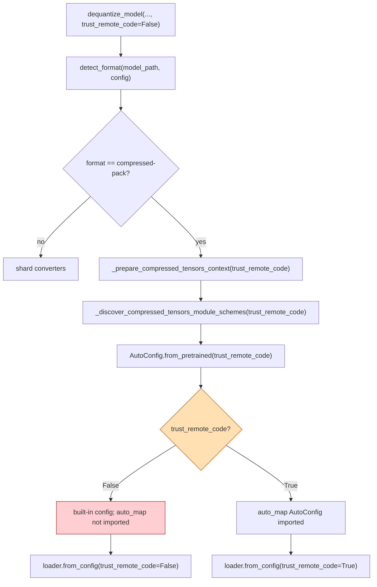

# Trusted remote-code boundary

`trust_remote_code` is the caller's consent to execute Python files bundled in
a checkpoint. A checkpoint's `auto_map`, its `quant_method`, and its tensor keys
are attacker-controlled data, so none of them may turn that consent on. This
page documents the boundary enforced by load, save and dequantize after issue
#3968.

The boundary has one rule: a snapshot module is imported only when the caller
passed `trust_remote_code=True` to the public API that is reading the snapshot.
Native `model_type` values and `auto_map` entries can coexist; the presence of
`auto_map` alone never selects the remote path.

## Load

`GPTQModel.load()` / `GPTQModel.from_quantized()` resolve the caller's flag once
with `resolve_trust_remote_code()` and pass the same value to every stage. A
config with a built-in `model_type` plus `auto_map` still loads as the built-in
class, but `prepare_remote_model_init_compat()` returns before
`get_class_from_dynamic_module()`.

Both loader entry points pass the caller's value: `from_quantized` at
`gptqmodel/models/loader.py:1313` and `from_pretrained` at
`gptqmodel/models/loader.py:1803`. `normalize_hf_config_compat()`
(`gptqmodel/utils/hf.py:1723`) now returns after the RoPE backfill when trust is
off, instead of enabling remote-code shims because `auto_map` exists.

## Save

Re-saving a loaded quantized checkpoint rebuilds the shell model with
`get_model_with_quantize()`. It now reads the config with the model's own
`self.trust_remote_code` (`gptqmodel/models/writer.py:2140-2147`); the old
`AutoConfig.from_pretrained(..., trust_remote_code=True)` is gone.

## Dequantize

`dequantize_model()` gained `trust_remote_code: bool = False` and threads it
through `_prepare_compressed_tensors_context()` into
`_discover_compressed_tensors_module_schemes()`. The compressed-tensors format
is selected from checkpoint data, so it cannot imply consent.

`scripts/dequantize_model.py` exposes the same decision as
`--trust-remote-code`.

## Processors and Kimi K3

`BaseQModel.__init__()` loads processors with `self.trust_remote_code`
(`gptqmodel/models/base.py:746`), and every `load_processor()` override does the
same. `load_calibration_reference()` (`gptqmodel/utils/kimi_k3.py:24`) raises
unless `trust_remote_code=True`, because it `exec`s
`configuration_kimi_k3.py` and `modeling_kimi_linear.py` from the snapshot.

## Before / after

| Mechanism | Before | After |
| --- | --- | --- |
| `auto_map` import at load | `prepare_remote_model_init_compat()` called `get_class_from_dynamic_module()` with no trust argument (`gptqmodel/utils/hf.py:1900-1923`) | Returns before the import unless `trust_remote_code=True` (`gptqmodel/utils/hf.py:1902`) |
| Load call sites | `loader.py:1789` / `1801` and `1307` / `1313` did not pass the flag | Both pass `trust_remote_code=trust_remote_code` (`gptqmodel/models/loader.py:1313`, `1803`) |
| `auto_map` compat patches | Enabled whenever `auto_map` existed (`gptqmodel/utils/hf.py:1729-1735`) | Enabled only for `trust_remote_code=True` (`gptqmodel/utils/hf.py:1723`) |
| Re-save config | `AutoConfig.from_pretrained(..., trust_remote_code=True)` (`gptqmodel/models/writer.py:2140-2147`) | `trust_remote_code=self.trust_remote_code` (`gptqmodel/models/writer.py:2145`) |
| Dequantize config/model | Hard-coded `True` (`gptqmodel/utils/model_dequant.py:335`, `354`) | `trust_remote_code` parameter threaded from `dequantize_model()` (`gptqmodel/utils/model_dequant.py:1766`) |
| Processor load | `self.require_trust_remote_code` (`gptqmodel/models/base.py:746`) | `self.trust_remote_code` (`gptqmodel/models/base.py:746`) |
| K3 reference exec | `load_calibration_reference(snapshot)` with no opt-in (`gptqmodel/utils/kimi_k3.py:24-57`) | Requires `trust_remote_code=True` (`gptqmodel/utils/kimi_k3.py:24`) |

## Failure contract

| Situation | Before | After |
| --- | --- | --- |
| Native `model_type` + `auto_map`, trust off | Snapshot module imported | Built-in config; no import |
| `auto_map` cross-repo `repo--module.Class`, trust off | Module imported from the other repo | Built-in config; no import |
| `compressed-tensors` checkpoint, trust off | Snapshot config/model imported | Built-in config; no import |
| Trust on | Remote classes imported | Unchanged |
| `KimiK3Source` without opt-in | Snapshot files executed | `ValueError` before file access |
