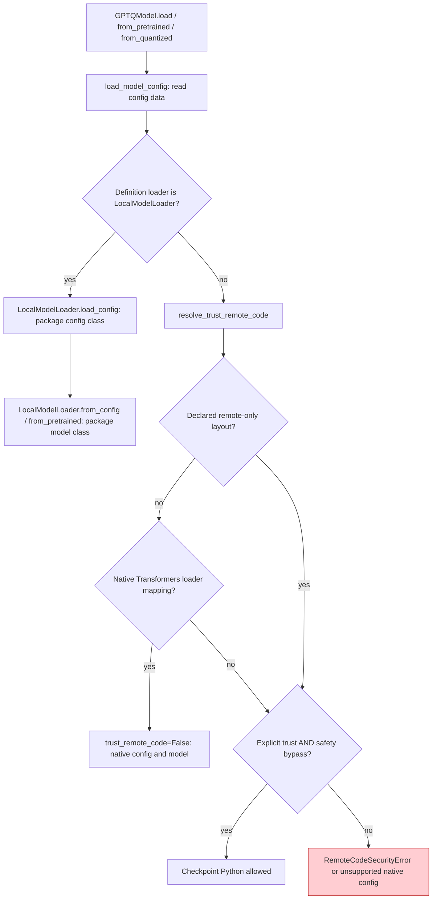
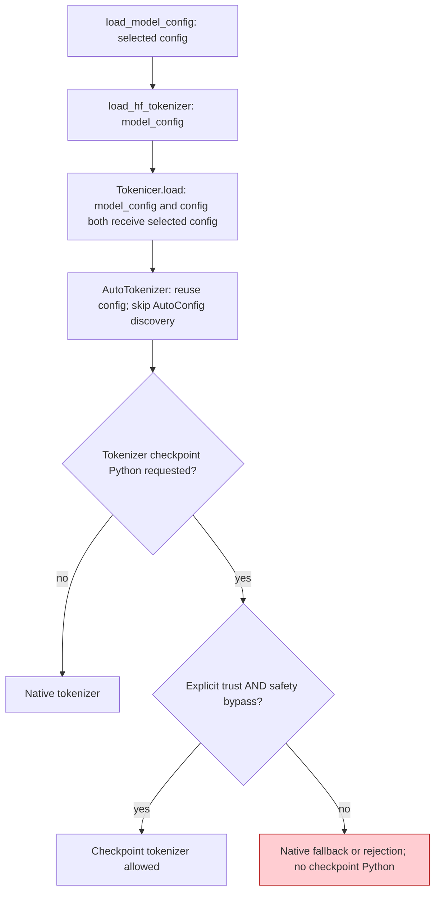
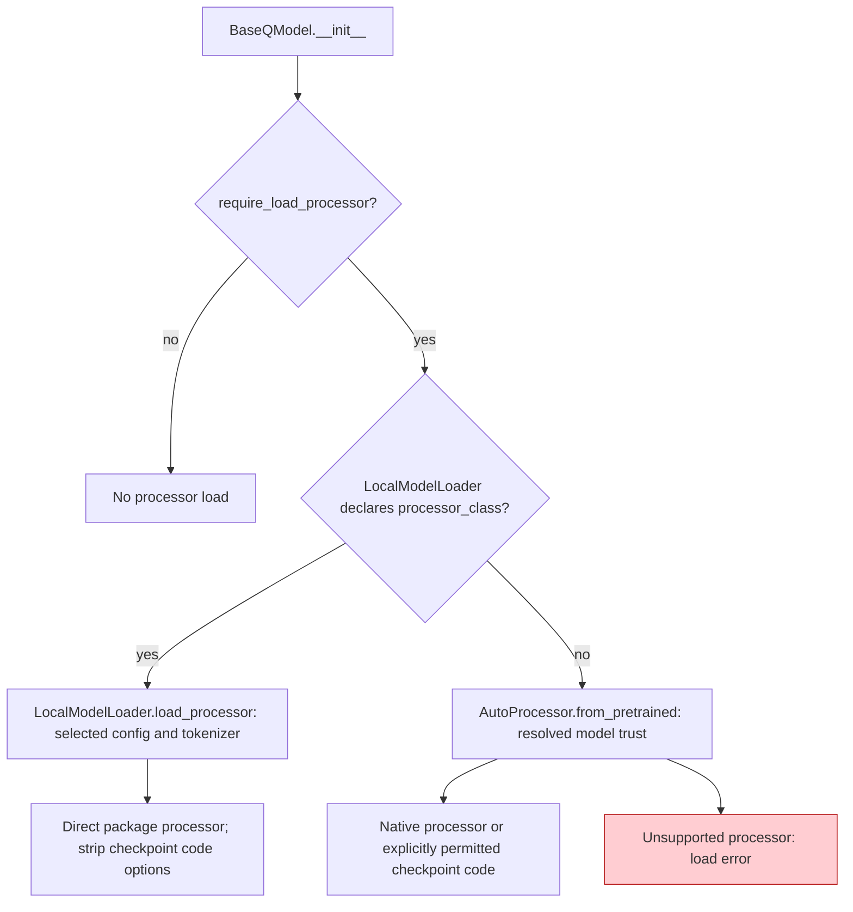

# Model implementation selection and checkpoint code

GPT-QModel targets Transformers 5. Model definitions use native Transformers
implementations or modeling code shipped inside `gptqmodel`. Checkpoint
`auto_map` entries are untrusted data and cannot override a local port.

## Selection policy

`load_model_config` reads configuration data with
`PreTrainedConfig.get_config_dict`, preserving revision, authentication and
subfolder options. A definition with a `LocalModelLoader` owns both its config
and model class. It imports those classes lazily, calls the config class
directly and constructs the model with `_from_config` or `from_pretrained`.
It never registers checkpoint classes globally with Transformers.



The existing security bypass is `GPTQ_BYPASS_SAFETY_CHECKS=1`. It is additional
consent: it does not turn trust on. For a remote-only implementation, both that
flag and the explicit API argument `trust_remote_code=True` are necessary.
Local ports ignore both for model/config selection. Native implementations
continue to override remote trust. A known remote-only checkpoint layout
(currently Bailing Hybrid MLA, selected by `q_lora_rank`) cannot silently fall
back to an incompatible native model.

Tokenizers receive remote trust only when both explicit trust and the safety
bypass are present. This gate does not change Tokenicer normalization.
Tokenizer construction also receives the policy-selected config as Transformers'
`config` argument, separately from Tokenicer's `model_config` normalization
argument. This prevents AutoTokenizer from importing checkpoint `AutoConfig`
while initializing a tokenizer for a local or native model, even when tokenizer
trust and the bypass are both enabled.



Definitions can also declare `LocalModelLoader.processor_class`. For models
requiring a processor, `BaseQModel.__init__` selects that packaged class
directly and passes the already-selected model config and the underlying
Tokenicer-normalized tokenizer. Checkpoint processor `auto_map`, API trust and
the bypass cannot replace it. Class paths are validated by the same
`gptqmodel.` package restriction. The packaged processor must construct its
packaged image/video components directly rather than rediscovering checkpoint
classes through an auto loader.



Other processor loads use the resolved model trust. Definition pre-load hooks that

import checkpoint modules declare `before_model_load_requires_remote_code` and
run only when remote trust has been resolved and the bypass is enabled.

## Local model ports

Each model port belongs in its own pull request after the shared loader contract
lands. Put the config and model implementation under a model-specific package
inside `gptqmodel`, preserving upstream license/attribution and recording the
source revision. Set the definition's loader explicitly:

```python
from ..local import LocalModelLoader

loader = LocalModelLoader(
    config_class="gptqmodel.models.model_name.configuration_model_name.ModelConfig",
    model_class="gptqmodel.models.model_name.modeling_model_name.ModelForCausalLM",
    # Optional for definitions with require_load_processor=True.
    processor_class="gptqmodel.models.model_name.processing_model_name.ModelProcessor",
)
```

These strings are trusted source metadata; never construct them from checkpoint
fields. Both must name classes in `gptqmodel`. The model class must implement
the Transformers 5 `PreTrainedModel` construction contract. Construction keeps
the existing shared model-load lock; the frozen loader metadata does not cache
mutable model instances or modify Transformers' global registries.

Remove obsolete Transformers 4 pins, remote import hooks and remote-trust
requirements in that model's PR. Port composite config/model construction as
well: nested `auto_map` must not cause checkpoint code execution. Qualify
checkpoint key/conversion mappings, generation/cache behavior, save/reload,
real-model module-plan ownership, and the model's explicit AWQ policy. Native
support must be verified against the checkpoint layout, not inferred from
similar model names. Do not replace an architecture with a lookalike.

## Load, save, export and retry boundaries

The public dispatchers, ordinary and quantized loaders, quantized re-save shell,
and compressed-tensors dequantizer use `load_model_config`. The dequantizer
also selects the definition's local model loader for shell construction.
`prepare_remote_model_init_compat` resolves the policy before any dynamic import.
The Kimi K3/K3.1 reference loaders require the same security bypass in addition
to explicit trust. The bypass is checked on each attempt; a previous successful
remote load is not permission for the next load.
Direct SGLang and vLLM engine helpers also enforce the bypass before forwarding
remote trust to an external engine. Their runtime architecture support remains
the responsibility of those engines.

| Mechanism | Previous behavior (base revision `bb36e7fb2`) | Current behavior |
| --- | --- | --- |
| Remote-only implementation | Explicit trust alone allowed checkpoint Python (`gptqmodel/utils/hf.py:1011-1052`) | Explicit trust and the existing security bypass are both required |
| Native model with a remote-only layout marker | Kept remote trust (`gptqmodel/utils/hf.py:1024-1038`) | Local port, explicit bypass, or a clear failure; no incompatible native fallback |
| Config selection | `AutoConfig.from_pretrained` selected checkpoint config classes (`gptqmodel/models/auto.py:643`, `gptqmodel/models/loader.py:1887,2440`) | Definition-owned config class first, then gated AutoConfig |
| Re-save | Loaded config directly through AutoConfig (`gptqmodel/models/writer.py:2587`) | Uses the same local/native/security policy |
| Remote pre-load hooks | Could import checkpoint modules on a native load (`gptqmodel/models/loader.py:917-933`) | Declared remote hooks require resolved trust and the bypass |
| Tokenizer config discovery | AutoTokenizer could reload checkpoint `AutoConfig` despite a policy-selected local config | `load_hf_tokenizer` supplies the selected config through the existing Tokenicer API |
| Processor selection | Always entered `AutoProcessor.from_pretrained` (`464cfb05f:gptqmodel/models/base.py:1071`) | Optional definition-owned processor class receives selected config/tokenizer directly |


Tests in `tests/test_local_model_loading.py` exercise public load rejection,
actual checkpoint config and model imports under explicit bypass, permission
revocation, native/local precedence, all three public dispatchers, lazy local
meta construction, native multimodal mappings and subfolder selection.
They establish dispatch and security behavior, not numerical qualification of
the separate model ports.
