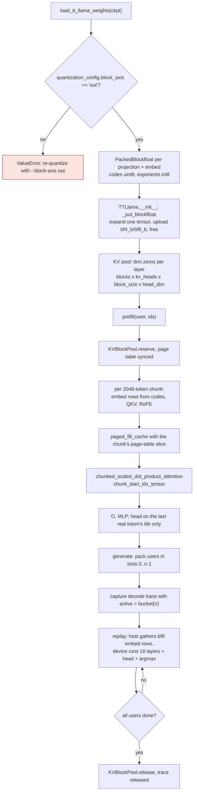
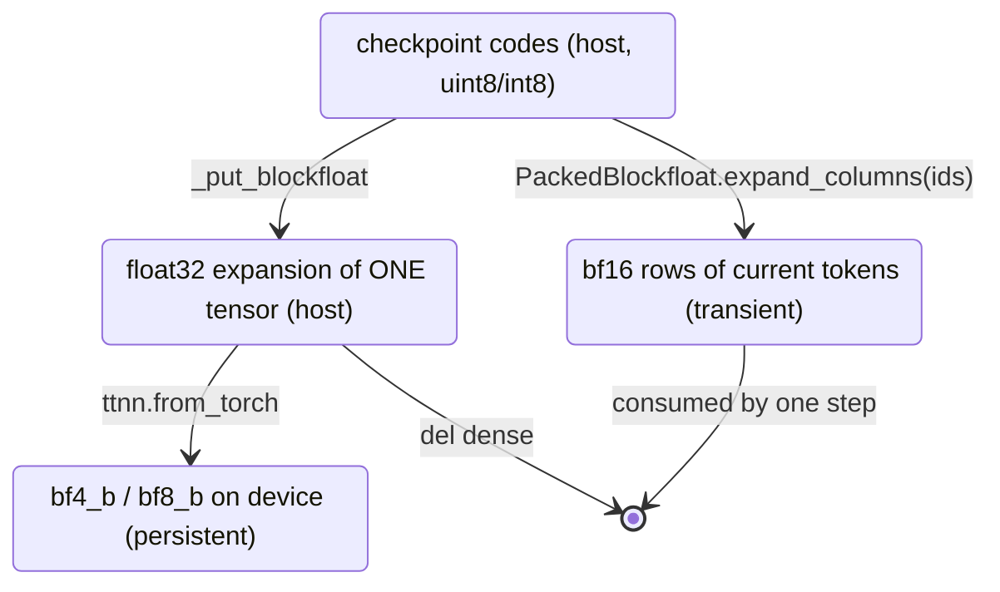
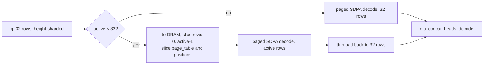

# Tenstorrent Llama serving: paged KV, chunked prefill and quantized storage

`gptqmodel/utils/tt_llama.py` (`TTLlama`) serves an out-axis `tt-blockfloat`
Llama checkpoint on one Tenstorrent chip. This page records the flow it ships,
what each stage stores, and the measurements behind each decision. The general
Tenstorrent guide is [docs/tenstorrent.md](tenstorrent.md).

## Request flow

## What persists, and where

| Weight | Before (merged #3998) | Now |
| --- | --- | --- |
| projections | dense float32 `W^T` dict held by the caller for the whole run (`load_tt_llama_weights`, `tt_llama.py:120`) | `PackedBlockfloat` codes; each expanded only inside its own upload |
| embedding | **bf16 row-major copy on device (501 MB) plus dense float32 table on host**, an expanded weight cache | bf8 codes on host; per-step gather of 32 rows (prefill: one row per prompt token) |
| tied head | bf8_b on device | unchanged |
| KV cache | contiguous `[32 users, kv, max_seq, hd]` | paged block pool sized in tokens, zero-filled |

Retained weight storage on device: 1.04 GB of bf4_b/bf8_b for Llama-3.2-1B
(projections plus the 279 MB tied head). Host: the checkpoint's packed codes
(996 MiB). Transient: one projection's float32 expansion during upload (at most
64 MiB) and 32 x 2048 bf16 embedding rows per decode step (128 KiB).

## Decode attention over active rows

Flash-decode divides cores among the query rows it is given. With 32 rows, a
single long sequence gets ~3 of 110 cores. `decode_step(..., active=n)` slices
the queries, page table and positions to the first `n` slots, and `generate`
captures one trace per bucket (1, 2, 4, 8, 16, 32).

Paged SDPA-decode per layer at 16k context: 32 rows 3.47 ms (bf16 KV) / 2.63 ms
(bf8); 1 row 0.16 / 0.10 ms.

## Failure and ambiguity contract

| Situation | Behaviour |
| --- | --- |
| in-axis checkpoint | `ValueError` naming the re-quantization command |
| embedding not 8-bit | `NotImplementedError` |
| upload drift != 0 | recorded per tensor in `TTLlama.drift`; `scripts/tt_llama_decode.py` exits |
| prompt + generation > `max_context` | `ValueError` before any device work |
| KV pool exhausted | `MemoryError` from `KVBlockPool.reserve` |
| more than one chip in the device handle | `NotImplementedError`; run one process per card |
| uninitialized KV memory read by masked SDPA chunks | prevented: pool is zero-filled (an uninitialized pool gave a 6e36 attention output and all-zero logits) |

## Measured (one p300c, Llama-3.2-1B-Instruct out-axis bf8/bf4, HiFi4)

Decode step, traced, all users at the stated position:

| ctx | KV | 1 user | full batch | aggregate tok/s |
| --- | --- | --- | --- | --- |
| 8k | bf16 | 7.6 ms (131 tok/s) | 34.1 ms, 32 users | 939 |
| 16k | bf16 | 13.5 ms (74 tok/s) | 96.4 ms, 32 users | 332 |
| 16k | bf8 | 12.3 ms (81 tok/s) | 61.3 ms, 32 users | 522 |
| 32k | bf16 | 15.8 ms (63 tok/s) | 158.3 ms, 27 users | 171 |
| 32k | bf8 | 13.6 ms (73 tok/s) | 112.4 ms, 32 users | 285 |
| 64k | bf16 | 20.2 ms (49 tok/s) | 155.9 ms, 13 users | 83 |
| 64k | bf8 | 16.2 ms (62 tok/s) | 187.4 ms, 25 users | 133 |

Before active-row attention, one user at 16k took 54.2 ms and at 64k 181 ms.
Full batch sizes are capped by the 31 GiB usable per chip.

Prefill, warm, one user: 8k in 0.40 s, 16k 1.54 s, 32k 3.05 s, 64k 15.2 s.
The scalar `chunk_start_idx` recompiled per chunk (8k cold 5.0 s); the
tensor offset form takes 8k cold to 1.5 s.

Accuracy on the same checkpoint against CPU fp32:

| check | result |
| --- | --- |
| last-token logits after prefill | cosine 0.99930 (300 tok), 0.99932 (8k), 0.99917 (16k); argmax equal |
| greedy continuation, 300-token prompt | 16/16 tokens equal |
| passkey retrieval, depths 0.25 and 0.75 | 8k, 16k, 32k: all retrieved |
| passkey at 64k | missed, and the **dense** model on CPU misses the same prompt; the quantized model on CPU gives the same answer as the device (`"5assistant\n\nThe secret"`) |

## Not in scope

- Prefill of several users in one call (prompts are prefilled one at a time).
- Admitting new requests while a decode trace is running (continuous batching).
- Removing the ~2x `MeshDevice` overhead; one process per card is used instead.
