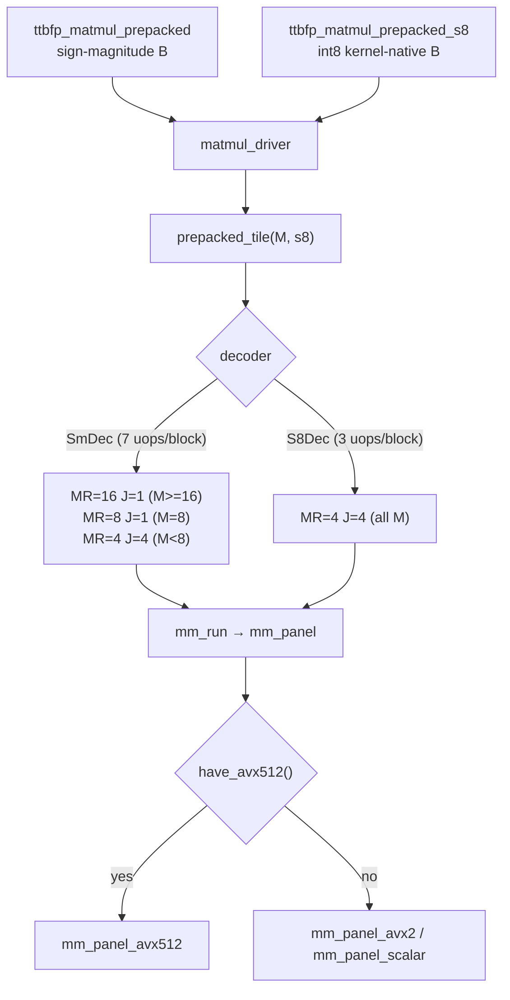

# Tenstorrent block floats on CPU (`ttbfp`)

`gptqmodel_ext/ttbfp/` is a standalone C++/NumPy library that reproduces
Tenstorrent's block-float tensor formats on ordinary CPUs, so models and
kernels that use them can be tested on non-Tenstorrent hardware.  It is not
part of the `gptqmodel` Python package and `setup.py` does not build it; see
[`gptqmodel_ext/ttbfp/README.md`](../gptqmodel_ext/ttbfp/README.md).

## Dtype naming

Tenstorrent block floats are **not** an industry-standard format.  Block
floating point is an old, generic idea, but the TT encoding differs from the
standardized block-scaled formats (OCP MX and friends):

| Property | TT `ttbf8` / `ttbf4` / `ttbf2` | OCP MXFP8 / MXFP4 |
|---|---|---|
| Block size | 16 elements | 32 elements |
| Shared exponent | 8 bits, bias 127 | 8 bits, bias 127 |
| Datum encoding | sign-magnitude | sign-magnitude |
| Element bits | 8 / 4 / 2 | 8 / 4 (E4M3/E2M1) |
| Exponent in datum | none (block shared) | none (block shared) |

Because the names are Tenstorrent-specific, the public API uses `ttbf8`,
`ttbf4` and `ttbf2`.  `BFP8`/`BFP4`/`BFP2` remain deprecated aliases.  Do not
rename them to `bf8`/`bf4`/`bf2`.

The P300C (Blackhole) native formats covered here are `Bfp8_b` (BLOCKFP8),
`Bfp4_b` (BLOCKFP4) and `Bfp2_b` (BLOCKFP2); `README.md` section 2 in the extension documents the full
native-dtype table.

## Bit-exactness invariants

Two invariants drive every implementation decision:

1. **The quantizer matches tt-llk bit-for-bit.**  fp32→bf16 truncation, block
   max exponent, guard-bit round-to-nearest/ties-away, magnitude truncation for
   `ttbf4`, sign dropped when magnitude is zero, and FTZ below `FLT_MIN` when
   `e < 7`.  `tools/verify_against_tt.py` checks 200 seeds x 4 distributions x
   2 formats against the verbatim upstream helpers.
2. **Every execution path is bitwise identical.**  Scalar, AVX2, AVX-512,
   sign-magnitude vs int8 datums, every tile shape and every thread count
   accumulate over `k` in the same order.  The test suite asserts this, and
   `bench/ab_compare.py` refuses to report a speedup if two builds disagree.

## Dispatch flow



The tile shape only decides which B blocks share an A broadcast; it never
changes the `k` order, so every branch above is bitwise equal.

## Layouts

| Layout | Exponent index | Datum index | Use |
|---|---|---|---|
| flat (row-major) | `k*nblk + j` | `(k*nblk + j)*db` | default API, no prepack |
| block-major | `j*K + k` | `(j*K + k)*db` | recommended for matmul |
| int8 block-major | `j*K + k` | `(j*K + k)*16` | fastest at every M |

`db` is 16 bytes for `ttbf8` and 8 for `ttbf4`.  The int8 layout stores
`sign*magnitude` as a signed int8, which turns the decode into
`vpmovsxbd` + `vcvtdq2ps` + `vmulps`; the decoded values are unchanged.

## Where the time goes

Single thread, `K = N = 4096`, process CPU time:

| format | M=1 | M=4 | M=16 | M=64 |
|---|---|---|---|---|
| `ttbf8` int8 | 0.80 ms | 1.60 ms | 6.48 ms | 25.64 ms |
| `ttbf4` int8 | 0.80 ms | 1.60 ms | 6.40 ms | 25.93 ms |
| `ttbf2` int8 | 0.80 ms | 1.60 ms | 6.50 ms | 25.74 ms |

The pure FMA path (no decode, no scale, no broadcast) runs a 16x4096x16 panel
in ~0.0178 ms, i.e. ~118 GFLOP/s or ~18.2 ms for the whole M=64 problem.  The
int8 kernel is at ~70% of that floor.  The gap is accounted for per `k` step
of a 4x4 tile: 16 FMA (8 cycles at two 512-bit FMA pipes) plus 4
`vpmovsxbd` + 4 `vcvtdq2ps` + 4 `vmulps`, eight vector uops that share the
same FP pipes.  Deleting the scale multiply alone gives 0.0192 ms, so the
remaining headroom is ~8%.

Going below the FMA floor would require integer dot products (`vpdpbusd`),
which change the fp32 accumulation order and would break bitwise parity with
tt-llk.  That trade is deliberately not taken.

Rejected alternatives, all measured on the same host: fp32 B prepack (DRAM
bound, no better), `vpsignb` decode (slower), exponent-add scaling (helps only
16x1, by 4%), `J=8` (28% slower), `kAPanel` 64/128, prefetch, and removing the
FTZ branch (free).  Cache blocking over `k` would reach the floor but changes
the accumulation association.

## Build and test

```bash
cd gptqmodel_ext/ttbfp
make
make test
OMP_WAIT_POLICY=passive OMP_NUM_THREADS=8 \
    python bench/ab_compare.py --old baseline.so --new ./libttbfp.so
```

`OMP_WAIT_POLICY=passive` is required for meaningful back-to-back numbers:
GNU OpenMP spins after a parallel region, so idle workers inflate CPU time and
steal issue slots from the next kernel.  It changes performance only, never
results.
