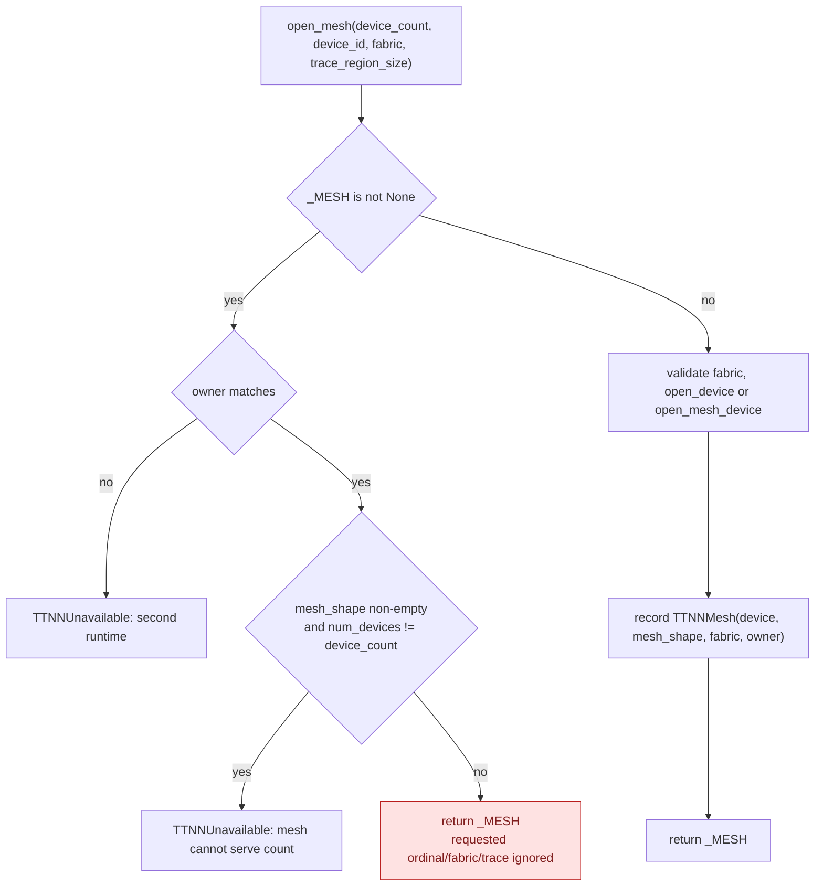
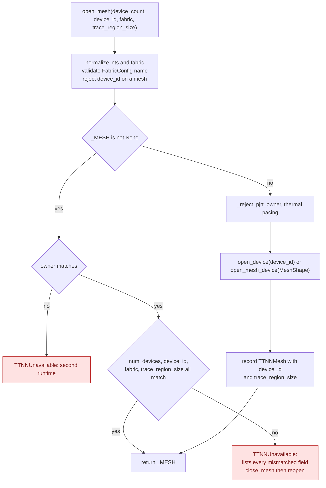
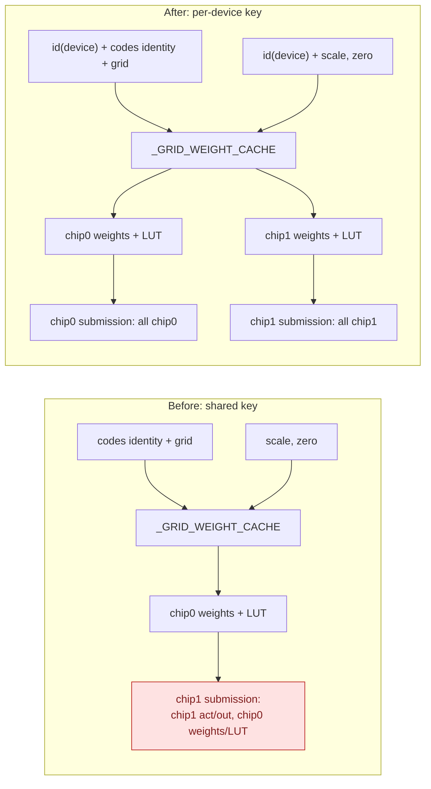

<!-- SPDX-FileCopyrightText: 2026 ModelCloud.ai
SPDX-License-Identifier: Apache-2.0 -->

# Native TTNN device ownership and per-device caches

The native Tenstorrent backend opens exactly one `ttnn.MeshDevice` per process
(`gptqmodel/utils/ttnn_runtime.py`). TT-Metal permits one runtime owner per
chip, so that handle is process state, not a per-layer object: every layer and
every direct kernel helper shares it. Sharing is only safe when the handle is
the placement the caller asked for, and when every device-resident cache entry
belongs to the device that consumes it.

This page describes the two mechanisms that enforce that contract. Introduced
by PR #4521 for issue #4484.

## 1. Reuse is a placement match, not "a handle exists"

`open_mesh(device_count, device_id, fabric, trace_region_size)` records the full
request on `TTNNMesh`: `mesh_shape`/`num_devices`, `device_id`, `fabric`, and
`trace_region_size`. `mesh_shape == ()` is a single chip, so `device_id` is where
that chip's ordinal lives.

Before the fix, the reuse branch compared chip counts only when `mesh_shape` was
non-empty and then returned the handle. A one-chip open answered a four-chip
request, and a chip-0 open answered a chip-1 request, with no error.

### Old flow

`gptqmodel/utils/ttnn_runtime.py:191` was the count guard; it was skipped
entirely for a single-chip `mesh_shape == ()`. `TTNNLinear._mesh` and
`_TTNNBlockFloatMixin._mesh` also returned `current_mesh()` directly, so a
layer's request never reached the guard at all.

### New flow

Both `_mesh()` implementations now call `open_mesh` unconditionally, so a layer
whose chip count or fabric differs from the live handle fails closed instead of
being placed on the wrong topology.

## 2. Grid caches are keyed by the owning device

`run_fused_gemm_grid` keeps packed weights and the dequant LUT resident on the
device (`_GRID_WEIGHT_CACHE` in `gptqmodel/utils/tt_int4_kernel.py`). The cache
key covered the source codes, grid geometry and `(scale, zero)` but not the
device, so a second live device was submitted the first device's buffers next to
its own activation and output.

`id(device)` is the identity of the live device object. Two chips are distinct
objects, so they never share an entry; repeating a call on the same device still
hits, which preserves the ~57 ms packing amortisation the cache exists for.
`close_mesh` now calls `clear_grid_weight_cache()`, so buffers that died with a
closed device cannot be matched by a recycled object id.

## Failure and ambiguity contract

| Situation | Before | After |
| --- | --- | --- |
| Live one-chip handle, request `device_count=4` | Returned the one-chip handle | `TTNNUnavailable` naming `device_count=4` |
| Live chip-0 handle, request `device_id=1` | Returned chip 0 | `TTNNUnavailable` naming `device_id=1` |
| Live `DISABLED` handle, request `FABRIC_1D` | Returned the fabric-less handle | `TTNNUnavailable` naming `fabric` |
| Live handle, different `trace_region_size` | Returned the handle | `TTNNUnavailable` naming `trace_region_size` |
| Unknown fabric name with a live handle | Returned the handle | `ValueError` before reuse |
| `device_id` with `device_count > 1` | `ValueError` only on a fresh open | `ValueError` before reuse as well |
| Grid call on a second live device | Mixed-owner submission | Weights and LUT uploaded for that device |
| Grid call after `close_mesh` | Stale entries possible | Cache cleared on close |
| Same request repeated | Reused | Reused |

Placement changes remain possible, but only explicitly: `close_mesh()` then a
new `open_mesh`. Silent substitution is never a success path.

## Scope

This covers the native TTNN runtime and the fused grid helper. It does not add
multi-device numerical qualification: the regression tests run against a
tagged fake driver and assert the Python/FFI boundary (returned topology, open
count, per-buffer device tags), not Tenstorrent arithmetic.
