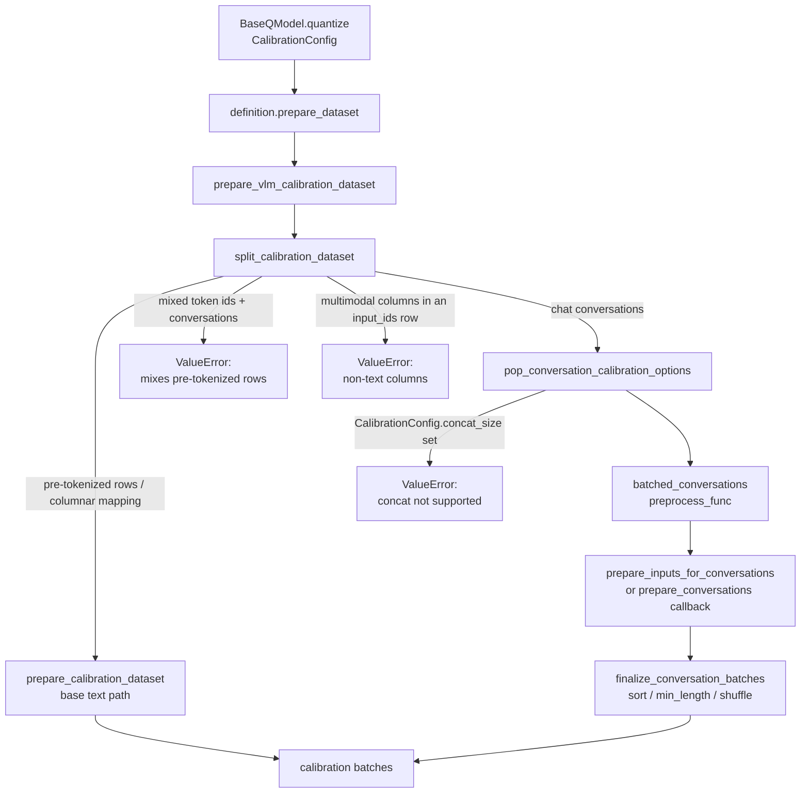
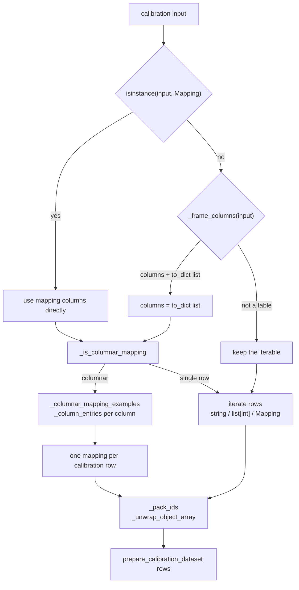

# VLM calibration input normalization

Vision-language definitions do not hand calibration rows straight to
`processor.apply_chat_template`. `quantize()` accepts raw text, chat
conversations, and pre-tokenized rows (`input_ids` + `attention_mask`), while a
multimodal processor only understands conversations. Every definition that
overrides `BaseQModel.prepare_dataset` therefore delegates to one shared helper,
`prepare_vlm_calibration_dataset` in
`gptqmodel/models/definitions/_vlm_calibration.py`, so the decision cannot drift
per model again (issues #4228, #4308, #4371, #4455, #4633).

## The flow

`BaseQModel.quantize` passes the same five calibration options to whichever
`prepare_dataset` the definition provides. The override supplies only its
processor hook; the helper owns the row split, the option handling, and the
batch finalization.

### Container resolution

Before any row is read, `prepare_calibration_dataset` and
`split_calibration_dataset` classify the *container* the caller passed. A table
(pandas `DataFrame`, Polars `DataFrame`, ...) is columnar even though it is not a
`Mapping`, and `Dataset.with_format("numpy")[:]` stores a ragged token column as
a 1-D `ndarray(dtype=object)`. Both are now resolved before the row split, so
they reach the same paths as an equivalent `dict` of columns.

`_column_entries` is the single place that decides how a column yields one
entry per row: 2-D arrays index by row, 1-D `ndarray`/`Series` unwrap through
`tolist()`, and a `datasets` `Column` (a `Sequence` without `ndim`) is listed.
`_unwrap_object_array` then lets `torch.as_tensor` accept an object-dtype array
whose elements are integer token ids, which is what one NumPy-formatted row is.

A definition that does not use the shared splitter (`base_qwen3_vl.py`) rejects
a table with the same `ValueError` it already used for mappings, instead of
iterating the column labels.

| Input | Before | After |
| --- | --- | --- |
| `Dataset.with_format("numpy")[:]` | 1-D object column read as one token row, `torch.as_tensor` raised | unpacked into one row per element |
| `Dataset.with_format("pandas")[:]` / `df.to_pandas()` | column labels iterated, calibrated on `"text"` | unpacked into one row per element |
| plain `{"input_ids": [7, 8, 9]}` | one token row | unchanged, still one token row |
| `pandas.DataFrame({"foo": ...})` | no error until the misleading length check | `ValueError` naming the accepted columns |

Two shapes of per-model work remain, and both delegate:

- `prepare_inputs_for_conversations(processor, conversations)` prepares one
  processor batch. It is the default hook, and every definition whose processor
  call is a plain `apply_chat_template` supplies only this method.
- `prepare_conversations(rows)` receives the raw non-chat rows and returns the
  prepared batches. Models whose calibration rows are not chat conversations
  (`{"image", "text"}` OCR rows, Ovis `{"conversations", "image"}` rows, OpenVLA
  prompt rows) use it; the split and option contract still runs in the helper.

Processors are resolved with `self.processor` first and `load_processor()` only
when none is loaded. A pre-tokenized dataset never reaches either, so it cannot
load a multimodal processor at all.

## What the helper replaced

Before #4633, definitions added after #4228/#4308 copied the conversation loop
and dropped the split. A `[{"input_ids": ...}]` dataset was rendered as an empty
chat prompt or calibrated on the literal text `"input_ids"`, and
`CalibrationConfig.concat_size`/`sort`/`min_length` were silently discarded with
`del kwargs`.

| Pre-fix location | Bypass | Now |
| --- | --- | --- |
| `cohere_compass.py:374` | no split; `del kwargs`; no `padding=True` | delegates; `padding=True` |
| `inkling.py:132` | no split; `del kwargs`; no `padding=True` | delegates; `padding=True` |
| `hunyuan_vl.py:110` | no split; `del kwargs` | delegates via new hook |
| `muse_glimmer.py:83` | no split; `del kwargs` | delegates |
| `ernie4_5_vl_moe.py:399` | no split; options ignored | delegates; `_prepare_calibration_batch` |
| `minimax_m3_vl.py:114` | no split; options ignored | delegates; `_prepare_calibration_batches` |
| `nemotron_omni.py:138` | no split; options ignored | delegates; `_prepare_calibration_batches` |
| `qwen3_omni_moe.py:94` | no split; options ignored | delegates; `_prepare_calibration_batches` |
| `qwen2_audio.py:81` | no split; options ignored | delegates; `_prepare_calibration_batch` |
| `interns1.py:127` | no split; options ignored; no padding | delegates; `padding=True` |
| `intern_s2_preview.py:187` | no split; `del kwargs` | delegates via new hook |
| `lfm3_vl.py:143`, `lfm3_omni.py:139` | no split; options ignored; no padding | delegates; `padding=True` |
| `deepseek_vl.py:111` | no split; `del kwargs` | delegates |
| `diffusion_gemma.py:344` | no split; `del kwargs` | delegates via new hook |
| `apertus.py:130` | no split; `del kwargs` | delegates via new hook |
| `deepseek_ocr2.py:124` | no split; `del kwargs` | delegates; `_prepare_calibration_batches` |
| `deepseek_vl_v2.py:171` | no split; `del kwargs` | delegates; `_prepare_calibration_batches` |
| `locateanything.py:98` | no split; `del kwargs` | delegates; `_prepare_calibration_batches` |
| `openvla.py:180` | no split; `del kwargs` | delegates; `_prepare_calibration_batches` |
| `ovis.py:129` | no split; options ignored | delegates; `_prepare_calibration_batches` |
| `ovis2_5.py:102` | no split; options ignored | delegates; `_prepare_calibration_batches` |
| `unlimited_ocr.py:255` | no split; `del kwargs` | delegates; `_prepare_calibration_batches` |
| `zdtaichu5.py:283` | own conversation detector; options ignored | delegates for conversations; base path otherwise |

The definitions that already used the shared helpers
(`base_qwen2_vl.py:345`, `base_qwen2_5_omni.py:293`, `gemma3.py:299`,
`internvl.py:138`, `internvl_chat.py:407`, `lfm2_vl.py:136`, `llava.py:117`,
`minicpm_o.py:405`, `minicpmv.py:174`, `minicpmv_4_6.py:133`, `ovis2.py:103`,
`smolvlm.py:106`) keep their existing `prepare_inputs_for_conversations` hooks
and are unchanged.

`base_qwen3_vl.py:563` is the one deliberate exception: it buffers a
pre-tokenized prefix and then applies the same options and finalizer, which also
lets it accept a dataset whose leading rows are token ids. It does not call
`split_calibration_dataset`, so it rejects columnar mappings that the shared
splitter accepts; converting it is a follow-up, not part of #4633.

`deepseek_v4.py:3247` overrides `prepare_dataset` for durable MTP replay
batches, which are neither text nor conversations; it is not a VLM calibration
input and is out of scope.

## Failure contract

| Situation | Before #4633 | After |
| --- | --- | --- |
| pre-tokenized row (`list[int]`, `input_ids` mapping) | processor path: empty prompt, `"input_ids"` text, or `AttributeError` | base text path keeps the ids |
| columnar mapping (`tokenizer(texts)`) | calibrated on key names | unpacked into rows |
| mixed token ids and conversations | silent corruption or late crash | `ValueError` naming the mix |
| `input_ids` row plus `pixel_values` | tensors silently dropped | `ValueError` naming the columns |
| `CalibrationConfig.concat_size` with conversations | silently ignored | `ValueError` |
| `CalibrationConfig.sort` / `CalibrationConfig.min_length` | silently ignored | applied |
| `Dataset.with_format("numpy")[:]` (object columns) | crash in tensor conversion | unpacked into rows |
| `Dataset.with_format("pandas")[:]` / `DataFrame` | calibrated on the column labels | unpacked into rows, or rejected by definitions that cannot unpack |
| unequal conversations at `batch_size > 1` | `ValueError` from `apply_chat_template` | `padding=True` on `support_batch_quantize=True` models |

## Conformance test

`tests/test_vlm_prepare_dataset_contract_4633.py` discovers every exported
definition with its own `prepare_dataset` (`"prepare_dataset" in cls.__dict__`)
and pins the contract with a stub tokenizer and a fail-closed processor loader:

- pre-tokenized mapping rows keep their exact ids and masks;
- a columnar mapping is unpacked instead of rendered as `"input_ids"`;
- conversations reject `CalibrationConfig.concat_size`;
- `batch_size=2` pads unequal conversations for Cohere Compass and Inkling.

A new VLM definition cannot skip the contract: adding an override puts it in the
parametrization automatically.
