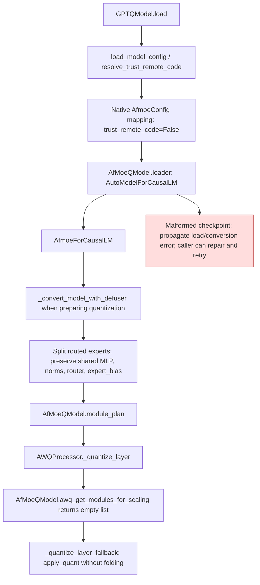

<!-- SPDX-FileCopyrightText: 2026 ModelCloud.ai -->
<!-- SPDX-License-Identifier: Apache-2.0 -->

# Afmoe native loading and quantization ownership

Afmoe / Trinity uses **native Transformers 5 modeling**, not a new local
modeling copy. `AfMoeQModel.loader` remains `AutoModelForCausalLM`, whose
`AfmoeConfig -> AfmoeForCausalLM` mapping implements this exact architecture.
There is no `LocalModelLoader`, remote import, global HF registration, or
modeling implementation in this directory. These are provenance/coverage data.

## Source and attribution

Native implementation: Hugging Face Transformers **5.23.0**, copyright 2025
Arcee AI and the HuggingFace Inc. team, Apache-2.0. Audited wheel files:

| File | SHA-256 |
| --- | --- |
| `transformers/models/afmoe/modeling_afmoe.py` | `4a1d5748c5376d5d62b56db2c9fd6631915498a04c5afd858191402f402dc0ca` |
| `transformers/models/afmoe/configuration_afmoe.py` | `b7e21cc234e1695e654384343fbed98ddc9652978609da901b939f4ca556932c` |

The native config names `arcee-ai/Trinity-Mini` as its reference checkpoint.
Its checkpoint Python was read as text only, never imported or executed.
Pinned configs and safetensors indexes were audited for these variants:

| Checkpoint | Revision | Checkpoint keys |
| --- | --- | ---: |
| [Trinity-Mini](https://huggingface.co/arcee-ai/Trinity-Mini/tree/e7fa016763d03089ab547c9ee19044980073669b) | `e7fa016763d03089ab547c9ee19044980073669b` | 12031 |
| [Trinity-Nano-Preview](https://huggingface.co/arcee-ai/Trinity-Nano-Preview/tree/e2ef4a3bebfb265283736454a24c8fb07cd30e75) | `e2ef4a3bebfb265283736454a24c8fb07cd30e75` | 21631 |
| [Trinity-Large-Preview](https://huggingface.co/arcee-ai/Trinity-Large-Preview/tree/fe24811cce621d64a499aa22f6718c99d2fbee2d) | `fe24811cce621d64a499aa22f6718c99d2fbee2d` | 42423 |

`checkpoint-schema.json` preserves the independently observed index schema,
native-relevant config values, and index hashes. Expanding it reproduced every
key in all three downloaded indexes exactly. The checkpoint materials are
from Arcee AI; the reference checkpoint's OpenMDW-1.1 license is preserved in
`LICENSE.checkpoint`. No checkpoint modeling source or trained tensors are
redistributed.

## Mechanism and ownership

| Before | After | Code evidence |
| --- | --- | --- |
| Definition claimed remote Python was required | Inherits native loader without the stale trust requirement | `definitions/afmoe.py:12-21`; previous `require_trust_remote_code` at base revision `22bea1201:19` |
| Q/K norm checkpoint weights had no owner spec | `self_attn.q_norm:!`, `self_attn.k_norm:!` explicitly remain dense | `definitions/afmoe.py:34-37` |
| Inherited AWQ scale discovery emitted unqualified groups | Definition returns no scale groups; ordinary AWQ quantization remains enabled | `definitions/afmoe.py:59-62` |



The shared native-support policy overrides both values of API trust, including
when the existing security bypass is enabled. Malicious `AutoConfig` and
`AutoModelForCausalLM` mappings are ignored. The parent tokenizer fix must also
be present: passing the already-selected config to `AutoTokenizer` prevents a
second config dispatch from re-importing checkpoint Python.

The checkpoint's individual `mlp.experts.N.{gate,up,down}_proj.weight` tensors
are converted by Transformers' Afmoe-to-Qwen2-MoE conversion mapping into
native packed tensors. Defuser restores the individual expert layout for the
quantizer. Tiny tensor tests verify both transformations exactly; `mlp.expert_bias`
is owned directly by capture-only `mlp`, and `mlp.router.gate` is excluded.
Q/K norms are real checkpoint weights, unlike rotary buffers which are
non-persistent. Dense-prefix counts are config-driven, not hard-coded to one
layer. Mini and Large have attention widths larger than the residual width;
the tests retain this distinction.

## AWQ policy

**Plain quantization only**, for both dense and MoE layers. Q/K normalization,
the attention sigmoid gate, sandwich post-norms, and the router/shared/routed
consumers make source/consumer shape matching insufficient to qualify folding
or candidate search. This migration makes no scale-search or neutral-fold
claim. The existing processor consumes the empty list even with
`AWQConfig(fallback=None)` and quantizes every supported linear without
altering any norm, routing weight, expert bias, embedding, or lm-head.

Tests execute actual `AWQProcessor._quantize_layer` and `apply_quant`, check
weight changes and staged scale/zero payloads for every projection, re-enter
the completed layer without requantizing it, and run the resulting model.
No quantizer implementation is mocked; feature capture is supplied directly
because no scale search/replay occurs under this policy. GPU packing is not
qualified by these CPU pseudoquantization checks.

## Validation

Environment: CPython 3.14.6t, `PYTHON_GIL=0`, Torch 2.15.0+cpu,
Transformers 5.23.0, Defuser 0.0.31. No threaded execution or new concurrency
claims are introduced.

```bash
PYTHON_GIL=0 /home/ubuntu/.venvs/gptqmodel-tf5/bin/python -s -m pytest -q \
  tests/test_afmoe_local_port.py tests/module_tree/test_afmoe_local_port.py \
  tests/test_afmoe_support.py
```

25 passed (3.66 s). Coverage includes full-config meta inventories for all three
pinned checkpoints; real CPU/meta ownership with all-dense, mixed, and all-MoE
layouts; GQA with unequal attention/residual widths; muP on/off; multiple shared
experts; independent sigmoid/top-k/MLP equation oracle with nonuniform routing;
exact checkpoint conversion; forward/cache continuation beyond the sliding
window; greedy generation with/without cache; two safetensors save/reload
cycles; malformed expert load followed by repair/retry; and malicious-map
public-loading trust/bypass matrix.

Red evidence on the base definition: the native-requirement regression failed
because the stale flag was `True`; the real owner test failed specifically on
`self_attn.q_norm.weight`. Restoring only the inherited
`BaseQModel.awq_get_modules_for_scaling` for a disposable test process made
`test_awq_plain_policy_quantizes_every_linear_without_folding[1]` fail because
it emitted two scale groups instead of the declared empty list. All pass with
the definition changes.

The AWQ onboarding baseline ran 572 passed, 3 skipped, 2 deselected (7.84 s)
with `-k 'not afmoe'`. Skips: uncached DeciLM, EXAONE and Nanbeige fixtures.
The unfiltered baseline had one failure solely because the parent-owned
registry fixture still lacked the two new exclusion tags (573 passed,
3 skipped). Integrator changes are specified below; the model-specific owner
and tensor tests do not depend on refreshing a central fixture.

### Integration-owned inventories

Replace `cases["AfMoeQModel/gptq"]["blocks"][1]` in
`tests/module_tree/fixtures/registered_module_plans.json` with:

```json
["self_attn.q_proj", "self_attn.k_proj", "self_attn.v_proj", "self_attn.gate_proj", "self_attn.q_norm:!", "self_attn.k_norm:!"]
```

Add `"afmoe"` to `PLAIN_QUANTIZATION_FAMILIES` in
`tests/test_awq_scaling_groups.py`. The parent owns shared docs and the root
README link to this mechanism/provenance page in draft PR #4620.

### Limits

No trained checkpoint tensors were downloaded. Full trained-weight accuracy,
GPU kernels/packing, accelerator cache execution, performance, and concurrent
multi-device loads need separate qualification. Native upstream sigmoid,
normalized routing is what the inspected checkpoints use; this is not a
qualification of arbitrary unpublished remote-only scoring variants or
quantized FP8/NVFP4 checkpoint formats. Fusion eligibility is unchanged and
this migration adds no GPU fusion qualification.
