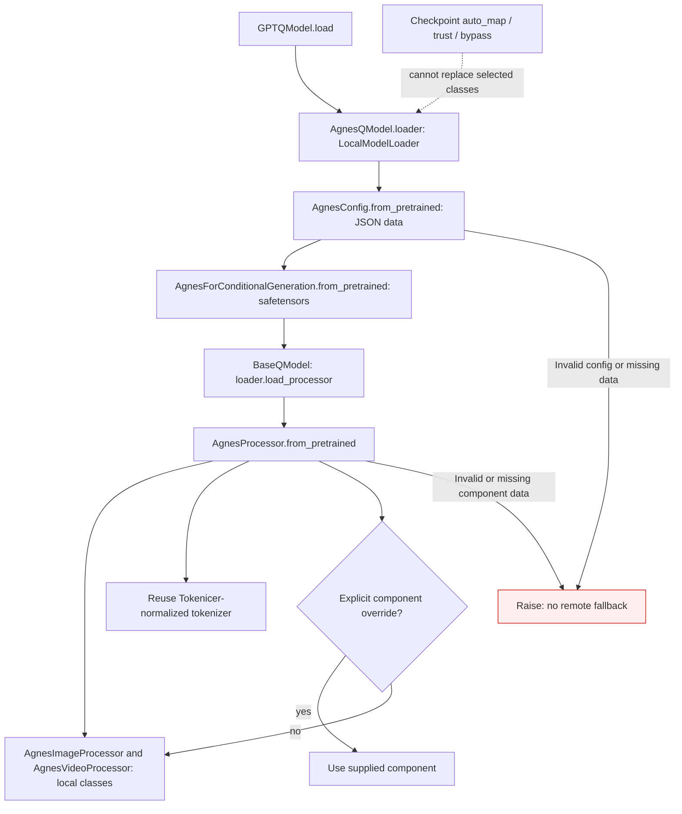
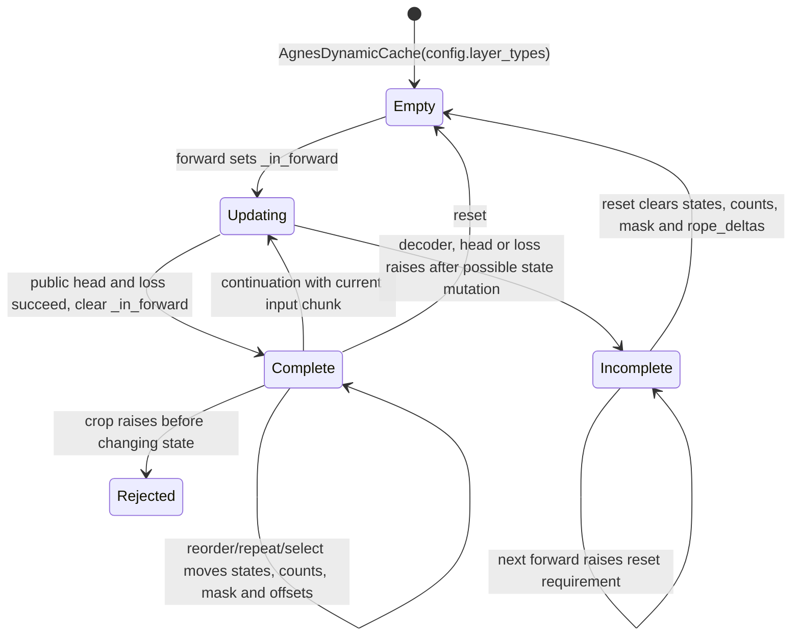

# GPT-QModel Agnes implementation

This package owns Agnes configuration, the complete image/video conditional
generation model, and its tokenizer/image/video processor composition.
`AgnesQModel.loader` selects the classes directly; no Transformers AutoClass
registration or checkpoint Python is needed. The only registered model alias is
`agnes`. Text calibration quantizes the language decoder; the vision tower stays
at native precision. Auxiliary checkpoint `mtp.*` tensors remain explicitly
outside the inference model.

## Provenance

Adapted from the Apache-2.0 Agnes AI implementation in
[Agnes-AI/Agnes-3.0-Flash, pinned revision
891ce4f9ffb89b22888aa7fcc2bb2f3618867684](https://huggingface.co/Agnes-AI/Agnes-3.0-Flash/tree/891ce4f9ffb89b22888aa7fcc2bb2f3618867684).
The original 2026 Agnes AI copyright and Apache-2.0 notices remain in all source
files. [checkpoint_ownership.json](checkpoint_ownership.json) records SHA-256
hashes for all six source files, both processor data files, config data, and the
checkpoint index. [upstream_config.json](upstream_config.json) is the pinned
released config, without architecture downsizing.

Transformers 5.23.0 has neither an `agnes` config nor an image-text model mapping.
This port preserves upstream projection names, the one-centred RMS norms,
gated grouped-query attention, gated delta recurrence, parallel SwiGLU branch,
vision patch/merger layout, and multimodal rotary positions.

Changes for current Transformers include request-owned hybrid cache layers,
dictionary-indexed linear state, explicit sequence-length tracking for all-delta
and all-global layouts, cache invalidation after partial failure, and cache-owned
multimodal rotary offsets. Short prefill keeps padded convolution cache storage
separate from current-token outputs. Cache invalidation remains active through
the public language-model head and loss; appended image/video chunks update the
rotary cursor even when the cache already contains media. Valid-token counts and
the padding-mask snapshot belong to the request and follow beam selection.
Image/video placeholder counting and preprocessing share size resolution,
including individual legacy min/max pixel overrides and `do_resize=False`.
The processor loads package-owned component classes
from JSON data and reuses the existing Tokenicer-normalized tokenizer. Standalone
processor loading also uses Tokenicer with the local config and remote code
disabled. No tokenizer normalization shim is introduced here. Explicit tokenizer,
image/video processor, and chat-template arguments retain precedence. Processor
hook signatures accept current Transformers kwargs; removed documentation symbols
are no longer imported. Input list/config dictionaries are copied before mutation.

## Selection and state lifecycle

| Previous mechanism at base `22bea120181e739161ee2969b260fe94f5b4e791` | Current mechanism |
| --- | --- |
| `definitions/agnes.py:46-49`: `AutoModelForImageTextToText` and required remote trust | Definition-owned `LocalModelLoader` config/model/processor metadata |
| `definitions/agnes.py:22-40,102-106`: create old Transformers registry/documentation symbols for checkpoint code | Package imports use current APIs; no global registration |
| Pinned `modeling_agnes.py`: model-owned `rope_deltas`, registry-driven cache allocation | Per-request `AgnesDynamicCache` owns offsets and linear/KV states |
| `definitions/agnes.py:60` and inherited AWQ scale-group selection | Explicit empty scaling-group list, tested plain quantization |





A cache belongs to one request and must not be used by concurrent forwards.
Different requests hold separate rotary offsets; the model has no request state.
Cache rollback/cropping is rejected because a recurrent state cannot reconstruct
an earlier prefix. Reset and replay the prefix after failure. Foreign/static
caches are rejected rather than silently treated as compatible.

Decoder state/count/mask/offset updates are provisional while `_in_forward` is
true. A failing public head or loss leaves the cache incomplete; rollback is not
attempted. Direct text-model calls commit at their own output boundary. Newly
appended media supplies pixels/grids for the current chunk; full-sequence
references concatenate old and new media in batch order. Generation with an
existing prefix cache takes full input IDs and only the new media's pixels/grids.
Full-prefix masks, chunk-local masks, and omitted continuation masks retain the
prefix's padding history.

| Reproduced port defect | Repair and failure boundary |
| --- | --- |
| `e67b2fcc5:modeling_agnes.py:623-639`: padded cache storage became current QKV for prompts shorter than the convolution width | Cache stores padded history; fresh convolution consumes only current QKV; resumed chunks consume history plus new QKV |
| `e67b2fcc5:modeling_agnes.py:1038-1041`: text decoder cleared the invalidation flag before the public head/loss | Both public heads defer completion until logits, optional loss, and the result exist; failure requires reset/replay |
| `e67b2fcc5:modeling_agnes.py:1236-1258`: existing rotary delta bypassed newly appended media | Local media coordinates translate by valid prefix length plus prior delta; local delta accumulates; generation uses the same current-chunk calculation |
| `e67b2fcc5:image_processing_agnes.py:182-191`: count ignored `size` | Image/video counters use the same modern/legacy size resolution and resize policy as real preprocessing |

## Qualification

Run from the repository root on the isolated Transformers 5 environment:

```shell
python -s -m pytest tests/test_agnes_local_port.py tests/module_tree/test_agnes_local_port.py tests/test_agnes_support.py -q
ruff check gptqmodel/models/definitions/agnes.py gptqmodel/models/ports/agnes tests/test_agnes_local_port.py tests/module_tree/test_agnes_local_port.py tests/test_agnes_support.py tests/models/test_agnes.py
git diff --check
```

The CPU tests execute raw image/video preprocessing, independently indexed patch
ordering (including temporal frame padding), vision forward, placeholder checks,
multimodal generation and beam expansion, padded hybrid and homogeneous decoders,
single- and multi-token continuation, cache repeat/select/reset/failure/retry,
safe config/model/processor loading under all trust/bypass combinations, and
safetensors save/reload equivalence. The complete 72-layer text / 27-block vision
model on meta matches the pinned index's exact sorted non-MTP key digest: 1,506
tensors out of 1,521 including 15 auxiliary MTP entries. Every decoder owner is
covered by the live module plan, including the `delta_attn:!` state container.

The independent float64 delta-rule oracle uses nonzero initial state, unequal
key/value widths, and 1/7/67-token sequences, crossing the 64-token chunk boundary.
A separate inspected-source comparison in a disposable process restored only the
removed upstream registry import names, used identical tiny weights, and measured
maximum absolute logit difference **0.0** for all 12 combinations of FP32/BF16,
text/image/video, and absent/present parallel FFN with eager uncached attention.
That one-off comparison did not qualify upstream cache behavior or fused kernels.

Red evidence before the repairs: all four malicious model-map cases executed the
authored sentinel through the old AutoClass loader; multimodal cached continuation
failed on full-prefix rotary positions; current processor calls rejected forwarded
hook kwargs; cache batch repetition failed because `LinearAttentionLayer` has no
`batch_repeat_interleave`. The corresponding permanent regression nodes now pass.

The subsequent peer review reproduced four further defects despite the original
41 passing tests: 1/2-token cached generation crashed, a failed head allowed a
retry with **0.0169564** maximum logit error, appended media had **0.00950073**
maximum error and stale rotary delta, and a size override counted four image
tokens where real processing produced one. The supplied script was inspected
and reproduced these values before changes. New regressions compare real public
forwards and generation against uncached complete-sequence execution:

| Invariant / trigger | Regression nodes in `tests/test_agnes_local_port.py` |
| --- | --- |
| Short cached prefill, both heads, all-delta/global/mixed, convolution widths 3/4, lengths 1/2/3/4/5/63/64/65, FP32/BF16 | `test_short_prefill_and_kernel_boundaries` |
| Head/loss exceptions after decoder mutation during fresh prefill and continuation, reject retry, reset/replay numerically | `test_public_head_or_loss_failure_invalidates_cache` |
| Text/media prefix plus newly appended images, multiple images, videos with multiple frames, mixed media, old+new grid reference, explicit/default positions, padded full/chunk masks and later text | `test_appended_media_updates_positions_and_continues_text` |
| Repeated beams, selection/reordering with distinct padding/rotary offsets, caller mask mutation, reset/replay | `test_appended_media_padding_history_follows_beam_selection_and_reset` |
| Public generation from an existing media cache; compare logits as well as greedy IDs | `test_generate_appended_media_from_existing_cache` |
| Image/video size, single/both legacy pixel bounds, precedence, resize disabled, patch/merge overrides; no mutable option leakage | `test_patch_count_overrides_match_real_media_processing` |

FP32 continuation comparisons use `rtol=2e-5, atol=2e-6`; BF16 convolution/cache
comparisons allow `rtol=0.03, atol=0.002` for separately rounded chunked execution.
The original 12-case pinned-source comparison qualifies uncached computation;
it does not qualify these repaired cache transitions against upstream's obsolete
cache APIs. The new transition oracle is uncached full-sequence execution with
the same weights, with independently specified expected rotary deltas.

Repair validation on CPU Torch 2.15.0 / Transformers 5.23.0 / Python 3.14t:

```shell
# Run the new tests in a disposable checkout at e67b2fcc5, then in the repaired tree.
python -s -m pytest tests/test_agnes_local_port.py -k 'short_prefill or public_head_or_loss or appended_media or patch_count_overrides' -q --disable-warnings
# Include shared loader/security/module-plan coverage in the repaired tree.
python -s -m pytest tests/test_agnes_local_port.py tests/module_tree/test_agnes_local_port.py tests/test_agnes_support.py tests/test_local_model_loading.py tests/test_local_processor_loading.py tests/test_hf_config_compat.py tests/module_tree/test_registered_module_plans.py -k 'not (matches_quantization_consumers and agnes)' -q --disable-warnings
```

The pre-fix run reports **97 failed, 159 passed, 30 deselected**, with failures
in the intended arithmetic/lifecycle/count checks and rejected legacy video
kwargs, without collection/import/name errors (including 40 short-prompt,
8 head/loss, 36 appended-media, 9 processor, 1 beam-history and 3 generation
cases). The combined repaired run reports **801 passed, 1 skipped, 1 deselected**.
The skip is the existing PEFT/AWQ dependency probe; the deselection is the stale
parent-owned Agnes registry-fixture row in this unit's older base. The parent
already owns its fixture update; it is not cherry-picked again for this repair.
Ruff and `git diff --check` pass. In the supplied peer fixture, retry now rejects
the incomplete cache; reset/replay differs from the uncached logits by only
**2.2352e-8**. Appended-media error becomes **5.9605e-8**, its delta becomes -2 as
expected, the overridden image count becomes 1, and safetensors image reload
retains exact logits (maximum difference 0.0).

AWQ is **plain quantization only** for hybrid, all-delta, all-global, and optional
parallel-FFN layouts. No norm folding or scaling search/replay is qualified. Tests
invoke the real AWQ processor fallback and check quantization state and changed
weights for every declared linear in both parallel variants, while preserving
norm, convolution and recurrent-state parameters. No shared AWQ algorithm changes
are needed.

Unqualified: GPU execution and fused CUDA/FLA paths (this port selects portable
Torch delta math), FP16 numerical parity, trained checkpoint quality/perplexity,
uncached full checkpoint loading, file-based video decoding, static/quantized
caches, speculative cache cropping, and concurrent reuse of the same cache.
CPU BF16 pinned-source forward parity does not qualify device-specific kernels.

The integrator owns the central `AgnesQModel/gptq` registry fixture, plain-AWQ
family classification, ports table and README links. These repairs need no
additional central fixture changes. Port-specific module-tree tests continue
enforcing the unchanged architecture, weight ownership and AWQ policy.
