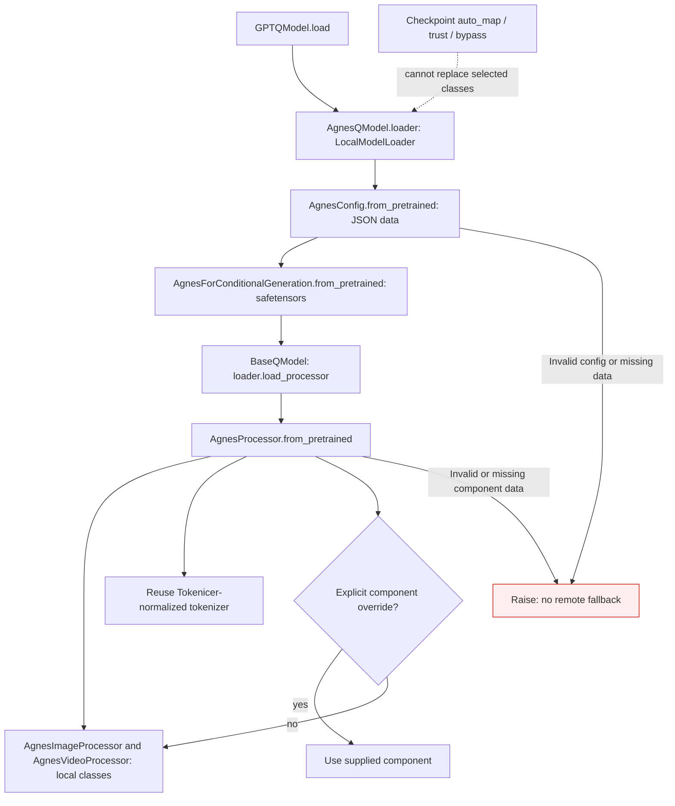
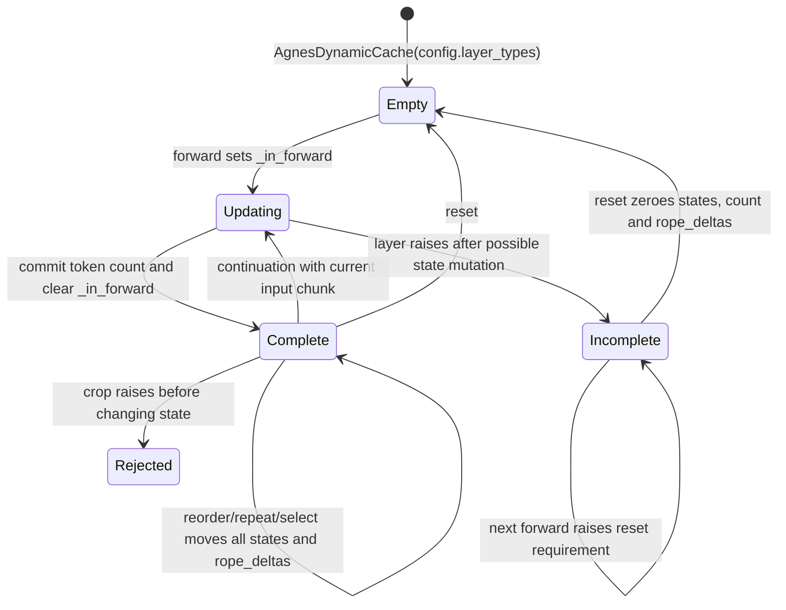

# GPT-QModel Agnes implementation

This package owns Agnes configuration, the complete image/video conditional
generation model, and its tokenizer/image/video processor composition.
`AgnesQModel.loader` selects the classes directly; no Transformers AutoClass
registration or checkpoint Python is needed. The only registered model alias is
`agnes`. Text calibration quantizes the language decoder; the vision tower stays
at native precision. Auxiliary checkpoint `mtp.*` tensors remain explicitly
outside the inference model.

## Provenance

Adapted from the Apache-2.0 Agnes AI implementation in
[Agnes-AI/Agnes-3.0-Flash, pinned revision
891ce4f9ffb89b22888aa7fcc2bb2f3618867684](https://huggingface.co/Agnes-AI/Agnes-3.0-Flash/tree/891ce4f9ffb89b22888aa7fcc2bb2f3618867684).
The original 2026 Agnes AI copyright and Apache-2.0 notices remain in all source
files. [checkpoint_ownership.json](checkpoint_ownership.json) records SHA-256
hashes for all six source files, both processor data files, config data, and the
checkpoint index. [upstream_config.json](upstream_config.json) is the pinned
released config, without architecture downsizing.

Transformers 5.23.0 has neither an `agnes` config nor an image-text model mapping.
This port preserves upstream projection names, the one-centred RMS norms,
gated grouped-query attention, gated delta recurrence, parallel SwiGLU branch,
vision patch/merger layout, and multimodal rotary positions.

Changes for current Transformers include request-owned hybrid cache layers,
dictionary-indexed linear state, explicit sequence-length tracking for all-delta
and all-global layouts, cache invalidation after partial failure, and cache-owned
multimodal rotary offsets. The processor loads package-owned component classes
from JSON data and reuses the existing Tokenicer-normalized tokenizer. Standalone
processor loading also uses Tokenicer with the local config and remote code
disabled. No tokenizer normalization shim is introduced here. Explicit tokenizer,
image/video processor, and chat-template arguments retain precedence. Processor
hook signatures accept current Transformers kwargs; removed documentation symbols
are no longer imported. Input list/config dictionaries are copied before mutation.

## Selection and state lifecycle

| Previous mechanism at base `22bea120181e739161ee2969b260fe94f5b4e791` | Current mechanism |
| --- | --- |
| `definitions/agnes.py:46-49`: `AutoModelForImageTextToText` and required remote trust | Definition-owned `LocalModelLoader` config/model/processor metadata |
| `definitions/agnes.py:22-40,102-106`: create old Transformers registry/documentation symbols for checkpoint code | Package imports use current APIs; no global registration |
| Pinned `modeling_agnes.py`: model-owned `rope_deltas`, registry-driven cache allocation | Per-request `AgnesDynamicCache` owns offsets and linear/KV states |
| `definitions/agnes.py:60` and inherited AWQ scale-group selection | Explicit empty scaling-group list, tested plain quantization |





A cache belongs to one request and must not be used by concurrent forwards.
Different requests hold separate rotary offsets; the model has no request state.
Cache rollback/cropping is rejected because a recurrent state cannot reconstruct
an earlier prefix. Reset and replay the prefix after failure. Foreign/static
caches are rejected rather than silently treated as compatible.

## Qualification

Run from the repository root on the isolated Transformers 5 environment:

```shell
python -s -m pytest tests/test_agnes_local_port.py tests/module_tree/test_agnes_local_port.py tests/test_agnes_support.py -q
ruff check gptqmodel/models/definitions/agnes.py gptqmodel/models/ports/agnes tests/test_agnes_local_port.py tests/module_tree/test_agnes_local_port.py tests/test_agnes_support.py tests/models/test_agnes.py
git diff --check
```

The CPU tests execute raw image/video preprocessing, independently indexed patch
ordering (including temporal frame padding), vision forward, placeholder checks,
multimodal generation and beam expansion, padded hybrid and homogeneous decoders,
single- and multi-token continuation, cache repeat/select/reset/failure/retry,
safe config/model/processor loading under all trust/bypass combinations, and
safetensors save/reload equivalence. The complete 72-layer text / 27-block vision
model on meta matches the pinned index's exact sorted non-MTP key digest: 1,506
tensors out of 1,521 including 15 auxiliary MTP entries. Every decoder owner is
covered by the live module plan, including the `delta_attn:!` state container.

The independent float64 delta-rule oracle uses nonzero initial state, unequal
key/value widths, and 1/7/67-token sequences, crossing the 64-token chunk boundary.
A separate inspected-source comparison in a disposable process restored only the
removed upstream registry import names, used identical tiny weights, and measured
maximum absolute logit difference **0.0** for all 12 combinations of FP32/BF16,
text/image/video, and absent/present parallel FFN with eager uncached attention.
That one-off comparison did not qualify upstream cache behavior or fused kernels.

Red evidence before the repairs: all four malicious model-map cases executed the
authored sentinel through the old AutoClass loader; multimodal cached continuation
failed on full-prefix rotary positions; current processor calls rejected forwarded
hook kwargs; cache batch repetition failed because `LinearAttentionLayer` has no
`batch_repeat_interleave`. The corresponding permanent regression nodes now pass.

AWQ is **plain quantization only** for hybrid, all-delta, all-global, and optional
parallel-FFN layouts. No norm folding or scaling search/replay is qualified. Tests
invoke the real AWQ processor fallback and check quantization state and changed
weights for every declared linear in both parallel variants, while preserving
norm, convolution and recurrent-state parameters. No shared AWQ algorithm changes
are needed.

Unqualified: GPU execution and fused CUDA/FLA paths (this port selects portable
Torch delta math), FP16 numerical parity, trained checkpoint quality/perplexity,
uncached full checkpoint loading, file-based video decoding, static/quantized
caches, speculative cache cropping, and concurrent reuse of the same cache.
CPU BF16 pinned-source forward parity does not qualify device-specific kernels.

Integration needs the central `AgnesQModel/gptq` registry fixture to insert
`["delta_attn:!"]` immediately after `["input_layernorm:!"]`. Central AWQ coverage
should classify `agnes` as plain quantization and construct its tiny multimodal
model through the local loader. The port-specific module-tree tests enforce these
policies independently. The central ports table and README links are maintained
by the integrator.
