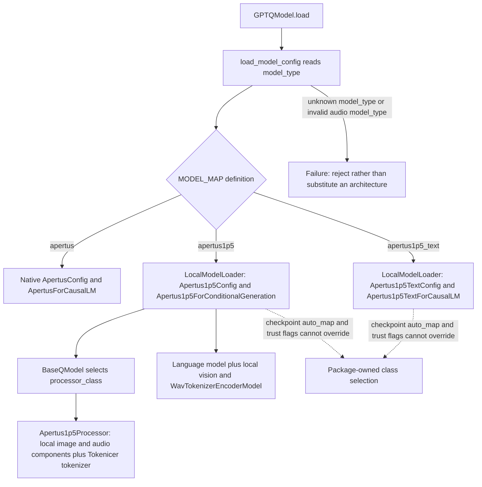
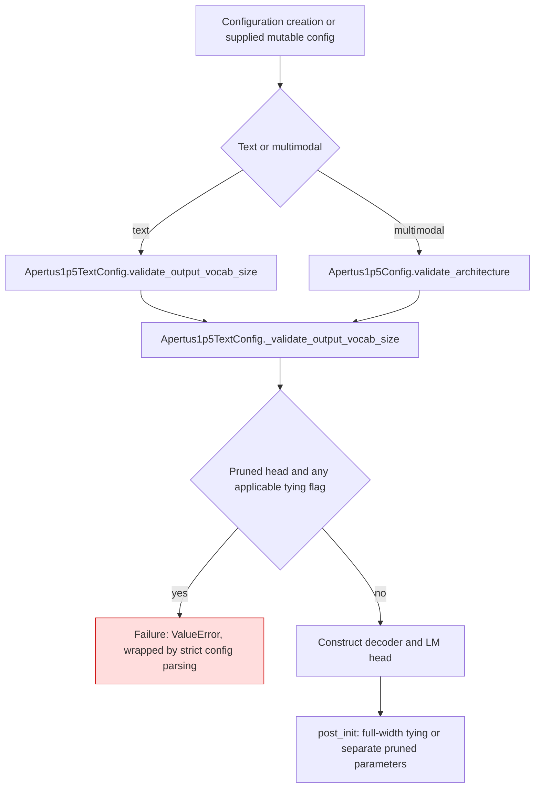

# GPT-QModel Apertus model selection and local media processing

## Source and scope

The Apertus 1.5 implementation is adapted from the Swiss AI Initiative's
[Transformers fork at revision `e917e237c94fa73707d29edf351463a6aff51538`](https://github.com/swiss-ai/transformers/tree/e917e237c94fa73707d29edf351463a6aff51538),
inspected on its `feature/apertus_1p5_pipeline` branch. The copied files retain
their Swiss AI/Hugging Face copyright and Apache-2.0 license notices. The
[upstream license](https://github.com/swiss-ai/transformers/blob/e917e237c94fa73707d29edf351463a6aff51538/LICENSE)
and this repository's Apache-2.0 license apply.

Source files under `src/transformers/models/`:

- `apertus1p5/configuration_apertus1p5.py`
- `apertus1p5/modeling_apertus1p5.py`
- `apertus1p5/image_processing_apertus1p5.py`
- `apertus1p5/processing_apertus1p5.py`
- `wavtokenizer/configuration_wavtokenizer.py`
- `wavtokenizer/modeling_wavtokenizer.py`
- `wavtokenizer/feature_extraction_wavtokenizer.py`

Transformers 5.23.0 provides exact native `ApertusConfig` and
`ApertusForCausalLM` mappings for `apertus`; that implementation stays native.
It has no native `apertus1p5` or `apertus1p5_text` mappings. This package owns
both missing configurations/models, the vision tokenizer, the WavTokenizer
encoder/codebook, and the image/audio processor. Original Apertus is not used
as a substitute for a multimodal model.

## Adaptations

Imports of sibling architectures are package-relative; Transformers primitives
use their public installed package. There is no runtime source download, global
Auto registration, or checkpoint-selected Python import. Hub kernel decorators
were removed in favor of their original PyTorch implementations. The source's
`AutoModel.from_config(audio_config)` is an explicit local
`WavTokenizerEncoderModel` construction; other audio architecture types fail
configuration validation instead of dispatching through checkpoint metadata.
Only the encoder/codebook used by Apertus is included, not the standalone
WavTokenizer audio decoder. Parameter names, weight normalization parametrizations,
media code offsets, RoPE/cache operations, and full/pruned LM-head layouts are
preserved. Existing Transformers 5 APIs execute the copied computation directly.

The processor explicitly selects package-owned image/audio components, reuses a
supplied policy-selected configuration/tokenizer, and otherwise uses GPT-QModel's
existing `load_hf_tokenizer` (Tokenicer) path. Corrective tokenizer normalization
is not implemented here. A supplied `tokenizer=None` means load one, not replace
the successfully loaded tokenizer with `None` during ProcessorMixin construction.

## Resolution flow

This is the Apertus-specific reference for the mechanism introduced in
[PR #4620](https://github.com/ModelCloud/GPTQModel/pull/4620). Shared loader/security
behavior is documented in [the loader reference](../../../../docs/trust-remote-code-isolation.md); this page remains
port-local because central documentation is maintained by the integrator.



| Mechanism | Before at base `22bea1201` | After |
|---|---|---|
| 1.5 text selection | `definitions/apertus.py:43-45`: inherited generic AutoModel loader | `definitions/apertus.py:53-56`: LocalModelLoader config/model paths |
| 1.5 multimodal selection | `definitions/apertus.py:52`: AutoModelForMultimodalLM without native mapping | `definitions/apertus.py:62-66`: LocalModelLoader config/model/processor paths |
| Processor discovery | `definitions/apertus.py:127-128`: AutoProcessor.from_pretrained | `definitions/apertus.py:142-147`: LocalModelLoader.load_processor, also selected by BaseQModel.__init__ |
| Native checkpoint ownership | `definitions/apertus.py:33-38`: Q/K norms and xIELU weights unowned | Explicit `q_norm:!`, `k_norm:!`, `act_fn:!` owners |
| AWQ scale sources | Generic discovery, with nonlinear up-projection excluded | Explicit empty scale groups; every decoder linear uses plain quantization |

There is no ambiguous local/remote fallback: the local loader ignores checkpoint
`auto_map`, `trust_remote_code`, and `code_revision`. Both security opt-ins still
cannot replace a package-owned implementation. Missing optional image/audio
dependencies raise their normal dependency error only when that component is
imported, not when the model definition is imported.

## LM-head tying admission

A pruned head has fewer physical rows than the input embedding table. Direct
parameter tying would replace that head with the full table without updating
its declared width, yielding too many logits and an invalid loss reshape. Prefix
tying is not implemented: pruned heads explicitly require both applicable tying
flags to be false. This guard is an intentional correction to the pinned source.

| Head width | Text tying | Multimodal outer/nested tying | Admission |
|---|---|---|---|
| Full (`None` or `vocab_size`) | Either | Any combination | Supported |
| Pruned (`output_vocab_size < vocab_size`) | False | Both false | Supported, separate parameters |
| Pruned | True | Either true | Rejected before model allocation/initialization |

For a full-width multimodal model, the **outer** `tie_word_embeddings` flag
controls the outer LM head. A nested-only true flag does not tie that head;
the flags are preserved rather than silently synchronized. Explicit full-width
`output_vocab_size == vocab_size` canonicalizes to `None` during config creation.

Both the strict configuration path and model constructors check this invariant.
Constructor checks also cover mutable configurations whose tying flag or output
width changes after successful validation. Rejection does not alter the caller's
config; fixing its flags allows an ordinary retry.



| Mechanism | Before at `fee1477f5` | After |
|---|---|---|
| Text config | `configuration_apertus1p5.py:169-174`: range validation only | `configuration_apertus1p5.py:169-185`: range and tying admission |
| Multimodal config | `configuration_apertus1p5.py:229-231`: outer tying ignored | `configuration_apertus1p5.py:241-243`: validate with outer plus nested tying |
| Mutable config consumption | `modeling_apertus1p5.py:723-732,1027-1036`: model construction and post_init without revalidation | `modeling_apertus1p5.py:723-726,1028-1031`: validate before creating decoder/head |

Regression command:

```bash
python -s -m pytest -q tests/test_apertus_local_port.py \
  -k 'tied_pruned_head or supported_head_tying' --tb=short
```

Before the guard, 16 cases failed because invalid configs/constructors/public
loads did not reject; 14 valid controls passed. With the guard, all 30 pass.
The controls cover both architectures, full-width `None`/explicit sizes,
untied pruned heads, every outer/inner flag combination, exact parameter aliases
and widths, independent cross-entropy/finite loss, and two safetensors save/reload
cycles with no missing/unexpected/mismatched keys and bitwise-identical tensors,
logits and loss. Negative cases also exercise mutation in both directions and
public invalid-checkpoint rejection followed by repair/retry at the same path.

## AWQ policy

**Plain quantization only**, for native Apertus and both 1.5 aliases, including
full/pruned heads, QKV bias variants, GQA, xIELU and SiLU. Q/K RMSNorm intervene
between Q/K projections and attention; `up_proj -> xIELU -> down_proj` is not a
homogeneous fold. No scaling group, candidate search, or norm fold is claimed
qualified. The definition returns no groups; all six decoder linears still
quantize through the existing AWQ fallback. `up_proj:nosrc` and nonquantized
activation/norm tags prevent inferred unsafe producer relationships.

The regression captures real native projection inputs and verifies all six
weights change, norms/activations remain bitwise unchanged, interrupted capture
leaves weights untouched, retry completes, repeated quantization is idempotent,
and the model still produces finite logits. It does not qualify packed GPU AWQ
inference or a trained-checkpoint accuracy score.

## Offline qualification

Use `/home/ubuntu/.venvs/gptqmodel-tf5/bin/python -s -m pytest -q` with:

```text
tests/test_apertus_local_port.py
tests/module_tree/test_apertus_local_port.py
tests/test_local_processor_loading.py
```

The first two files are port-owned; the last qualifies the shared processor
loader supplied by the parent change. CPU/meta checks use actual models, not
tree-generated fake modules, under Python 3.14t, Transformers 5.23.0 and Torch
2.15.0+cpu. They cover all three model types; full/pruned text and multimodal
heads; xIELU/SiLU; QKV bias; GQA; exact decoder state-dict owners; actual media
encoder state including weight-norm keys/codebook buffers; eager/SDPA text
attention; left padding; cache continuation; cached/uncached and beam generation;
finite loss; exact safetensors tensor round trips; processor save/reload and
image/audio placeholder replacement; malformed-placeholder failure/retry;
hostile config/processor `auto_map`; and both trust/bypass settings through the
public loading API. Matching native Apertus weights provide a text-logits oracle.

Before implementation, the two local-loader assertions failed on the generic
Auto loaders and the native ownership assertion failed on
`self_attn.q_norm.weight`; those same named regression nodes now pass. No native
model test is skipped to mask an implementation gap.

## Limits and integration

The official `swiss-ai/Apertus-v1.5-8B` config request returned HTTP 401; its gated
trained config/weights, production tokenizer/chat template, and checkpoint key
audit have not been qualified. Tiny source-derived models are not a substitute
for that validation. GPU/FlashAttention, CUDA xIELU, low-precision kernels,
full packed GPTQ/AWQ quantization, concurrent multi-device execution, and trained
accuracy remain untested. Vision attention retains its fixed upstream path;
the decoder-only SDPA check does not imply vision SDPA support. No standalone
audio generation or video implementation is advertised.

The integrator must update the parent-owned registered-module-plan fixture for
`ApertusQModel/gptq`, `Apertus1p5TextQModel/gptq`, and
`Apertus1p5QModel/gptq`. Preserve the existing `layers` entries, add
`self_attn.q_norm:!`/`self_attn.k_norm:!` beside Q/K/V and `mlp.act_fn:!` beside
`mlp.up_proj`. Model-specific tests assert the complete resulting blocks in the
meantime; the stale shared fixture currently fails those three registry cases.
The central README/reference-page link and PR-body flow diagram are also owned
by the integrator; this port does not edit those shared files.
