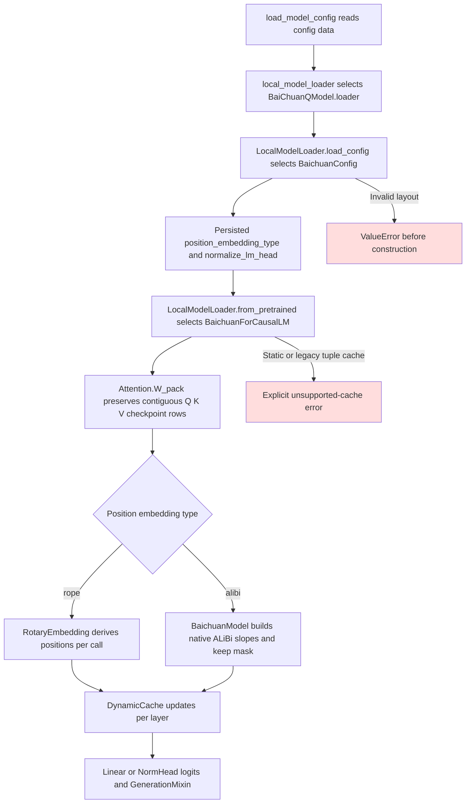

# Baichuan package-owned modeling

GPT-QModel selects its own Baichuan configuration and fused-MHA decoder through
`BaiChuanQModel.loader`. Transformers 5.23.0 has neither a Baichuan config mapping
nor a causal-LM mapping. The upstream model is not a native Llama checkpoint.

## Source and attribution

The following authoritative Hugging Face source snapshots were downloaded as
text and inspected before adaptation. No checkpoint Python was executed.
Configuration, decoder, attention, norm, MLP and output-head equations come from
these files. `NOTICE` preserves the upstream attribution and Apache notice;
the repository root `LICENSE` supplies the Apache 2.0 license. Pretrained model
and tokenizer licenses are separate; neither artifact is redistributed here.

| Source | Pinned revision | Layout |
| --- | --- | --- |
| [Baichuan-7B](https://huggingface.co/baichuan-inc/Baichuan-7B/tree/5d86e56a58fe4a5b3292cd9bb7468afef6f93eab) | `5d86e56a58fe4a5b3292cd9bb7468afef6f93eab` | RoPE, linear head, persistent `inv_freq`, original `BaiChuan` class spelling |
| [Baichuan-13B-Chat](https://huggingface.co/baichuan-inc/Baichuan-13B-Chat/tree/e3e1498bb6b7fb0bcb5a65679c09b862d7c29301) | `e3e1498bb6b7fb0bcb5a65679c09b862d7c29301` | ALiBi, linear head |
| [Baichuan2-7B-Chat](https://huggingface.co/baichuan-inc/Baichuan2-7B-Chat/tree/ea66ced17780ca3db39bc9f8aa601d8463db3da5) | `ea66ced17780ca3db39bc9f8aa601d8463db3da5` | FP32 RoPE, normalized head, no persistent rotary tensors |
| [Baichuan2-13B-Chat](https://huggingface.co/baichuan-inc/Baichuan2-13B-Chat/tree/c8d877c7ca596d9aeff429d43bff06e288684f45) | `c8d877c7ca596d9aeff429d43bff06e288684f45` | ALiBi, normalized head |

Each snapshot's `configuration_baichuan.py`, `modeling_baichuan.py` and
`config.json` was reviewed. SHA256 of the modeling files, in table order:

```text
b4fae757cf1cd56e75eb82831f340441162af8bd2cc5fe586c41d3744167d002
da90488619bbd6385481dcfa37865124b9508ce82d624d22fb6d5c98800c5ad7
3ffe5c7c5b019f838f3a141cb44ebdb61507dbf37b3d454c100d76e7df7fcbd7
ecf7e6da06e1cdb74a6243f74a305fe44f6752f89cc5063b5872c33c6f4afb72
```

## Selection and adaptation

Released configs distinguish 13B by `hidden_size=5120` and Baichuan 2 by
`vocab_size=125696`. The local config derives `position_embedding_type`
(`rope`/`alibi`) and `normalize_lm_head` from those released values and persists
both explicit fields on save. Tiny configs and resized/custom checkpoints can
set those fields directly; they do not depend on a checkpoint filename or
`architectures`/`auto_map` code path. Original `BaiChuanConfig` and
`BaiChuanForCausalLM` spellings are local aliases; the registry has one
`model_type=baichuan` entry.



| Before at base `22bea1201` | Local replacement |
| --- | --- |
| `definitions/baichuan.py:12` inherits the generic HF loader, with no definition-owned implementation | `BaiChuanQModel.loader` names only package-owned classes; checkpoint trust and bypass values cannot replace them |
| `definitions/baichuan.py:21` names fused attention but omits the Baichuan 1 checkpoint buffer owner | Tree tags `self_attn.rotary_emb:!` and fused `W_pack:q:k:v`; all five linear owners remain quantizable |
| `definitions/baichuan.py:54` repairs shared mutable rotary caches after load | Local forward derives rotary/ALiBi tensors without publishing mutable position caches; legacy repair hook bypasses local models |
| Inherited AWQ grouping could attempt folds based on the generic tree | `awq_get_modules_for_scaling` returns no groups: real AWQProcessor plain quantization for all five linears, including with `fallback=None` |

Attention retains full MHA (`W_pack` has `3 * hidden_size` rows), original
pre-norm residuals, SwiGLU and RMSNorm gain semantics. It preserves FP32 versus
activation-dtype rotary multiplication, ALiBi's non-power-of-two interleaved
slope order, positive absolute offsets in evaluation and relative offsets in
training, 13B packed-document masks and upstream activation-dtype logits.
Baichuan 1 retains its initial-table FP32 calculation followed by a dtype cast
and its extension-table calculation in the current `inv_freq` dtype. Tables
are derived per call: a later short request does not inherit precision state
from a previous long request, unlike upstream's mutable growing cache.
Normalized heads use an ephemeral normalized weight rather than mutating
`weight.data` on the first evaluation forward. This preserves output equations
while keeping checkpoint state stable across train/eval/save/retry calls.

The current runtime uses Transformers 5 `DynamicCache` and `GenerationMixin`;
cache ownership is per call, including beam reordering. It validates mask
dimensions before cache mutation so malformed-context retries preserve a warm
cache. It imports no Xformers/FlashAttention/custom quantizer and downloads or
imports no Python at runtime. All internal imports are package-relative.

## Checkpoint keys and conversion evidence

No key conversion or split/fuse rename is applied. Each decoder layer owns:

```text
input_layernorm.weight
self_attn.W_pack.weight              # [3 * hidden_size, hidden_size]
self_attn.o_proj.weight
post_attention_layernorm.weight
mlp.gate_proj.weight
mlp.up_proj.weight
mlp.down_proj.weight
```

Outside decoder layers, checkpoints own `model.embed_tokens.weight`,
`model.norm.weight` and `lm_head.weight`. The pinned 13B and Baichuan2-13B
`pytorch_model.bin.index.json` files were downloaded and inspected: their
layer-0 keys exactly match the seven above, and the complete indexes contain
40 copies plus those three non-layer keys (283 total). Baichuan 1 7B's
Apache-licensed source additionally registers persistent
`self_attn.rotary_emb.inv_freq`; the tree excludes that owner from quantization.
Its monolithic trained payload was not downloaded, so this last ownership
claim is based on the source registration, not an inspected weight header.
Baichuan2-7B source's rotary state is unregistered and is not a checkpoint
obligation. Its monolithic payload was likewise not downloaded.

Real CPU and meta model tests enumerate `state_dict()` (including persistent
buffers), assert exact key sets/shapes, and check every decoder owner through
the loaded wrapper's `module_plan().find()` plus `simple_layer_modules()`.
Non-quantized owners have `:!`; cached/generated tensors add no obligations.
Safetensors round trips have no missing, unexpected or mismatched keys and
exactly preserve both tensors and logits.

## AWQ policy and support limits

All four variants deliberately use **plain AWQ weight quantization**. None is
qualified for source folding, candidate search, or attention replay. Tests
capture actual projection inputs, run AWQProcessor's real no-group fallback
and real `apply_quant`, assert scales/zeros and changed weights for every
projection, unchanged norms and idempotent retry. No shared AWQ algorithm is
modified. Fusion also remains unqualified and disabled.

CPU forward equivalence is checked against an independent transcription of
the pinned source equations in FP32, FP16 and BF16. This is structural and
numerical qualification, not a trained-language-quality claim. GPU quantized
packing/kernels, trained 7B/13B generation/evaluation, tokenizer integration,
and concurrent multi-GPU GIL=0 execution remain untested. The existing large
checkpoint integration test remains available with API trust disabled.
The supplied CPU tests run under the free-threaded interpreter but introduce
no new threading and make no native concurrency safety claim.

Static/offloaded cache implementations, legacy tuple caches, upstream custom
`chat` streaming wrappers and upstream ad-hoc quantizer helpers are not ported;
use standard `generate` with DynamicCache and GPT-QModel's quantization API.
Static and legacy tuple caches fail explicitly. Gradient checkpointing and
accelerated attention are not advertised. Existing safetensors writers are
used unchanged; no new pickle payload is emitted.

Parent integration owns central README/logic-flow documentation and fixtures.
The diagrams here provide the Baichuan-specific reference for draft PR #4620.
Exact fixture payloads and validation commands are in `VALIDATION.md`.
