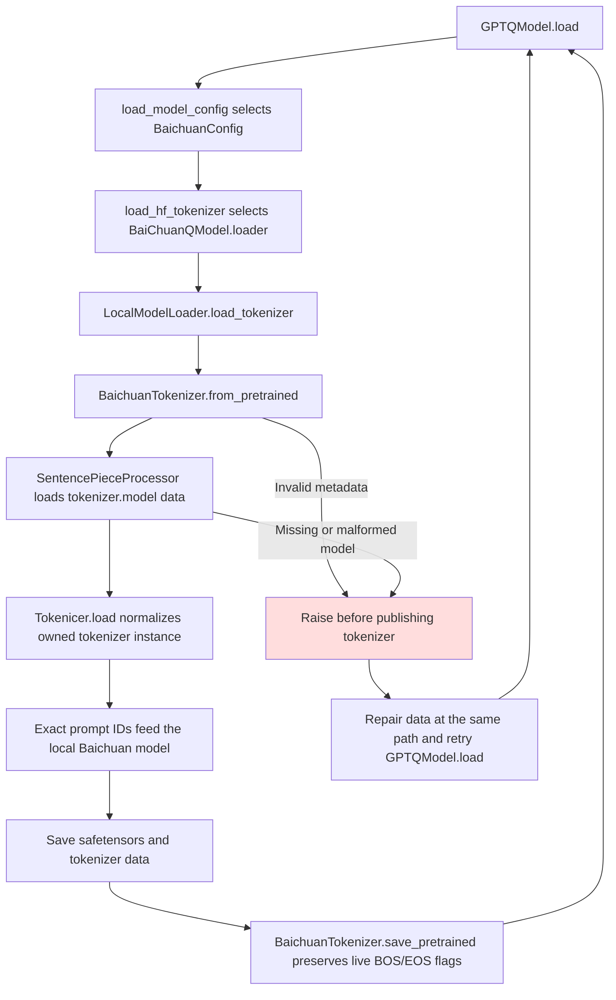

# Baichuan local model and tokenizer

GPT-QModel loads Baichuan 1/2 with the packaged configuration, model and
SentencePiece tokenizer declared by `BaiChuanQModel.loader`. Transformers 5.23
has no native Baichuan tokenizer class; the released checkpoints provide
`tokenizer.model` and custom class metadata. A synthetic WordLevel tokenizer
does not establish support for these checkpoints.

The tokenizer requires `sentencepiece`. The original `BaiChuanTokenizer`
spelling is an alias of the packaged `BaichuanTokenizer`. There is no checkpoint
Python import, dynamic class registration, automatic fast-tokenizer conversion
or tokenizer asset rewrite. Tokenicer owns reusable metadata preparation and
runtime padding/normalization; this package owns the original SentencePiece
algorithm, special-token assembly, decoding and serialization of its BOS/EOS
behavior flags.

## Selection, failure and retry



| Before at parent `0fdfd2396` | Packaged behavior |
| --- | --- |
| `definitions/baichuan.py` declares only config/model classes; Tokenicer rejects unavailable `BaichuanTokenizer` | Definition also binds the package tokenizer; API trust and bypass settings cannot replace it |
| Exact real `tokenizer.model` metadata cannot reach a native class | Source-matched SentencePiece tokenizer reads that data directly |
| Transformers 5 generic tokenizer save drops `add_bos_token` and `add_eos_token` | The owned serializer preserves the live flags, including released `False/False` and explicit overrides |
| Mock native WordLevel coverage could pass while real tokenizers failed | Hash-pinned real assets, source-oracle IDs and public load/roundtrip/repair regressions |

Malformed tokenizer data raises normally. Repair does not require a process
restart or cache clearing and does not trigger checkpoint-code fallback.

## Real asset and source contract

[PROVENANCE.md](PROVENANCE.md) records pinned source revisions and licenses.
[tokenizer_contracts.json](tokenizer_contracts.json) records SHA256 values for
the exact real `tokenizer.model`, tokenizer metadata, model config, generation
config and tokenizer source in all four audited layouts. It also records
fixed IDs/decodes, special-token flags, pair masks and explicit BOS/EOS controls
captured from inspected upstream sources in an isolated Transformers 4.45.2 /
SentencePiece 0.2.1 oracle. Tests download only the small public data files,
verify their hashes and reuse the Hugging Face cache. No trained weights or
checkpoint Python are downloaded by the tests.

| Checkpoint | SentencePiece vocabulary | Tokenizer source |
| --- | ---: | --- |
| Baichuan-7B | 64,000 | Original `BaiChuanTokenizer` spelling |
| Baichuan-13B-Chat | 64,000 | Same source methods; distinct real SentencePiece file |
| Baichuan2-7B-Chat | 125,696 | Expanded vocabulary |
| Baichuan2-13B-Chat | 125,696 | Same model asset as Baichuan2-7B; distinct special-token metadata |

All four source implementations have identical tokenizer method bodies after
removing docstrings and formatting. The packaged code adapts the import to
Transformers 5, retains native AddedToken objects during initialization instead
of their string forms, and adds source-specific BOS/EOS flag persistence. It does not
substitute a Llama tokenizer or retrain a vocabulary.

## Prompts and chat

The upstream tokenizers have **no default Hugging Face chat template**. Chat
checkpoints use the source `generation_utils.build_chat_input` convention:
encode the system message, append the user role ID before each user message,
append the assistant role ID before assistant content, and append an assistant
role ID for generation. The three audited Chat generation configs declare
`user_token_id=195` and `assistant_token_id=196`. The base Baichuan-7B generation
config declares neither. The contract includes fixed multi-turn IDs for each
Chat layout, including the different Baichuan 1/2 vocabularies.

Callers may supply an explicit template and register the real role-token
strings as special tokens when using `apply_chat_template`. Tests prove that
this produces the source IDs without installing an invented default template.
Upstream history-window truncation and interactive `.chat()`/streaming helpers
are separate model helpers, not tokenizer methods supplied by this port.

## Qualification

Run from the repository root:

```bash
PYTHON_GIL=0 python -m pytest tests/test_baichuan_tokenizer.py tests/test_baichuan_local_port.py tests/module_tree/test_baichuan_local_port.py tests/test_local_tokenizer_loading.py -q
```

The tokenizer suite exercises all four real metadata layouts, nine hostile
trust/bypass combinations per layout (trust unset/false/true, bypass unset/0/1),
exact multilingual/whitespace/special token prompts, real dense CPU
forward/generation, tokenizer and safetensors
save/load/re-save, explicit BOS/EOS pair masks, and missing/malformed asset
repair at the same path. Dense test model weights are tiny random local
safetensors with the real vocabulary sizes. Four additional real public
plain-AWQ tests calibrate on those source text prompts with `fallback=None`,
pack every decoder linear, preserve excluded state, infer/generate, then
perform two exact public `GPTQModel.save`/load cycles with the real tokenizer.
They explicitly cast live floating state to FP16 before saving, matching the
requested reload dtype. Baichuan 1 permits narrowing its checkpoint-owned
`inv_freq`; an uncast FP32 buffer otherwise narrows when quantized loading
requests FP16. Extended-context equivalence across that dtype change is not
claimed. The existing module-plan and plain-quantization tests remain applicable.

New checkpoint tensor payloads are safetensors. The existing dense
`GPTQModel.save` facade targets the quantized writer; dense roundtrips use
the actual model/tokenizer `save_pretrained` methods and public
`GPTQModel.load`. No production trained-weight accuracy, packed GPU kernel,
concurrent multi-device or full interactive-chat qualification is inferred
from these tests. Pretrained/tokenizer artifacts retain their upstream
model/community licenses and are not redistributed in this package.
