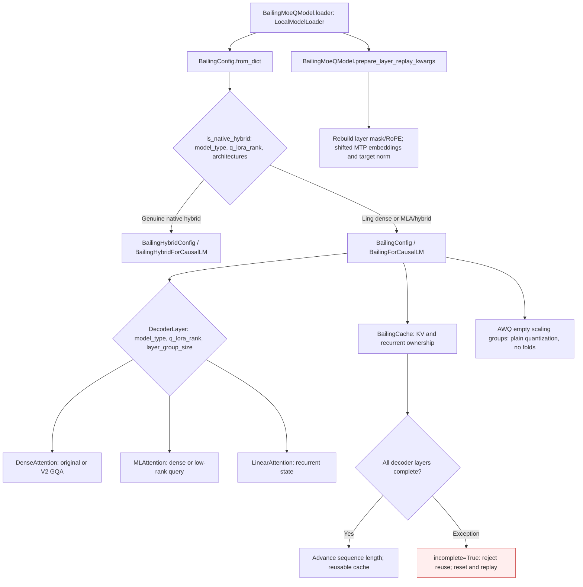

<!-- SPDX-FileCopyrightText: 2026 ModelCloud.ai -->
<!-- SPDX-License-Identifier: Apache-2.0 -->

# GPT-QModel package-owned Bailing / Ling models

## Provenance and license

The configuration, checkpoint namespaces and attention/MoE/MTP equations are
adapted from the Antgroup and Hugging Face implementations below. Their source
headers identify Apache-2.0 and their derivation from EleutherAI GPT-NeoX and
Hugging Face GPT-NeoX/OPT. Copyright attribution and Apache notices are retained
in the Python sources; the full license is at the repository root. This is a
source-code port, not a redistribution of checkpoint weights.

| Checkpoint | Immutable source revision | Files inspected |
| --- | --- | --- |
| [inclusionAI/Ling-lite](https://huggingface.co/inclusionAI/Ling-lite/tree/d80333a0f637caa11a37629af46e0c0cf387de45) | `d80333a0f637caa11a37629af46e0c0cf387de45` | `configuration_bailing_moe.py`, `modeling_bailing_moe.py`, `config.json`, `model.safetensors.index.json` |
| [inclusionAI/Ling-mini-2.0](https://huggingface.co/inclusionAI/Ling-mini-2.0/tree/a810f6416bc4e1e29c9d7f271dd2fa7e56e71eab) | `a810f6416bc4e1e29c9d7f271dd2fa7e56e71eab` | `configuration_bailing_moe_v2.py`, `modeling_bailing_moe_v2.py`, `config.json`, `model.safetensors.index.json` |
| [inclusionAI/Ling-2.6-flash](https://huggingface.co/inclusionAI/Ling-2.6-flash/tree/89f8441a870241ea8c36959b629393045d565e0e) | `89f8441a870241ea8c36959b629393045d565e0e` | `configuration_bailing_moe_v2_5.py`, `modeling_bailing_moe_v2_5.py`, `config.json`, `model.safetensors.index.json` |

Modeling source SHA-256: Ling-lite
`38ff07ed3d310980d8e1cfe41cb381be3f70a5ba4ab115809e4d1ec97cbcfe9f`, Ling 2.0
`2f73b14e5f9f56c5e78df01813bddce43e856ffe4fdcfcd77ec0a3a2111cd1dd`,
Ling 2.6 `04afe1bace33934893e95bace0f0d4b2d07da460c87171ab957315e3aa9e9e73`.
The slope builder is attributed by upstream to
[lightning-attention](https://github.com/OpenNLPLab/lightning-attention/blob/d15c38529bbd5c2c82b44ddda3cac885825aa873/lightning_attn/utils/utils.py#L6).

No source is fetched or executed at runtime. Checkpoint `auto_map` is not a
dispatch input. There is no global Transformers registration or optional CUDA
dependency. The local implementation uses portable Torch eager attention and an
FP32 recurrent linear-attention state instead of FLA's optimized chunk kernels.

## Selection and lifecycle

Transformers 5.23.0 has no native `bailing_moe` mapping. Its native
`bailing_hybrid` class is not Ling-2.6-flash: the checkpoint owns
`attention.q_a_proj/q_a_layernorm/q_b_proj`, whereas native attention has
`self_attn.q_proj`. The published Ling 2.6 architecture marker also distinguishes
the legitimate dense-query (`q_lora_rank=None`) MLA layout from native hybrids.

| Before | After |
| --- | --- |
| `definitions/bailing_moe.py:10` at base `22bea1201`: inherited AutoModel loader | `definitions/bailing_moe.py:12`: definition-owned `LocalModelLoader` selects only shipped classes |
| Shared `utils/hf.py:977-993` at base `22bea1201`: remote-layout marker rejects default MLA loading | `configuration_bailing.py:83-95`: local/native config dispatch without checkpoint code |
| Native hybrid name could be mistaken for Ling's MLA layout | Explicit configuration/architecture layout decision; native variants stay native |
| First decoder replay context reused for every layer | Local replay rebuilds causal/padding masks and rotary context, including MTP |
| HF fast initialization leaves nonpersistent frequencies uninitialized | `_init_weights` regenerates RoPE frequencies and linear slopes |

Parent-owned central docs/README and shared test updates are enumerated in
[INTEGRATION.md](INTEGRATION.md); they are intentionally not modified here.

## Runtime and ownership contract

Both registered aliases, `bailing_moe` and `bailing_hybrid`, retain their
definition. Package-owned layouts keep upstream `model.word_embeddings`,
`model.layers.*.attention`, `mlp.gate.expert_bias`, routed/shared expert and MTP
parameter names. Original `BailingMoeForCausalLM` uses full-head RoPE, softmax
routing without `expert_bias`/group limits, optional top-k renormalization, no
QK norms, and an optionally column-normalized lm-head. `legacy_gqa` preserves
that detected configuration across save/reload, when HF replaces `architectures`
with the packaged class name. Modern dense V2 keeps partial RoPE, QK norms and
group-limited sigmoid routing. Non-null `q_lora_rank` selects MLA even under the
original `bailing_moe` alias; rotary/replay dispatch follows the actual layer
class, not merely the alias. There are no tensor-name conversion maps. Full-size
configs instantiated on meta matched the pinned checkpoint indexes exactly:
5,603 entries for Ling-lite, 14,813 for Ling-mini-2.0 and 25,015 for
Ling-2.6-flash, with no extras.
The network-free regression reconstructs those index-owned key templates with
the published layer/expert counts and tiny widths.

Each `BailingCache` is caller-owned, not shared between concurrent requests.
Partial-forward failures poison it until `reset()`. A recurrent cache cannot be
cropped because past states cannot be reconstructed; callers must replay the
prefix. Static caches and KV-only `DynamicCache` are rejected. Cache sequence
length counts input tokens, not recurrent matrix dimensions. Generation with
and without cache agrees for the tested prefixes. MTP heads retain shifted-token
semantics; speculative decoding is not implemented or claimed.

Calibration metadata belongs to the existing per-example input-capture
lifecycle. Definition replay handles dense GQA, linear/MLA transitions, target
normalization and successive MTP token shifts; it does not mutate module-global
RoPE state or retain per-request tensors on the model. The tests ran on
free-threaded Python 3.14 with the GIL disabled; this is **not** a multi-GPU or
concurrent-PyTorch qualification. No new worker-thread API or CUDA communication
primitive is introduced.

## Coverage and limits

`tests/test_bailing_moe_local_port.py` covers real CPU FP32/BF16 dense GQA,
low-rank/dense-query MLA and hybrid forwards, nonuniform masks, causal isolation,
cached continuation, greedy generation, exact safetensors keys/tensors, repeat
save/reload, native hybrid delegation and native save/reload, MTP loss/weights,
cache failure/reset/reorder/repeat/select, and scaled RoPE round trips.
An independent full-prefix checkpoint-tensor oracle checks six layout/alias cases,
biases and both MLA rotary orderings; its quadratic linear-attention decay
matrix is independent of the production recurrence. Malicious local Python is
never executed across all four trust/bypass combinations and local layouts.

`tests/module_tree/test_bailing_moe_local_port.py` exercises both aliases,
checkpoint-owned parameters **and persistent buffers**, plan roles/tags, routed
and shared MoE consumers, full-index key counts, and exact replay parity through
two MTP layers. The conservative AWQ policy is intentional for every local
layout: no scale search, fold, or activation clipping is admitted. Real
`AWQProcessor._quantize_layer` uses its empty-group fallback, stages every
quantizable decoder linear, packs `AwqTorchLinear` weights, and the packed model
forwards on CPU. Router/norm tensors remain exact. Native hybrid AWQ continues
to use the existing native path and existing fold-neutrality tests.

Not qualified: trained checkpoint evaluation/perplexity, GPU/FLA/FlashAttention
numerical/performance comparisons, multi-GPU/free-threaded concurrency, full
public quantize/save/load integration, speculative decoding, training parity,
dynamic-RoPE cache behavior beyond the configured context, or optimized fused
executors. The reference recurrence is deliberately slower than FLA. Unsupported
RoPE families raise rather than silently choosing another model computation.

## Red/green evidence

Run from the repository root with
`/home/ubuntu/.venvs/gptqmodel-tf5/bin/python -m pytest -q`, adding
`-o addopts='' -o log_cli=false --disable-warnings` as needed.

* Removing only the definition-owned loader makes
  `tests/test_bailing_moe_local_port.py::test_public_config_and_definition_ignore_malicious_auto_map[False-False-dense]`
  fail during public config loading because remote custom code is required.
  Restoring the loader passes the same test without executing checkpoint Python.
* Omitting only the RoPE `_init_weights` buffer copy makes
  `tests/test_bailing_moe_local_port.py::test_real_forward_cache_generation_and_safetensors[dtype0-dense]`
  fail at reloaded-logit equivalence: 296/370 entries differ, maximum absolute
  difference 0.0428192, despite exact persistent tensors. Restoring the copy
  passes the same node.
* The `dtype0-mla_alias` and `dtype0-legacy_gqa` variants of that same test fail
  before the alias extension: the former owns dense QKV instead of MLA
  projections; the latter incorrectly owns an `expert_bias` buffer. Both pass
  with explicit MLA dispatch and original softmax-GQA ownership restored.

These were runtime assertion failures, not collection errors or skipped tests.

Final focused validation: **105 passed** (runtime, module-tree and
`tests/test_awq_empty_groups.py`) on Python 3.14t / Transformers 5.23.0 /
Torch 2.15.0+cpu. Ruff, `git diff --check` and `compileall` also passed. The
affected shared suite has 470 passes and exactly the ten parametrized stale
expectations described in `INTEGRATION.md`, to be updated by the parent.
