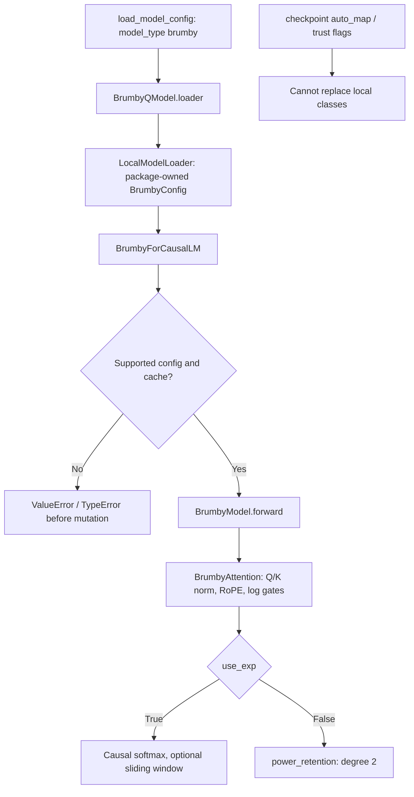
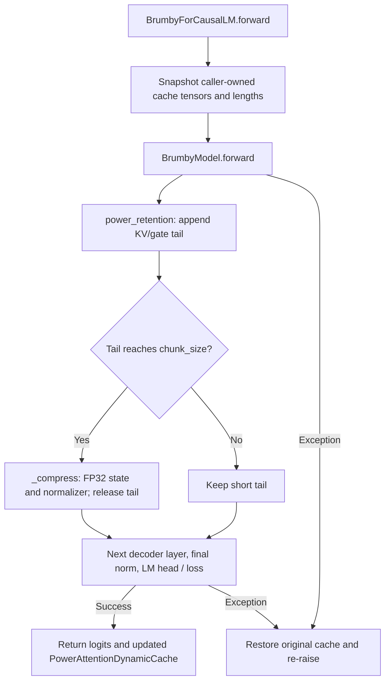

<!-- SPDX-FileCopyrightText: 2026 ModelCloud.ai -->
<!-- SPDX-License-Identifier: Apache-2.0 -->

# Brumby local implementation

GPT-QModel owns the config and model selected by `BrumbyQModel.loader`.
Checkpoint `auto_map`, Python files, and API trust flags cannot replace these
classes. Transformers 5.23.0 has no native `brumby` config or causal-LM mapping.

## Inspected sources

The authoritative publisher is Manifest AI. The existing repository test's
`/monster/data/model/Brumby-14B-Base` directory was unavailable; public publisher
sources and safetensors indexes were retrieved without downloading weight shards
or executing checkpoint Python.

| Source | Pinned revision | Inspected material |
| --- | --- | --- |
| [manifestai/Brumby-14B-Base](https://huggingface.co/manifestai/Brumby-14B-Base/tree/8f162fefd95848f900b1ab743bb7d0a4c46d3adb) | `8f162fefd95848f900b1ab743bb7d0a4c46d3adb` | config, configuration/modeling Python, model card, safetensors index |
| [manifestai/Brumby-4B-Base](https://huggingface.co/manifestai/Brumby-4B-Base/tree/b61e8c4400852d19ba4399829d1085b4995a5345) | `b61e8c4400852d19ba4399829d1085b4995a5345` | config, configuration/modeling Python, safetensors index |
| [ModelCloud/Brumby-14B-Base-GPTQMODEL-W4A16-v2](https://huggingface.co/ModelCloud/Brumby-14B-Base-GPTQMODEL-W4A16-v2/tree/4dc5b668cbe607c4f56e79d50c5176be50fc1bba) | `4dc5b668cbe607c4f56e79d50c5176be50fc1bba` | config, configuration/modeling Python, model card |
| [retention 1.0.7](https://pypi.org/project/retention/1.0.7/) | wheel SHA256 `e36947b701e6bc44415f0f19021a8b709e25ed3646b97721e1162830d446e236` | `power_retention_maker.py`, `_attention/reference.py`, `_update_state/reference.py`, `_query_state/reference.py`, `_utils.py`, license |

The publisher Python files and model card are Apache-2.0 licensed; the retention
wheel also includes Apache-2.0. Original Hugging Face, NVIDIA and Manifest AI
copyright notices are retained in the adapted files. The complete Apache license
is distributed in this repository at `licenses/LICENSE.apache`.

| Publisher file | SHA256 |
| --- | --- |
| 14B `configuration_brumby.py` | `ff1e6ffc7cfd5a4790aa18e32c6306ef2a959efa9fef5cb8023cc682bb1938be` |
| 14B `modeling_brumby.py` | `e99ca25291c4ee505d437f30259b90767366615b3a4b76b1cf3353d2e522edd7` |
| 14B `model.safetensors.index.json` | `5c55e8ad99cee30db7a5ec84f814028da49f9bdeefb43203eebefe3ec9e6f2a0` |
| 4B `configuration_brumby.py` | `59fab1db0b1e99cc80557b4d23bdd9b951b160a22032d5dea060fdfc4f0d9553` |
| 4B `modeling_brumby.py` | `1c56f189f39f4c4ce958c7110339d15b26f504512bdae27a395890cfcc803098` |
| 4B `model.safetensors.index.json` | `b23f37688880ae2bc8029e70a6ca48ed5b63b492ac9f6f65017fb06d1c5f63ce` |

## Architecture and port adaptations

The port preserves the publisher's parameter paths, RMS normalization, Q/K
per-head normalization, GQA head arrangement, RoPE, sigmoid log gates, gated
degree-2 retention and SwiGLU. The 14B model has hidden width 5120, 40 query
heads, 8 KV heads, head width 128 and 40 layers. The 4B model has hidden width
2560, 32 query heads, 8 KV heads, head width 128 and 36 layers: projected Q
width is **4096**, so substituting a hidden-width attention implementation would
be incorrect. The safetensors indexes contain exactly 483 and 435 weight keys,
respectively; both match full-size meta `state_dict()` inventories.

The optional retention/Triton dependency is replaced by portable Torch math;
there is no checkpoint import or kernel download. Local scores implement the
publisher's log-domain degree-2 quadratic attention formula with causal masking
and gate discounts. At `chunk_size` boundaries a symmetric-square feature map
compresses the KV tail into FP32 state and normalizer. Triangular off-diagonals
carry weight two, giving `(q @ k)**2` with `d*(d+1)/2` features. This basis is
equivalent to the publisher's redundant blocked expansion; floating-point
accumulation and the reference's small log/normalizer epsilons can differ across
the compression boundary. No bitwise CUDA-kernel parity is claimed.

The source's 4B config class defaults `chunk_size=64`, while its saved config
omits this field. The local class uses the 14B default 512 for either size;
`chunk_size` is an explicit config control for state compression, and `None`
keeps a quadratic KV tail. It changes floating-point accumulation/performance,
not the degree-2 model architecture. `switch_over_seq_len` and
`prefill_chunk_size` remain readable checkpoint metadata; no retention kernel is
selected from them. HF generation's separately supplied `prefill_chunk_size`
argument is supported without silently enabling it from old kernel metadata.

The publisher's optional `use_exp=True` branch uses ordinary eager softmax
attention, including configured sliding windows. In the power-retention branch,
the publisher does not apply a sliding window; this behavior is retained.
Padding keys are excluded and padding positions do not decay the recurrent
state. Cache continuation accepts multiple tokens and reads compressed state,
whereas the publisher's multi-token prefill branch omits an existing state.
Requests own their caches; failures during decoder execution restore all prior
cache tensors and lengths. Cache reset, beam reorder and batch selection include
the gates and compressed state. KV-only/static/offloaded caches and speculative
rollback are explicitly unsupported.

RoPE uses current config-owned `rope_parameters`, accepts legacy `rope_scaling`,
and rebuilds nonpersistent frequencies during HF meta-buffer materialization.
Generation creates the retention cache before HF chunked prefill and keeps
`use_cache=False` available. Saving uses the normal HF safetensors writer;
no runtime cache or rotary buffers become checkpoint weights.

## AWQ policy and fusion

**Plain quantization only** for both publisher layouts and the bias/softmax
configurations. No scale-search or norm-fold groups are emitted. The input norm
feeds Q, K, V **and the non-quantized retention gate**; Q/K then pass through
per-head normalization and rotary transforms before the recurrent operation.
The existing attention replay objective is not qualified for this complete
relationship. Post-attention norm feeds both SwiGLU inputs, but the definition
conservatively disables all folding until native replay is qualified.

Tests execute real CPU AWQ quantization/packing with both `fallback=None` and
`fallback={}`. Every supported projection (Q/K/V/O, MLP gate/up/down) becomes an
`AwqTorchLinear`; dense norms and the retention gate retain their checkpoint
values. This is an architecture-level empty-group policy, not a swallowed
scale-search failure. Fusion remains unqualified.

## Validation scope

`tests/test_brumby_local_port.py` uses real CPU models and an independent FP64
quadratic attention/full-model functional oracle, FP32/FP16/BF16 arithmetic,
compression boundaries, GQA/MHA, padding, exp/power variants, cache failure/retry,
generation and safetensors round trips. It tests malicious `auto_map` with all
four combinations of API trust and the existing security bypass flag.
`tests/module_tree/test_brumby_local_port.py` checks both full-size meta layouts,
actual checkpoint-owned `state_dict()` entries, GPTQ/AWQ plan consumers, explicit
dense tags and role metadata. No remote implementation executes in these tests.

The CPU suite does **not** qualify GPU kernels, full-size inference memory or
performance, trained-checkpoint generation/perplexity, or training/backward
behavior. The local `/monster` checkpoint and GPUs were unavailable. Retention
CUDA/Triton acceleration, arbitrary static/offloaded caches, speculative decoding
and fusion need separate qualification before being advertised.

## Loading and cache flow

Before this port, `BrumbyQModel.require_trust_remote_code` and
`before_model_load_requires_remote_code` selected checkpoint Python, the
definition's `before_model_load` imported and patched its rotary class, and
`after_model_load` disabled caching. The definition now declares
`LocalModelLoader` and an empty AWQ scaling map. Central loader/security diagrams
and README links are maintained by the integrator.

