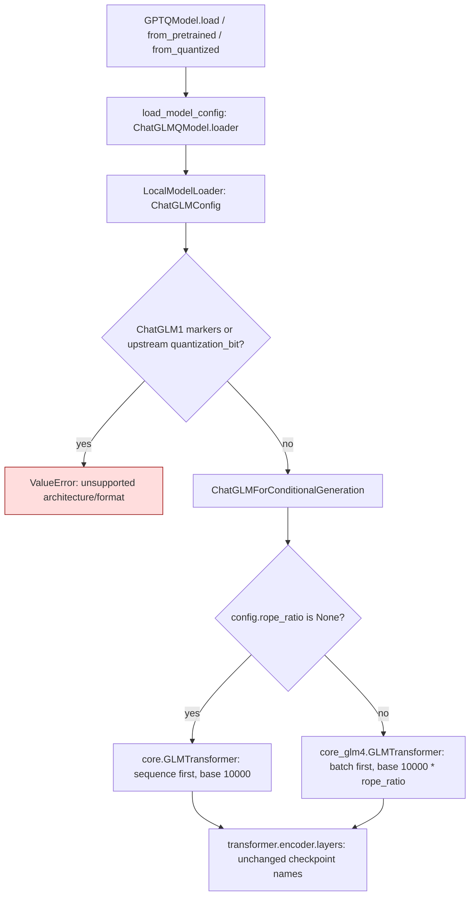
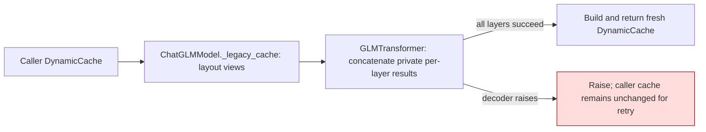

<!-- SPDX-FileCopyrightText: 2026 ModelCloud.ai -->
<!-- SPDX-License-Identifier: Apache-2.0 -->

# ChatGLM local selection and cache ownership

The definition selects package-owned classes before model construction.
Neither caller trust nor the existing security bypass can return a local-owned
ChatGLM checkpoint to checkpoint-Python discovery. Decoder parameter ownership
still follows `transformer.encoder.layers`.



| Before (base commit 22bea1201) | After |
| --- | --- |
| `definitions/chatglm.py:13-14`: remote trust and monkeypatch required | `ChatGLMQModel.loader`: package-owned config/model |
| `definitions/chatglm.py:33-85`: disable cache, replace remote generation hook globally | Standard `GenerationMixin` with `DynamicCache` continuation |
| `definitions/chatglm.py:94` onward: monkeypatch remote forward | Package-owned causal-LM forward and explicit architecture rejection |
| Unqualified default AWQ relationships | Explicit empty scaling groups, tested plain quantization |



The tests exercise both layouts, FP32/FP16/BF16 numerical equations against an
independent functional oracle, left padding, explicit position IDs, MQA and
ordinary attention, norm/bias/residual variants, full vs incremental logits,
cached/uncached/beam generation, continuation, reordering and failed-forward
retry, prefix tuning, safetensors round trips and real plain-AWQ save/reload.
Public security tests use poisoned `auto_map` under all four trust/bypass
combinations, and reject original ChatGLM1 through all three public entry points.
The meta-model audit compares full official configs against every index key,
then verifies each decoder owner and quantized/non-quantized module-plan tag.

Run from `tests/` with the isolated Transformers 5 interpreter:

```bash
PYTHON_GIL=0 /home/ubuntu/.venvs/gptqmodel-tf5/bin/python -m pytest -q \
  test_chatglm_local_port.py module_tree/test_chatglm_local_port.py \
  module_tree/test_registered_module_plans.py
```

Runtime qualification uses Python 3.14t, Torch 2.15.0 CPU and Transformers 5.23.0.
See [provenance and limits](PROVENANCE.md) for the source pins and untested
GPU/trained-checkpoint boundaries. Shared loader/security and central reference
documentation are integrated by the parent change in PR #4620.

Measured final port/registry result: **540 passed**, including 48 independent
numerical layout/dtype/norm cases and eight real plain-AWQ quantize/reload cases.
The shared AWQ/onboarding baseline returned **574 passed, 3 skipped**:
`test_awq_scale_search_safety.py test_awq_moe_router_scaling.py
test_awq_empty_groups.py test_awq_position_kwargs.py
test_awq_scale_search_memory.py test_bloom_awq_replay.py
module_tree/test_awq_relationships.py module_tree/test_bloom_awq_relationships.py
module_tree/test_registered_module_plans.py module_tree/test_definition_subset_ordering.py`.
The additional `test_awq_scaling_groups.py` baseline returned **100 passed,
6 skipped** (unavailable checkpoint fixtures and families excluded from its
buildable CausalLM inventory).
Baseline passes do not qualify ChatGLM scale folding; the port's policy remains
plain quantization. Ruff on all changed Python paths and `git diff --check`
also passed.

## Regression evidence

The public consumer regression was run with the original definition from base
commit `22bea1201` substituted into both real definition registries in-process.
The local modeling code and shared security policy were unchanged. All eight
`test_chatglm_public_load_ignores_checkpoint_python` variants failed: the old
definition either required checkpoint Python or executed the deliberately
poisoned test fixture when both trust and bypass were enabled. Reproduction
from `tests/` (does not change the worktree):

```python
import subprocess
import sys
from pathlib import Path

sys.path.insert(0, str(Path.cwd().parent))
import pytest
import gptqmodel.models.auto as registry

source = subprocess.check_output(
    ["git", "show", "22bea1201:gptqmodel/models/definitions/chatglm.py"], text=True
)
namespace = {
    "__name__": "gptqmodel.models.definitions.chatglm_before_port",
    "__package__": "gptqmodel.models.definitions",
}
exec(compile(source, "chatglm_before_port.py", "exec"), namespace)
registry.MODEL_MAP["chatglm"] = namespace["ChatGLMQModel"]
registry.MODEL_MAP_CASEFOLD["chatglm"] = namespace["ChatGLMQModel"]
sys.exit(pytest.main([
    "-q", "test_chatglm_local_port.py", "-k", "public_load_ignores_checkpoint_python"
]))
```

Without the original-definition substitution, all eight variants pass. This
checks real public loading, not a mocked loader return.

The additional state-transition regression
`test_chatglm_checkpointed_training_disables_cache_and_backpropagates` failed
for both layouts before moving `presents` initialization below the checkpointing
cache-disable guard: it returned `DynamicCache(layers=[])` despite disabling
cache. Both now return no cache and backpropagate finite nonzero QKV gradients.

The two corresponding existing `tests/models/test_chatglm.py` compatibility
nodes were also collected and run. Their inherited `ModelTest.setUpClass`
skips because `/monster/data/model/chatglm3-6b` is absent; those skips are not
runtime proof. The independent port suite runs the actual tiny/meta models
without that external directory. No trained-checkpoint or accelerator result
is inferred from it.
