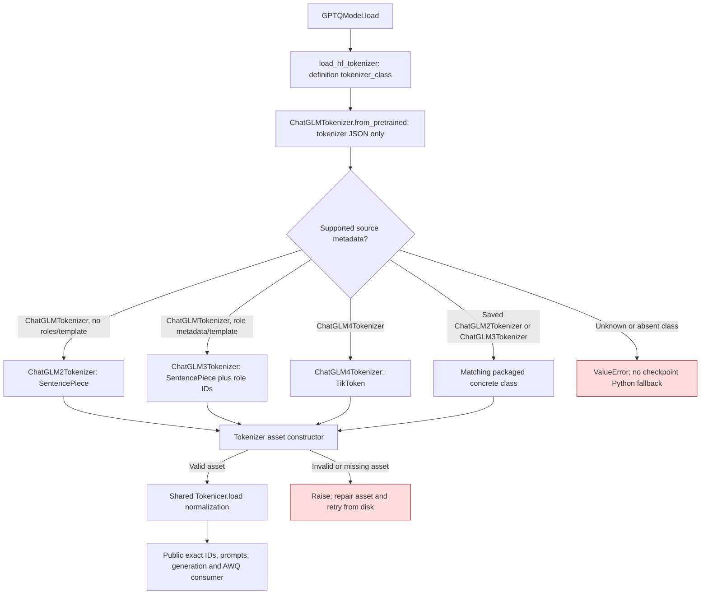
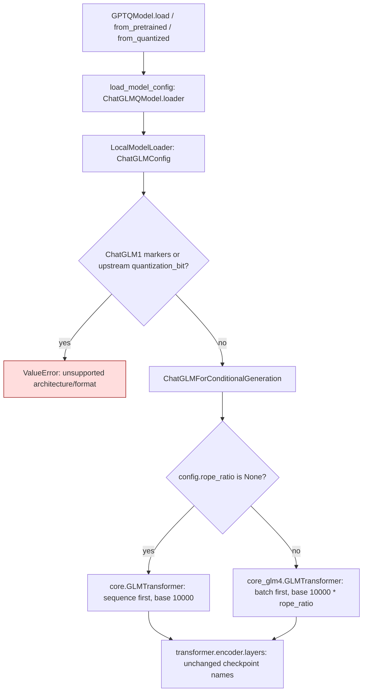
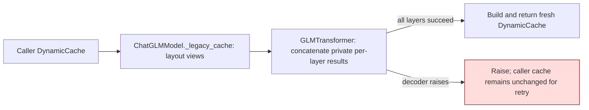
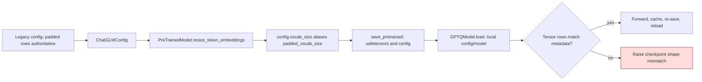
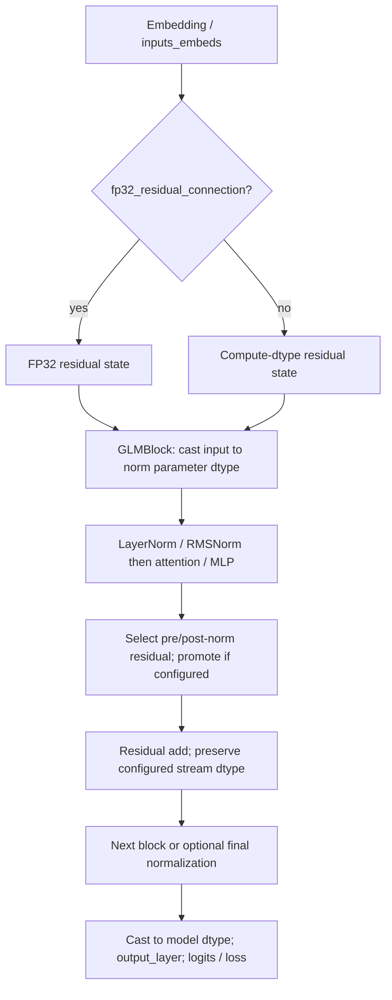

<!-- SPDX-FileCopyrightText: 2026 ModelCloud.ai -->
<!-- SPDX-License-Identifier: Apache-2.0 -->

# ChatGLM local selection and cache ownership

The definition selects package-owned classes before model construction.
Neither caller trust nor the existing security bypass can return a local-owned
ChatGLM checkpoint to checkpoint-Python discovery. Decoder parameter ownership
still follows `transformer.encoder.layers`.

## Released tokenizer selection

`ChatGLMQModel.loader.tokenizer_class` owns GLM2/3/4 tokenization as well as
model selection. JSON and vocabulary files remain checkpoint data; neither
checkpoint Python nor a generic tokenizer-json substitution defines behavior.
This closes the released-asset failure that synthetic WordLevel fixtures did
not exercise.



| Before tokenizer follow-up at `0fdfd2396` | After |
| --- | --- |
| `definitions/chatglm.py:14-17`: config/model only | Declared package tokenizer dispatcher in the same `LocalModelLoader` |
| `utils/hf.py:2819-2835`: no declared ChatGLM tokenizer, Tokenicer class discovery | Metadata selects one of three inspected package classes, no class discovery |
| TF5 lacks `ChatGLMTokenizer`/`ChatGLM4Tokenizer` | Original released tokenizer configs/assets load with trust disabled |
| Upstream SP `get_vocab` enumerated display strings and dropped control entries | Actual SP pieces plus command IDs preserve assistant/observation ownership |
| Synthetic WordLevel tests missed released behavior | SHA-checked real assets with source-derived token, chat and special-token contracts |

The public tokenizer regression
`test_chatglm_released_tokenizer_public_load` covers three releases across
trust `None`/`False`/`True` and the existing bypass absent/present: **18 cases**.
Every case loads a real tiny decoder with the released vocabulary width and
real tokenizer config/model assets, checks five source-derived text cases,
padded batches, specials and prompts, then compares dense forward logits and
generates two tokens. GLM3 additionally checks tool/history construction and
fixed assistant/observation IDs; a separate real-asset test checks literal
system/observation commands with `encode_special_tokens=True`. Model and
tokenizer checkpoint Python contain execution sentinels which remain absent.

`test_chatglm_released_tokenizer_roundtrip_retry` corrupts each release's
tokenizer asset, verifies failure without executing Python, restores the exact
asset, and retries. It then saves/loads/re-saves/reloads the tiny safetensors
model and owned tokenizer through `GPTQModel.load`, with exact asset hashes,
token/chat parity, logits and one shared outer Tokenicer normalization per
successful public load. `test_chatglm_released_tokenizer_plain_awq_roundtrips`
uses real source text IDs for calibration, packs all eight decoder linears
with `fallback=None`, and checks two quantized safetensors cycles, exact packed
and excluded dense state, source token/chat parity and once-only normalization.
The existing tiny-vocabulary resizing/dtype tests use real SP assets with
explicit integer inputs; those do not claim release-specific text semantics.

Tokenizer red evidence before binding: **18 failures** in 9.84s, all the intended
unavailable `ChatGLMTokenizer`/`ChatGLM4Tokenizer` error. Initial public-load green:
**18 passed** in 9.15s. A stronger source chat oracle caught the TF5 vocabulary
collision; restoring only old SP `get_vocab` in memory makes all six GLM3
public matrix cases fail exact chat IDs (**6 failed**, 2.16s). Package files are
not rewritten by that control. The literal-command save/reload regression
also failed before retaining `encode_special_tokens` in constructor metadata:
the reloaded system command became ordinary text IDs (**1 failed**, 3.40s).
Unknown tokenizer classes fail closed in three
additional cases. Full model/module sibling rerun, excluding the three shared
once-only normalization checks while the parent adapter is pending:
**261 passed, 3 deselected** in 23.15s.

Parent prerequisite `0fdfd2396` called Tokenicer twice on public loading. The
new three dense and three quantized roundtrip tests require one call and exposed
that shared adapter defect. The parent-authorized shared prerequisite preserves
the helper's default native return contract, carries its existing wrapper
internally with `return_tokenicer=True`, and lets `BaseQModel` reuse it. The six
tests now pass (**6 passed**, 11.60s), including both dense safetensors cycles,
both AWQ packed-state cycles and repaired-asset retries. No model-local marker
or normalization shim is used. Shared adapter integration remains parent-owned.

Final combined run with released Tokenicer **0.0.17**: **780 passed, no skips
or deselections**, 31.46s. This includes the complete owned ChatGLM/model-plan
suite, registry-plan contract, local model/processor loaders, trust isolation
and local-path security tests:

```bash
# From tests/:
PYTHON_GIL=0 /home/ubuntu/.venvs/gptqmodel-tf5/bin/python -m pytest -q \
  test_chatglm_local_port.py module_tree/test_chatglm_local_port.py \
  module_tree/test_registered_module_plans.py test_local_model_loading.py \
  test_local_processor_loading.py test_trust_remote_code_isolation.py \
  test_local_model_paths.py
```

`format/check.sh` passed the complete repository gate with Ruff **0.14.2**.
Compileall, package discovery and `git diff --check` also passed.
The identical complete command with source-qualified Tokenicer **0.0.19** at
`c14e1c8c062c7b7cc9a981054366f98bde015fa1` also passed: **780 passed, no skips
or deselections**, 31.36s. This candidate is unreleased; it supplies the shared
`prepare_load_kwargs` API for parent integration. No ChatGLM normalization shim
is needed with either tested Tokenicer version.

Source/assets and runtime versions are recorded in
[tokenizer provenance](PROVENANCE.md#released-tokenizer-ownership). The
tokenizer contracts and tests require SentencePiece and TikToken; parent owns
their central dependency and package-data declarations.

## Model and cache selection



| Before (base commit 22bea1201) | After |
| --- | --- |
| `definitions/chatglm.py:13-14`: remote trust and monkeypatch required | `ChatGLMQModel.loader`: package-owned config/model |
| `definitions/chatglm.py:33-85`: disable cache, replace remote generation hook globally | Standard `GenerationMixin` with `DynamicCache` continuation |
| `definitions/chatglm.py:94` onward: monkeypatch remote forward | Package-owned causal-LM forward and explicit architecture rejection |
| Unqualified default AWQ relationships | Explicit empty scaling groups, tested plain quantization |



The tests exercise both layouts, FP32/FP16/BF16 numerical equations against an
independent functional oracle, left padding, explicit position IDs, MQA and
ordinary attention, norm/bias/residual variants, full vs incremental logits,
cached/uncached/beam generation, continuation, reordering and failed-forward
retry, prefix tuning, safetensors round trips and real plain-AWQ save/reload.
Public security tests use poisoned `auto_map` under all four trust/bypass
combinations, and reject original ChatGLM1 through all three public entry points.
The meta-model audit compares full official configs against every index key,
then verifies each decoder owner and quantized/non-quantized module-plan tag.

Run from `tests/` with the isolated Transformers 5 interpreter:

```bash
PYTHON_GIL=0 /home/ubuntu/.venvs/gptqmodel-tf5/bin/python -m pytest -q \
  test_chatglm_local_port.py module_tree/test_chatglm_local_port.py \
  module_tree/test_registered_module_plans.py
```

Runtime qualification uses Python 3.14t, Torch 2.15.0 CPU and Transformers 5.23.0.
See [provenance and limits](PROVENANCE.md) for the source pins and untested
GPU/trained-checkpoint boundaries. Shared loader/security and central reference
documentation are integrated by the parent change in PR #4620.

Measured final port/registry result after vocabulary/residual follow-up:
**658 passed** in 12.85s, including the original 48 independent numerical
layout/dtype/norm cases and eight real plain-AWQ quantize/reload cases, plus
118 resize/residual regressions and controls described below.
The shared AWQ/onboarding baseline returned **574 passed, 3 skipped**:
`test_awq_scale_search_safety.py test_awq_moe_router_scaling.py
test_awq_empty_groups.py test_awq_position_kwargs.py
test_awq_scale_search_memory.py test_bloom_awq_replay.py
module_tree/test_awq_relationships.py module_tree/test_bloom_awq_relationships.py
module_tree/test_registered_module_plans.py module_tree/test_definition_subset_ordering.py`.
The additional `test_awq_scaling_groups.py` baseline returned **100 passed,
6 skipped** (unavailable checkpoint fixtures and families excluded from its
buildable CausalLM inventory).
Baseline passes do not qualify ChatGLM scale folding; the port's policy remains
plain quantization. Ruff on all changed Python paths and `git diff --check`
also passed.

## Regression evidence

The public consumer regression was run with the original definition from base
commit `22bea1201` substituted into both real definition registries in-process.
The local modeling code and shared security policy were unchanged. All eight
`test_chatglm_public_load_ignores_checkpoint_python` variants failed: the old
definition either required checkpoint Python or executed the deliberately
poisoned test fixture when both trust and bypass were enabled. Reproduction
from `tests/` (does not change the worktree):

```python
import subprocess
import sys
from pathlib import Path

sys.path.insert(0, str(Path.cwd().parent))
import pytest
import gptqmodel.models.auto as registry

source = subprocess.check_output(
    ["git", "show", "22bea1201:gptqmodel/models/definitions/chatglm.py"], text=True
)
namespace = {
    "__name__": "gptqmodel.models.definitions.chatglm_before_port",
    "__package__": "gptqmodel.models.definitions",
}
exec(compile(source, "chatglm_before_port.py", "exec"), namespace)
registry.MODEL_MAP["chatglm"] = namespace["ChatGLMQModel"]
registry.MODEL_MAP_CASEFOLD["chatglm"] = namespace["ChatGLMQModel"]
sys.exit(pytest.main([
    "-q", "test_chatglm_local_port.py", "-k", "public_load_ignores_checkpoint_python"
]))
```

Without the original-definition substitution, all eight variants pass. This
checks real public loading, not a mocked loader return.

The additional state-transition regression
`test_chatglm_checkpointed_training_disables_cache_and_backpropagates` failed
for both layouts before moving `presents` initialization below the checkpointing
cache-disable guard: it returned `DynamicCache(layers=[])` despite disabling
cache. Both now return no cache and backpropagate finite nonzero QKV gradients.

The two corresponding existing `tests/models/test_chatglm.py` compatibility
nodes were also collected and run. Their inherited `ModelTest.setUpClass`
skips because `/monster/data/model/chatglm3-6b` is absent; those skips are not
runtime proof. The independent port suite runs the actual tiny/meta models
without that external directory. No trained-checkpoint or accelerator result
is inferred from it.

## Vocabulary and residual state transitions

`ChatGLMConfig.attribute_map` makes `vocab_size` an alias of the physical
`padded_vocab_size`. HF resize updates that same field, including padding to
a multiple, so save/reload reconstructs the actual embedding and output rows.
Older metadata with a smaller logical `vocab_size` still loads its explicitly
padded rows unchanged. This follows the generic HF resize lifecycle without
adding a separate resize override.



FP32 residual state is independent from compute precision. Both `GLMBlock`
implementations cast normalization inputs to actual norm parameter dtype.
Attention and MLP outputs are added to FP32 residual values when configured,
including post-layernorm residual selection. Final normalization, when enabled,
also consumes its parameter dtype; the language head receives the model compute
dtype even when final normalization is disabled.



| Before (port commit a0e09844c) | After |
| --- | --- |
| `configuration_chatglm.py:48,73-74`: independent vocabulary fields; resize leaves stale padded rows | `configuration_chatglm.py:11-15,52-55,80`: one physical field, HF alias, legacy padded precedence |
| `core.py:424-455`, `core_glm4.py:451-482`: FP32 residual reaches low-precision norms/projections | `core.py:424-464`, `core_glm4.py:451-491`: norm compute casts and explicit FP32 residual promotion |
| `modeling_chatglm.py:237-238`: FP32 unnormalized state reaches low-precision language head | `modeling_chatglm.py:237-241`: explicit model-compute cast |

The added regressions ran before modifying those production files: **44 failed,
65 passed** in 9.82s. Twelve resize cases failed at actual tensor shape loading,
and 32 FP16/BF16 FP32-residual cases failed at real normalization/QKV dtype
boundaries. FP32 and disabled-FP32-residual sibling controls passed. After the
fix, the same command returned **109 passed, 101 deselected** in 4.97s:

```bash
PYTHON_GIL=0 /home/ubuntu/.venvs/gptqmodel-tf5/bin/python -m pytest -q \
  test_chatglm_local_port.py \
  -k 'public_resize or legacy_logical_vocab or fp32_residual_compute'
```

The final suite additionally exercises the legacy padded control through public
loading for both layouts and adds eight public low-precision load tests:

| Test node | Verified transition |
| --- | --- |
| `test_chatglm_public_resize_safetensors_reload_resave` (12 cases) | Both layouts, tied/untied head, shrink/grow/pad, preserved rows, public poisoned-config loading, logits/cache equivalence, re-save/reload with exact tensors |
| `test_chatglm_legacy_logical_vocab_does_not_shrink_padded_checkpoint` (2 cases) | Legacy logical 31 / physical 64 through public load, exact weight preservation and no-op resize |
| `test_chatglm_fp32_residual_compute_dtype_oracle_and_cache` (96 cases) | Both layouts; FP32/FP16/BF16; LayerNorm/RMSNorm; pre/post-norm residual; final norm on/off; FP32 residual on/off; independent functional logits/loss oracle, QKV/residual dtypes, continuation, inputs_embeds |
| `test_chatglm_public_load_fp32_residual_dtype_roundtrip` (8 cases) | FP32 saved weights loaded as FP16/BF16 through GPTQModel, both norms/layouts, no final norm, poisoned config, exact cast tensors/logits, cached/uncached generation, finite nonzero backward gradients, safetensors re-save/reload |

The complete command earlier on this page returned **658 passed, no skips**.
Ruff on the port and owned test paths plus `git diff --check` passed.
These are CPU results; they do not qualify GPU concurrency or trained-model
quality. Shared files, definition/registry fixtures and PR state are unchanged
by this follow-up.
