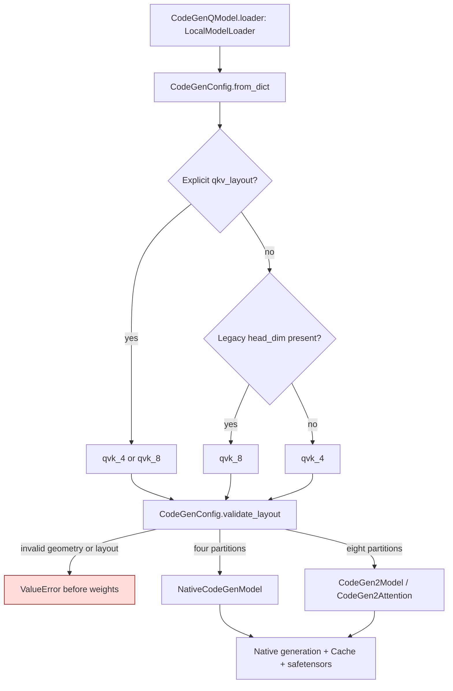

<!-- SPDX-FileCopyrightText: 2026 ModelCloud.ai
SPDX-License-Identifier: Apache-2.0 -->

# CodeGen checkpoint layout compatibility

GPT-QModel owns CodeGen config/model selection through `CodeGenQModel.loader`.
The package uses current native Transformers CodeGen for four-partition models,
and ports Salesforce's eight-partition Q,V,K attention for CodeGen2 1B/3.7B.
No checkpoint Python is imported, including when trust and the existing security
bypass are both enabled. There is no global Hugging Face class registration.

## Authoritative sources and license

The table lists inspected `config.json` revisions. For every CodeGen2 row,
`modeling_codegen.py` was also inspected at that exact revision. The small
`upstream_configs.json` file preserves **structural excerpts**, not the complete
upstream configs. The CodeGen1 control uses the native Transformers model.

| Salesforce repository | Pinned revision | Legacy `head_dim` | Q,V,K partitions |
| --- | --- | --- | --- |
| [codegen-350M-mono](https://huggingface.co/Salesforce/codegen-350M-mono/tree/d9107f71cca463240db1143f4a75a927a27fcb27) | `d9107f71cca463240db1143f4a75a927a27fcb27` | absent | 4, native |
| [codegen2-1B_P](https://huggingface.co/Salesforce/codegen2-1B_P/tree/47f05cd3c1b357745fbead74202fc1efe87b6d25) | `47f05cd3c1b357745fbead74202fc1efe87b6d25` | 128 | 8 |
| [codegen2-3_7B_P](https://huggingface.co/Salesforce/codegen2-3_7B_P/tree/2999b8fc740371db5923ef6f8ec1b74cfb9b4900) | `2999b8fc740371db5923ef6f8ec1b74cfb9b4900` | 256 | 8 |
| [codegen2-7B_P](https://huggingface.co/Salesforce/codegen2-7B_P/tree/b3d2f281d860402d5e7acc3c2c466098ccc0b482) | `b3d2f281d860402d5e7acc3c2c466098ccc0b482` | absent | 4, native |
| [codegen2-16B_P](https://huggingface.co/Salesforce/codegen2-16B_P/tree/14bcc89999feb32d9ee3c51388aa4d8ac134124d) | `14bcc89999feb32d9ee3c51388aa4d8ac134124d` | absent | 4, native |

Upstream authors: **Salesforce authors, The EleutherAI, and HuggingFace Teams**,
Copyright 2022. The upstream source and adaptations use Apache-2.0; the license
notice is retained in `modeling_codegen.py`. Upstream attention partitions
fused rows in Q,V,K order at `CodeGenAttention.forward` (lines 198–211).
The two eight-partition sources are byte-identical with SHA-256
`63d12bd7d29969780b44702c6cf75d8a2faccbdc1e8727916eab65ae79bb472f`.
The two four-partition CodeGen2 sources are byte-identical with SHA-256
`d6e01345b18e5493ccd18d5b2c6fcdd4c75d28a1ba3f09c49a1a498de97e1052`.
Their only source difference from the eight-partition implementation is
`mp_num = 4` and its adjacent TPU-v4 comment.

The runtime adapter was validated against Transformers **5.23.0**, whose
installed `models/codegen/modeling_codegen.py` has SHA-256
`21e7cb672eb94dfe4a57d957e6cb71320a7a590190af2ffebeed3250b63fe57f`.
It reuses native cache, masking, parallel-residual block forward, MLP, model
forward, generation, initialization and safetensors saving/loading APIs.
The local eight-partition forward preserves Salesforce's scaling **before**
the additive attention mask and uses `Cache.update` with native layer indices.
No row conversion occurs at load/save time, including for quantized QKV.

## Config contract and loading flow

`qkv_layout="qvk_4"` or `"qvk_8"` is the explicit, serialized checkpoint
layout. Without this migration field, the audited legacy `head_dim` metadata
selects eight partitions when present and four when absent. A supplied
`head_dim` must equal `n_embd / n_head`. Head count must be divisible by the
partition count; hidden size must be divisible by head count. Structural API overrides are merged
before validation; mutated config objects are revalidated before model
construction. Partial and full-head RoPE are supported. Legacy
`rotary_dim=null` canonicalizes to the full head width before native validation.

The native 5.23.0 CodeGen config serializer does not invent `head_dim`. Config
and execution tests independently protect native four-partition behavior.
The repository name, local directory, `auto_map`, `architectures` and trust
flags do not participate in layout selection. A third-party checkpoint that
has stripped or repurposed the legacy metadata must carry explicit
`qkv_layout`; tensor shape alone cannot disambiguate its row ordering. Invalid
or conflicting metadata raises before weight loading. An explicit legacy
`head_dim=null` also requires explicit `qkv_layout` rather than guessing four
partitions. Use GPT-QModel to load
eight-partition checkpoints: direct Transformers AutoModel does not understand
this package's layout metadata.



| Mechanism | Before (base `22bea1201`) | Now |
| --- | --- | --- |
| Definition selection | `definitions/codegen.py:9`, no owned loader | `LocalModelLoader` with packaged classes |
| Fused Q,V,K semantics | native 5.23.0 attention hardcodes `mp_num=4` at line 184, silently reinterpreting eight-partition weights | config-owned layout; eight-partition local attention; four-partition native code |
| Legacy config dependency | `tests/models/test_codegen.py:24–33` skips missing Transformers 4 ONNX helpers | packaged config, no ONNX import/skip |
| AWQ source inference | QKV could still be returned as a candidate producer across attention | explicit QKV `:nosrc`; no scaling group, all four linears quantize plainly |

## Checkpoint weight ownership

The pinned 1B `pytorch_model.bin` ZIP's `data.pkl` **was disassembled, never
unpickled**, from a bounded 131072-byte HTTP Range read. It names 149 tensors:
16 layers × (8 parameter tensors + 1 `attn.causal_mask` buffer), plus the input
embedding, final norm weight/bias and LM head weight/bias. Every parameter
keeps its original checkpoint name and shape. The port explicitly ignores
only `transformer.h.<index>.attn.causal_mask` on load: current Transformers
regenerates causal/padding masks from input positions and caller-owned cache.
This deterministic legacy buffer is deliberately omitted from new checkpoints.
The runtime 1B model owns the remaining 133 tensors. Tests assert the complete
tensor inventory for all official sizes and validate legacy-mask loading,
mask causality, cache continuation and output equivalence.

The decoder module plan covers the norm with `:!` and all four supported
projections with quantized tags. Existing central registry blocks remain
unchanged; no alias is added (`model_type=codegen` covers all these layouts).

## AWQ policy

**Plain quantization only**, for both layouts. Source inspection:
`CodeGenBlock.forward` feeds the same `ln_1` result into attention and MLP,
then adds both outputs to the original residual. A norm fold cannot be scored
by an attention-only replay. QKV's output crosses head partitioning, RoPE,
softmax and value mixing before `out_proj`; `out_proj` crosses the residual
boundary before MLP; `fc_in` crosses GELU before `fc_out`. Consequently
`ln_1`, `qkv_proj`, `out_proj` and `fc_in` are all non-sources.
`test_awq_plain_quantization_reaches_every_supported_linear` captures real
activations, then runs the actual `AWQProcessor._quantize_layer` with
`fallback=None`: all four weights change, publish scales/zeros, preserve norm
weights and yield finite model outputs. No guessed fold/search/replay group
is emitted. This qualifies the conservative policy, not GPU kernel packing.

## Qualification and limits

The tiny CPU suites cover independent per-head numerical oracles; multiple
heads per partition; native four-partition parity; partial/full RoPE; distinct
padding masks/positions; multi-token cache continuation and fresh requests;
cached/uncached greedy generation; FP32/FP16/BF16 safetensors save/reload/re-save;
legacy config normalization; explicit config overrides; invalid-config retry;
public `GPTQModel.load` with all trust/bypass combinations; full-size meta
ownership; and actual plain AWQ pseudo-quantization. Malicious config/model
`auto_map` references cannot execute on either branch.

The old numerical behavior is reproduced by substituting native
`CodeGenForCausalLM` in `test_full_model_numerics_and_layout_regression(8, 4, 8)`:
all **410/410** logits fail the independent eight-partition oracle, maximum
absolute difference **0.43965959548950195** (seed 106). The local implementation
passes the same oracle with `rtol=2e-5, atol=2e-7`. Before the QKV `:nosrc` tag,
the plain-policy test fails because a QKV-to-out-projection scaling candidate
survives definition inference; after the tag it runs real plain quantization.
The full public-load matrix also uses the shared tokenizer-config security
preflight: Tokenicer receives the selected packaged config as both `config`
and `model_config`, preventing checkpoint config re-discovery.

Reproduce the combined validation from the repository root:

```sh
PYTHON_GIL=0 /home/ubuntu/.venvs/gptqmodel-tf5/bin/python -m pytest \
  tests/test_codegen_local_port.py tests/module_tree/test_codegen_local_port.py \
  tests/module_tree/test_registered_module_plans.py \
  tests/module_tree/test_definition_subset_ordering.py \
  tests/test_awq_empty_groups.py tests/test_local_model_loading.py \
  tests/test_awq_scaling_groups.py \
  -x -q --tb=short
```

Before-fix probes substituted `NativeCodeGenForCausalLM` into the numerical
test's globals, and removed only `:nosrc` from `CodeGenQModel.module_tree`'s QKV
tag for the AWQ test. Both failed the same tests that pass with the shipped
classes/tags; neither probe imports or executes checkpoint Python.

No trained multi-GB checkpoint evaluation, ARC accuracy run, GPU kernel,
quantized packing/reload or multi-GPU/GIL=0 concurrency qualification is claimed.
The existing model integration test no longer requires remote code or skips
on missing Transformers 4 ONNX helpers; its cached-weight/GPU evaluation still
needs the integration host. All local checks run with `PYTHON_GIL=0`, without
introducing threaded PyTorch calls.
