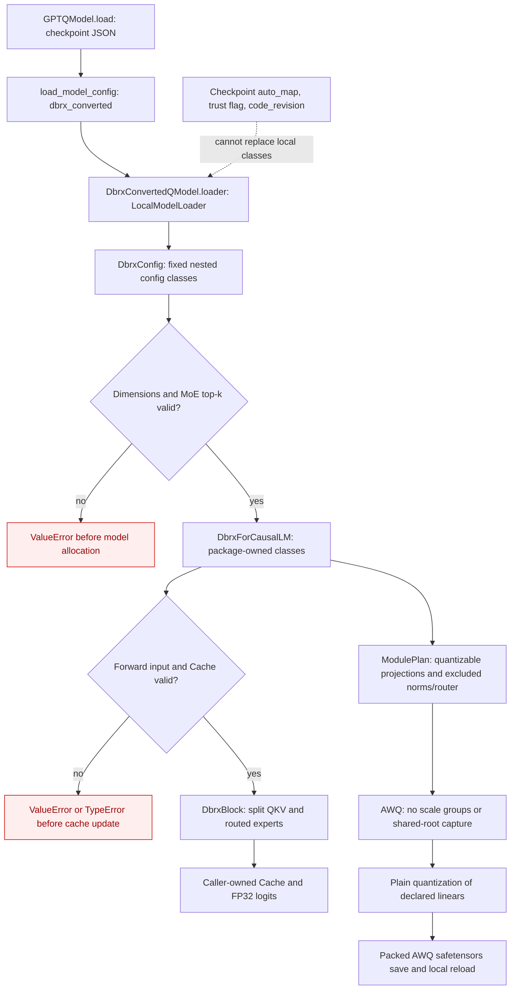

# Converted DBRX Transformers 5 port

This is GPT-QModel's package-owned **converted** DBRX implementation. It is not
the native Transformers `dbrx` architecture: those original checkpoints have
fused QKV and packed expert weights. The converted `dbrx_converted` checkpoints
have separate Q/K/V projections and `ModuleList` experts containing `w1/v1/w2`.
The existing `definitions/dbrx.py` placeholder directs users to ModelCloud's
converted repositories. Transformers 5.23.0 has native `dbrx`, but no
`dbrx_converted` config or causal-LM mapping.

## Pinned source and attribution

| Checkpoint/source | Inspected immutable revision |
| --- | --- |
| [ModelCloud/dbrx-base-converted-v2](https://huggingface.co/ModelCloud/dbrx-base-converted-v2/tree/8ba7c19c8ee5b8d995ea3736cab6fcbf93054d67) | `8ba7c19c8ee5b8d995ea3736cab6fcbf93054d67` |
| [ModelCloud/dbrx-instruct-converted-v2](https://huggingface.co/ModelCloud/dbrx-instruct-converted-v2/tree/8ae889542f05605a028d09286cf9d1f99c50f0eb) | `8ae889542f05605a028d09286cf9d1f99c50f0eb` |

The source files `configuration_dbrx.py`, `modeling_dbrx.py`, `config.json`,
`model.safetensors.index.json`, `LICENSE.txt`, and `NOTICE.txt` were downloaded
as text and inspected, **not imported or executed**. Both source implementations
and both weight indexes are byte-identical; the base/instruct configs differ in
router jitter and explicit/default SiLU activation. No trained tensor shards were
downloaded. Copyright Databricks, Inc.; DBRX is provided under the Databricks Open
Model License. The original [license](LICENSE.txt) and [notice](NOTICE.txt) are
preserved verbatim. The source identifies its rotary and auxiliary-loss equations
as derived from Llama and Mixtral respectively. ModelCloud's changes adapt the
converted implementation to current Transformers APIs and package-local loading.

| Shared upstream file | SHA-256, identical in both revisions |
| --- | --- |
| `configuration_dbrx.py` | `29344455f9fe3ae8a2544b625efa65e6a8e3628ea61d9506bb7f65edb05799dc` |
| `modeling_dbrx.py` | `c4e09b87e52f2df8a8bb0ef569d93e19f066800e61720ac5ddedb2ac16309a18` |
| `model.safetensors.index.json` | `f0fdff8dd07c6a9ac0be7b03c65617422f0e6f13e276b1cb73b90e08cb6693bf` |
| `LICENSE.txt` | `516246c751d9d7fd329f66f7d90f48688aaa5959b6af1bc87ed7bf0d181d8293` |
| `NOTICE.txt` | `bd164c296690cd021db9cd3ba620c151b550c19fc1933c266b3d55adeaf754f1` |

Both published indexes have exactly **2,203** keys. SHA-256 of their sorted keys
joined by `\n` without a trailing newline is
`6cbda8bf37a5d87aa14c21e72ec5f5a2889e11f9a7267828b7d848ef53036b51`.
The module-tree test independently reconstructs this key set and checks a real
meta model. Both full published configs were also instantiated on meta and their
state dictionaries compared directly to the downloaded indexes, without key
conversion. Rotary `inv_freq` is nonpersistent, as in the converted source.

## Adaptation and ownership

- Keep `transformer.wte`, `transformer.blocks`, `transformer.norm_f`, `lm_head`.
- Preserve split attention, clipping, grouped KV heads and full-head rotary.
- Preserve two frozen block norms and the frozen probability-valued router.
- Preserve routed SiLU/GELU experts and configurable top-k/normalization.
- Use current `PreTrainedConfig`, `GenerationMixin`, masking and `Cache` APIs.
- Keep post-rotary keys in caller-owned dynamic or static caches.
- Preserve FP32 LM-head outputs and the source's second auxiliary-loss softmax.
- Restrict auxiliary-loss padding masks to current tokens during continuation.
- Write dense and packed checkpoints as safetensors.

Runtime code imports only package-local config/model classes and installed Torch
and Transformers APIs. It never downloads Python, registers a global HF mapping,
or delegates to checkpoint `auto_map`. Package ownership wins with API trust and
the existing security bypass either enabled or disabled. Tuple caches are
explicitly rejected; use current Transformers cache objects. A supplied cache
with `use_cache=False` is rejected. Auxiliary router-loss output requires a 2D
padding mask; ordinary forward also accepts 4D additive attention masks.

## Definition-owned loading and failure paths

Before/after evidence is relative to the pre-port definition at
`22bea120181e739161ee2969b260fe94f5b4e791`.

| Mechanism | Before | After |
| --- | --- | --- |
| Class selection | `definitions/dbrx_converted.py:10-11` required checkpoint custom code | `definitions/dbrx_converted.py:11-14` declares the exact local config/model |
| Model layout | Checkpoint Python owned split projections and experts | Package code owns those exact weights, without converting to original DBRX |
| AWQ scaling | Inherited generic source inference | `definitions/dbrx_converted.py:22-31` disables unused root capture and all scale groups |
| Cache continuation with auxiliary loss | Full-history padding mask mismatched current router tokens | The LM head slices the auxiliary mask to current tokens; attention still receives full key history |



AWQ is deliberately **plain quantization only**. Clipped QKV and routed expert
fan-out have not been qualified for source folding, scale search or compensation.
No source/consumer relationship is inferred from width or adjacency. The unused
`ffn` shared-root feature capture is disabled because no scaling group consumes
it; retaining it caused public quantization with `fallback=None` to fail on an
empty activation bucket. Module projections still collect their ordinary inputs.
Tests run the real AWQ consumer and public calibration/packing/save/reload, not a
mock quantizer. Router/norm weights remain unquantized. Fusion is unqualified.

## Qualification and limits

The two model-specific suites use real CPU models, an independent dense-expert
Torch oracle, and full-dimension meta models. They cover MQA/GQA/MHA; expert count,
top-k, normalization, uniform assignment and activation variants; left padding and
causality; FP32/FP16/BF16 forward/reload; dynamic/static continuation; greedy/beam
generation; inputs-embeds, loss and tuple outputs; failed-input/cache retry;
simultaneous CPU calls with independent caches; malicious config/model `auto_map`
across all four API-trust/security-bypass combinations; public loading; exact
checkpoint ownership; module-plan flags/MoE families; and plain AWQ packed reload.

Exact commands, run from the repository root with
`/home/ubuntu/.venvs/gptqmodel-tf5/bin/python` (Python 3.14t, Torch 2.15.0+cpu,
Transformers 5.23.0):

```sh
python -s -m pytest tests/test_dbrx_converted_local_port.py tests/module_tree/test_dbrx_converted_local_port.py tests/module_tree/test_registered_module_plans.py -q --tb=short -o log_cli=false
ruff check gptqmodel/models/definitions/dbrx_converted.py gptqmodel/models/ports/dbrx_converted tests/test_dbrx_converted_local_port.py tests/module_tree/test_dbrx_converted_local_port.py
pyright --pythonpath /home/ubuntu/.venvs/gptqmodel-tf5/bin/python gptqmodel/models/ports/dbrx_converted
git diff --check
```

Red evidence: the four `test_definition_owns_config_before_checkpoint_python`
cases fail on the pre-port definition (including actual checkpoint Python
execution in the trust+bypass case). The public tokenizer-discovery trust+bypass
case also exposed the separately repaired shared loader issue. The new
`test_router_aux_loss_with_padded_cache_continuation` fails with a real tensor
shape mismatch before slicing its auxiliary mask to current tokens. Public
`test_plain_awq_public_quantization_and_packed_reload` fails with missing `ffn`
activation features before the model-specific root-capture policy is applied.

Not qualified here: trained 132B checkpoint perplexity/chat quality, GPU kernels,
multi-GPU/offload behavior, GPU GIL=0 concurrency, FlashAttention/SDPA, compiled
execution, AWQ folding/search, fusion, and training/gradient checkpointing. The
ported attention path is eager. No multi-GB trained weights are needed for these
tests, and passing tiny CPU checks does not assert trained-checkpoint quality.
