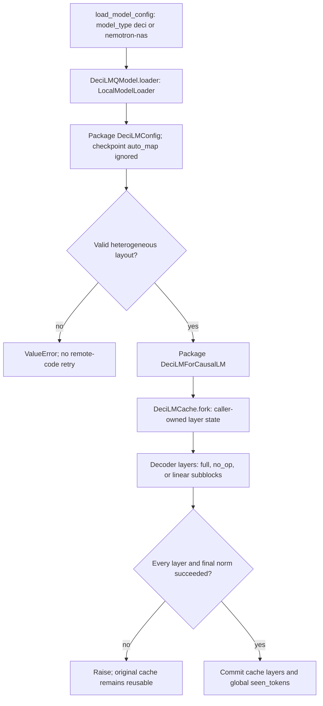

# GPT-QModel DeciLM and Nemotron-NAS modeling

Both `deci` and `nemotron-nas` use the package-owned `DeciLMConfig` and
`DeciLMForCausalLM` through `DeciLMQModel.loader`. Neither has an exact
AutoConfig/AutoModelForCausalLM mapping in the validated Transformers 5.23.0.
Native `nemotron` and `nemotron_h` are different architectures.

## Source provenance and terms

| Source | Pinned revision | Inspected implementation |
| --- | --- | --- |
| [Deci/DeciLM-7B-instruct](https://huggingface.co/Deci/DeciLM-7B-instruct/tree/4adc7aa9efe61b47b0a98b2cc94527d9c45c3b4f) | `4adc7aa9efe61b47b0a98b2cc94527d9c45c3b4f` | `configuration_decilm.py`, `modeling_decilm.py`, bundled Transformers 4.35.2 Llama implementation |
| [nvidia/Llama-3_1-Nemotron-Ultra-253B-v1](https://huggingface.co/nvidia/Llama-3_1-Nemotron-Ultra-253B-v1/tree/5b47def5b8957142d82faeb44bfad9349d02840d) | `5b47def5b8957142d82faeb44bfad9349d02840d` | `configuration_decilm.py`, `modeling_decilm.py`, `block_config.py`, `variable_cache.py`, bundled Transformers 4.44.2 cache implementation |

This is an adaptation to current Transformers APIs, with relative local imports,
current Cache/GenerationMixin integration, and stateless RoPE computation.
It does not load the above Python files at runtime. Code retains Apache 2.0
terms and upstream attribution in LICENSE, NOTICE and source headers.
Deci's model card identifies Apache 2.0. NVIDIA's trained weights are subject to
the [NVIDIA Open Model License](https://www.nvidia.com/en-us/agreements/enterprise-software/nvidia-open-model-license/)
and its model card links the
[Llama 3.1 Community License](https://www.llama.com/llama3_1/license/).
This package includes no trained checkpoint weights.

`checkpoint_contracts.json` records the pinned config and weight-index SHA256s,
key counts, and SHA256 of UTF-8 `"\\n".join(sorted(weight_map))` (no trailing
newline). Its NAS block list losslessly encodes attention group / FFN multiplier
pairs; zero denotes a no-op. All other per-block flags in that released config
are false or null. Tests reconstruct the actual 162-layer architecture on meta
and compare all 647 tensor keys by this independent digest. The Deci checkpoint
similarly matches all 291 keys across 32 layers.

## Local dispatch and cache ownership



| Mechanism | Before | Shipped behavior / evidence |
| --- | --- | --- |
| Model ownership | Definition required checkpoint code; no exact native architecture | `definitions/decilm.py:13-17`: explicit LocalModelLoader and `require_trust_remote_code=False` |
| Heterogeneous module discovery | Inherited Llama paths omitted NAS linear replacements | `definitions/decilm.py:20-27`: `linear_attn` and `linear_mlp`, explicit non-quantized norms |
| Cache lifecycle | Legacy per-layer caches/old HF API | `modeling_decilm.py:68-148,322-367`: package Cache, fork then commit, first-layer pruning supported |
| Shifted sink boundary | Upstream SinkCache shifts when old length + incoming width reaches the window | `modeling_decilm.py:98-132`: preserve strict less-than growth boundary and pinned RoPE re-rotation |
| AWQ scaling | Inherited Llama group assumptions | `definitions/decilm.py:29-32`: no scaling groups; all declared linears use plain AWQ |

The pre-port definition is available at
[22bea1201](https://github.com/ModelCloud/GPTQModel/blob/22bea120181e739161ee2969b260fe94f5b4e791/gptqmodel/models/definitions/decilm.py).
Shared security/dispatch documentation belongs to the integration PR; this
port-local reference supplies the flow and evidence for that page.

## Qualified behavior and limits

- Deci heterogeneous per-layer GQA and NAS full/no-op/linear attention and MLP;
  all nine NAS combinations execute and match independent tensor equations.
- RMSNorm, gated MLP, pretraining TP slicing, default/linear/dynamic/Llama-3 RoPE,
  eager and SDPA attention, CPU FP32/FP16/BF16 cache continuation.
- Sliding and unshifted sink attention use full KV history plus native masks.
  This preserves numerical behavior but uses memory proportional to sequence
  length. Shifted sinks retain and re-rotate the window; initial prefill may
  fill/exceed it, as upstream. Later continuation chunks must be smaller than
  window minus sink count; larger chunks raise instead of silently changing
  sink semantics. Static/compiled/offloaded caches are unsupported.
- Greedy and beam generation, cache reset/reorder, failure after a completed
  layer followed by retry, and corrected-config retry are tested. Model RoPE
  computation stores no mutable per-model frequency cache. Each concurrent
  caller must own its cache; GPU concurrent execution remains unqualified.
- Public GPTQModel.load and LocalModelLoader safetensors reloads ignore malicious
  checkpoint AutoConfig/AutoModel mappings for all four trust/bypass settings.
  Public tokenizer consumption relies on the parent tokenizer security fix.
- AWQ policy is **plain quantization** for both aliases and every layout.
  Producer identity, fold/search/replay safety are unqualified. Tests actually
  calibrate and pack every declared linear with fallback None and {}, preserve
  norms, save safetensors, reload packed weights and compare logits.
- Sparse NAS weights execute as ordinary inference tensors. Sparse training is
  explicitly unsupported. FlashAttention, GPUs, trained-weight generation
  quality and full Deci/Nemotron ARC evaluation were not run.

## Validation and detection evidence

On CPU Torch 2.15.0 / Transformers 5.23.0 / Python 3.14t with PYTHON_GIL=0:

```sh
PYTHON_GIL=0 /home/ubuntu/.venvs/gptqmodel-tf5/bin/python -m pytest \
  tests/test_decilm_local_port.py tests/module_tree/test_decilm_local_port.py \
  -q -x --disable-warnings
```

59 passed. Restoring the legacy AutoModel loader in an isolated Python process
makes all eight `test_public_config_ignores_checkpoint_code` cases fail: the
default policy refuses the unported architecture, and both permissions allow
the test checkpoint's sentinel code to execute. Restoring `<= window` in a
separate process fails
`test_shifted_sink_cache_retention_rerotation_and_reorder` at the tensor
assertion (127/192 mismatched elements; max absolute error 2.6500034).
The shipped strict-boundary implementation passes. Mutation probes never
change the working files.

The 7B/253B key audits use metadata and meta tensors; they are not trained-weight
or accelerator qualification. The existing full model evaluation tests now
use TRUST_REMOTE_CODE=False and retain their external checkpoint requirements.

## Parent-owned registry update

Both aliases already map to DeciLMQModel. Replace only the existing
`cases["DeciLMQModel/gptq"]` value with:

```json
{
  "layers": ["model.layers"],
  "blocks": [
    ["input_layernorm:!"],
    ["self_attn.q_proj", "self_attn.k_proj", "self_attn.v_proj", "self_attn.linear_attn"],
    ["self_attn.o_proj"],
    ["post_attention_layernorm:!"],
    ["mlp.gate_proj", "mlp.up_proj", "mlp.linear_mlp"],
    ["mlp.down_proj"]
  ]
}
```

The model-specific fixture test pins this exact value without editing the
parent-owned registry. Add `deci` and `nemotron-nas` to the central AWQ
plain-quantization family set if that set is present in the integration branch.
