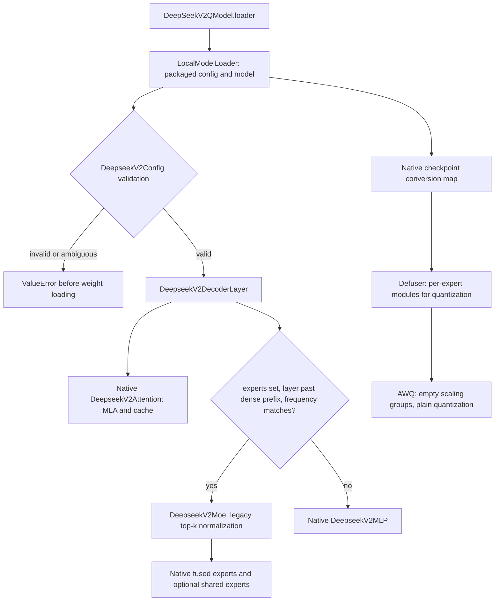

<!-- SPDX-FileCopyrightText: 2026 ModelCloud.ai -->
<!-- SPDX-License-Identifier: Apache-2.0 -->

# GPT-QModel DeepSeek V2 compatibility

The `deepseek_v2` definition selects this package's config and causal LM directly
with `LocalModelLoader`. Neither caller trust nor the security bypass can replace
them with checkpoint Python. No global Transformers registrations are changed.

## Provenance

- Native Transformers 5.23.0 at
  [`52b080b6416a7897e2af90febeb4dfad22b84d19`](https://github.com/huggingface/transformers/tree/52b080b6416a7897e2af90febeb4dfad22b84d19/src/transformers/models/deepseek_v2):
  the config, decoder/model constructors and model API are subclassed/adapted;
  MLA, rotary embeddings, compressed cache, expert execution and generation stay
  native. The installed `modeling_deepseek_v2.py` matched this revision byte for
  byte (SHA256 `8c807b695c6d3835b5035703d6def4a45dfa6296a2b35583064be5f937ee32ec`).
- DeepSeek-Coder-V2-Lite-Instruct at
  [`e434a23f91ba5b4923cf6c9d9a238eb4a08e3a11`](https://huggingface.co/deepseek-ai/DeepSeek-Coder-V2-Lite-Instruct/tree/e434a23f91ba5b4923cf6c9d9a238eb4a08e3a11):
  `configuration_deepseek.py`, `modeling_deepseek.py`, and `config.json` establish
  legacy routing and dense/MoE selection. Inspected as text; never executed.
  Modeling source SHA256:
  `7d8e5221095286eea991137760893fd7ba52727c0b4ebf48ec09e8bc56b45b9c`.
- Both sources use Apache-2.0. Attribution and inherited provenance are preserved
  in [NOTICE](NOTICE) and the Python headers. No checkpoint weights are vendored.

## Architecture and checkpoint contract

Native 5.23 supports the exact DeepSeek V2 MLA architecture. Its documented
configuration, however, types `n_routed_experts` as an integer; its decoder does
not implement legacy periodic `moe_layer_freq`, and its router does not apply
legacy `norm_topk_prob`. This small native-derived implementation preserves:

- Full (`q_lora_rank > 0`) and Lite (`q_lora_rank=None`) Q projections;
  low-rank KV projection, distinct no-position/rotary head widths and compressed
  native KV cache; native RoPE including legacy YaRN metadata.
- A dense MLP when `n_routed_experts=None`. Otherwise a layer is MoE exactly when
  `layer_idx >= first_k_dense_replace` and `layer_idx % moe_layer_freq == 0`.
  Shared experts may be omitted with `n_shared_experts=None`.
- Greedy and group-limited greedy softmax routing. For top-k greater than one,
  `norm_topk_prob=True` normalizes the selected probabilities without routed
  scaling; all other cases multiply by `routed_scaling_factor`, as upstream did.
- Standard dense/checkpoint names and Transformers' fused expert tensor ABI.
  The model's `is_custom_code=False` marker enables the **native serialization
  conversion map** for this ABI. It does not authorize remote code. Safetensors
  round trips and public lazy loading test both fused expert tensors and legacy
  per-expert gate/up/down keys. Defuser exposes per-expert linear modules.

Expert-parallel checkpoints (`ep_size != 1`), non-softmax scoring, unknown top-k
methods, invalid expert/group ranges, nonpositive MoE frequencies and invalid
scaling factors fail explicitly. Load a consolidated all-expert checkpoint.
Other architectural limitations remain those of native Transformers 5.23; this
package does not add new attention kernels or distributed expert execution.

The module plan declares both low-rank norms and the router as nonquantized,
and declares Q/K/V/O and gate/up/down roles. No projection fusion is qualified.
AWQ always uses the existing **plain quantization** fallback: MLA crosses
low-rank normalization and split/expanded attention states, while the MoE router
and shared experts add consumers. No scale-search/folding safety is claimed.



Previously the definition required remote trust and relied on checkpoint model
selection. It now owns class selection. Before/after implementation references:
the old `DeepSeekV2QModel.require_trust_remote_code` versus its `loader`;
native `DeepseekV2TopkRouter.forward` versus this package's override;
native `DeepseekV2DecoderLayer.__init__` versus the periodic/dense selection here.
Shared security-loader and central flow documentation remain integrator-owned.

## Qualification

Run from the repository root:

```sh
PYTHON_GIL=0 /home/ubuntu/.venvs/gptqmodel-tf5/bin/python -s -m pytest tests/test_deepseek_v2_local_port.py tests/module_tree/test_deepseek_v2_local_port.py -q --tb=short
```

These use tiny real CPU/meta models, independent softmax/group/top-k routing,
native numerical and cache/generation parity, causal masking, dense and periodic
MoE schedules, optional shared experts, YaRN configuration, actual Defuser,
checkpoint tensor ownership and native conversion mappings, exact lazy-shell
materialization, safetensors round trips, malicious `auto_map` under both trust
values and both bypass states, corrupted-load/corrected-retry transitions, and
actual AWQ plain quantization with router/norm preservation. The independent
model-specific registry case pins all nonquantized paths and fusion exclusion.

Measured with Python 3.14.6 free-threaded, Transformers 5.23.0 and CPU Torch
2.15.0: **53 passed** in 5.97 seconds. In a disposable checkout, assigning the real native
router forward to the compatibility router made both normalized top-k cases
fail (2 failed / 6 passed); assigning the real native decoder constructor made
the dense/periodic variants fail (3 failed / 1 passed); disabling the native
checkpoint-layout declaration broke all four safetensors conversion cases.
The same tests pass with the shipped implementation. The original definition
also failed all five initial ownership/AWQ tests before the plan/policy fix.

The affected registry/AWQ suite with proposed integrator-owned expectation
updates passed **583 tests, 6 skipped** in 15.01 seconds in that checkout. This
includes `test_mla_awq_quantization_completes`, which runs public plain AWQ
quantization. Without the proposed shared updates, four assertions still expect
the previous DeepSeek plan/folding policy. No shared fixture or AWQ test changes
are part of this port's commit.

No trained multi-GB checkpoint, accuracy/perplexity run, GPU, FlashAttention,
distributed experts, or complete packed quantized checkpoint export/inference
was qualified. Actual low-precision accelerator numerics and real trained
DeepSeek-V2/Coder-V2 checkpoint evaluation remain separate validation work.
