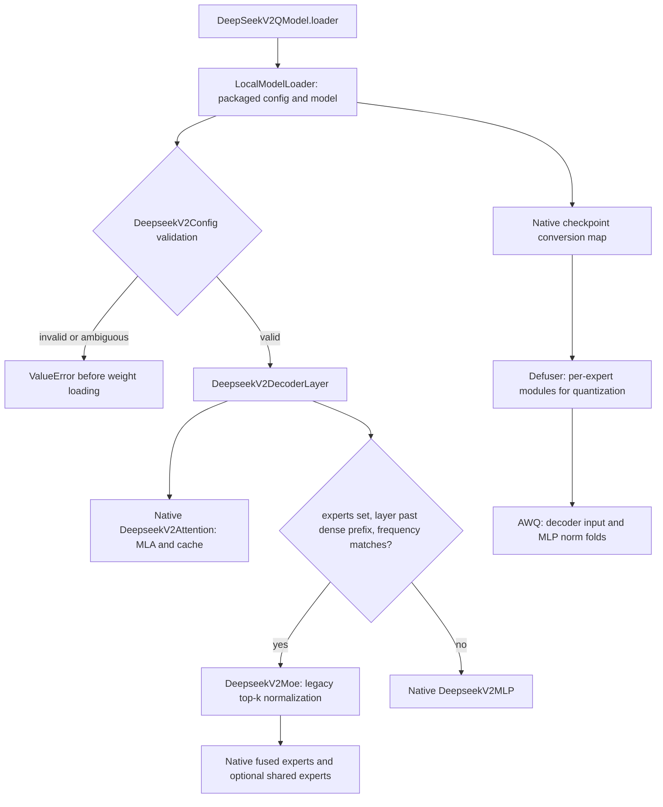
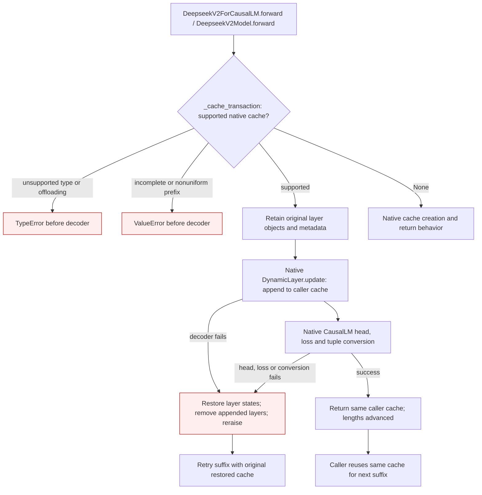

<!-- SPDX-FileCopyrightText: 2026 ModelCloud.ai -->
<!-- SPDX-License-Identifier: Apache-2.0 -->

# GPT-QModel DeepSeek V2 compatibility

The `deepseek_v2` definition selects this package's config and causal LM directly
with `LocalModelLoader`. Neither caller trust nor the security bypass can replace
them with checkpoint Python. No global Transformers registrations are changed.

## Provenance

- Native Transformers 5.23.0 at
  [`52b080b6416a7897e2af90febeb4dfad22b84d19`](https://github.com/huggingface/transformers/tree/52b080b6416a7897e2af90febeb4dfad22b84d19/src/transformers/models/deepseek_v2):
  the config, decoder/model constructors and model API are subclassed/adapted;
  MLA, rotary math, compressed cache layers, expert execution and generation stay
  native, with package-owned cache failure rollback and derived-buffer lifecycle.
  The installed `modeling_deepseek_v2.py` matched this revision byte for
  byte (SHA256 `8c807b695c6d3835b5035703d6def4a45dfa6296a2b35583064be5f937ee32ec`).
- DeepSeek-Coder-V2-Lite-Instruct at
  [`e434a23f91ba5b4923cf6c9d9a238eb4a08e3a11`](https://huggingface.co/deepseek-ai/DeepSeek-Coder-V2-Lite-Instruct/tree/e434a23f91ba5b4923cf6c9d9a238eb4a08e3a11):
  `configuration_deepseek.py`, `modeling_deepseek.py`, and `config.json` establish
  legacy routing and dense/MoE selection. Inspected as text; never executed.
  Modeling source SHA256:
  `7d8e5221095286eea991137760893fd7ba52727c0b4ebf48ec09e8bc56b45b9c`.
- Both sources use Apache-2.0. Attribution and inherited provenance are preserved
  in [NOTICE](NOTICE) and the Python headers. No checkpoint weights are vendored.

## Architecture and checkpoint contract

Native 5.23 supports the exact DeepSeek V2 MLA architecture. Its documented
configuration, however, types `n_routed_experts` as an integer; its decoder does
not implement legacy periodic `moe_layer_freq`, and its router does not apply
legacy `norm_topk_prob`. This small native-derived implementation preserves:

- Full (`q_lora_rank > 0`) and Lite (`q_lora_rank=None`) Q projections;
  low-rank KV projection, distinct no-position/rotary head widths and compressed
  native KV cache; native RoPE including legacy YaRN metadata.
- A dense MLP when `n_routed_experts=None`. Otherwise a layer is MoE exactly when
  `layer_idx >= first_k_dense_replace` and `layer_idx % moe_layer_freq == 0`.
  Shared experts may be omitted with `n_shared_experts=None`.
- Greedy and group-limited greedy softmax routing. For top-k greater than one,
  `norm_topk_prob=True` normalizes the selected probabilities without routed
  scaling; all other cases multiply by `routed_scaling_factor`, as upstream did.
- Standard dense/checkpoint names and Transformers' fused expert tensor ABI.
  The model's `is_custom_code=False` marker enables the **native serialization
  conversion map** for this ABI. It does not authorize remote code. Safetensors
  round trips and public lazy loading test both fused expert tensors and legacy
  per-expert gate/up/down keys. Defuser exposes per-expert linear modules.

Expert-parallel checkpoints (`ep_size != 1`), non-softmax scoring, unknown top-k
methods, invalid expert/group ranges, nonpositive MoE frequencies and invalid
scaling factors fail explicitly. Load a consolidated all-expert checkpoint.
Other architectural limitations remain those of native Transformers 5.23; this
package does not add new attention kernels or distributed expert execution.

The module plan declares both low-rank norms and the router as nonquantized,
and declares Q/K/V/O and gate/up/down roles. No projection fusion is qualified.
AWQ uses the decoder input norm for the upstream MLA projections and the MLP
input norm for dense or shared/routed consumers. The two latent norms and the
attention output projection stay outside scale search because attention replay
consumes hidden states rather than normalized low-rank latents.



Previously the definition required remote trust and relied on checkpoint model
selection. It now owns class selection. Before/after implementation references:
the old `DeepSeekV2QModel.require_trust_remote_code` versus its `loader`;
native `DeepseekV2TopkRouter.forward` versus this package's override;
native `DeepseekV2DecoderLayer.__init__` versus the periodic/dense selection here.
Shared security-loader and central flow documentation remain integrator-owned.

## Native cache identity, failure rollback and derived RoPE state

Successful forwards preserve Hugging Face's mutable-cache contract:
**`outputs.past_key_values is past_key_values`**, and the caller's cache advances
in place. Reusing the same external cache for successive 1-, 4- and 1-token calls
produces lengths 1, 5 and 6 without assigning the returned cache back to it. Tuple
outputs expose that same original object. Calls without an external cache retain
native cache creation behavior.

`_cache_transaction` validates the cache and records its pre-call layer lengths,
layer objects and complete layer metadata. Native `DynamicLayer.update` uses
`torch.cat` to replace tensor references, so retaining the original references
allows exact rollback without cloning prefix tensors or truncating them after an
error. `DeepseekV2ForCausalLM.forward` restores the original state on decoder,
head, loss or native tuple-conversion exceptions, then reraises. Direct
`DeepseekV2Model.forward` callers have the same decoder-failure protection. Layers
appended to an empty lazy cache are removed on failure; configured/reset caches
recover their original initialization, dtype/device metadata and tensor objects.
A failed suffix can be retried with the same caller cache and prefix.
Native DDP cache conversion, crop, batch selection/repetition, reorder, reset and
replay remain native cache operations. Snapshots live only for the current call;
concurrent writes to the same mutable cache are not qualified.

Only non-offloaded native `DynamicCache` with ordinary `DynamicLayer` entries is
qualified. Static, sliding, quantized, offloaded and arbitrary subclass caches
raise `TypeError` before decoder execution. Incomplete or unequal-length decoder
prefixes raise `ValueError`; an empty lazy native cache is accepted. This port
does not claim compiled static-cache or accelerator/offloaded-cache support.
Both package-owned model classes set `_can_compile_fullgraph=False` rather than
inheriting native fullgraph compilation advertisement for this eager rollback.

`DeepseekV2RotaryEmbedding._apply` and the model initialization hook regenerate
`inv_freq` and `original_inv_freq` in FP32 from the pinned native RoPE recipes.
They never promote an already rounded FP16/BF16 frequency table. Dynamic RoPE
retains its grown sequence length and native short-position reset behavior; YaRN
retains native scaling. The derived tables remain nonpersistent. Learned tensors
retain normal PyTorch casting and checkpoint behavior without repair or rewrite.

| Before | Shipped replacement |
| --- | --- |
| `modeling_deepseek_v2.py:45-52`: native selected scores scaled before dividing and normalizing; extreme finite factors produced NaNs | `DeepseekV2TopkRouter.forward`: FP32 logits/softmax, native group mask/top-k index selection, then selected-probability normalization without scaling; other branches stay native |
| `da3ecd85c`, `modeling_deepseek_v2.py:102-132`: inherited model/CausalLM forward left the caller cache partly advanced after decoder/head/loss failure | `_cache_transaction` around both model and complete CausalLM forward: append in place on success, restore exact layer state and reraise on failure |
| `1882d6b57`, `modeling_deepseek_v2.py:105-133,190-200`: `_fork_cache` left the caller cache unchanged even on success, breaking native manual cache reuse | Return and advance the original cache/list/layer objects; preserve failure atomicity with rollback instead of a fork |
| `modeling_deepseek_v2.py:114`: native rotary buffers followed parameter casts and lost FP32 frequency precision | `DeepseekV2RotaryEmbedding._refresh_frequencies`, `_apply`, `_NativeCheckpointLayout._init_weights`: regenerate nonpersistent FP32 tables on the destination device from native config |



The normalization formula is pinned to `MoEGate.forward` in the inspected
DeepSeek source above: when `top_k > 1 and norm_topk_prob`, divide selected
probabilities by their sum plus `1e-20` and do not multiply by the scaling factor.
Native 5.23's `DeepseekV2TopkRouter.forward` supplies the group-mask and top-k tie
semantics. Native `DeepseekV2RotaryEmbedding`, `ROPE_INIT_FUNCTIONS` and
`dynamic_rope_update` supply frequency construction, growth and reset semantics.

## Qualification

Run from the repository root:

```sh
PYTHON_GIL=0 /home/ubuntu/.venvs/gptqmodel-tf5/bin/python -s -m pytest tests/test_deepseek_v2_local_port.py tests/module_tree/test_deepseek_v2_local_port.py -q --tb=short
```

These use tiny real CPU/meta models, independent softmax/group/top-k routing,
native numerical and cache/generation parity, causal masking, dense and periodic
MoE schedules, optional shared experts, YaRN configuration, actual Defuser,
checkpoint tensor ownership and native conversion mappings, exact lazy-shell
materialization, safetensors round trips, malicious `auto_map` under both trust
values and both bypass states, corrupted-load/corrected-retry transitions, and
actual AWQ quantization with decoder norm folding and latent norm preservation. The independent
model-specific registry case pins all nonquantized paths and fusion exclusion.

Initial port qualification used Python 3.14.6 free-threaded, Transformers 5.23.0 and CPU Torch
2.15.0: **53 passed** in 5.97 seconds. In a disposable checkout, assigning the real native
router forward to the compatibility router made both normalized top-k cases
fail (2 failed / 6 passed); assigning the real native decoder constructor made
the dense/periodic variants fail (3 failed / 1 passed); disabling the native
checkpoint-layout declaration broke all four safetensors conversion cases.
The same tests pass with the shipped implementation. The original definition
also failed all five initial ownership/AWQ tests before the plan/policy fix.

The affected registry/AWQ suite with proposed integrator-owned expectation
updates passed **583 tests, 6 skipped** in 15.01 seconds in that checkout. This
includes `test_mla_awq_quantization_completes`, which runs public AWQ
quantization. Without the proposed shared updates, four assertions still expect
the previous DeepSeek plan/folding policy. No shared fixture or AWQ test changes
are part of this port's commit.

The current cache-identity follow-up passes **300 owned cases** in 13.12 seconds
on parent `0fdfd2396`, using the command above. The new regressions include:

- 36 external-cache 1+4+1 loops, comparing logits and every compressed cache
  tensor bitwise with a genuine native sibling, then with safetensors reload.
  Full/Lite, dense/mixed/periodic layouts, FP32/FP16/BF16 and dict/tuple outputs
  are covered. CPU native eager expert execution is selected explicitly; tiny
  12-wide expert fixtures do not meet grouped-MM alignment requirements.
- 144 prefilled-cache failure/retry cases across those layouts and dtypes.
  Failure is injected after decoder layer 0/1, the head, or at loss computation.
  Tests observe partial in-place progress, then require original tensor object
  identity, bitwise prefix contents and metadata after rollback. Retry logits
  and every cache tensor match a fresh full forward with dtype-specific limits.
- 24 empty/configured/reset-cache failure cases, including direct decoder
  callers; native tuple-conversion failure; DDP conversion and cache methods;
  unsupported-cache and malformed-prefix rejection before mutation.

On an isolated unchanged `0fdfd2396` runtime, the identical final cache selector
produces **209 failed, 7 passed** in 108.02 seconds. The fork breaks
identity and visible in-place progress; the seven rejection controls pass.
As a separate negative control, replacing only `_cache_transaction` with
`lambda *_: contextlib.nullcontext()` retains real native cache writes but
disables rollback: all **169** decoder/head/loss/tuple failure regressions fail
on the unrestored state (120 deselected, 58.05 seconds). Both controls ran
with another CPU test process on this VM; no native tensor operation was mocked.
The separate compilation-advertisement regression fails before removing the
inherited flag (1 failed in 2.56 seconds) and passes with the owned override.

Final cache selector:

```sh
PYTHON_GIL=0 /home/ubuntu/.venvs/gptqmodel-tf5/bin/python -s -m pytest tests/test_deepseek_v2_local_port.py -k 'external_cache_manual_1_4_1 or public_cache_failure or empty_cache_failure or tuple_conversion_failure or native_cache_conversion_methods or empty_native_cache or invalid_cache_prefix or unsupported_cache_fails' -q --tb=short
```

The router extreme-scale oracle, RoPE cast/reload/generation and previous port
regressions remain green. The affected suite on `0fdfd2396` with just this owned
follow-up applied passes **970 tests, 7 skipped** in 31.46 seconds using:

```sh
PYTHON_GIL=0 /home/ubuntu/.venvs/gptqmodel-tf5/bin/python -s -m pytest tests/test_deepseek_v2_local_port.py tests/module_tree/test_deepseek_v2_local_port.py tests/module_tree/test_registered_module_plans.py tests/test_awq_scaling_groups.py tests/test_awq_mla_scaling.py tests/test_awq_moe_router_scaling.py tests/test_local_model_loading.py tests/test_local_model_paths.py tests/test_checkpoint_local_model.py -q --tb=short
```

All owned cases pass. Skips are five unrelated AWQ fixtures and two local Llama
recovery cases; none qualify DeepSeek. No shared files are changed by this
follow-up. Central documentation remains the integrator's responsibility and
must describe native in-place success with failure rollback.

No trained multi-GB checkpoint, accuracy/perplexity run, GPU, FlashAttention,
distributed experts, or complete packed quantized checkpoint export/inference
was qualified. Actual low-precision accelerator numerics and real trained
DeepSeek-V2/Coder-V2 checkpoint evaluation remain separate validation work.
