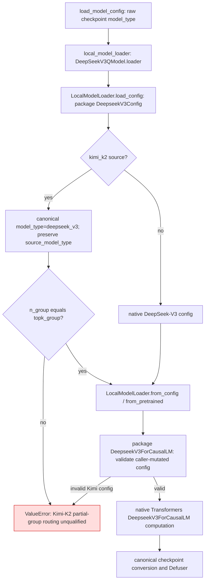

<!-- SPDX-FileCopyrightText: 2026 ModelCloud.ai
SPDX-License-Identifier: Apache-2.0 -->

# DeepSeek-V3 and standalone Kimi-K2 native loading

GPT-QModel owns the alias/config contract; Transformers owns computation. This
package deliberately subclasses native `DeepseekV3Config` and
`DeepseekV3ForCausalLM`, rather than copying old checkpoint modeling code.
There are no runtime downloads, global registrations, remote imports, optional
accelerator imports, or tokenizer corrections here.

## Sources inspected

| Source | Pinned revision | Inspected files / license |
| --- | --- | --- |
| [DeepSeek-V3](https://huggingface.co/deepseek-ai/DeepSeek-V3/tree/e815299b0bcbac849fa540c768ef21845365c9eb) | `e815299b0bcbac849fa540c768ef21845365c9eb` | `config.json`, `configuration_deepseek.py`, `modeling_deepseek.py`, `model.safetensors.index.json`; code header Apache-2.0; repository LICENSE-CODE MIT, copyright 2023 DeepSeek |
| [Kimi-K2-Instruct](https://huggingface.co/moonshotai/Kimi-K2-Instruct/tree/fd1984e2b7a3350dbf7305fe73a4ede25c14de50) | `fd1984e2b7a3350dbf7305fe73a4ede25c14de50` | `config.json`, `configuration_deepseek.py`, `modeling_deepseek.py`, `LICENSE`; code header Apache-2.0; checkpoint license Modified MIT, copyright 2025 Moonshot AI |
| [Moonlight-16B-A3B-Instruct](https://huggingface.co/moonshotai/Moonlight-16B-A3B-Instruct/tree/4e735b07a89f73647dfab71ab91b840f362ede5b) | `4e735b07a89f73647dfab71ab91b840f362ede5b` | `config.json`, `configuration_deepseek.py`, `modeling_deepseek.py`; Apache-2.0 code header |
| [Transformers native DeepSeek-V3](https://github.com/huggingface/transformers/tree/v5.23.0/src/transformers/models/deepseek_v3) | installed release `5.23.0` | Native config, MLA, grouped sigmoid router, experts, rotary embedding, checkpoint conversions and generation; Apache-2.0 |

Upstream modeling headers credit **2023 DeepSeek-AI and The HuggingFace Inc.
team**, and acknowledge EleutherAI GPT-NeoX, OPT and Meta AI lineage. The bridge
is original ModelCloud Apache-2.0 code; it does not redistribute upstream model
implementations or weights. `LICENSE-KIMI` and `LICENSE-DEEPSEEK` preserve the
checkpoint-repository notices separately; they do not relicense this package.
Users of checkpoint weights must follow the applicable checkpoint license,
including Kimi's commercial attribution condition.

## Exact compatibility boundary

The published standalone Kimi-K2 config has `n_group=topk_group=1`,
`topk_method=noaux_tc`, sigmoid routing and split-Q MLA. Its modeling source
adds unused `seq_aux` metadata and masks excluded routing groups with zero,
where native DeepSeek-V3 uses negative infinity. With every group selected no
score is excluded, so these inference computations agree. A source-derived
router oracle tests nonuniform weights, nonzero correction bias and normalized
scaled routing weights for one and two fully selected groups.

`DeepseekV3Config` canonicalizes `kimi_k2` to `deepseek_v3` and persists
`source_model_type=kimi_k2`. Both Transformers expert-checkpoint conversion and
Defuser select by the canonical type. The source marker survives saving and
reloading, so an unqualified Kimi layout cannot accidentally bypass validation
after canonical serialization. Config loading and model construction reject
Kimi partial-group routing (`n_group != topk_group`) with a clear `ValueError`;
construction rechecks caller-mutated configs. Native `deepseek_v3` partial-group
routing is unchanged. No claim is made for arbitrary Kimi architectures or
Kimi-K2.5 multimodal nested-config conversion.

Both dense-Q (`q_lora_rank=None`, as in Moonlight) and split-Q survive. The
checkpoint owns separate expert gate/up/down weights; native Transformers
converts them to fused expert tensors, and Defuser restores the exact separate
owners for quantization. MLA latent RMSNorms, router weight and router correction
bias are explicitly non-quantized. DeepSeek-V3's published safetensors index has
1,564 additional tensor entries under `model.layers.61`; these MTP tensors are
preserved by `out_of_model_tensors`, not treated as decoder layers.

## Loading and failure flow



`LocalModelLoader` ignores checkpoint `auto_map`, `trust_remote_code` and
`code_revision`. Neither an API trust value nor the preexisting security bypass
can select checkpoint Python for this definition.

| Before (base definition) | After |
| --- | --- |
| `deepseek_v3.py:13-14` requires checkpoint trust despite native support | Definition-owned config/model classes; `require_trust_remote_code=False` |
| `deepseek_v3.py:44` lacks MLA norm exclusions and split-Q roles | Explicit checkpoint owners and Q/K/V roles |
| `deepseek_v3.py:46-51` lacks router state ownership | Explicit non-quantized gate and correction bias |
| No Kimi alias conversion mapping | Canonical native type, persisted source and fail-closed partial-group validation |
| Inherited guessed AWQ scaling groups | Explicit empty groups and actual CPU plain quantization/packing |

The parent integration owns the matching central `docs/` reference/README link,
PR diagram and shared registry/AWQ fixtures; this page supplies the port-local
diagram and exact mechanism for that integration.

## AWQ policy and validation scope

MLA has distinct latent-norm and projection consumers. Routed/shared experts
and the correction-biased sigmoid router cannot be qualified by width or order
alone. This definition returns no AWQ scaling groups. Existing AWQ plain
quantization handles all actual decoder projections without producer folding,
search, activation replay, or router compensation. Tests cover both model types,
both Q layouts and fallback enabled/disabled, quantize and INT4-pack every real
projection, compare packed linear output with pseudo-quantized computation,
check protected norms/router tensors exactly and run the resulting native model.
They do not claim GPU-kernel or full-model quality qualification.

The owned suites are `tests/test_deepseek_v3_local_port.py` and
`tests/module_tree/test_deepseek_v3_local_port.py`: malicious checkpoint
`auto_map` with all trust/bypass combinations; public entrypoint rejection;
mutation/retry and serialization validation; real CPU/meta models; exact
checkpoint ownership; numerical forward, causal/padded cache continuation,
generation, YaRN metadata, Defuser equivalence and safetensors reload; MTP writer
preservation; module-plan, MoE looper and plain-AWQ consumers. Validation uses
Python 3.14t with `PYTHON_GIL=0`, Torch 2.15.0+cpu and Transformers 5.23.0.
No new threaded PyTorch path is introduced. GPU kernels, FP8 production weights,
trained multi-GB checkpoint loading and full evaluation remain untested.

## Regression detection and commands

With the new tests copied into an isolated checkout of base
`22bea120181e739161ee2969b260fe94f5b4e791`, selecting
`definition_selects_native_config or every_checkpoint_owner` yields 12 failures:
the stale trust requirement, unsupported Kimi alias/checkpoint-code dispatch,
and missing MLA norm owners. These are behavioral failures, not collection errors.
With the bridge present but `validate_kimi_k2_config` disabled in that disposable
checkout, selecting `partial_group_kimi_rejected or mutated_kimi_config` yields
seven `DID NOT RAISE ValueError` failures. The shipped guard passes those tests.

```bash
PYTHON_GIL=0 /home/ubuntu/.venvs/gptqmodel-tf5/bin/python -s -m pytest -q \
  tests/test_deepseek_v3_local_port.py \
  tests/module_tree/test_deepseek_v3_local_port.py --tb=short
# 51 passed; no skips.

/home/ubuntu/.venvs/gptqmodel-tf5/bin/ruff check \
  gptqmodel/models/definitions/deepseek_v3.py \
  gptqmodel/models/ports/deepseek_v3 \
  tests/test_deepseek_v3_local_port.py \
  tests/module_tree/test_deepseek_v3_local_port.py
git diff --check
```

The affected registry/shared-input/AWQ/loader/writer suites yielded 1,101 passed,
three skipped and two expected central-fixture mismatches before integration.
Updating only the parent-owned `DeepSeekV3QModel/gptq` case in the isolated
checkout makes all 419 registry cases pass. No shared fixture is included in
this port's commit. An additional owned-plus-security/paths run yielded 139
passed and two skipped. Skips do not qualify runtime behavior.

Combined validation with that sole fixture update in the isolated checkout:
**1,242 passed, five skipped in 15.93 seconds**. Three skips require unavailable
DeciLM/EXAONE/Nanbeige local checkpoints; two require an explicit checkpoint and
two CUDA devices. No owned test skips. Pyright reports zero errors for the new
port package. Checking the definition also reproduces the existing base-commit
`module_tree` assignment error (`BaseQModel` annotates nested trees as
`List[str]`); this shared annotation is unchanged and belongs to the parent.
