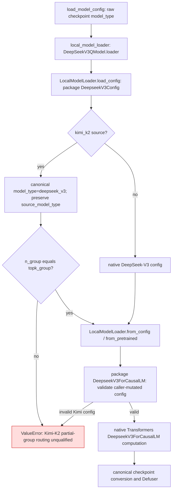
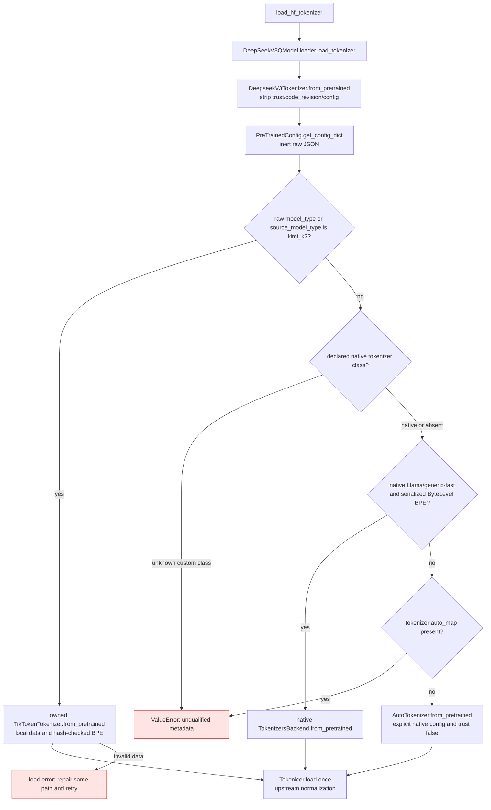

<!-- SPDX-FileCopyrightText: 2026 ModelCloud.ai
SPDX-License-Identifier: Apache-2.0 -->

# DeepSeek-V3 and standalone Kimi-K2 local loading

GPT-QModel owns the alias/config contract; Transformers owns computation. This
package deliberately subclasses native `DeepseekV3Config` and
`DeepseekV3ForCausalLM`, rather than copying old checkpoint modeling code.
There are no checkpoint-code downloads/imports, global registrations, optional
accelerator imports, or corrective tokenizer normalization here. Standard
Hugging Face helpers resolve tokenizer data files; the tokenizer implementation
selection described below is package-owned.

## Sources inspected

| Source | Pinned revision | Inspected files / license |
| --- | --- | --- |
| [DeepSeek-V3](https://huggingface.co/deepseek-ai/DeepSeek-V3/tree/e815299b0bcbac849fa540c768ef21845365c9eb) | `e815299b0bcbac849fa540c768ef21845365c9eb` | `config.json`, `configuration_deepseek.py`, `modeling_deepseek.py`, `model.safetensors.index.json`; code header Apache-2.0; repository LICENSE-CODE MIT, copyright 2023 DeepSeek |
| [Kimi-K2-Instruct](https://huggingface.co/moonshotai/Kimi-K2-Instruct/tree/fd1984e2b7a3350dbf7305fe73a4ede25c14de50) | `fd1984e2b7a3350dbf7305fe73a4ede25c14de50` | `config.json`, `configuration_deepseek.py`, `modeling_deepseek.py`, `LICENSE`; code header Apache-2.0; checkpoint license Modified MIT, copyright 2025 Moonshot AI |
| [Moonlight-16B-A3B-Instruct](https://huggingface.co/moonshotai/Moonlight-16B-A3B-Instruct/tree/4e735b07a89f73647dfab71ab91b840f362ede5b) | `4e735b07a89f73647dfab71ab91b840f362ede5b` | `config.json`, `configuration_deepseek.py`, `modeling_deepseek.py`; Apache-2.0 code header |
| [Transformers native DeepSeek-V3](https://github.com/huggingface/transformers/tree/v5.23.0/src/transformers/models/deepseek_v3) | installed release `5.23.0` | Native config, MLA, grouped sigmoid router, experts, rotary embedding, checkpoint conversions and generation; Apache-2.0 |

Upstream modeling headers credit **2023 DeepSeek-AI and The HuggingFace Inc.
team**, and acknowledge EleutherAI GPT-NeoX, OPT and Meta AI lineage. The bridge
is original ModelCloud Apache-2.0 code; it does not redistribute upstream model
implementations or weights. The tokenizer adaptation below separately retains
Moonshot's license. `LICENSE-KIMI` and `LICENSE-DEEPSEEK` preserve the
checkpoint-repository notices; they do not relicense the config/model bridge.
Users of checkpoint weights must follow the applicable checkpoint license,
including Kimi's commercial attribution condition.

## Exact compatibility boundary

The published standalone Kimi-K2 config has `n_group=topk_group=1`,
`topk_method=noaux_tc`, sigmoid routing and split-Q MLA. Its modeling source
adds unused `seq_aux` metadata and masks excluded routing groups with zero,
where native DeepSeek-V3 uses negative infinity. With every group selected no
score is excluded, so these inference computations agree. A source-derived
router oracle tests nonuniform weights, nonzero correction bias and normalized
scaled routing weights for one and two fully selected groups.

`DeepseekV3Config` canonicalizes `kimi_k2` to `deepseek_v3` and persists
`source_model_type=kimi_k2`. Both Transformers expert-checkpoint conversion and
Defuser select by the canonical type. The source marker survives saving and
reloading, so an unqualified Kimi layout cannot accidentally bypass validation
after canonical serialization. Config loading and model construction reject
Kimi partial-group routing (`n_group != topk_group`) with a clear `ValueError`;
construction rechecks caller-mutated configs. Native `deepseek_v3` partial-group
routing is unchanged. No claim is made for arbitrary Kimi architectures or
Kimi-K2.5 multimodal nested-config conversion.

Both dense-Q (`q_lora_rank=None`, as in Moonlight) and split-Q survive. The
checkpoint owns separate expert gate/up/down weights; native Transformers
converts them to fused expert tensors, and Defuser restores the exact separate
owners for quantization. MLA latent RMSNorms, router weight and router correction
bias are explicitly non-quantized. DeepSeek-V3's published safetensors index has
1,564 additional tensor entries under `model.layers.61`; these MTP tensors are
preserved by `out_of_model_tensors`, not treated as decoder layers.

## Loading and failure flow



`LocalModelLoader` ignores checkpoint `auto_map`, `trust_remote_code` and
`code_revision`. Neither an API trust value nor the preexisting security bypass
can select checkpoint Python for this definition.

| Before (base definition) | After |
| --- | --- |
| `deepseek_v3.py:13-14` requires checkpoint trust despite native support | Definition-owned config/model classes; `require_trust_remote_code=False` |
| `deepseek_v3.py:44` lacks MLA norm exclusions and split-Q roles | Explicit checkpoint owners and Q/K/V roles |
| `deepseek_v3.py:46-51` lacks router state ownership | Explicit non-quantized gate and correction bias |
| No Kimi alias conversion mapping | Canonical native type, persisted source and fail-closed partial-group validation |
| Inherited guessed AWQ scaling groups | Explicit empty groups and actual CPU plain quantization/packing |

The parent integration owns the matching central `docs/` reference/README link,
PR diagram and shared registry/AWQ fixtures; this page supplies the port-local
diagram and exact mechanism for that integration.

## AWQ policy and validation scope

MLA has distinct latent-norm and projection consumers. Routed/shared experts
and the correction-biased sigmoid router cannot be qualified by width or order
alone. This definition returns no AWQ scaling groups. Existing AWQ plain
quantization handles all actual decoder projections without producer folding,
search, activation replay, or router compensation. Tests cover both model types,
both Q layouts and fallback enabled/disabled, quantize and INT4-pack every real
projection, compare packed linear output with pseudo-quantized computation,
check protected norms/router tensors exactly and run the resulting native model.
They do not claim GPU-kernel or full-model quality qualification.

The owned suites are `tests/test_deepseek_v3_local_port.py` and
`tests/module_tree/test_deepseek_v3_local_port.py`: malicious checkpoint
`auto_map` with all trust/bypass combinations; public entrypoint rejection;
mutation/retry and serialization validation; real CPU/meta models; exact
checkpoint ownership; numerical forward, causal/padded cache continuation,
generation, YaRN metadata, Defuser equivalence and safetensors reload; MTP writer
preservation; module-plan, MoE looper and plain-AWQ consumers. Validation uses
Python 3.14t with `PYTHON_GIL=0`, Torch 2.15.0+cpu and Transformers 5.23.0.
No new threaded PyTorch path is introduced. GPU kernels, FP8 production weights,
trained multi-GB checkpoint loading and full evaluation remain untested.

## Regression detection and commands

With the new tests copied into an isolated checkout of base
`22bea120181e739161ee2969b260fe94f5b4e791`, selecting
`definition_selects_native_config or every_checkpoint_owner` yields 12 failures:
the stale trust requirement, unsupported Kimi alias/checkpoint-code dispatch,
and missing MLA norm owners. These are behavioral failures, not collection errors.
With the bridge present but `validate_kimi_k2_config` disabled in that disposable
checkout, selecting `partial_group_kimi_rejected or mutated_kimi_config` yields
seven `DID NOT RAISE ValueError` failures. The shipped guard passes those tests.

```bash
PYTHON_GIL=0 /home/ubuntu/.venvs/gptqmodel-tf5/bin/python -s -m pytest -q \
  tests/test_deepseek_v3_local_port.py \
  tests/module_tree/test_deepseek_v3_local_port.py --tb=short
# 51 passed; no skips.

/home/ubuntu/.venvs/gptqmodel-tf5/bin/ruff check \
  gptqmodel/models/definitions/deepseek_v3.py \
  gptqmodel/models/ports/deepseek_v3 \
  tests/test_deepseek_v3_local_port.py \
  tests/module_tree/test_deepseek_v3_local_port.py
git diff --check
```

The affected registry/shared-input/AWQ/loader/writer suites yielded 1,101 passed,
three skipped and two expected central-fixture mismatches before integration.
Updating only the parent-owned `DeepSeekV3QModel/gptq` case in the isolated
checkout makes all 419 registry cases pass. No shared fixture is included in
this port's commit. An additional owned-plus-security/paths run yielded 139
passed and two skipped. Skips do not qualify runtime behavior.

Combined validation with that sole fixture update in the isolated checkout:
**1,242 passed, five skipped in 15.93 seconds**. Three skips require unavailable
DeciLM/EXAONE/Nanbeige local checkpoints; two require an explicit checkpoint and
two CUDA devices. No owned test skips. Pyright reports zero errors for the new
port package. Checking the definition also reproduces the existing base-commit
`module_tree` assignment error (`BaseQModel` annotates nested trees as
`List[str]`); this shared annotation is unchanged and belongs to the parent.

## Definition-owned tokenizer selection

The model bridge alone is insufficient for the actual Kimi-K2 checkpoint:
its tokenizer metadata declares `TikTokenTokenizer` with checkpoint
`AutoTokenizer` code. Tokenicer 0.0.17 correctly rejects that unavailable native
class rather than interpreting a generic serialized vocabulary as equivalent.
`DeepSeekV3QModel.loader.tokenizer_class` now selects
`tokenization_deepseek_v3.DeepseekV3Tokenizer`. Its raw, inert config read chooses
the owned K2 implementation only for `model_type=kimi_k2` or persisted
`source_model_type=kimi_k2`. A generic tokenizer class name never chooses K2.
The shared adapter still passes the selected object to Tokenicer exactly once;
special-token/padding normalization remains upstream.

### Pinned tokenizer sources and data

All K2 files below are from
[`moonshotai/Kimi-K2-Instruct@fd1984e2b7a3350dbf7305fe73a4ede25c14de50`](https://huggingface.co/moonshotai/Kimi-K2-Instruct/tree/fd1984e2b7a3350dbf7305fe73a4ede25c14de50).
The adapted Python file retains copyright **2025 Moonshot AI**, under the
unmodified Modified MIT notice in `LICENSE-KIMI`. No vocabulary, trained weights
or checkpoint Python is bundled or dynamically imported.

| File | SHA256 |
| --- | --- |
| `tokenization_kimi.py` | `b52cbff687ee5b32c8c0551da9974c678d39be0f3c890d53727888557b850c1f` |
| `tiktoken.model` | `b6c497a7469b33ced9c38afb1ad6e47f03f5e5dc05f15930799210ec050c5103` |
| `tokenizer_config.json` | `5ba77d5822137ac3cb9337d2b84561d10425562cf8b8f2c74c91a832516a778d` |
| `chat_template.jinja` | `39e8c195b474c1a4148046f41fedd177b2ff8f420fa376e52fcdddb829e8f0c5` |

Transformers 5 compatibility uses its official slow-tokenizer
`transformers.tokenization_python.PythonBackend`. The original K2 positional
`encode`, `decode`, chat API, static cleanup method, and invalid-ID `None`
conversion are retained, with targeted type-check annotations where these
intentionally differ from the general Transformers signatures. HF batching,
padding, tensors, special-token decoding and chat calls use tested keyword
options. The reversible byte alphabet is the canonical Apache-2.0 Hugging Face
helper from Transformers 5.23.0 `convert_slow_tokenizer.py:1890`, copied locally
to avoid depending on conversion internals; its copyright is preserved.
Formatting/docstring/logging simplifications do not change tokenization.
Missing vocabulary/mapping errors are explicit `ValueError`s. The BPE reader
passes the current local file's SHA256 as `expected_hash` so tiktoken cannot
reuse a stale cache entry after a failed load and repair at the same path.

K2 retains its Han-aware regex, 163,584 mergeable ranks, 256 reserved IDs,
special-token flags, byte decoding, 400,000-character chunking and
25,000-character whitespace/non-whitespace runs. Its pinned Jinja template
renders recursively sorted tools as JSON, not K2.5 TypeScript declarations.
K3's XTML/user-vs-structure protection and `thinking_effort`, and K2.5's
`thinking`/`tool_declaration_ts` helper are not K2 semantics. Shared vocabulary
bytes do not justify sharing their implementation or inventing those helpers
for K2. No such helpers exist in the inspected pinned K2 repository.

### Native DeepSeek implementation selection and ambiguity

The native control uses actual DeepSeek-V3 data at
`deepseek-ai/DeepSeek-V3@e815299b0bcbac849fa540c768ef21845365c9eb`:

| File | SHA256 |
| --- | --- |
| `tokenizer.json` | `621ac2e32d0dba658404412318818aaa8ce8cda492e59830109d8da6b517fb41` |
| `tokenizer_config.json` | `637bcd1a08cf7c772ce6a383196b22930921c79c3c73223c5afc0c7f41545546` |

That checkpoint declares `LlamaTokenizerFast` but serializes ByteLevel BPE.
Transformers 5.23.0 `AutoTokenizer.from_pretrained` already selects
`TokenizersBackend` for this architecture (`tokenization_auto.py:841-860`),
but only while tokenizer `auto_map` is absent. Injecting a hostile map with
`fast=None` disables that selection and instantiates Metaspace `LlamaTokenizer`,
silently deleting spaces/CJK even with `trust_remote_code=False` and an explicit
config. The factory therefore selects the exact native `TokenizersBackend`
directly when serialized BPE contains ByteLevel and the declared class is
native Llama/generic-fast (or absent). The serialized backend is loaded as-is;
no regex, prompt, token ID or cleanup rewriting is performed.

Unknown custom classes and foreign global tokenizer registrations fail
explicitly instead of being guessed from JSON; native classes must belong to
the `transformers` package.
Other native tokenizer formats may use `AutoTokenizer` only without ambiguous
tokenizer `auto_map`, with the explicit selected native config and trust false.
Unqualified remote metadata fails closed; removing it permits a tested retry.
API trust and the security bypass cannot replace these implementations.

| Before / evidence | After / evidence |
| --- | --- |
| Definition had no tokenizer selector, `deepseek_v3.py:15`; Tokenicer rejects K2's custom class | Definition declares the package factory, `deepseek_v3.py:18` |
| Checkpoint tokenizer class/auto-map could control implementation discovery | Raw config/source marker chooses K2, `tokenization_deepseek_v3.py:21-25` |
| Native AutoTokenizer remote-map branch loses ByteLevel implementation selection, `tokenization_auto.py:841-860` | Serialized ByteLevel BPE selects native `TokenizersBackend`, `tokenization_deepseek_v3.py:35-50` |
| Unknown/native remote ambiguity could select an incorrect generic implementation | Explicit errors, `tokenization_deepseek_v3.py:29-34,51-55`; native fallback always receives config and trust false |
| Unhashed BPE path cache remains corrupted after same-path repair | `tokenization_kimi.py` hashes the current file before `load_tiktoken_bpe` |



### Tokenizer qualification

The 37 additional cases in `tests/test_deepseek_v3_local_port.py` download only
hash-pinned data assets (about 11 MB total), never Python or trained weights.
They require HF access or its existing asset cache; no blanket skip masks a
missing dependency/data asset. Coverage includes raw/persisted source markers,
all trust/bypass/str-vs-Path combinations, exact multilingual/special IDs,
all reserved tokens, batch/tensors/attention masks, long-run boundaries,
rendered chat/tools, same-path malformed-BPE repair/retry, save/reload,
subfolders, native hostile maps and unknown-class/format negative controls.
The public `GPTQModel.load` test uses real pinned K2 token IDs with tiny
unquantized native weights and compares full logits to its native reference.
For example, `Hello, world! 你好，世界！` produces K2 IDs
`[19180,11,2695,0,220,33845,378,2243,856]` and native DeepSeek IDs
`[19923,14,2058,3,223,30594,303,3427,1175]`; they must not be conflated.

Red evidence with one mechanism disabled at a time:

| Regression node | Intended red result |
| --- | --- |
| `test_real_kimi_tokenizer_default_deny[str-False-False-raw_alias]`, remove declared tokenizer factory | Tokenicer `ValueError`: `TikTokenTokenizer` unavailable natively |
| `test_real_native_deepseek_tokenizer_control[False-False-True]`, revert native factory to AutoTokenizer | IDs become `[19923,14,29616,3]`; exact-ID assertion fails |
| `test_kimi_tokenizer_save_reload_and_failure_retry`, omit BPE expected hash | Repair succeeds on disk but cached invalid BPE still raises on retry |

With all mechanisms enabled, the owned model suites and shared tokenizer suite
pass **112 tests, no skips, in 23.91 seconds**:

```bash
PYTHON_GIL=0 /home/ubuntu/.venvs/gptqmodel-tf5/bin/python -s -m pytest -q \
  tests/test_deepseek_v3_local_port.py \
  tests/module_tree/test_deepseek_v3_local_port.py \
  tests/test_local_tokenizer_loading.py --tb=short
```

Runtime: Python 3.14.6 free-threaded, Transformers 5.23.0, Torch 2.15.0+cpu,
Tokenicer 0.0.17, tiktoken 0.12.0. A separate inspected, SHA-pinned upstream
source oracle (only the slow-base import adapted to `PythonBackend`) matches
every one of the 163,840 encoder/decoder entries, all reserved IDs, regex,
six text cases in both special-token modes, callable IDs, and chat/tools in
both generation-prompt modes. Ruff and port-only Pyright pass (the latter with
the isolated interpreter and the documented intentional override annotations).
No new threaded PyTorch path is introduced. Existing dense-Q/split-Q, routing,
cache, safetensors and conservative plain-AWQ tests remain green.

No GPU, trained production FP8 checkpoint, large-model generation quality,
K2.5/K3 tokenizer reuse, or arbitrary custom native-tokenizer metadata is
qualified. The tokenizer follow-up requires the parent's shared
`LocalModelLoader.tokenizer_class` adapter; the parent owns the tiktoken
dependency and central docs/README integration. No central module-plan fixture
changes are needed for this tokenizer follow-up.
