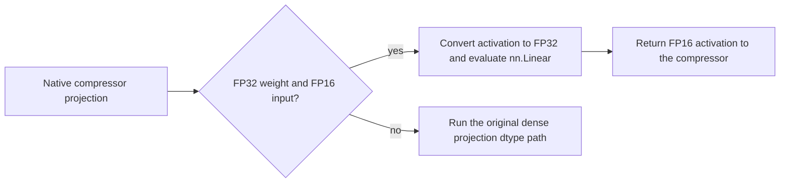
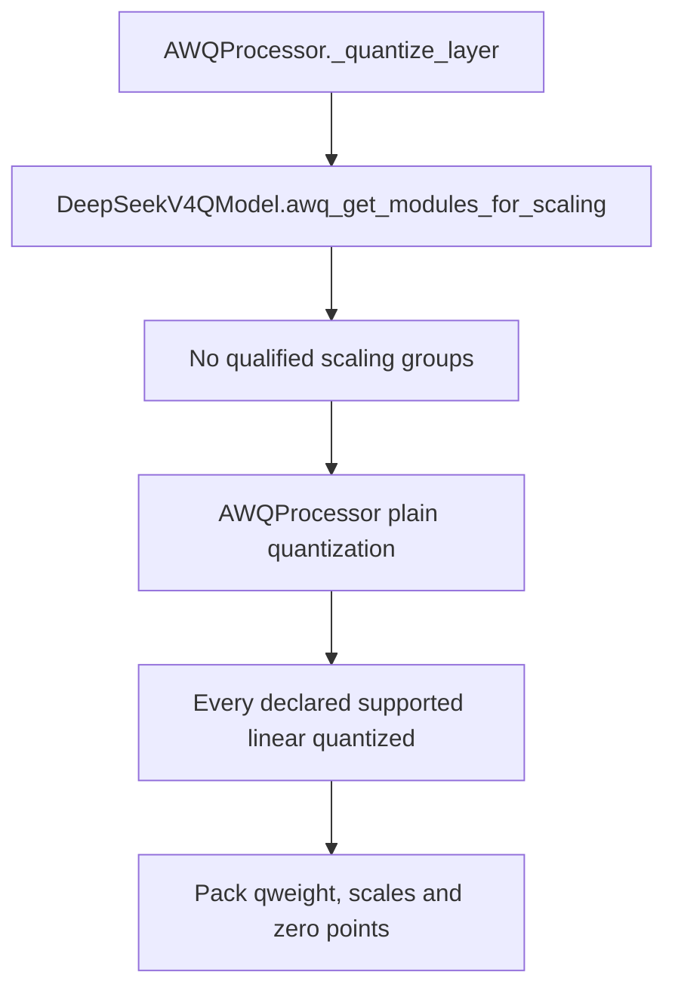

<!-- SPDX-FileCopyrightText: 2026 ModelCloud.ai -->
<!-- SPDX-License-Identifier: Apache-2.0 -->

# GPT-QModel DeepSeek V4 native qualification

`deepseek_v4` uses the exact native Transformers `DeepseekV4Config` →
`DeepseekV4ForCausalLM` mapping. No copied modeling code, checkpoint Python,
`LocalModelLoader`, or global Auto-class registration is necessary.
`DeepSeekV4QModel` overrides the obsolete remote-trust requirement inherited
from V3. Public loading tests put throwing Python files behind malicious
`auto_map` entries and verify native loading for both API trust values and
both existing safety-bypass states.

## Sources and ownership

The validated runtime is Transformers **5.23.0**, tag commit
[`52b080b6416a7897e2af90febeb4dfad22b84d19`](https://github.com/huggingface/transformers/tree/52b080b6416a7897e2af90febeb4dfad22b84d19/src/transformers/models/deepseek_v4),
with Torch **2.15.0+cpu** on free-threaded Python **3.14.6**, GIL disabled.
Native modeling and checkpoint conversion remain owned by the installed
Transformers dependency; its Apache-2.0 source is not copied into this directory.

The independently inspected public checkpoint is
[`deepseek-ai/DeepSeek-V4-Flash`](https://huggingface.co/deepseek-ai/DeepSeek-V4-Flash/tree/60d8d70770c6776ff598c94bb586a859a38244f1),
pinned at `60d8d70770c6776ff598c94bb586a859a38244f1`:

| Artifact | Purpose |
| --- | --- |
| [Original config](https://huggingface.co/deepseek-ai/DeepSeek-V4-Flash/blob/60d8d70770c6776ff598c94bb586a859a38244f1/config.json) | Byte-exact `upstream_config.json`; hash pinned in the schema |
| [Safetensors index](https://huggingface.co/deepseek-ai/DeepSeek-V4-Flash/blob/60d8d70770c6776ff598c94bb586a859a38244f1/model.safetensors.index.json) | `checkpoint-schema.json` key inventory; original index SHA-256 retained |
| [Inference source](https://huggingface.co/deepseek-ai/DeepSeek-V4-Flash/blob/60d8d70770c6776ff598c94bb586a859a38244f1/inference/model.py) | Inspected names and MoE routing/SwiGLU equations; never imported or executed |
| [Checkpoint license](https://huggingface.co/deepseek-ai/DeepSeek-V4-Flash/blob/60d8d70770c6776ff598c94bb586a859a38244f1/LICENSE) | Wording preserved as `LICENSE.checkpoint`, MIT, copyright DeepSeek; line endings normalized to LF |

The schema is derived from index keys, not generated from the definition's
module tree. Layer IDs are separated, expert IDs normalized to `#`, and the
four distinct suffix sets interned as `layout_0` through `layout_3`. The layer
table preserves which schema each of the 43 decoder layers owns. Expanding
the expert placeholder to the config's 256 routed experts reconstructs
67,606 decoder entries. Six globals and 1,575 MTP entries account for the
original **69,187** index keys. Excluding quantizer `.scale` tensors and MTP
leaves **34,223** BF16/float architecture tensors. The full native model is
built on meta and its independently renamed/split state dictionary must match
that complete target set exactly. This is a key-ownership audit, not trained
weight or FP8/FP4 conversion qualification.

Native Transformers converts `attn`/`ffn`, projection names, hyper-connection
parameters and per-expert `w1`/`w3`/`w2` tensors into its native namespaces and
fused expert tensors. A real tiny source-namespaced safetensors checkpoint
tests those conversions, with exact tensor equality and no missing/unexpected
keys. Defuser subsequently splits native fused experts for quantization;
separate real forwards check unchanged outputs, including saturated SwiGLU
and both hash and score-based expert routing against independent equations.

## AWQ policy

Transformers 5.23.0 pins the dense compressor and indexer projections to FP32
when loading in FP16. Their native forwards still pass FP16 activations to
those projections, which raises a dtype mismatch with both direct and lazy
checkpoint loading. The GPT-QModel definition adapts the five affected dense
linears when it wraps the native model. The projection uses its FP32 weights
and returns FP16 activations to the compressor. BF16, FP32, and packed modules
retain their existing execution. The public AWQ regression covers CPU
calibration, packing and safetensors reload with and without disk offload.

Packed reload limits Transformers' legacy `.norm.` rename to
compressor and indexer norms. The final decoder norm keeps its native
`model.norm.weight` key. The regression checks exact final norm and
compressor weights, packed expert weights and logits after reload.



`DeepSeekV4QModel.awq_get_modules_for_scaling()` deliberately returns no
groups for every layout. Hyper-connections, compressed/indexed attention and
shared/routed MoE consumers have **not** been qualified together for safe
folding, search, or replay. The existing AWQ processor therefore takes its
plain-quantization branch; this is not permission to infer folding safety
from compatible dimensions.

Tests run the real `_quantize_layer` path with `fallback=None` and clipping
disabled, verify every declared supported projection changes, and pack/unpack
all **16** tiny-model linears with `AwqTorchLinear`. Repeating the quantization
call is idempotent;
excluded checkpoint tensors remain byte-exact. Real dense fake-quantized
model forwards remain finite. This does not claim trained-model quality or
packed GPU inference qualification.



Previously the generic inherited AWQ method emitted unqualified groups;
the V4 definition now overrides that method at
`gptqmodel/models/definitions/deepseek_v4.py:1479`. Packing failures still
propagate; the override only declines scale folding and does not catch errors
or silently skip a declared projection.

## Coverage and limits

`tests/test_deepseek_v4_local_port.py` and
`tests/module_tree/test_deepseek_v4_local_port.py` cover:

- All three attention layouts crossed with `hash_moe` and `moe`.
- CPU/meta tensor ownership, explicit exclusions, roles and expert grouping.
- Native forward, causal masking, cache continuation and greedy generation.
- Mixed three-layer FP32/BF16 models, alternate output groups and HC width.
- Native safetensors reload/resave, malformed load and repaired retry.
- Public config/tokenizer/model selection despite hostile checkpoint Python.
- Independent source-key conversion, routing and saturated expert arithmetic.
- Conservative plain AWQ quantization/packing across all six layouts.

Run from the repository root with the isolated supported interpreter:

```sh
PYTHON_GIL=0 /home/ubuntu/.venvs/gptqmodel-tf5/bin/python -s -m pytest -q \
  tests/test_deepseek_v4_local_port.py \
  tests/module_tree/test_deepseek_v4_local_port.py
```

The existing trained test names `deepseek-ai/DeepSeek-V4-Flash-BF16`.
Its metadata endpoint returned HTTP 401; the public Flash checkpoint above
is a separately identified control, **not** proof of BF16 checkpoint identity.
No multi-GB weights were downloaded. GPU kernels, trained evaluation,
quantized checkpoint roundtrips, Flash FP8/FP4 conversion, multimodal payloads,
and the checkpoint's dSpark/MTP auxiliary weights remain unqualified here.
Native safetensors roundtrips occur before Defuser splitting; direct HF
serialization of the split representation is not qualified by these tests.

Parent integration owns the central documentation/README and shared fixtures.
Existing registry/module-plan JSON already covers `deepseek_v4`; no tree or
ordered-subset snapshot change is needed. The shared AWQ assertion must treat
V4 as explicitly plain rather than require routed/shared expert folding.
